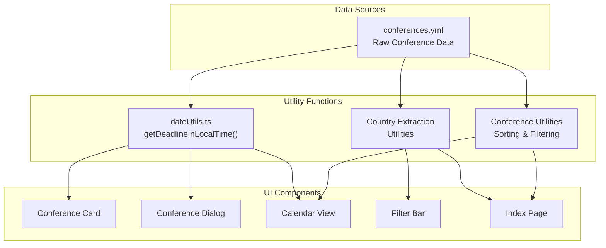
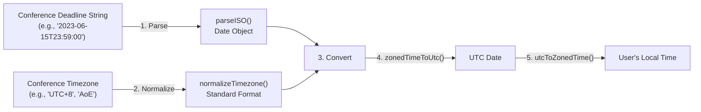
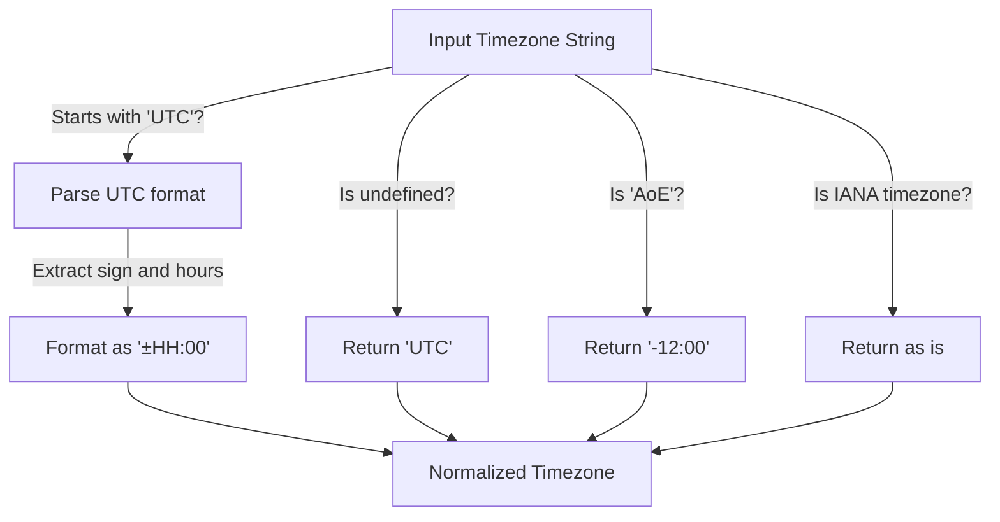
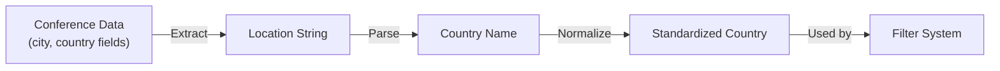
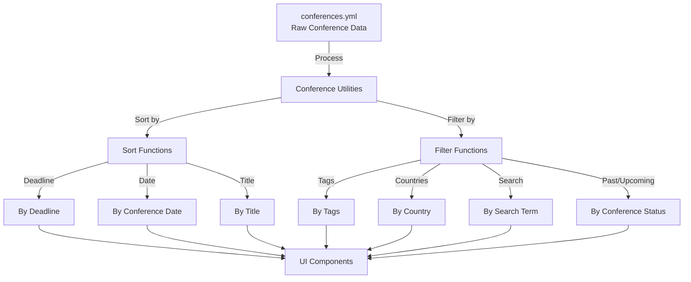

<!-- source: DeepWiki mcp.deepwiki.com · repo huggingface/ai-deadlines · page 5 Utility Functions · fetched 2026-10-26 -->

# Utility Functions

Relevant source files

The following files were used as context for generating this wiki page:

- [src/utils/dateUtils.ts](src/utils/dateUtils.ts)

## Introduction

The Utility Functions module provides a collection of specialized helper functions that support core operations across the AI-deadlines application. These utilities handle critical cross-cutting concerns such as date/timezone processing, country information extraction, and conference data transformation operations.

For information on the UI components that utilize these utilities, see [UI Components](#4). For specific details about date handling, see [Date Utilities](#5.1). For information about conference data processing, see [Data Processing Utilities](#5.2).

## Utility Categories and Architecture

The Utility Functions layer acts as a bridge between the raw conference data and the UI components that display this information. These utilities ensure consistent behavior across the application while keeping the codebase maintainable by isolating specialized logic.

Title: Utility Functions in Application Architecture

Sources: [src/utils/dateUtils.ts]()

## Date Utilities

The date utilities handle all date-related operations in the application, with a primary focus on timezone conversion for conference deadlines. These utilities ensure users see deadline dates correctly converted to their local timezone, regardless of where the conference is located.

### Timezone Conversion Process

The main function `getDeadlineInLocalTime` in the date utilities module converts deadlines from a conference's specified timezone to the user's local timezone:

Title: Deadline Timezone Conversion Flow

Sources: [src/utils/dateUtils.ts:4-70]()

The function performs several steps:
1. Validates input, returning `null` for undefined deadlines or "TBD" values
2. Parses the deadline string into a Date object using `parseISO` from date-fns
3. Normalizes the timezone specification using an internal helper function
4. Detects the user's local timezone using `Intl.DateTimeFormat().resolvedOptions().timeZone`
5. Converts the deadline from the conference's timezone to UTC using `zonedTimeToUtc`
6. Converts from UTC to the user's local timezone using `utcToZonedTime`
7. Returns the resulting local date or null if any errors occur

### Timezone Normalization

The timezone normalization logic handles various timezone formats that may appear in conference data:

Title: Timezone Normalization Process

Sources: [src/utils/dateUtils.ts:19-42]()

Special cases handled by the normalizer include:
- **AoE (Anywhere on Earth)**: Converted to UTC-12:00, the timezone furthest behind UTC
- **UTC±XX formats**: Converted to standard timezone offset format (±HH:00)
- **IANA timezone names**: Used as-is (e.g., "America/New_York")
- **Undefined timezones**: Defaulted to UTC
- **UTC+0/UTC-0**: Special case handling for zero offset timezones, converted to "UTC"

This normalization ensures consistent handling of the various timezone formats that might be specified in conference data.

## Country Extraction Utilities

The country extraction utilities process location information from conference data, enabling geographic filtering of conferences. While the specific implementation is not visible in the provided files, these utilities extract and normalize country information from venue fields.

Title: Country Extraction Process

These utilities likely:
1. Extract country information from conference location fields
2. Normalize country names to ensure consistent filtering (e.g., "USA", "U.S.A", and "United States" are treated as the same)
3. Provide the extracted countries to the filtering system

Country extraction utilities support the country filter functionality in the Filter Bar component, allowing users to find conferences in specific geographic regions.

## Conference Utilities

Conference utilities provide functions for processing conference data to support the application's display and filtering capabilities. These utilities handle operations like sorting, filtering, and transforming conference data.

Title: Conference Data Processing Flow

These utilities ensure consistent handling of conference data throughout the application, supporting both the main index view and the calendar view.

For more information about the filtering system that uses these utilities, see [Filter System](#4.3).

Sources: [src/utils/dateUtils.ts]()

## Summary

The utility functions in AI-deadlines serve as essential infrastructure that supports the application's core features. These utilities:

1. Handle timezone conversion for accurate display of deadlines
2. Extract and normalize country information for location-based filtering
3. Process conference data for efficient sorting and filtering

By isolating these specialized functions into dedicated utility modules, the application maintains a clean separation of concerns and ensures consistent behavior across different components.

---

