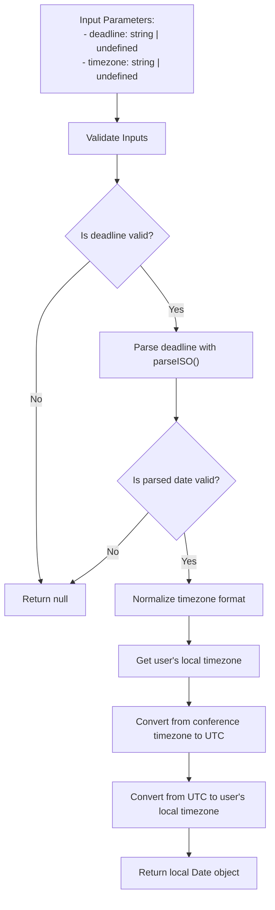
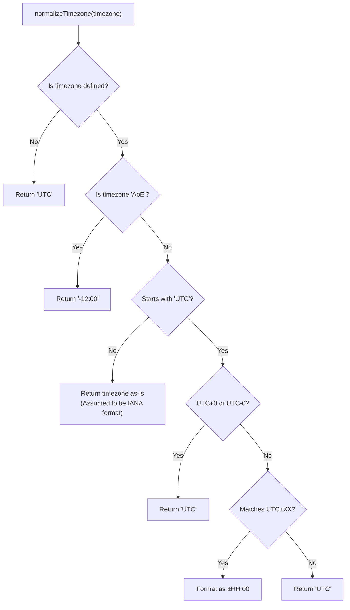
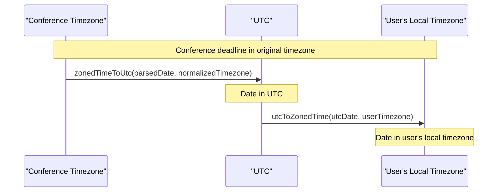
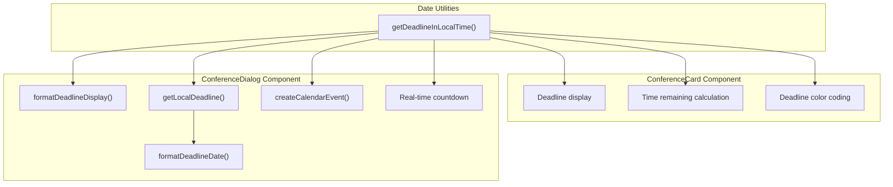
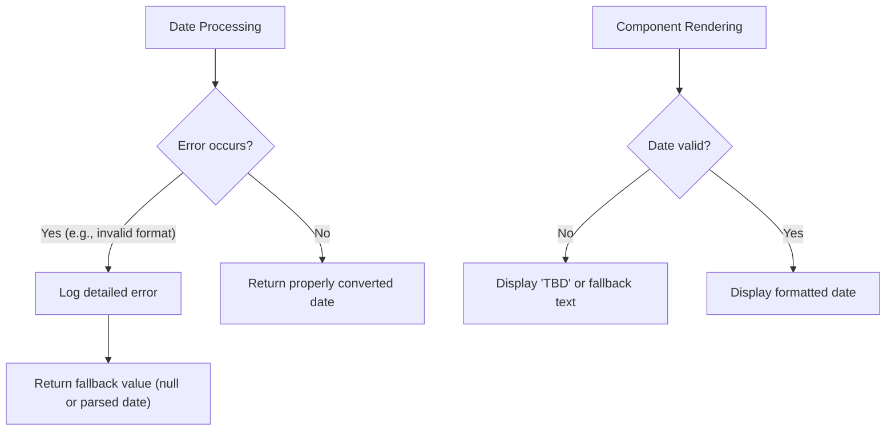
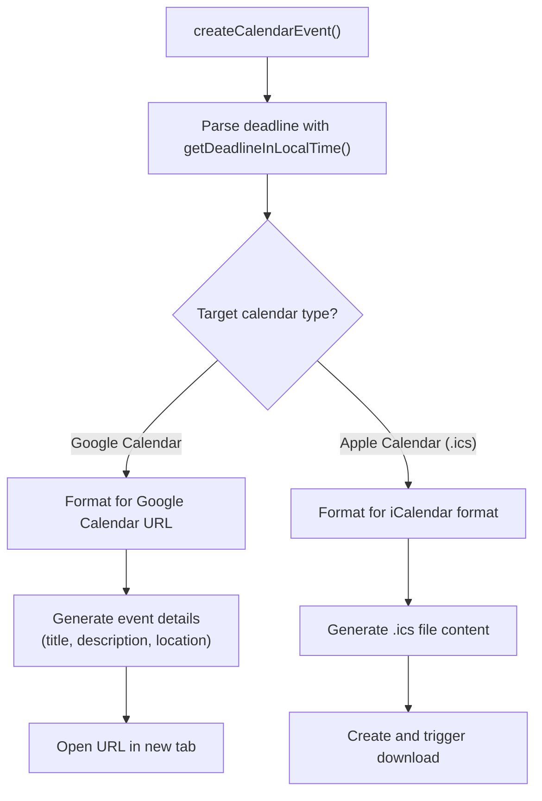

<!-- source: DeepWiki mcp.deepwiki.com · repo huggingface/ai-deadlines · page 5.1 Date Utilities · fetched 2026-10-26 -->

# Date Utilities

Relevant source files

The following files were used as context for generating this wiki page:

- [src/components/ConferenceCard.tsx](src/components/ConferenceCard.tsx)
- [src/components/ConferenceDialog.tsx](src/components/ConferenceDialog.tsx)
- [src/utils/dateUtils.ts](src/utils/dateUtils.ts)

## Purpose and Scope

The Date Utilities module provides essential functions for handling conference deadlines across different timezones. It serves as the critical component responsible for accurately converting deadline dates from conference-specific timezones to the user's local timezone, ensuring users always see the correct deadline relative to their location.

For information about other data processing utilities, see [Data Processing Utilities](#5.2).

Sources: [src/utils/dateUtils.ts:1-70]()

## Core Function: getDeadlineInLocalTime

The central function of the Date Utilities module is `getDeadlineInLocalTime`, which transforms conference deadline strings into local time Date objects:

This function accepts two parameters:
- `deadline`: A date string in ISO format (e.g., "2023-12-31T23:59:59")
- `timezone`: The timezone string of the conference (e.g., "America/New_York", "UTC+3", "AoE")

The function returns either a JavaScript Date object representing the deadline in the user's local timezone or `null` if the conversion fails.

Sources: [src/utils/dateUtils.ts:4-70]()

## Timezone Normalization

The Date Utilities module handles various timezone formats commonly used in academic conferences:

The module handles these special cases:
- **Anywhere on Earth (AoE)**: Converted to "-12:00" (UTC-12)
- **UTC formats**: Formats like "UTC+5" are converted to "+05:00"
- **IANA timezone identifiers**: Passed through as-is (e.g., "America/New_York")

Sources: [src/utils/dateUtils.ts:19-42]()

## Date Conversion Process

The date conversion follows a three-step process to ensure accurate timezone transformation:

This conversion is critical because conference deadlines are typically specified in a particular timezone (often the conference's local timezone or AoE), but users need to see when that deadline occurs in their own timezone.

Sources: [src/utils/dateUtils.ts:46-65]()

## Integration with UI Components

The Date Utilities are used throughout the application's UI components to provide consistent deadline display:

Sources: 
- [src/components/ConferenceCard.tsx:25-45]() 
- [src/components/ConferenceDialog.tsx:29-80]()
- [src/components/ConferenceDialog.tsx:196-210]()

## Countdown and Deadline Visualization

The Date Utilities enable several visual indicators based on deadline proximity:

| Days to Deadline | Color Indicator | Format in Card | Format in Dialog |
|------------------|----------------|----------------|------------------|
| ≤ 7 days | Red | "X days left" | Countdown timer (Xd Xh Xm Xs) |
| 8-30 days | Orange | "X days left" | Countdown timer (Xd Xh Xm Xs) |
| > 30 days | Green | "X days left" | Countdown timer (Xd Xh Xm Xs) |
| Passed | Default text | "Deadline passed" | "Deadline passed" |
| Invalid/TBD | Default text | "TBD" | "TBD" |

This visual coding helps users quickly identify which conferences have upcoming deadlines requiring immediate attention.

Sources: 
- [src/components/ConferenceCard.tsx:51-62]()
- [src/components/ConferenceDialog.tsx:82-88]()

## Error Handling

The Date Utilities module implements robust error handling to ensure the application remains functional even when dealing with malformed date strings or unsupported timezone formats:

This approach ensures a graceful user experience even when the application encounters unexpected date formats.

Sources: 
- [src/utils/dateUtils.ts:62-69]()
- [src/components/ConferenceCard.tsx:27-43]()

## Calendar Export Functionality

The Date Utilities module powers the calendar export feature, allowing users to add conference deadlines to their personal calendars:

This feature leverages the accurate timezone conversion of the Date Utilities to ensure that calendar events are created with the correct timing information.

Sources: [src/components/ConferenceDialog.tsx:113-173]()

## Implementation Dependencies

The Date Utilities rely on two external libraries:

1. **date-fns**: For basic date parsing and manipulation
   - `parseISO`: Parses ISO date strings to Date objects
   - `isValid`: Validates Date objects
   - Other helpers for date formatting and comparison

2. **date-fns-tz**: For timezone-aware operations
   - `zonedTimeToUtc`: Converts from a specific timezone to UTC
   - `utcToZonedTime`: Converts from UTC to a specific timezone

Sources: [src/utils/dateUtils.ts:1-2]()

## Summary

The Date Utilities module is a critical part of the AI Deadlines application, ensuring users always have accurate deadline information regardless of their location. By handling complex timezone conversions and providing consistent date formatting across components, it enables a reliable user experience for tracking academic conference deadlines globally.

---

