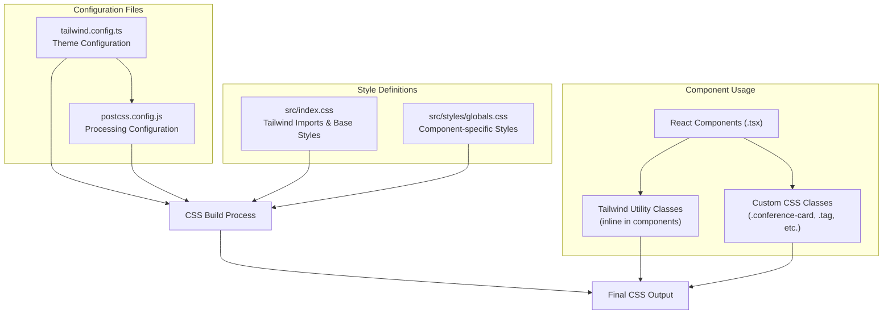
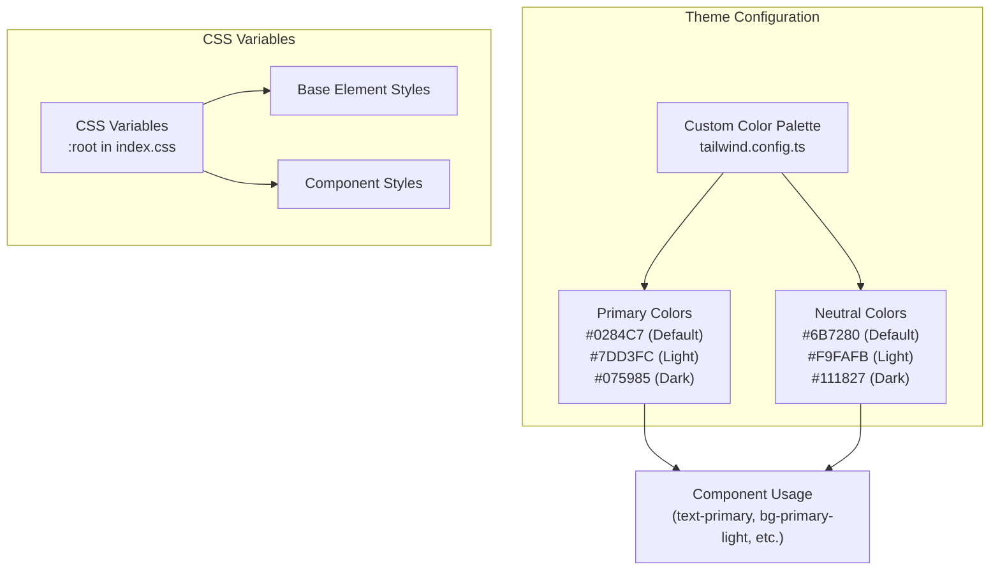
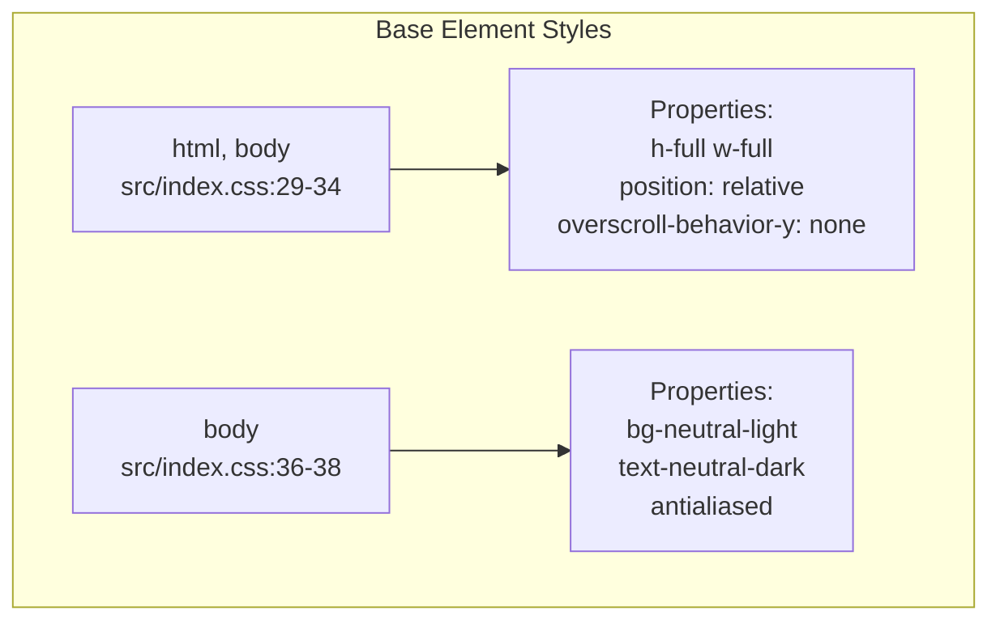
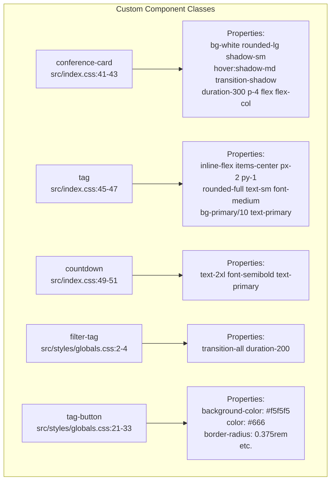
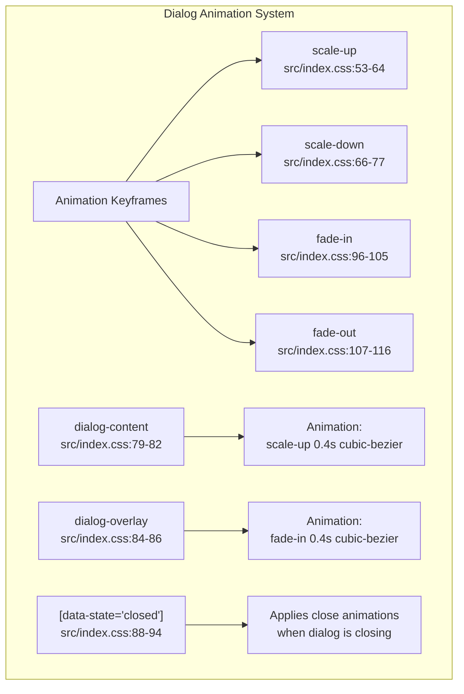
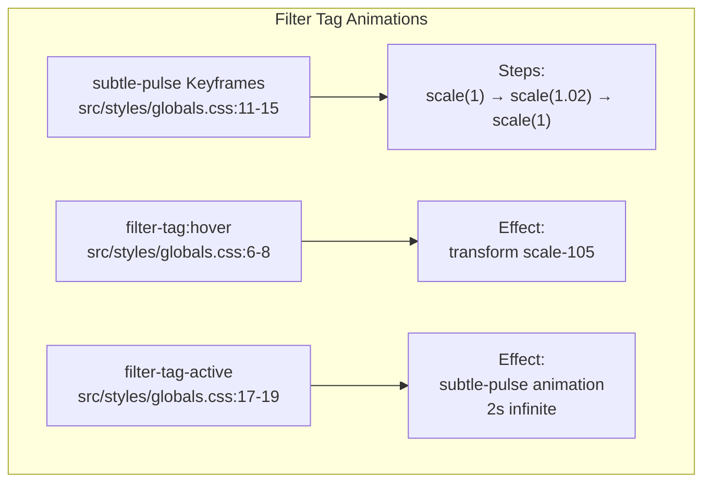
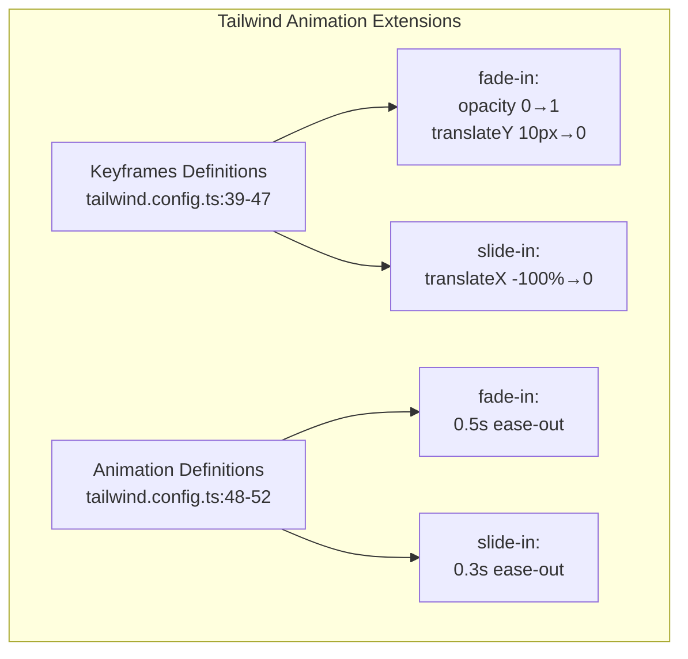

<!-- source: DeepWiki mcp.deepwiki.com · repo huggingface/ai-deadlines · page 6 Styling System · fetched 2026-10-26 -->

# Styling System

<details>
<summary>Relevant source files</summary>

The following files were used as context for generating this wiki page:

- [postcss.config.js](postcss.config.js)
- [src/index.css](src/index.css)
- [src/styles/globals.css](src/styles/globals.css)
- [tailwind.config.ts](tailwind.config.ts)

</details>


This document provides an overview of the styling architecture and implementation in the ai-deadlines application. The styling system is built on Tailwind CSS with custom configurations, component-specific styles, and animation definitions.

## Overview

The ai-deadlines application uses a utility-first CSS approach through Tailwind CSS, supplemented with custom component styles and animations. The styling system consists of:

- Tailwind CSS as the core styling framework
- Custom theme configuration with brand colors
- Component-specific CSS classes
- Animation and transition effects
- PostCSS for processing

## Styling Architecture



Sources: [tailwind.config.ts](), [postcss.config.js](), [src/index.css](), [src/styles/globals.css]()

## Tailwind Configuration

The application extends Tailwind's default configuration with custom colors, animations, and container settings in `tailwind.config.ts`.

### Color System



Sources: [tailwind.config.ts:22-37](), [src/index.css:5-27]()

The color system includes:

| Variable | Value | Usage |
|----------|-------|-------|
| primary | #0284C7 | Main brand color, buttons, links |
| primary-light | #7DD3FC | Highlights, backgrounds |
| primary-dark | #075985 | Hover states, emphasis |
| neutral | #6B7280 | Regular text, icons |
| neutral-light | #F9FAFB | Page backgrounds |
| neutral-dark | #111827 | Headings, important text |

## Component Styling Approach

The application uses a mix of Tailwind utility classes and custom component classes to achieve consistent styling.

### Base Styles

Base HTML and body styles are defined in `index.css`:



Sources: [src/index.css:29-38]()

### Component-Specific Classes

The application defines several reusable component classes:



Sources: [src/index.css:41-51](), [src/styles/globals.css:1-37]()

## Animation System

The application includes a rich set of animations for UI transitions and interactions.

### Dialog Animations

Dialog animations provide smooth transitions when opening and closing conference detail dialogs:



Sources: [src/index.css:53-116]()

### Filter Tag Animations

Interactive animations for filter tags improve user experience:



Sources: [src/styles/globals.css:1-19]()

## Tailwind Extensions

The application extends Tailwind's default configuration with custom animations and keyframes:



Sources: [tailwind.config.ts:39-52]()

## Usage Examples

### Inline Tailwind Classes

Most styling in the application is applied using Tailwind utility classes directly in component TSX files:

```tsx
<div className="bg-white rounded-lg shadow-sm p-4 my-2">
  <h2 className="text-xl font-semibold text-primary">Conference Title</h2>
  <p className="text-sm text-neutral">Conference description</p>
</div>
```

### Custom Component Classes

For common UI patterns, the application uses predefined component classes:

```tsx
<div className="conference-card">
  <h2 className="text-xl font-semibold">Conference Title</h2>
  <div className="flex gap-2 mt-2">
    <span className="tag">AI</span>
    <span className="tag">Machine Learning</span>
  </div>
  <div className="countdown">2 days</div>
</div>
```

### Animation Classes

Animations are applied to components using the defined animation classes:

```tsx
<Dialog>
  <DialogOverlay className="dialog-overlay" />
  <DialogContent className="dialog-content">
    {/* Dialog content */}
  </DialogContent>
</Dialog>
```

## Integration with UI Components

The styling system integrates directly with the UI components described in [UI Components](#4), particularly with the [Conference Card](#4.1), [Conference Dialog](#4.2), and [Filter System](#4.3).

Sources: [src/index.css](), [src/styles/globals.css](), [tailwind.config.ts]()

---

