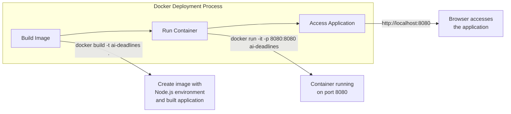
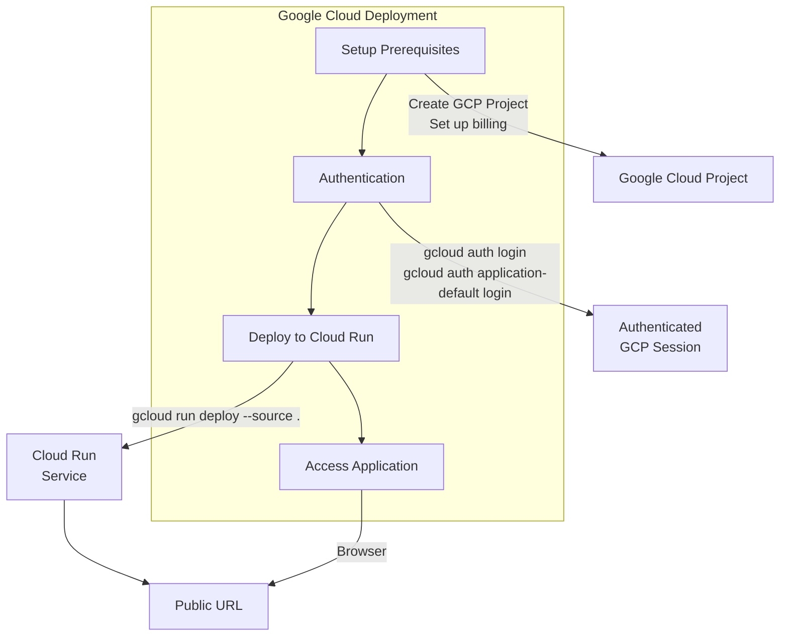
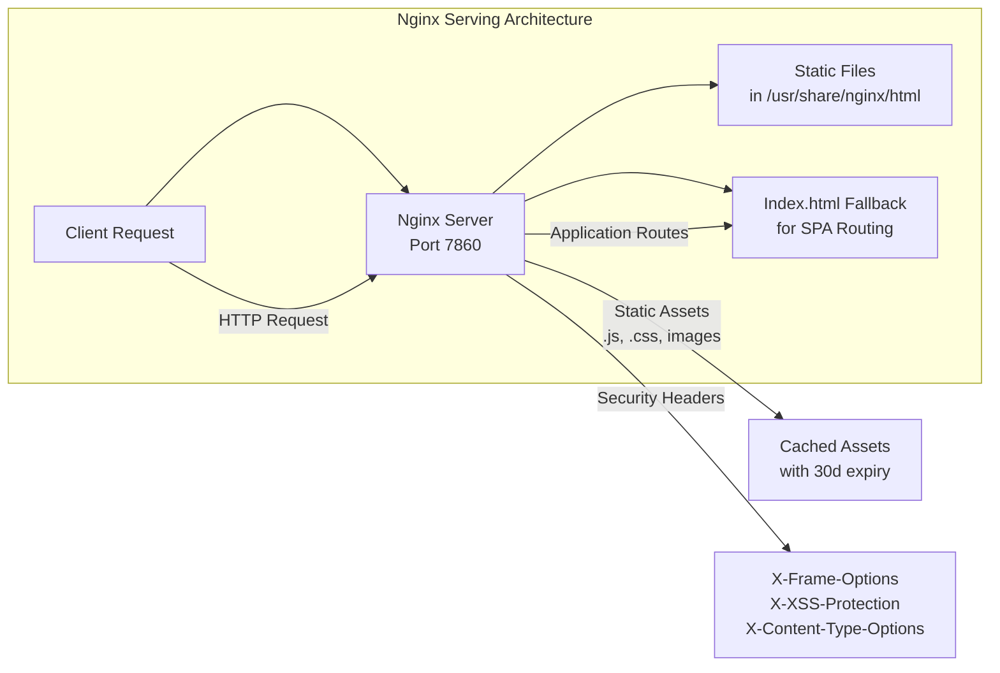
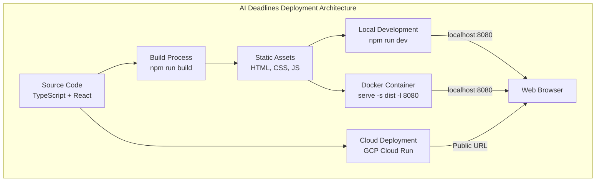

<!-- source: DeepWiki mcp.deepwiki.com · repo huggingface/ai-deadlines · page 7 Deployment · fetched 2026-10-26 -->

# Deployment

<details>
<summary>Relevant source files</summary>

The following files were used as context for generating this wiki page:

- [.dockerignore](.dockerignore)
- [Dockerfile](Dockerfile)
- [LICENSE](LICENSE)
- [README.md](README.md)
- [nginx.conf](nginx.conf)

</details>


This document explains how to deploy the AI Deadlines application using various methods, including local development deployments, Docker containerization, and cloud-based deployments. It covers the technical details of each deployment option and provides step-by-step instructions for setting up the application in different environments.

## Local Development Deployment

The simplest way to run the AI Deadlines application is locally for development purposes.

### Prerequisites

- Node.js and npm (Node Package Manager) installed
  - Recommended: Install using [nvm (Node Version Manager)](https://github.com/nvm-sh/nvm#installing-and-updating)

### Deployment Steps

1. Clone the repository
2. Install dependencies
3. Start the development server

```bash
# Clone the repository
git clone https://github.com/huggingface/ai-deadlines

# Navigate to project directory
cd ai-deadlines

# Install dependencies
npm i

# Start development server
npm run dev
```

The application will be available at http://localhost:8080/ with hot-reloading enabled for development.

Sources: [README.md:69-92]()

## Docker Deployment

Docker provides a containerized deployment option that ensures consistent environments across different systems.



### Building the Docker Image

The Docker image is built using a multi-stage build process defined in the Dockerfile:

```bash
docker build -t ai-deadlines .
```

### Running the Docker Container

Once built, the container can be run with:

```bash
docker run -it -p 8080:8080 ai-deadlines
```

This command maps port 8080 from the container to port 8080 on the host, making the application accessible at http://localhost:8080/.

### Dockerfile Breakdown

The Dockerfile uses a Node.js image to build and serve the application:

1. Uses `node:20-slim` as the base image
2. Sets up the working directory
3. Installs dependencies
4. Builds the application
5. Uses the `serve` package to serve the static files from the `dist` directory
6. Exposes port 8080

The `.dockerignore` file excludes unnecessary files from the Docker image to keep it lightweight.

Sources: [README.md:93-107](), [Dockerfile:1-25](), [.dockerignore:1-8]()

## Cloud Deployment

The AI Deadlines application can be deployed to various cloud platforms. The README specifically provides instructions for Google Cloud Platform.



### Google Cloud Platform Deployment

Google Cloud Platform provides an easy way to deploy the application using Artifact Registry and Cloud Run:

1. **Prerequisites**:
   - Create a Google Cloud project
   - Set up a billing account
   - Install the [gcloud SDK](https://cloud.google.com/sdk/docs/install)

2. **Deployment Steps**:
   ```bash
   gcloud auth login
   gcloud auth application-default login
   gcloud run deploy --source .
   ```

3. **Result**:
   - Cloud Run automatically builds the container using the Dockerfile
   - Deploys it as a serverless container
   - Provides a public URL to access the application

Sources: [README.md:109-125]()

## Nginx Configuration

For production deployments, Nginx can be used as a web server to serve the application with optimized performance and security configurations.



### Key Nginx Configuration Features

The `nginx.conf` file includes the following optimizations:

1. **Static File Serving**:
   - Serves files from `/usr/share/nginx/html`
   - Falls back to `index.html` for SPA routing

2. **Performance Optimizations**:
   - Gzip compression for text-based assets
   - Caching for static assets with 30-day expiry

3. **Security Headers**:
   - X-Frame-Options: SAMEORIGIN
   - X-XSS-Protection: 1; mode=block
   - X-Content-Type-Options: nosniff

4. **Path Configurations**:
   - Custom temp paths for various Nginx operations

Sources: [nginx.conf:1-32]()

## Deployment Architecture

The overall deployment architecture of the AI Deadlines application varies based on the deployment method chosen.



### Deployment Comparison

| Deployment Method | Best For | Configuration | Scaling | URL Access |
|-------------------|----------|---------------|---------|------------|
| Local Development | Development, testing | `npm run dev` | N/A | localhost:8080 |
| Docker Container | Development, testing, CI/CD | Dockerfile, manual container management | Manual | localhost:8080 or custom |
| Google Cloud Run | Production | Automatic from source | Automatic | Public HTTPS URL |
| Custom Nginx | Production, self-hosted | nginx.conf | Manual | Custom domain |

Sources: [README.md:69-125](), [Dockerfile:1-25](), [nginx.conf:1-32]()

## Hugging Face Spaces Deployment

The AI Deadlines application is deployed on Hugging Face Spaces, which can be identified from the metadata in the README file. The application uses the Docker SDK for Spaces with port 8080 exposed.

The deployed application can be accessed at: https://huggingface.co/spaces/huggingface/ai-deadlines

Sources: [README.md:1-9](), [README.md:29]()