# Page: Overview

# Overview

<details>
<summary>Relevant source files</summary>

The following files were used as context for generating this wiki page:

- [LICENSE](LICENSE)
- [README.md](README.md)
- [package.json](package.json)
- [src/App.tsx](src/App.tsx)

</details>


This document provides a high-level introduction to the AI Deadlines application, a web application designed to help AI researchers track submission deadlines for academic conferences. It gives an overview of the system architecture, core components, and general functionality of the application.

For detailed information about the conference data structure, see [Conference Data System](#2) and [Conference Data Model](#2.1).

## Purpose and Scope

AI Deadlines is a web application that displays submission deadlines for top AI conferences in an easily accessible format. The primary purpose is to help researchers quickly identify upcoming paper submission deadlines to plan their work accordingly. 

The application provides:
- A list view of conferences with detailed information and filtering capabilities
- A calendar view to visualize deadlines chronologically
- Automatic updates of conference data
- Tools to export conference deadlines to personal calendars

Sources: [README.md:11-15]()

## System Architecture

The AI Deadlines application follows a clean, modular architecture centered around a single source of truth for conference data.

### High-Level System Overview

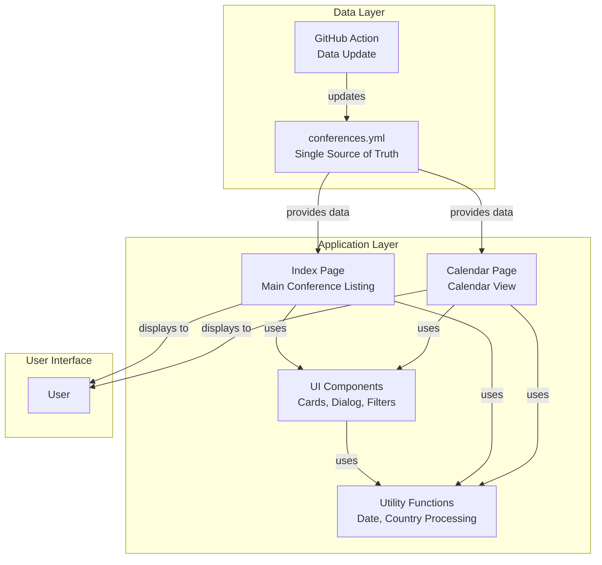

Sources: [README.md:11-19](), [src/App.tsx:12-28]()

### Core Data Flow

The application operates on a straightforward data flow model, where external conference data is automatically processed, made available to the application, and then presented to users through filtering and display systems.

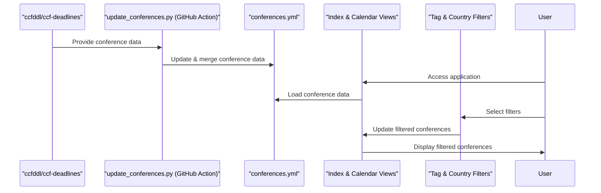

Sources: [README.md:25-27]()

## Key Features

### 1. Conference Listing

The main page displays conferences as cards with essential information and countdown timers. Users can filter conferences by:
- Tags (topic areas)
- Countries
- Search queries
- Past/upcoming status

### 2. Calendar View

The calendar view presents conferences in a monthly calendar format, allowing users to:
- See conferences scheduled for specific dates
- Navigate between months
- Get a visual overview of conference timelines

### 3. Automated Data Updates

Conference data is automatically kept up-to-date through:
- GitHub Actions that run periodically
- Data synchronization with ccfddl/ccf-deadlines repository
- Merged updates to the central conferences.yml file

Sources: [README.md:25-27]()

## Technology Stack

The application is built using modern web technologies:

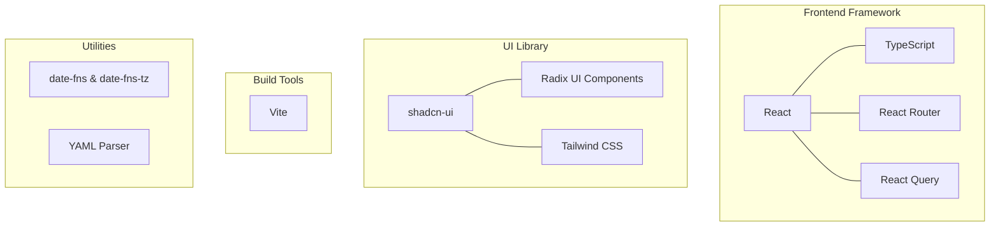

Sources: [README.md:126-134](), [package.json:13-63]()

### Key Libraries

| Category | Libraries | Purpose |
|----------|-----------|---------|
| Core Framework | React, TypeScript | Application foundation |
| Routing | React Router | Page navigation |
| State Management | React Query | Data fetching & caching |
| UI Components | shadcn-ui, Radix UI | UI elements & accessibility |
| Styling | Tailwind CSS | Utility-based styling |
| Date Handling | date-fns, date-fns-tz | Date formatting & timezone handling |
| Build | Vite | Development & production builds |

Sources: [package.json:13-63]()

## Application Structure

The application consists of two main views:

1. **Index Page** (`/`) - The main conference listing with filtering capabilities
2. **Calendar Page** (`/calendar`) - Calendar visualization of conferences

Both views access the same conference data from `conferences.yml` but present it in different formats and with different interaction models.

Sources: [src/App.tsx:18-24]()

## Component Organization

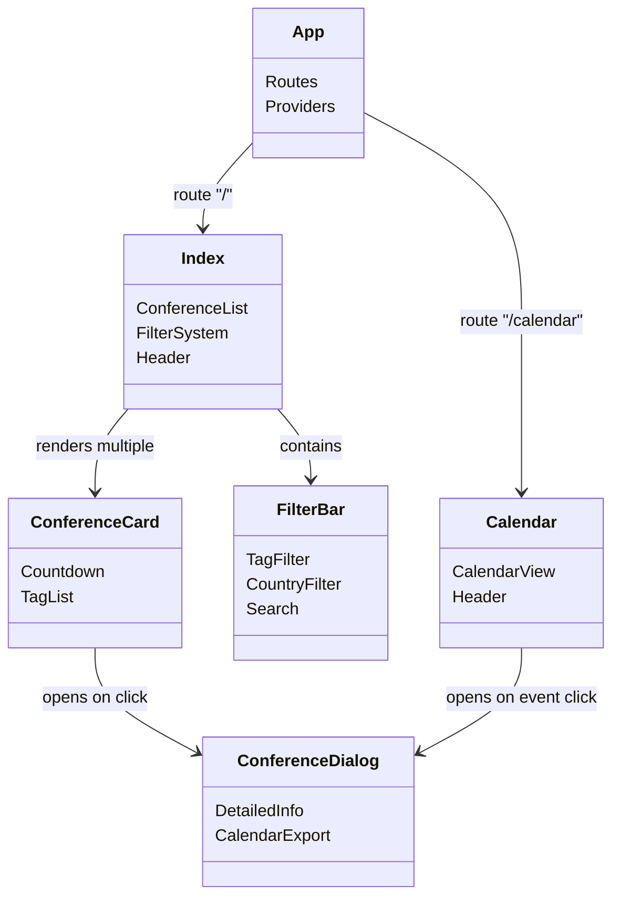

Sources: [src/App.tsx:12-28]()

## Deployment Options

The application can be deployed using several methods:

1. **Docker Container**
   - Built using the included Dockerfile
   - Can be run locally or on cloud platforms

2. **Cloud Deployment**
   - Google Cloud Run (recommended in documentation)
   - Other container-based cloud services

Sources: [README.md:93-124]()

## Contributing

The project welcomes contributions, particularly:
- Adding or updating conference information
- UI/UX improvements
- Bug fixes

The contribution process involves updating the `conferences.yml` file with accurate conference information following the specified format.

Sources: [README.md:31-67]()

---

# Page: Technology Stack

# Technology Stack

<details>
<summary>Relevant source files</summary>

The following files were used as context for generating this wiki page:

- [LICENSE](LICENSE)
- [README.md](README.md)
- [package.json](package.json)
- [src/types/yaml.d.ts](src/types/yaml.d.ts)
- [tailwind.config.ts](tailwind.config.ts)
- [vite.config.ts](vite.config.ts)

</details>


This page provides a comprehensive overview of the technologies, frameworks, and tools used in the AI Deadlines application. It covers the front-end development stack, UI components, data handling mechanisms, and deployment configurations. For information about the conference data model itself, see [Conference Data Model](#2.1).

## Overview

The AI Deadlines application uses a modern JavaScript stack centered around React and Vite, with TypeScript for type safety. The application provides a clean, responsive interface for viewing AI conference deadlines using a component-based architecture.

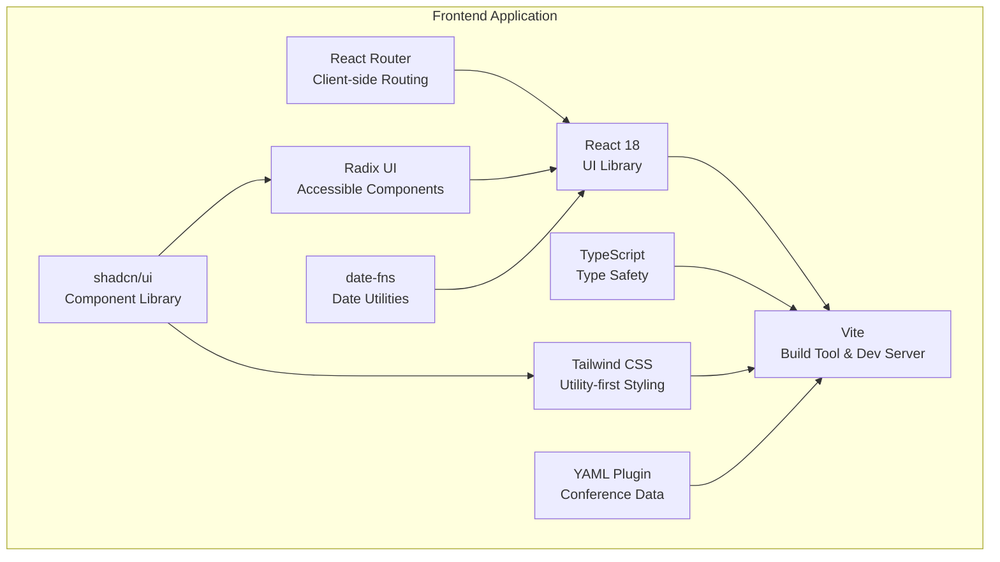

Sources: [README.md:126-134](), [package.json:4-84](), [vite.config.ts:1-27]()

## Core Framework

The application is built using React 18, a popular JavaScript library for building user interfaces. TypeScript is used throughout the codebase to provide static typing and improve developer experience.

### Build System

Vite serves as the build tool and development server, providing fast development experience with features like:

- Hot module replacement (HMR)
- Fast builds through esbuild
- Plugin system for extensions
- Configuration for server port (8080) and host settings

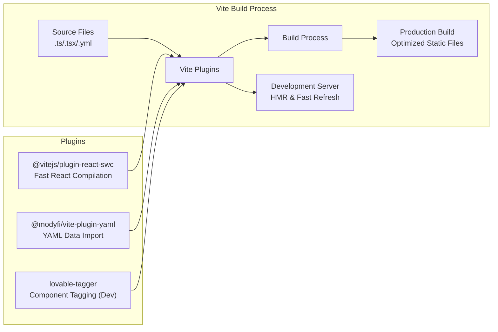

Sources: [vite.config.ts:1-27](), [package.json:65-84]()

## UI Architecture

The UI is built with a component-based architecture using several complementary technologies:

### Component Libraries

- **Radix UI**: Provides unstyled, accessible components
- **shadcn/ui**: A collection of reusable components built on Radix UI
- **Various UI Components**: Dialog, popover, accordion and other specialized components

### Styling

Tailwind CSS is used for styling with:
- Utility-first approach
- Custom configuration for colors, animations and themes
- Mobile-responsive design
- Dark mode support

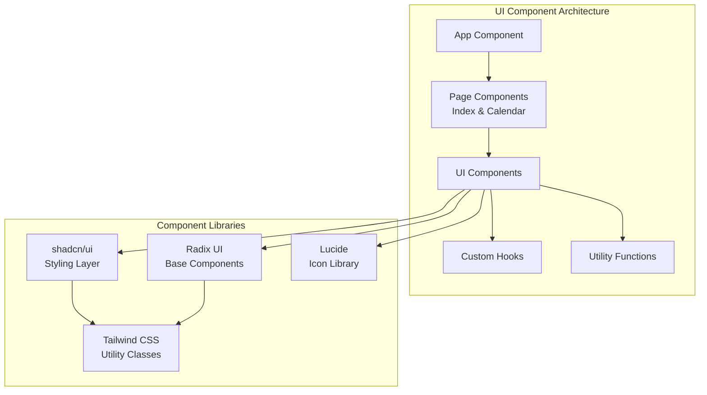

Sources: [README.md:126-134](), [package.json:13-64](), [tailwind.config.ts:1-56]()

## Data Handling

The application deals primarily with conference data and date management:

### Conference Data

- Conference information is stored in YAML format
- YAML files are imported directly into the application using a Vite plugin
- TypeScript type definitions ensure data integrity

### Date and Time Processing

- **date-fns**: For manipulating and formatting dates
- **date-fns-tz**: For timezone handling (critical for conference deadlines)

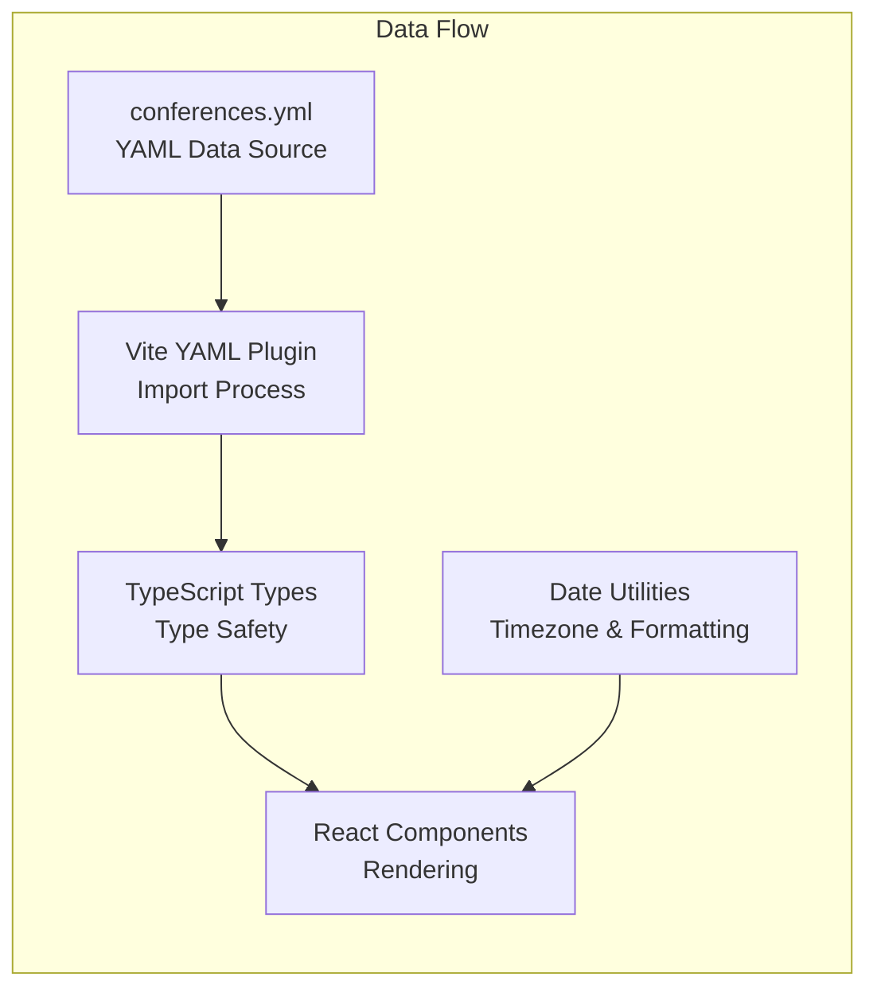

Sources: [vite.config.ts:15-20](), [src/types/yaml.d.ts:1-4](), [package.json:46-47]()

## Development Tools

The project includes several development tools to ensure code quality:

- **ESLint**: For code linting and static analysis
- **TypeScript**: For static type checking
- **SWC**: For fast compilation via Vite
- **npm scripts**: For development, building, and previewing

## Deployment Options

The application supports multiple deployment options:

### Docker Deployment

The application can be containerized using Docker:

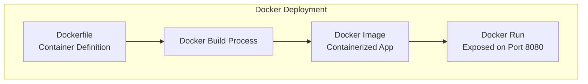

Sources: [README.md:93-107]()

### Cloud Deployment

The application is designed to be deployed to cloud services such as:

- **Google Cloud Run**: For serverless container deployment
- **Hugging Face Spaces**: Current hosting location (huggingface.co/spaces/huggingface/ai-deadlines)

## Technology Dependencies

The following table lists the key dependencies and their purposes:

| Category | Technology | Purpose |
|----------|------------|---------|
| **Core** | React | UI library |
| | TypeScript | Static typing |
| | Vite | Build tool & dev server |
| **Routing** | React Router | Client-side routing |
| **UI** | Radix UI | Unstyled, accessible components |
| | shadcn/ui | Component system |
| | Tailwind CSS | Utility-first styling |
| | Lucide React | Icon library |
| **Form Handling** | React Hook Form | Form state management |
| | Zod | Schema validation |
| **Data Fetching** | TanStack Query | Data fetching & caching |
| **Date Handling** | date-fns | Date manipulation |
| | date-fns-tz | Timezone support |
| **Build Tools** | SWC | Fast JavaScript compiler |
| | ESLint | Code linting |

Sources: [package.json:13-84](), [README.md:126-134]()

## License and Maintenance

The project is licensed under the MIT License and maintained by the Hugging Face team. Contributions are welcome through pull requests to the GitHub repository.

Sources: [LICENSE:1-21](), [README.md:136-142]()

---

# Page: Conference Data System

# Conference Data System

<details>
<summary>Relevant source files</summary>

The following files were used as context for generating this wiki page:

- [src/data/conferences.yml](src/data/conferences.yml)
- [src/types/conference.ts](src/types/conference.ts)
- [src/utils/countryExtractor.ts](src/utils/countryExtractor.ts)

</details>


The Conference Data System is the core data infrastructure that powers the AI Deadlines application. It defines how conference information is structured, stored, and accessed throughout the application. This documentation explains the data model, storage format, and how other components interact with the conference data.

For information about how this data is automatically kept up-to-date, see [Data Update System](#2.2). For details about the specific fields in the conference data model, see [Conference Data Model](#2.1).

## Data Structure Overview

The Conference Data System is built around a single, centralized YAML file that serves as the authoritative source of all conference information.

Conference Data System Architecture
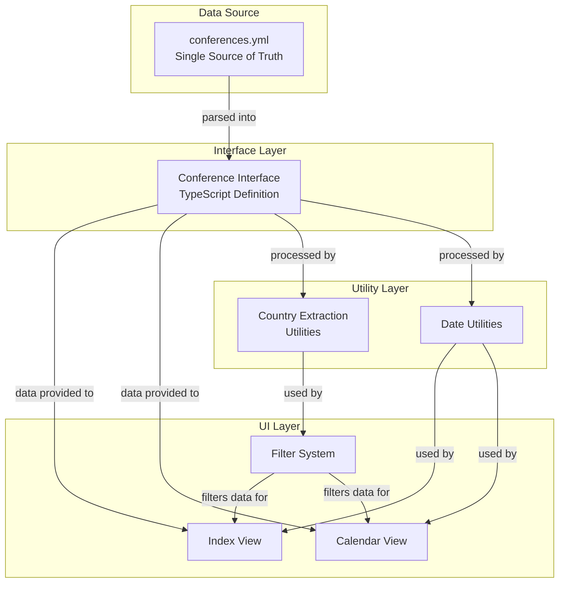

Sources: [src/data/conferences.yml:1-787](), [src/types/conference.ts:1-30]()

### YAML Data Store

The primary data store for all conference information is the `conferences.yml` file. This file contains an array of conference objects, each representing an academic conference with its associated metadata.

Example of a conference entry in the YAML file:

```yaml
- title: ICML
  year: 2025
  id: icml25
  full_name: International Conference on Machine Learning
  link: https://icml.cc/Conferences/2025
  deadline: '2025-01-30 23:59:59'
  timezone: UTC-12
  date: July 11-19, 2025
  tags:
  - machine-learning
  city: Vancouver
  country: Canada
  abstract_deadline: '2025-01-23 23:59:59'
  rankings: 'CCF: A, CORE: A*, THCPL: A'
  venue: Vancouver Convention Center
```

This human-readable format makes it easy to maintain and update conference information, while still providing structured data for the application.

Sources: [src/data/conferences.yml:1-787]()

### Conference Interface

The TypeScript interface `Conference` defines the structure of conference data objects throughout the application. This interface ensures type safety and provides a clear contract for how conference data should be structured.

Conference Data Model
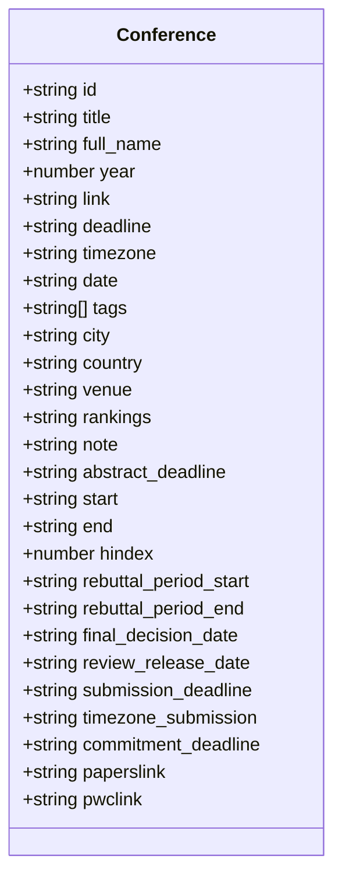

Sources: [src/types/conference.ts:1-30]()

## Data Flow

The Conference Data System follows a unidirectional data flow pattern from storage to presentation layers.

Conference Data Flow
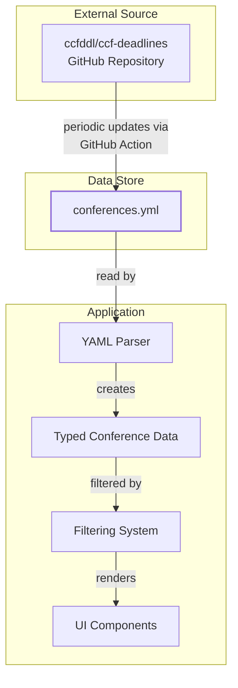

Sources: [src/data/conferences.yml:1-787]()

### Data Access Pattern

When the application starts:

1. The `conferences.yml` file is loaded and parsed
2. The parsed data is validated against the `Conference` interface
3. The data is processed by utility functions as needed (e.g., country extraction)
4. UI components receive and display the processed data
5. Filter components allow users to refine the displayed conferences

## Country Extraction Utility

The Conference Data System includes a utility for extracting and normalizing country information from conference data. This functionality supports the location-based filtering feature.

Country Extraction Process
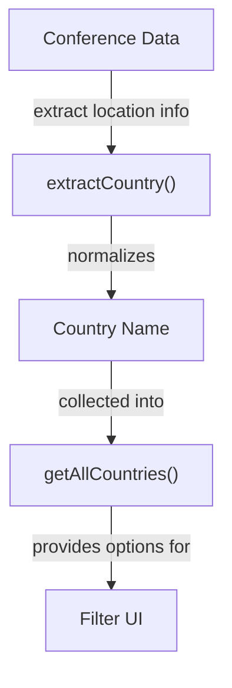

The country extractor handles various formats and special cases:
- Extracts country from city/venue strings
- Normalizes country names (e.g., "USA", "U.S.A.", "United States" → "USA")
- Handles special cases for countries like the UK

Sources: [src/utils/countryExtractor.ts:1-55]()

## Integration with UI Components

The Conference Data System serves as the foundation for all UI views and components in the application.

Component Integration
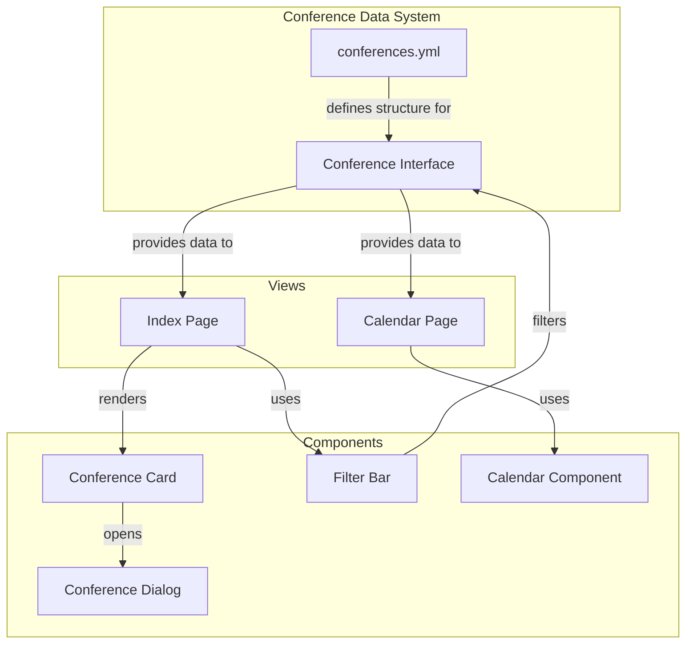

Sources: [src/data/conferences.yml:1-787](), [src/types/conference.ts:1-30]()

### Key Integration Points

1. **Index View**: Displays conferences as cards with filtering options
2. **Calendar View**: Shows conferences in a calendar format
3. **Filter System**: Filters conferences by tags, countries, and search queries
4. **Conference Cards/Dialog**: Display conference information at different detail levels

## Summary

The Conference Data System provides a solid foundation for the AI Deadlines application through:

1. **Centralized Data Storage**: The `conferences.yml` file serves as a single source of truth
2. **Structured Data Model**: The TypeScript interface ensures consistent data structure
3. **Utility Functions**: Support extraction and processing of specific data aspects
4. **Clear Data Flow**: Data flows from storage to UI in a predictable pattern

This design makes the application easy to maintain and extend, as all conference data is stored in a single, well-structured format that can be accessed and processed throughout the application.

---

# Page: Conference Data Model

# Conference Data Model

<details>
<summary>Relevant source files</summary>

The following files were used as context for generating this wiki page:

- [src/data/conferences.yml](src/data/conferences.yml)
- [src/types/conference.ts](src/types/conference.ts)
- [src/utils/countryExtractor.ts](src/utils/countryExtractor.ts)

</details>


The Conference Data Model is the core data structure that powers the AI Deadlines application. It defines the schema for all conference information displayed throughout the application and serves as the single source of truth for conference data. This page documents the complete data model, all available fields, their purposes, and how they're used within the system.

For information about how conference data is automatically updated, see [Data Update System](#2.2).

## Overview

The AI Deadlines application uses a structured data model to represent academic conferences. This data is primarily stored in the `conferences.yml` file, which acts as the centralized data source for the entire application. The data model is defined as a TypeScript interface in the codebase, ensuring type safety throughout the application.

### Conference Data Structure

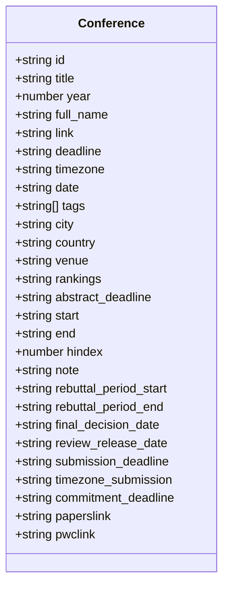

Sources: [src/types/conference.ts:1-30](), [src/data/conferences.yml:1-787]()

## Field Reference

The Conference data model consists of the following fields:

| Field | Type | Required | Description |
|-------|------|----------|-------------|
| `id` | string | ✅ | Unique identifier for the conference (usually abbreviation + year) |
| `title` | string | ✅ | Short name/abbreviation of the conference |
| `year` | number | ✅ | The year the conference takes place |
| `full_name` | string | ❌ | Complete name of the conference |
| `link` | string | ❌ | URL to the conference website |
| `deadline` | string | ✅ | Paper submission deadline in ISO format |
| `timezone` | string | ❌ | Timezone for the deadline (e.g., UTC-12, AoE) |
| `date` | string | ✅ | Human-readable date range of the conference |
| `tags` | string[] | ❌ | Array of topic categories for filtering |
| `city` | string | ❌ | Host city of the conference |
| `country` | string | ❌ | Host country of the conference |
| `venue` | string | ❌ | Specific location where the conference is held |
| `rankings` | string | ❌ | Academic rankings (e.g., 'CCF: A, CORE: A*, THCPL: A') |
| `abstract_deadline` | string | ❌ | Abstract submission deadline in ISO format |
| `start` | string | ❌ | Conference start date in ISO format |
| `end` | string | ❌ | Conference end date in ISO format |
| `hindex` | number | ❌ | H-index of the conference (research impact metric) |
| `note` | string | ❌ | Additional information about the conference |
| `rebuttal_period_start` | string | ❌ | Start date of author rebuttal period |
| `rebuttal_period_end` | string | ❌ | End date of author rebuttal period |
| `final_decision_date` | string | ❌ | Date when final acceptance decisions are released |
| `review_release_date` | string | ❌ | Date when reviews are released to authors |
| `submission_deadline` | string | ❌ | Alternative deadline specification (sometimes used with specific timezone) |
| `timezone_submission` | string | ❌ | Timezone for submission_deadline |
| `commitment_deadline` | string | ❌ | Deadline for commitment (used by some conferences) |
| `paperslink` | string | ❌ | Link to the papers submission system |
| `pwclink` | string | ❌ | Link to the Papers with Code page |

Sources: [src/types/conference.ts:1-30](), [src/data/conferences.yml:1-787]()

## Conference Data Flow

The following diagram illustrates how conference data flows through the system:

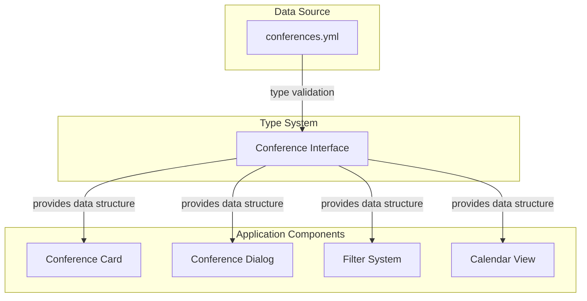

Sources: [src/types/conference.ts:1-30](), [src/data/conferences.yml:1-787]()

## Date-Related Fields

The Conference model contains several date-related fields that serve different purposes:

```mermaid
flowchart TD
    subgraph "Conference"
        deadline["deadline (required)"]
        abstract_deadline["abstract_deadline (optional)"]
        timezone["timezone (optional)"]
        submission_deadline["submission_deadline (optional)"]
        timezone_submission["timezone_submission (optional)"]
        
        date["date (required)"]
        start["start (optional)"]
        end["end (optional)"]
        
        review_release_date["review_release_date (optional)"]
        rebuttal_period_start["rebuttal_period_start (optional)"]
        rebuttal_period_end["rebuttal_period_end (optional)"]
        final_decision_date["final_decision_date (optional)"]
        commitment_deadline["commitment_deadline (optional)"]
    end
    
    subgraph "Timeline"
        submission["Paper Submission"]
        review["Review Process"]
        conference["Conference Event"]
    end
    
    deadline -->|"main deadline for"| submission
    abstract_deadline -->|"precedes"| deadline
    timezone -->|"specifies timezone for"| deadline
    submission_deadline -->|"alternative specification for"| deadline
    timezone_submission -->|"specifies timezone for"| submission_deadline
    
    date -->|"human readable date for"| conference
    start -->|"start date for"| conference
    end -->|"end date for"| conference
    
    review_release_date -->|"part of"| review
    rebuttal_period_start -->|"start of rebuttal in"| review
    rebuttal_period_end -->|"end of rebuttal in"| review
    final_decision_date -->|"final step in"| review
    commitment_deadline -->|"deadline for committing accepted papers"| review
```

Sources: [src/types/conference.ts:1-30](), [src/data/conferences.yml:1-787]()

## Example Conference Data

Here's an example of a conference entry from the data source:

```yaml
- title: CVPR
  year: 2025
  id: cvpr25
  full_name: IEEE/CVF Conference on Computer Vision and Pattern Recognition
  link: https://cvpr.thecvf.com/Conferences/2025/CallForPapers
  deadline: '2024-11-14 23:59:00'
  timezone: UTC-8
  date: June 10-17, 2025
  tags:
  - computer-vision
  city: Nashville
  country: Tennessee
  abstract_deadline: '2024-11-07 23:59:00'
  rankings: 'CCF: A, CORE: A*, THCPL: A'
  venue: Music City Center, Nashville, USA
  hindex: 389
  rebuttal_period_end: '2025-01-31 07:59:59'
  final_decision_date: '2025-02-26 07:59:59'
  review_release_date: '2025-01-23 07:59:59'
  note: OpenReview account creation deadline on Nov 1st, paper registration deadline on Nov 8th, supplementary materials deadline on Nov 22nd. Reviews released on Jan 23rd, rebuttal period ends Jan 31st, and final decisions on Feb 26th.
```

Sources: [src/data/conferences.yml:253-272]()

## Country and Location Handling

The system uses both `city` and `country` fields to represent the location of conferences. An auxiliary utility extracts country information for filtering and display purposes:

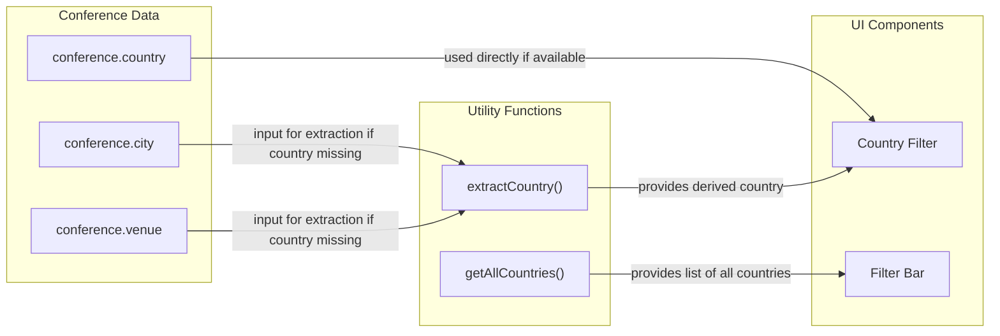

Sources: [src/utils/countryExtractor.ts:1-55](), [src/types/conference.ts:11-13]()

## Usage in the Application

The Conference data model is central to the application and is used by various components:

1. **Conference Cards**: Displays summarized conference information
2. **Conference Dialog**: Shows detailed conference information when a card is clicked
3. **Filter System**: Filters conferences by tags, countries, and search queries
4. **Calendar View**: Displays conferences in a calendar format

The structure enables efficient filtering, sorting, and display of conference information throughout the application.

Sources: [src/types/conference.ts:1-30](), [src/data/conferences.yml:1-787]()

## The Source of Truth

The `conferences.yml` file serves as the single source of truth for all conference data in the application. This YAML file contains an array of conference objects, each following the Conference data model structure. The file is updated through an automated process (see [Data Update System](#2.2)) and provides the data that powers all views in the application.

Sources: [src/data/conferences.yml:1-787]()

---

# Page: Data Update System

# Data Update System

<details>
<summary>Relevant source files</summary>

The following files were used as context for generating this wiki page:

- [.github/scripts/update_conferences.py](.github/scripts/update_conferences.py)
- [.github/workflows/update-conferences.yml](.github/workflows/update-conferences.yml)
- [LICENSE](LICENSE)
- [README.md](README.md)
- [src/data/conferences.yml](src/data/conferences.yml)

</details>


## Purpose and Scope

This document describes the automated system that keeps the AI Deadlines conference data up-to-date. It explains how GitHub Actions are used to periodically fetch data from external sources, transform it into the application's data format, and update the central conference database. For details about the conference data model itself, see [Conference Data Model](#2.1).

## System Overview

The Data Update System automatically refreshes the conference data in the application by fetching the latest information from external sources. This ensures users always have access to current conference deadlines without requiring manual maintenance.

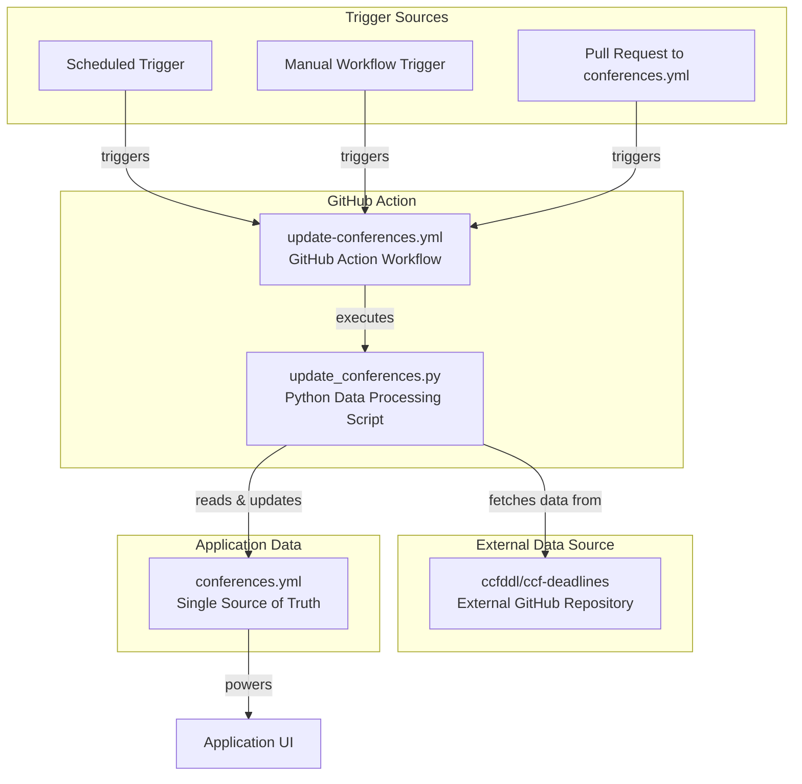

Sources: [.github/workflows/update-conferences.yml:1-49](), [README.md:24-27]()

## Update Workflow

The update process is implemented as a GitHub Action workflow that can be triggered manually or automatically when changes are made to the conference data file.

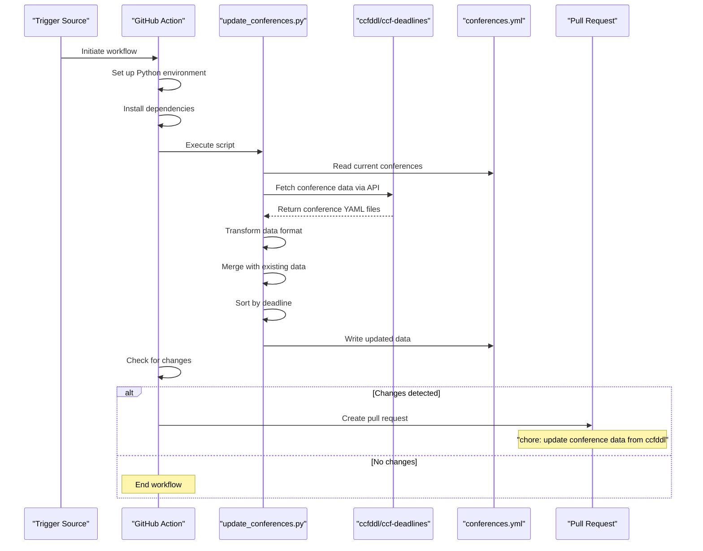

Sources: [.github/workflows/update-conferences.yml:12-49](), [.github/scripts/update_conferences.py:163-261]()

## GitHub Action Configuration

The GitHub Action workflow is defined in `.github/workflows/update-conferences.yml` and contains the following key components:

### Trigger Conditions

The workflow can be triggered in two ways:

1. **Manual Trigger**: Using GitHub's `workflow_dispatch` event, allowing maintainers to run the update on demand
2. **Pull Request**: When changes are made to the `src/data/conferences.yml` file

### Workflow Steps

1. **Checkout Repository**: Fetches the repository code
2. **Set up Python**: Installs the required Python environment
3. **Install Dependencies**: Installs necessary Python packages (PyYAML and requests)
4. **Run Update Script**: Executes the Python script to update conference data
5. **Check for Changes**: Determines if any changes were made to the conference data
6. **Create Pull Request**: If changes are detected, creates a PR with the updates

Sources: [.github/workflows/update-conferences.yml:6-49]()

## Data Update Script

The core of the update system is the Python script located at `.github/scripts/update_conferences.py`. This script is responsible for fetching, transforming, and merging conference data.

### Script Functionality

The script performs the following operations:

1. **Fetch External Data**: Retrieves conference data from the ccfddl/ccf-deadlines GitHub repository
2. **Read Current Data**: Loads the existing `conferences.yml` file
3. **Transform Data Format**: Converts ccfddl format to AI Deadlines format
4. **Merge Data**: Combines new data with existing data, preserving important fields
5. **Sort Conferences**: Orders conferences by submission deadline
6. **Write Updated Data**: Saves the updated conference list back to `conferences.yml`

```mermaid
flowchart TD
    start["Script Start"]
    
    subgraph "Data Fetching"
        fetchCurrent["Read conferences.yml"]
        fetchExternal["Fetch data from ccfddl/ccf-deadlines"]
    end
    
    subgraph "Data Processing"
        transform["Transform ccfddl format to AI Deadlines format"]
        createDict["Create dictionary of current conferences by ID"]
        createKeys["Create set of existing conference keys"]
        
        processLoop["For each new conference"]
        checkDuplicate["Check if duplicate by title+year"]
        checkExists["Check if ID exists in current data"]
        
        updateConf["Update existing conference<br>preserving important fields"]
        addConf["Add new conference"]
        
        sortConfs["Sort conferences by deadline"]
    end
    
    subgraph "Data Writing"
        writeFile["Write updated data to conferences.yml"]
    end
    
    start --> fetchCurrent
    start --> fetchExternal
    
    fetchCurrent --> createDict
    fetchCurrent --> createKeys
    fetchExternal --> transform
    
    transform --> processLoop
    createDict --> processLoop
    createKeys --> processLoop
    
    processLoop --> checkDuplicate
    
    checkDuplicate -->|"Duplicate"| processLoop
    checkDuplicate -->|"Not Duplicate"| checkExists
    
    checkExists -->|"Exists"| updateConf
    checkExists -->|"New"| addConf
    
    updateConf --> processLoop
    addConf --> processLoop
    
    processLoop -->|"All processed"| sortConfs
    sortConfs --> writeFile
```

Sources: [.github/scripts/update_conferences.py:163-261]()

### Data Transformation Process

The script carefully transforms data from the ccfddl format to the AI Deadlines format, performing these key transformations:

| ccfddl Field | AI Deadlines Field | Transformation |
|--------------|-------------------|----------------|
| `title` | `title` | Direct copy |
| `description` | `full_name` | Direct copy |
| `confs[].year` | `year` | Direct copy from most recent instance |
| `confs[].id` | `id` | Direct copy from most recent instance |
| `confs[].link` | `link` | Direct copy from most recent instance |
| `confs[].timeline[0].deadline` | `deadline` | Direct copy from most recent instance |
| `confs[].timezone` | `timezone` | Direct copy from most recent instance |
| `confs[].date` | `date` | Direct copy from most recent instance |
| `confs[].date` | `start`, `end` | Parsed from date string |
| `confs[].place` | `city`, `country` | Split on comma if possible |
| `confs[].rank` | `rankings` | Concatenated with format specifiers |

Sources: [.github/scripts/update_conferences.py:91-160]()

### Field Preservation Logic

When updating existing conferences, the script preserves important fields that may contain manually added or curated information:

```
preserved_fields = [
    'tags', 'venue', 'hindex', 'submission_deadline',
    'timezone_submission', 'rebuttal_period_start',
    'rebuttal_period_end', 'final_decision_date',
    'review_release_date', 'commitment_deadline',
    'start', 'end', 'note', 'city', 'country'
]
```

This ensures that valuable information like conference tags, venue details, and important dates are not lost during updates.

Sources: [.github/scripts/update_conferences.py:202-207]()

## Date Parsing System

One important component of the update system is its ability to parse various date formats and extract standardized start and end dates from conference date strings.

### Date Format Handling

The script can handle various date formats:

1. Single dates: "May 19, 2025"
2. Date ranges with hyphens: "May 19-23, 2025"
3. Date ranges with dashes: "May 19 - May 23, 2025"
4. Cross-month ranges: "April 29-May 4, 2025"

The date parser handles month abbreviations and extracts both start and end dates in the standardized format `YYYY-MM-DD`.

Sources: [.github/scripts/update_conferences.py:27-88]()

## Conference Data Output Format

The resulting conference data is written to `src/data/conferences.yml` in a structured YAML format with each conference entry containing all necessary fields. The script ensures proper formatting with two newlines between conferences.

Example output format:

```yaml
- title: ICRA
  year: 2025
  id: icra25
  full_name: IEEE International Conference on Robotics and Automation
  link: https://2025.ieee-icra.org
  deadline: '2024-07-15 12:00:00'
  timezone: UTC-4
  date: May 19-23, 2025
  tags:
  - machine-learning
  - robotics
  city: Atlanta
  country: USA
  start: '2025-05-19'
  end: '2025-05-23'
  rankings: 'CCF: B, CORE: A*, THCPL: A'
  venue: Georgia World Congress Center, Atlanta, USA
```

Sources: [src/data/conferences.yml:1-70](), [.github/scripts/update_conferences.py:235-255]()

## Pull Request Creation

When changes are detected, the GitHub Action automatically creates a pull request with the title "Update conference data from ccfddl" using the `peter-evans/create-pull-request` action. This allows maintainers to review changes before they are merged into the main branch.

The pull request includes:
- A descriptive commit message
- A branch named `update-conferences`
- An auto-generated body explaining the nature of the update

Sources: [.github/workflows/update-conferences.yml:37-49]()

## Manual Contribution Process

In addition to the automated update system, the repository also supports manual contributions to the conference data. Contributors can:

1. Fork the repository
2. Update `src/data/conferences.yml` directly
3. Ensure all required fields are present
4. Submit a pull request

The README provides detailed instructions for contributors, including field requirements and example format.

Sources: [README.md:31-67]()

## Summary

The Data Update System provides an automated mechanism to keep the AI Deadlines application's conference data current and accurate. By combining automated data fetching with careful preservation of manually maintained information, the system balances automation with quality control. The pull request workflow ensures that updates can be reviewed before being incorporated into the main application data.

---

# Page: Application Views

# Application Views

<details>
<summary>Relevant source files</summary>

The following files were used as context for generating this wiki page:

- [src/App.tsx](src/App.tsx)
- [src/pages/Calendar.tsx](src/pages/Calendar.tsx)
- [src/pages/Index.tsx](src/pages/Index.tsx)

</details>


This document provides a detailed explanation of the primary application views in the AI Deadlines system. It covers the structure, functionality, and implementation of the main pages that users interact with. For information about the underlying conference data model that powers these views, see [Conference Data System](#2).

## View Structure Overview

The AI Deadlines application provides two primary views for accessing conference information:

1. **Conference Listing View** - The main page that displays conferences as filterable cards
2. **Calendar View** - An alternative view showing conferences in a calendar format

These views represent different ways of interacting with the same underlying conference data.

```mermaid
graph TD
    subgraph "Core Data"
        confData["conferences.yml"]
    end

    subgraph "Main Views"
        indexPage["Index Page"]
        calendarPage["Calendar Page"]
    end

    subgraph "Routing"
        router["React Router"]
    end

    confData --> indexPage
    confData --> calendarPage
    router --> indexPage
    router --> calendarPage
```

Sources: [src/App.tsx:17-23](), [src/pages/Index.tsx:2-4](), [src/pages/Calendar.tsx:2-3]()

## Application Routing

The application uses React Router to manage navigation between the different views. The main routes are defined in the App component:

```mermaid
flowchart LR
    subgraph "App.tsx"
        router["BrowserRouter"]
        routes["Routes"]
    end

    subgraph "Route Paths"
        home["/"]
        cal["/calendar"]
        notFound["*"]
    end

    subgraph "View Components"
        index["Index Component"]
        calendar["Calendar Component"]
        notFoundPage["NotFound Component"]
    end

    router --> routes
    routes --> home
    routes --> cal
    routes --> notFound
    home --> index
    cal --> calendar
    notFound --> notFoundPage
```

Sources: [src/App.tsx:12-28]()

## Conference Listing View

The Conference Listing View is the main entry point to the application. It presents conferences as a grid of cards with comprehensive filtering capabilities.

### Structure and Components

```mermaid
flowchart TD
    subgraph "Index Page"
        header["Header Component"]
        filters["Filter Controls"]
        grid["Conference Grid"]
    end

    subgraph "Filter Controls"
        tagButtons["Category Buttons"]
        pastToggle["Past Conferences Toggle"]
        countryFilter["Country Filter Popover"]
    end

    subgraph "Conference Grid"
        card1["Conference Card"]
        card2["Conference Card"]
        cardN["..."]
    end

    header --> filters
    filters --> tagButtons
    filters --> pastToggle
    filters --> countryFilter
    grid --> card1
    grid --> card2
    grid --> cardN
```

Sources: [src/pages/Index.tsx:140-284]()

### Key Features

1. **Category Filtering**: Users can filter conferences by selecting one or more category tags
2. **Country Filtering**: A popover control allows filtering by conference location
3. **Past Conference Toggle**: Option to show or hide conferences with past deadlines
4. **Search Functionality**: Header component provides search across conference titles and names
5. **URL Parameter Support**: Selected filters are reflected in URL parameters for bookmarking and sharing

### Implementation Details

The `Index` component manages several pieces of state:
- `selectedTags`: Set of category identifiers that are currently selected
- `selectedCountries`: Set of country names that are currently selected
- `searchQuery`: Current search text from the header
- `showPastConferences`: Boolean toggle for showing past events

The component applies these filters to the conference data and produces a filtered list for display:

```mermaid
flowchart TD
    confData["conferences.yml"] --> filters["Filter Functions"]
    filters --> filtered["Filtered Conferences"]
    filtered --> sort["Sort by Deadline"]
    sort --> display["Display as Cards"]

    subgraph "Filter Criteria"
        tags["Selected Tags"]
        countries["Selected Countries"]
        search["Search Query"]
        past["Show Past Toggle"]
    end

    tags --> filters
    countries --> filters
    search --> filters
    past --> filters
```

Sources: [src/pages/Index.tsx:40-83](), [src/pages/Index.tsx:85-117]()

## Calendar View

The Calendar View provides a time-based visualization of conferences, showing both submission deadlines and conference dates in a calendar format.

### Structure and Components

```mermaid
flowchart TD
    subgraph "Calendar Page"
        calHeader["Header Component"]
        viewToggle["View Toggle\n(Month/Year)"]
        legend["Category Legend"]
        calComp["Calendar Component"]
        eventDialog["Event Dialog"]
    end

    subgraph "Calendar Features"
        monthView["Month View"]
        yearView["Year View"]
        dayContent["Day Cell Content"]
        dayEvents["Day Events"]
    end

    calHeader --> viewToggle
    viewToggle --> monthView
    viewToggle --> yearView
    legend --> calComp
    calComp --> dayContent
    dayContent --> dayEvents
    dayEvents --> eventDialog
```

Sources: [src/pages/Calendar.tsx:70-752]()

### Key Features

1. **Dual View Modes**: Toggle between month view and year view
2. **Category Filtering**: Select which conference categories to display
3. **Deadline Highlighting**: Shows submission deadlines with distinct styling
4. **Conference Duration**: Visualizes conference durations across calendar days
5. **Detailed Event Dialog**: Click on a day to view detailed information about events
6. **Search Functionality**: Header component provides search across all conferences

### Implementation Details

The Calendar component maintains several key state variables:
- `selectedDate`: Currently selected date in the calendar
- `isYearView`: Boolean toggle between year and month views
- `currentMonth`/`currentYear`: Current display period
- `selectedCategories`: Set of categories to display
- `showDeadlines`: Boolean to toggle deadline display

The component processes conference data to extract deadline and event dates for display in the calendar:

```mermaid
flowchart TD
    confData["conferences.yml"] --> parse["Parse ISO Dates"]
    parse --> filter["Filter by Category"]
    filter --> separate["Separate Deadlines\nand Conferences"]
    separate --> render["Render in Calendar"]
    
    subgraph "Calendar Processing"
        getDayEvents["getDayEvents Function"]
        getEvents["getEvents Function"]
        renderDayContent["renderDayContent Function"]
    end
    
    getDayEvents --> render
    getEvents --> render
    renderDayContent --> render
```

Sources: [src/pages/Calendar.tsx:116-154](), [src/pages/Calendar.tsx:156-197](), [src/pages/Calendar.tsx:263-313]()

## View Interaction Patterns

The two main views share common interaction patterns and components:

```mermaid
sequenceDiagram
    participant User
    participant Header
    participant IndexView
    participant CalendarView
    participant ConferenceData
    
    User->>Header: Perform search
    Header->>IndexView: Update searchQuery
    Header->>CalendarView: Update searchQuery
    
    IndexView->>ConferenceData: Filter by query
    CalendarView->>ConferenceData: Filter by query
    
    User->>IndexView: Select category tag
    IndexView->>ConferenceData: Filter by tag
    
    User->>CalendarView: Select category
    CalendarView->>ConferenceData: Filter by category
    
    User->>Header: Navigate between views
```

Sources: [src/pages/Index.tsx:142-145](), [src/pages/Calendar.tsx:578]()

## Shared Components

Both main views leverage several shared components:

1. **Header Component**: Provides navigation and search functionality
2. **Dialog Components**: Display detailed information about conferences
3. **UI Components**: Tooltips, popovers, buttons, and other UI elements

```mermaid
graph TD
    subgraph "Shared Components"
        header["Header\n(Navigation & Search)"]
        dialog["Dialog Components\n(Conference Details)"]
        ui["UI Components\n(Buttons, Tooltips, etc.)"]
    end
    
    subgraph "Views"
        index["Index View"]
        calendar["Calendar View"]
    end
    
    header --> index
    header --> calendar
    dialog --> index
    dialog --> calendar
    ui --> index
    ui --> calendar
```

Sources: [src/pages/Index.tsx:142](), [src/pages/Calendar.tsx:578](), [src/pages/Calendar.tsx:706-749]()

## Data Flow in Views

Both views follow a similar data flow pattern where conference data is filtered and transformed for display:

```mermaid
flowchart LR
    confYml["conferences.yml"] --> dataLoad["Load Data"]
    dataLoad --> filter["Apply Filters"]
    filter --> transform["Transform for Display"]
    transform --> render["Render UI Components"]
    
    subgraph "User Interactions"
        search["Search Input"]
        catSelect["Category Selection"]
        countrySelect["Country Selection"]
        dateSelect["Date Selection"]
    end
    
    search --> filter
    catSelect --> filter
    countrySelect --> filter
    dateSelect --> filter
```

Sources: [src/pages/Index.tsx:40-83](), [src/pages/Calendar.tsx:116-197]()

## Summary

The application views provide two complementary ways to interact with conference data:

1. **Conference Listing View** offers a list-based approach with powerful filtering options, ideal for quickly finding specific conferences.

2. **Calendar View** provides a temporal visualization, making it easier to understand submission deadlines and conference dates in relation to each other.

Both views access the same underlying conference data but present it in different ways to support different user tasks and preferences.

---

# Page: Conference Listing View

# Conference Listing View

<details>
<summary>Relevant source files</summary>

The following files were used as context for generating this wiki page:

- [src/components/ConferenceCard.tsx](src/components/ConferenceCard.tsx)
- [src/components/FilterBar.tsx](src/components/FilterBar.tsx)
- [src/components/Header.tsx](src/components/Header.tsx)
- [src/pages/Index.tsx](src/pages/Index.tsx)

</details>


The Conference Listing View serves as the main interface for users to browse, search, and filter AI-related academic conferences. This page documents the architecture and functionality of the main conference listing page, which is the primary entry point for the application. For information about the Calendar View, see [Calendar View](#3.2).

## Overview

The Conference Listing View displays conferences as cards in a grid layout, with comprehensive filtering options allowing users to narrow down conferences by research areas, location, and search terms. It also provides functionality to toggle between upcoming and past conferences.

```mermaid
graph TD
    subgraph "Conference Listing View"
        Index["Index.tsx<br>Main Listing Page"]
        Header["Header<br>Navigation & Search"]
        FilterSection["Filter Section<br>Tags & Country Filters"]
        CardGrid["Conference Card Grid<br>Conference Display"]
    end
    
    Index -->|"contains"| Header
    Index -->|"contains"| FilterSection
    Index -->|"contains"| CardGrid
    
    FilterSection -->|"filters"| CardGrid
    Header -->|"search input affects"| CardGrid
    
    ConferenceData["conferences.yml<br>Conference Data"]
    CardGrid -->|"displays data from"| ConferenceData
    
    User["User"]
    User -->|"interacts with"| Header
    User -->|"interacts with"| FilterSection
    User -->|"clicks on"| CardGrid
    
    CardGrid -->|"opens"| Dialog["Conference Dialog<br>Detail View"]
```

Sources: [src/pages/Index.tsx:140-286](), [src/components/Header.tsx:11-121]()

## Component Architecture

The Conference Listing View integrates several components to create a comprehensive user interface for browsing conferences.

### Core Components

| Component | File | Purpose |
|-----------|------|---------|
| Index | src/pages/Index.tsx | Main page component that composes all other components and handles conference filtering |
| Header | src/components/Header.tsx | Navigation, branding, and search functionality |
| FilterBar | src/components/FilterBar.tsx | Tag and country filtering interface |
| ConferenceCard | src/components/ConferenceCard.tsx | Individual conference display |
| ConferenceDialog | src/components/ConferenceDialog.tsx | Detailed conference information dialog |

```mermaid
classDiagram
    class Index {
        +useState selectedTags
        +useState selectedCountries
        +useState searchQuery
        +useState showPastConferences
        +handleTagsChange()
        +handleCountriesChange()
        +toggleTag()
        +filteredConferences()
    }
    
    class Header {
        +onSearch()
        +showEmptyMessage
    }
    
    class FilterBar {
        +selectedTags
        +selectedCountries
        +onTagSelect()
        +onCountrySelect()
    }
    
    class ConferenceCard {
        +title
        +full_name
        +year
        +date
        +deadline
        +tags
        +getTimeRemaining()
        +getCountdownColor()
        +handleCardClick()
        +handleTagClick()
    }
    
    class ConferenceDialog {
        +conference
        +open
        +onOpenChange()
    }
    
    Index "1" --> "1" Header: contains
    Index "1" --> "0..1" FilterBar: contains
    Index "1" --> "*" ConferenceCard: contains
    ConferenceCard "1" --> "1" ConferenceDialog: opens
```

Sources: [src/pages/Index.tsx:18-286](), [src/components/Header.tsx:11-121](), [src/components/FilterBar.tsx:21-135](), [src/components/ConferenceCard.tsx:8-179]()

## Data Flow

The Conference Listing View processes data from the conference source through several transformations before presenting it to the user.

```mermaid
flowchart TD
    subgraph "Data Source"
        confData["conferences.yml<br>Raw Conference Data"]
    end
    
    subgraph "State & Filtering"
        selectedTags["selectedTags<br>Set of selected tag IDs"]
        selectedCountries["selectedCountries<br>Set of selected countries"]
        searchQuery["searchQuery<br>Text search input"]
        showPastConf["showPastConferences<br>Toggle state"]
        
        filteredConf["filteredConferences()<br>useMemo hook"]
    end
    
    subgraph "Rendering"
        conferenceGrid["Conference Card Grid"]
        emptyMessage["Empty Results Message"]
    end
    
    confData -->|"imported at"| filteredConf
    selectedTags -->|"filter dependency"| filteredConf
    selectedCountries -->|"filter dependency"| filteredConf
    searchQuery -->|"filter dependency"| filteredConf
    showPastConf -->|"filter dependency"| filteredConf
    
    filteredConf -->|"if results.length > 0"| conferenceGrid
    filteredConf -->|"if results.length === 0"| emptyMessage
    
    conferenceGrid -->|"maps to"| confCard["ConferenceCard<br>per conference"]
```

Sources: [src/pages/Index.tsx:40-83](), [src/pages/Index.tsx:270-282]()

## Filtering System

The Conference Listing View implements a comprehensive filtering system that allows users to narrow down the list of conferences.

### Filter Types

1. **Tag Filtering**: Allows filtering by research areas like "Machine Learning," "Computer Vision," etc.
2. **Country Filtering**: Enables filtering conferences by location country
3. **Search Filtering**: Provides text search functionality
4. **Past/Future Toggle**: Option to show/hide conferences with past deadlines

```mermaid
graph TD
    subgraph "Filter Actions"
        tagAction["Tag Selection<br>categoryButtons"]
        countryAction["Country Selection<br>Popover UI"]
        searchAction["Search Input<br>Header Component"]
        toggleAction["Past Conferences Toggle<br>Switch Component"]
    end
    
    subgraph "Filter State"
        selectedTags["selectedTags<br>Set State"]
        selectedCountries["selectedCountries<br>Set State"]
        searchQuery["searchQuery<br>String State"]
        showPastConferences["showPastConferences<br>Boolean State"]
    end
    
    subgraph "Filter Logic"
        tagFilter["Tag Matching<br>Line 54-55"]
        countryFilter["Country Matching<br>Line 58-59"]
        searchFilter["Search Matching<br>Line 62-64"]
        pastFilter["Deadline Filtering<br>Line 49-51"]
        
        combinedFilter["Combined Filter Logic<br>Line 66"]
    end
    
    tagAction -->|"updates"| selectedTags
    countryAction -->|"updates"| selectedCountries
    searchAction -->|"updates"| searchQuery
    toggleAction -->|"updates"| showPastConferences
    
    selectedTags -->|"used by"| tagFilter
    selectedCountries -->|"used by"| countryFilter
    searchQuery -->|"used by"| searchFilter
    showPastConferences -->|"used by"| pastFilter
    
    tagFilter -->|"combined with AND"| combinedFilter
    countryFilter -->|"combined with AND"| combinedFilter
    searchFilter -->|"combined with AND"| combinedFilter
    pastFilter -->|"combined with AND"| combinedFilter
    
    combinedFilter -->|"produces"| filteredList["Filtered Conference List"]
```

Sources: [src/pages/Index.tsx:47-66](), [src/pages/Index.tsx:149-173](), [src/pages/Index.tsx:177-186](), [src/pages/Index.tsx:188-264]()

### URL State Management

The Conference Listing View preserves filter selections in the URL, allowing users to share filtered views and maintain their filtering state across page refreshes.

```mermaid
sequenceDiagram
    participant User
    participant FilterUI as "Filter UI"
    participant State as "Component State"
    participant URL as "Browser URL"
    
    User->>FilterUI: Select filter (tag/country)
    FilterUI->>State: Update state (selectedTags/Countries)
    State->>URL: Update URL search params
    
    Note over URL: ?tags=tag1,tag2&countries=country1,country2
    
    User->>URL: Load page with filters in URL
    URL->>State: Initialize state from URL params
    State->>FilterUI: Render with pre-selected filters
```

Sources: [src/pages/Index.tsx:85-95](), [src/pages/Index.tsx:97-106](), [src/pages/Index.tsx:120-134]()

## Conference Cards

The Conference Listing View displays conferences as cards in a grid layout, with each card showing key information about the conference.

### Card Content

Each conference card displays:

1. Conference title and year
2. Conference website link
3. Conference date
4. Conference location (city, country)
5. Submission deadline
6. Time remaining until deadline (with color coding)
7. Research area tags

```mermaid
graph TD
    subgraph "ConferenceCard Component"
        header["Card Header<br>Title, Year, Website Link"]
        info["Conference Info<br>Date, Location, Deadline"]
        countdown["Deadline Countdown<br>Time Remaining"]
        tags["Tag List<br>Research Areas"]
    end
    
    confData["Conference Data Object"] -->|"props"| ConferenceCard["ConferenceCard Component"]
    
    ConferenceCard -->|"renders"| header
    ConferenceCard -->|"renders"| info
    ConferenceCard -->|"renders"| countdown
    ConferenceCard -->|"renders"| tags
    
    countdown -->|"calculated using"| getTimeRemaining["getTimeRemaining()<br>Format time to deadline"]
    countdown -->|"styled using"| getCountdownColor["getCountdownColor()<br>Visual urgency indicator"]
    
    ConferenceCard -->|"click opens"| dialog["ConferenceDialog<br>Detailed View"]
    tags -->|"click adds"| urlFilter["URL Filter Parameters"]
```

Sources: [src/components/ConferenceCard.tsx:94-156](), [src/components/ConferenceCard.tsx:28-46](), [src/components/ConferenceCard.tsx:51-62]()

### Visual Cues

The Conference Listing View uses visual cues to indicate deadline urgency:

| Timeframe | Color | Purpose |
|-----------|-------|---------|
| ≤ 7 days | Red | Urgent deadline |
| ≤ 30 days | Orange | Approaching deadline |
| > 30 days | Green | Distant deadline |
| Invalid/TBD | Neutral | Unknown deadline |

Sources: [src/components/ConferenceCard.tsx:51-62]()

## User Interactions

The Conference Listing View supports several user interactions for browsing and filtering conferences.

```mermaid
sequenceDiagram
    participant User
    participant Index as "Index Page"
    participant Header as "Header"
    participant Filter as "Filter Controls"
    participant Card as "Conference Card"
    participant Dialog as "Conference Dialog"
    
    User->>Header: Enter search query
    Header->>Index: Update searchQuery state
    Index->>Index: Filter conferences by search
    
    User->>Filter: Click tag button
    Filter->>Index: Toggle tag in selectedTags
    Index->>Index: Update URL parameters
    Index->>Index: Filter conferences by tags
    
    User->>Filter: Select country filter
    Filter->>Index: Update selectedCountries
    Index->>Index: Update URL parameters
    Index->>Index: Filter conferences by countries
    
    User->>Filter: Toggle "Show past conferences"
    Filter->>Index: Update showPastConferences
    Index->>Index: Filter by deadline (past/future)
    
    User->>Card: Click conference card
    Card->>Dialog: Open dialog with conference details
    
    User->>Card: Click tag on card
    Card->>Index: Add tag to URL parameters
    Index->>Index: Update filter state
    Index->>Index: Filter conferences by tags
```

Sources: [src/pages/Index.tsx:86-117](), [src/components/ConferenceCard.tsx:64-92]()

## Implementation Details

### Main Page Structure

The Index component serves as the container for the Conference Listing View, handling state management and rendering the various UI components:

1. **Header**: Navigation and search functionality
2. **Filter Controls**: Category buttons, country filter, and past conference toggle
3. **Conference Grid**: Grid layout of conference cards

The main structure follows a responsive design that adapts to different screen sizes.

Sources: [src/pages/Index.tsx:140-286]()

### Filtering Logic

The filtering logic is implemented in a `useMemo` hook that applies multiple filter conditions to the conference data:

1. Deadline filtering (past/future)
2. Tag filtering
3. Country filtering
4. Search term filtering

These filters are combined with logical AND operations, meaning a conference must satisfy all applied filter conditions to be displayed.

Sources: [src/pages/Index.tsx:40-83]()

### Conference Card Implementation

The ConferenceCard component is responsible for rendering each conference in a consistent, information-rich format. It handles:

1. Formatting conference date information
2. Calculating and displaying time remaining until deadline
3. Handling clicks on the card to open the detail dialog
4. Handling clicks on tags to update filters

Sources: [src/components/ConferenceCard.tsx:8-179]()

---

# Page: Calendar View

# Calendar View

<details>
<summary>Relevant source files</summary>

The following files were used as context for generating this wiki page:

- [src/components/ConferenceCalendar.tsx](src/components/ConferenceCalendar.tsx)
- [src/components/Header.tsx](src/components/Header.tsx)
- [src/components/ui/calendar.tsx](src/components/ui/calendar.tsx)
- [src/pages/Calendar.tsx](src/pages/Calendar.tsx)

</details>


The Calendar View provides a visual representation of AI conference deadlines and event dates in a calendar format. This page allows users to view and filter conferences across time, with options to view either a monthly or yearly calendar. For information about the main list view of conferences, see [Conference Listing View](#3.1).

## Overview

The Calendar View offers a temporal organization of conference data, enabling users to:

- See conference submission deadlines and conference dates on a calendar
- Toggle between month and year views
- Filter conferences by categories (ML, CV, NLP, etc.)
- Search for specific conferences
- View detailed information about conferences on a particular date

Sources: [src/pages/Calendar.tsx:70-754]()

## Architecture

The Calendar View is implemented as a standalone page component that integrates with the application's data model and UI components.

```mermaid
graph TD
    subgraph "Calendar View Components"
        CalendarPage["CalendarPage Component"]
        CalendarComponent["Calendar Component<br>(react-day-picker)"]
        DialogComponent["Event Dialog"]
        HeaderComponent["Header Component"]
        LegendComponent["Category Legend"]
        ViewToggleComponent["Month/Year Toggle"]
    end
    
    subgraph "Data Management"
        ConferenceData["conferences.yml<br>(via import)"]
        StateManagement["Local Component State<br>- selectedDate<br>- isYearView<br>- currentMonth<br>- selectedCategories<br>- showDeadlines"]
        EventProcessing["Event Processing Functions<br>- getEvents()<br>- getDayEvents()<br>- safeParseISO()"]
    end
    
    subgraph "User Interactions"
        DateSelection["Date Selection"]
        CategoryFiltering["Category Filtering"]
        ViewSwitching["View Switching"]
        Searching["Search Functionality"]
    end
    
    ConferenceData -->|"Raw data source"| CalendarPage
    CalendarPage -->|"Manages state"| StateManagement
    CalendarPage -->|"Uses"| EventProcessing
    CalendarPage -->|"Renders"| CalendarComponent
    CalendarPage -->|"Renders"| HeaderComponent
    CalendarPage -->|"Renders"| LegendComponent
    CalendarPage -->|"Renders"| ViewToggleComponent
    CalendarPage -->|"Shows on day click"| DialogComponent
    
    DateSelection -->|"Updates"| StateManagement
    CategoryFiltering -->|"Updates"| StateManagement
    ViewSwitching -->|"Updates"| StateManagement
    Searching -->|"Updates via header"| StateManagement
    
    StateManagement -->|"Controls what's displayed"| CalendarComponent
    EventProcessing -->|"Provides filtered events"| CalendarComponent
```

Sources: [src/pages/Calendar.tsx:70-76](), [src/pages/Calendar.tsx:577-754]()

## Core State Management

The Calendar View utilizes several key state variables to manage its functionality:

| State Variable | Type | Purpose |
|----------------|------|---------|
| `selectedDate` | `Date \| undefined` | Currently selected date in the calendar |
| `isYearView` | `boolean` | Toggle between month view (false) and year view (true) |
| `currentMonth` | `Date` | Currently displayed month in month view |
| `searchQuery` | `string` | Current search term for filtering conferences |
| `selectedDayEvents` | `Object` | Stores events for the currently selected day |
| `selectedCategories` | `Set<string>` | Set of currently selected category filters |
| `showDeadlines` | `boolean` | Whether to display submission deadlines |
| `currentYear` | `number` | Current year being displayed in year view |

Sources: [src/pages/Calendar.tsx:71-83]()

## Data Processing Functions

The Calendar View contains several key functions for processing and filtering conference data:

```mermaid
flowchart TD
    ConferenceData["conferencesData<br>(from conferences.yml)"]
    
    subgraph "Date Parsing"
        safeParseISO["safeParseISO()"]
    end
    
    subgraph "Event Filtering"
        getEvents["getEvents()"]
        getDayEvents["getDayEvents()"]
        getConferenceLineStyle["getConferenceLineStyle()"]
    end
    
    subgraph "Rendering"
        renderDayContent["renderDayContent()"]
        renderEventPreview["renderEventPreview()"]
        renderEventDetails["renderEventDetails()"]
    end
    
    ConferenceData -->|"Input data"| getEvents
    ConferenceData -->|"Input data"| getDayEvents
    ConferenceData -->|"Input data"| getConferenceLineStyle
    
    getEvents -->|"Uses"| safeParseISO
    getDayEvents -->|"Uses"| safeParseISO
    getConferenceLineStyle -->|"Uses"| safeParseISO
    
    getDayEvents -->|"Events for selected day"| renderDayContent
    getDayEvents -->|"Events for tooltip"| renderEventPreview
    getDayEvents -->|"Events for dialog"| renderEventDetails
```

### Key Data Processing Functions:

1. **safeParseISO**: Safely converts date strings to Date objects, handling various formats and edge cases.
   - Input: Date string, which might be in various formats or invalid
   - Output: Valid Date object or null if parsing fails

2. **getEvents**: Filters conferences based on search criteria and selected categories.
   - Filters by search query
   - Filters by selected categories
   - Checks if deadlines or conferences fall within the current year

3. **getDayEvents**: Retrieves events for a specific day, separated into deadlines and conferences.
   - Finds deadlines that match the exact day
   - Finds conferences that include the day in their date range

4. **getConferenceLineStyle**: Generates styling for conference date ranges in the calendar.
   - Determines visual representation for conferences spanning multiple days
   - Handles edge cases like start/end of ranges

Sources: [src/pages/Calendar.tsx:85-114](), [src/pages/Calendar.tsx:116-197](), [src/pages/Calendar.tsx:227-261]()

## User Interface Components

### Calendar Rendering

The main calendar component is customized to display conference data with specialized day rendering:

```mermaid
graph TD
    subgraph "Calendar Component"
        Calendar["Calendar<br>(react-day-picker wrapper)"]
        DayComponent["Custom Day Component"]
        Tooltip["Event Tooltip"]
    end
    
    subgraph "Event Rendering"
        EventPreview["Event Preview<br>(renderEventPreview)"]
        DeadlineIndicator["Deadline Indicator"]
        ConferenceLine["Conference Range Line"]
    end
    
    Calendar -->|"Renders custom"| DayComponent
    DayComponent -->|"Contains"| DeadlineIndicator
    DayComponent -->|"Contains"| ConferenceLine
    DayComponent -->|"Shows on hover"| Tooltip
    Tooltip -->|"Displays"| EventPreview
```

The Calendar component is extensively customized with:
- Custom day rendering to show conference data
- Specialized styling for different view modes (month vs. year)
- Event indicators for deadlines and conferences
- Tooltips for preview information

Sources: [src/pages/Calendar.tsx:653-700](), [src/pages/Calendar.tsx:280-313]()

### Filtering Interface

The Calendar View includes a comprehensive filtering system:

1. **Category Filters**: Toggle buttons for each conference category (ML, CV, NLP, etc.)
2. **Deadline Toggle**: Option to show/hide submission deadlines
3. **View Mode Toggle**: Switch between month and year views
4. **Search Box**: Filter conferences by name or content

These filters affect both what's displayed in the calendar and in the event details dialog.

Sources: [src/pages/Calendar.tsx:412-508](), [src/pages/Calendar.tsx:510-569]()

### Event Details Dialog

When a user clicks on a day with events, a dialog displays detailed information:

```mermaid
sequenceDiagram
    participant User
    participant Calendar as "Calendar Day"
    participant State as "Component State"
    participant Dialog as "Event Dialog"
    
    User->>Calendar: Clicks on day with events
    Calendar->>State: Updates selectedDayEvents
    State->>Dialog: Opens dialog with event data
    Dialog->>User: Displays event details
    Dialog->>Dialog: Separates deadlines and conferences
    User->>Dialog: Closes dialog
    Dialog->>State: Clears selectedDayEvents
```

The dialog shows:
- Conference titles and full names
- Deadline information with timezone
- Conference date ranges
- Location information
- Notes and additional details
- Category tags for each conference

Sources: [src/pages/Calendar.tsx:706-749](), [src/pages/Calendar.tsx:320-404]()

## View Modes

### Month View
- Displays a single month at a time
- Shows conference deadlines and date ranges with colored indicators
- Provides navigation buttons to move between months

### Year View
- Displays all 12 months of a year
- Maintains the same event indicators as month view
- Provides year navigation controls
- Useful for an annual overview of conferences

The view mode can be toggled using the "Month View" and "Year View" buttons at the top of the page.

Sources: [src/pages/Calendar.tsx:510-569](), [src/pages/Calendar.tsx:653-700]()

## Calendar Day Rendering

Each day in the calendar is rendered with custom content to display event information:

1. **Date Display**: Shows the day number
2. **Event Indicators**:
   - Red lines for submission deadlines
   - Colored lines for conference dates based on category
   - Multiple lines can appear for overlapping conferences
3. **Tooltips**: Hover over days with events to see preview information
4. **Click Interaction**: Click on a day to open the detailed event dialog

The calendar visually distinguishes between:
- Regular days
- Days with deadlines
- Days with conferences
- Days with both deadlines and conferences
- Selected days

Sources: [src/pages/Calendar.tsx:280-313](), [src/pages/Calendar.tsx:227-261]()

## Search Functionality

The search function in the Calendar View:
1. Filters conferences based on the search query
2. Shows matching conferences in a separate section above the calendar
3. Allows clicking on search results to navigate to the relevant date
4. Persists the filter across view mode changes

The search box is integrated in the Header component and shared across the application.

Sources: [src/pages/Calendar.tsx:580-644](), [src/components/Header.tsx:11-48]()

## Integration with App Navigation

The Calendar View is accessible from the main application header:

```mermaid
graph LR
    IndexPage["Index Page<br>(Main Listing)"]
    Header["Header Component"]
    CalendarPage["Calendar Page"]
    
    IndexPage -->|"Contains"| Header
    CalendarPage -->|"Contains"| Header
    Header -->|"Calendar link"| CalendarPage
    Header -->|"Home link"| IndexPage
```

The Header component provides consistent navigation and search functionality across both main views of the application.

Sources: [src/components/Header.tsx:11-40]()

## Data Flow for Event Handling

```mermaid
flowchart TD
    ConferenceData["conferencesData<br>(from conferences.yml)"]
    
    subgraph "Filter Parameters"
        Categories["Selected Categories"]
        Deadlines["Show Deadlines Toggle"]
        SearchTerm["Search Query"]
        SelectedDate["Selected Date"]
        ViewMode["Year/Month View Mode"]
    end
    
    subgraph "Data Processing"
        EventFiltering["getEvents() / getDayEvents()"]
        DateParsing["safeParseISO()"]
    end
    
    subgraph "UI Components"
        CalendarDisplay["Calendar Component"]
        DialogDisplay["Event Details Dialog"]
        DayContent["Day Content Rendering"]
    end
    
    ConferenceData -->|"Raw data"| EventFiltering
    Categories -->|"Filter criteria"| EventFiltering
    Deadlines -->|"Filter criteria"| EventFiltering
    SearchTerm -->|"Filter criteria"| EventFiltering
    SelectedDate -->|"Date to filter"| EventFiltering
    
    EventFiltering -->|"Uses"| DateParsing
    EventFiltering -->|"Filtered events"| CalendarDisplay
    EventFiltering -->|"Events for day"| DayContent
    EventFiltering -->|"Detailed events"| DialogDisplay
    
    ViewMode -->|"Controls display"| CalendarDisplay
```

Sources: [src/pages/Calendar.tsx:116-197](), [src/pages/Calendar.tsx:280-313](), [src/pages/Calendar.tsx:706-749]()

## Usage Scenarios

### Viewing Conferences by Month/Year
1. User navigates to the Calendar View
2. User toggles between month and year views
3. Calendar displays conferences and deadlines for the selected period
4. User can navigate between months/years using navigation controls

### Filtering by Category
1. User selects specific categories from the filter buttons
2. Calendar updates to show only conferences in selected categories
3. User can toggle deadline visibility separately

### Viewing Event Details
1. User hovers over a day with events to see preview information
2. User clicks on a day to open the detailed event dialog
3. Dialog displays comprehensive information about deadlines and conferences
4. User can navigate to conference websites from the dialog

### Searching for Conferences
1. User enters a search term in the header search box
2. Calendar view filters to show only matching conferences
3. Search results are displayed above the calendar
4. User can click on search results to navigate to relevant dates

Sources: [src/pages/Calendar.tsx:577-754]()

---

# Page: UI Components

# UI Components

<details>
<summary>Relevant source files</summary>

The following files were used as context for generating this wiki page:

- [src/components/ConferenceCard.tsx](src/components/ConferenceCard.tsx)
- [src/components/ConferenceDialog.tsx](src/components/ConferenceDialog.tsx)
- [src/components/FilterBar.tsx](src/components/FilterBar.tsx)
- [src/components/Header.tsx](src/components/Header.tsx)

</details>


This document provides an overview of the reusable UI components that make up the AI Deadlines application interface. These components serve as the building blocks of the application's user interface, providing consistent interaction patterns and visual styling throughout the application.

For information about the main application views that utilize these components, see [Application Views](#3).

## Component Overview and Relationships

The AI Deadlines application is structured around several key UI components that are combined to create the complete user interface. These components interact to provide a cohesive user experience.

```mermaid
flowchart TD
    subgraph "Component Hierarchy"
        IndexPage["Index Page"]
        CalendarPage["Calendar Page"]
        
        Header["Header Component"]
        FilterBar["Filter Bar Component"]
        ConferenceCard["Conference Card Component"]
        ConferenceDialog["Conference Dialog Component"]
        CalendarComponent["Calendar Component"]
        
        IndexPage --> Header
        IndexPage --> FilterBar
        IndexPage --> ConferenceCard
        
        CalendarPage --> Header
        CalendarPage --> CalendarComponent
        
        ConferenceCard --> ConferenceDialog
    end
```

Sources: [src/components/ConferenceCard.tsx:1-182](), [src/components/ConferenceDialog.tsx:1-368](), [src/components/Header.tsx:1-123](), [src/components/FilterBar.tsx:1-135]()

## Component Interaction Flow

The following diagram illustrates how users interact with the different UI components and how these components communicate with each other.

```mermaid
sequenceDiagram
    participant User
    participant Header
    participant FilterBar
    participant ConferenceCard
    participant ConferenceDialog
    
    User->>Header: Search for conference
    Header-->>FilterBar: Update search query
    
    User->>FilterBar: Select filter tag/country
    FilterBar-->>ConferenceCard: Filter visible conferences
    
    User->>ConferenceCard: Click on conference
    ConferenceCard->>ConferenceDialog: Open with conference details
    
    User->>ConferenceDialog: Click "Add to Calendar"
    ConferenceDialog-->>User: Create calendar event
    
    User->>ConferenceCard: Click on tag
    ConferenceCard-->>FilterBar: Update selected tags
```

Sources: [src/components/ConferenceCard.tsx:64-92](), [src/components/ConferenceDialog.tsx:113-173](), [src/components/FilterBar.tsx:45-62]()

## Conference Card Component

The Conference Card component displays a summary of a conference, providing essential information in a compact, clickable card format.

Key features:
- Displays conference title, year, date, location, and deadline
- Shows a color-coded countdown to the submission deadline
- Renders conference tags as clickable elements for filtering
- Opens a detailed dialog when clicked

```mermaid
classDiagram
    class ConferenceCard {
        +Conference conference
        -boolean dialogOpen
        -Date deadlineDate
        -handleCardClick(event)
        -handleTagClick(event, tag)
        -getCountdownColor()
        -getTimeRemaining()
    }
```

The card uses color coding for the countdown display:
- Green: More than 30 days to deadline
- Orange: 8-30 days to deadline
- Red: 7 days or less to deadline
- Neutral gray: No deadline or deadline passed

Sources: [src/components/ConferenceCard.tsx:8-182](), [src/components/ConferenceCard.tsx:51-62]()

## Conference Dialog Component

The Conference Dialog component provides detailed information about a conference when a user clicks on a conference card.

Key features:
- Displays comprehensive conference information including full name, dates, and location
- Lists all important deadlines (abstract, submission, rebuttal periods, etc.)
- Shows a real-time countdown to the submission deadline
- Provides links to the conference website
- Allows adding the deadline to Google or Apple calendar
- Displays conference tags and notes

```mermaid
classDiagram
    class ConferenceDialog {
        +Conference conference
        +boolean open
        +function onOpenChange
        -Date deadlineDate
        -string countdown
        -createCalendarEvent(type)
        -formatDeadlineDisplay()
        -getLocalDeadline()
        -getLocationString()
        -getCountdownColor()
    }
```

Sources: [src/components/ConferenceDialog.tsx:21-366](), [src/components/ConferenceDialog.tsx:113-173]()

## Filter Bar Component

The Filter Bar component enables users to filter conferences by tags and countries, providing an intuitive interface for narrowing down the conference list.

Key features:
- Provides tag filtering through a popover menu
- Displays selected filters as removable pills
- Offers a "Clear all" button to reset all filters
- Extracts unique tags from all conferences

```mermaid
classDiagram
    class FilterBar {
        +Set~string~ selectedTags
        +Set~string~ selectedCountries
        +function onTagSelect
        +function onCountrySelect
        -Array uniqueTags
        -handleTagChange(tagId)
        -clearAllFilters()
        -isTagSelected(tagId)
    }
```

Sources: [src/components/FilterBar.tsx:14-135](), [src/components/FilterBar.tsx:45-62]()

## Header Component

The Header component appears at the top of the application and provides navigation, search functionality, and contextual information.

Key features:
- Displays the application logo and title
- Provides navigation to the calendar view
- Contains a search input for finding conferences
- Can show a warning message when no conferences match the current filters
- Includes informational text about the application

```mermaid
classDiagram
    class Header {
        +function onSearch
        +boolean showEmptyMessage
    }
```

The header adapts to different screen sizes:
- On larger screens, it shows "AI Conference Deadlines"
- On smaller screens, it displays the abbreviated "AI Deadlines"

Sources: [src/components/Header.tsx:6-123](), [src/components/Header.tsx:23-26]()

## Component Data Flow

This diagram illustrates how data flows through the UI components:

```mermaid
flowchart TD
    subgraph "Data Flow"
        conferences["conferences.yml\nConference Data"]
        
        AppState["Application State\n- Filter tags\n- Selected countries\n- Search query"]
        
        Header["Header Component\n(Performs search)"]
        FilterBar["Filter Bar Component\n(Manages filters)"]
        ConferenceList["Conference Cards\n(Display filtered conferences)"]
        ConferenceDialog["Conference Dialog\n(Shows detailed info)"]
        
        conferences --> AppState
        AppState --> ConferenceList
        
        Header --> AppState
        FilterBar --> AppState
        ConferenceList --> ConferenceDialog
    end
```

Sources: [src/components/ConferenceCard.tsx:64-92](), [src/components/FilterBar.tsx:45-62](), [src/components/Header.tsx:43-48]()

## UI Component Styling

All UI components use a combination of:

1. Tailwind CSS for styling (using utility classes)
2. Shadcn UI components for common UI elements (buttons, dialogs, etc.)
3. Lucide icons for consistent iconography

Components maintain a consistent visual language with:
- Rounded corners (rounded-lg)
- Subtle shadows (shadow-sm with hover:shadow-md)
- Consistent color palette (primary, neutral, semantic colors)
- Responsive design patterns

Sources: [src/components/ConferenceCard.tsx:96-155](), [src/components/ConferenceDialog.tsx:213-364](), [src/components/Header.tsx:13-119](), [src/components/FilterBar.tsx:64-132]()

## Summary

The UI components in AI Deadlines work together to create a cohesive user experience. Each component has a specific responsibility:

| Component | Primary Responsibility | Key Features |
|-----------|------------------------|--------------|
| ConferenceCard | Display conference summary | Countdown, clickable tags, opens dialog |
| ConferenceDialog | Show conference details | All dates, add to calendar, website link |
| FilterBar | Manage filtering | Tag filters, filter pills, clear filters |
| Header | Navigation and search | Search input, navigation links, responsive design |
| Calendar Components | Display calendar view | Conference date visualization |

For detailed information about specific components, see:
- [Conference Card](#4.1)
- [Conference Dialog](#4.2)
- [Filter System](#4.3)
- [Header Component](#4.4)
- [Calendar Components](#4.5)

---

# Page: Conference Card

# Conference Card

<details>
<summary>Relevant source files</summary>

The following files were used as context for generating this wiki page:

- [src/components/ConferenceCard.tsx](src/components/ConferenceCard.tsx)
- [src/utils/dateUtils.ts](src/utils/dateUtils.ts)

</details>


The Conference Card component is a key UI element in the AI Deadlines application that displays a summary of an academic conference. It serves as the primary interactive element on the main conference listing page, presenting essential conference information in a compact and user-friendly format.

For detailed information about viewing all conference cards together, see [Conference Listing View](#3.1). For information about the detailed view that appears when clicking a card, see [Conference Dialog](#4.2).

## Purpose and Responsibility

The Conference Card component is responsible for:
1. Displaying essential conference information in a standardized card format
2. Converting and displaying deadline times in the user's local timezone
3. Providing visual indicators for deadline proximity
4. Enabling tag-based filtering through interactive conference tags
5. Serving as an entry point to the detailed conference dialog

```mermaid
graph TD
    subgraph "Conference Card Component"
        confCard["ConferenceCard.tsx"]
        dateUtils["dateUtils.ts"]
        confDialog["ConferenceDialog.tsx"]
    end

    subgraph "Data Flow"
        confData["Conference Data\nFrom conferences.yml"]
        indexPage["Index Page"]
        userInteraction["User Interaction"]
    end

    confData -->|"Passed as props"| indexPage
    indexPage -->|"Renders conference as card"| confCard
    confCard -->|"Uses for deadline calculation"| dateUtils
    userInteraction -->|"Clicks card"| confCard
    confCard -->|"Opens"| confDialog
    userInteraction -->|"Clicks tag"| confCard
    confCard -->|"Updates URL filters"| indexPage
```

Sources: [src/components/ConferenceCard.tsx:8-179](). [src/utils/dateUtils.ts:4-70]()

## Component Interface

The Conference Card accepts a Conference object as props, which includes all information about a conference. The key properties used by the card include:

| Property | Type | Description |
|----------|------|-------------|
| title | string | Short name of the conference |
| full_name | string | Full name of the conference |
| year | number | Conference year |
| date | string | Conference date(s) |
| deadline | string | Submission deadline |
| timezone | string | Timezone of the deadline |
| tags | string[] | Conference categories/topics |
| link | string | URL to the conference website |
| city | string | Conference city |
| country | string | Conference country |
| note | string | Additional conference notes |
| abstract_deadline | string | Abstract submission deadline |
| venue | string | Conference venue |

Sources: [src/components/ConferenceCard.tsx:8-23]()

## Visual Structure

The Conference Card presents information in a hierarchical layout with carefully organized sections:

```mermaid
graph TD
    card["Conference Card"]
    header["Header Section"]
    details["Details Section"]
    tags["Tags Section"]

    card --> header
    card --> details
    card --> tags

    header --> title["Title + Year"]
    header --> link["Website Link"]

    details --> date["Conference Date"]
    details --> location["Location"]
    details --> deadline["Submission Deadline"]
    details --> countdown["Time Remaining Countdown"]

    tags --> tag1["Tag 1"]
    tags --> tag2["Tag 2"]
    tags --> tagN["Tag N..."]

    classDef section fill:#f9f9f9, stroke:#333;
    class header,details,tags section;
```

Sources: [src/components/ConferenceCard.tsx:94-156]()

## Deadline Handling and Display

One of the most important features of the Conference Card is how it handles and displays deadline information, particularly:

1. Converting deadline times to the user's local timezone
2. Calculating and displaying the time remaining until the deadline
3. Color-coding the countdown based on proximity to the deadline

```mermaid
flowchart TD
    deadline["Conference Deadline\n(with timezone)"]
    conversion["getDeadlineInLocalTime()"]
    calculation["Calculate Days Remaining"]
    colorLogic["Determine Countdown Color"]
    display["Display Time Remaining\nwith Appropriate Color"]

    deadline -->|"deadline + timezone"| conversion
    conversion -->|"local deadline date"| calculation
    calculation -->|"days remaining"| colorLogic
    colorLogic -->|"color class"| display

    subgraph "Color Logic"
        condition1{"Days ≤ 7?"}
        condition2{"Days ≤ 30?"}
        red["text-red-600"]
        orange["text-orange-600"]
        green["text-green-600"]
        
        condition1 -->|"Yes"| red
        condition1 -->|"No"| condition2
        condition2 -->|"Yes"| orange
        condition2 -->|"No"| green
    end
```

Sources: [src/components/ConferenceCard.tsx:25-62](), [src/utils/dateUtils.ts:4-70]()

The deadline conversion process involves several steps:
1. Parsing the deadline string into a Date object
2. Normalizing the timezone format (handling special cases like "AoE")
3. Converting the deadline from conference timezone to UTC
4. Converting from UTC to the user's local timezone
5. Formatting the time remaining in a human-readable format

## User Interactions

The Conference Card supports two primary user interactions:

### 1. Card Click

When a user clicks anywhere on the card (except on links or tags), it opens a detailed Conference Dialog:

```javascript
const handleCardClick = (e: React.MouseEvent) => {
  if (!(e.target as HTMLElement).closest('a') && 
      !(e.target as HTMLElement).closest('.tag-button')) {
    setDialogOpen(true);
  }
};
```

Sources: [src/components/ConferenceCard.tsx:64-69]()

### 2. Tag Click

When a user clicks on a tag, it updates the URL query parameters to filter the conference list by that tag:

```mermaid
sequenceDiagram
    actor User
    participant Card as Conference Card
    participant URL as Browser URL
    participant App as Application

    User->>Card: Clicks on tag
    Card->>Card: handleTagClick()
    Card->>URL: Update URL search params
    Card->>App: Dispatch 'urlchange' event
    App->>App: Filter conferences by tag
    App->>Card: Re-render filtered cards
```

Sources: [src/components/ConferenceCard.tsx:71-92]()

## Component Implementation Details

### State Management

The Conference Card maintains a single piece of state:
- `dialogOpen`: Boolean state that controls whether the Conference Dialog is open or closed

```javascript
const [dialogOpen, setDialogOpen] = useState(false);
```

Sources: [src/components/ConferenceCard.tsx:24]()

### Deadline Calculation

The component calls the `getDeadlineInLocalTime` utility function to convert the deadline to the user's local time:

```javascript
const deadlineDate = getDeadlineInLocalTime(deadline, timezone);
```

This function handles complex timezone conversions, including special cases like "AoE" (Anywhere on Earth, UTC-12).

Sources: [src/components/ConferenceCard.tsx:25](), [src/utils/dateUtils.ts:4-70]()

### Time Remaining Display

The component calculates the time remaining until the deadline using the `formatDistanceToNow` function from date-fns:

```javascript
const getTimeRemaining = () => {
  if (!deadlineDate || !isValid(deadlineDate)) {
    return 'TBD';
  }
  
  if (isPast(deadlineDate)) {
    return 'Deadline passed';
  }
  
  try {
    return formatDistanceToNow(deadlineDate, { addSuffix: true });
  } catch (error) {
    console.error('Error formatting time remaining:', error);
    return 'Invalid date';
  }
};
```

Sources: [src/components/ConferenceCard.tsx:28-43]()

### Visual Countdown Indicators

The component uses a color-coding system to indicate the proximity of the deadline:
- Red: 7 days or less remaining
- Orange: 8-30 days remaining
- Green: More than 30 days remaining

```javascript
const getCountdownColor = () => {
  if (!deadlineDate || !isValid(deadlineDate)) return "text-neutral-600";
  try {
    const daysRemaining = Math.ceil((deadlineDate.getTime() - new Date().getTime()) / (1000 * 60 * 60 * 24));
    if (daysRemaining <= 7) return "text-red-600";
    if (daysRemaining <= 30) return "text-orange-600";
    return "text-green-600";
  } catch (error) {
    console.error('Error calculating countdown color:', error);
    return "text-neutral-600";
  }
};
```

Sources: [src/components/ConferenceCard.tsx:51-62]()

## Integration with Other Components

The Conference Card plays a central role in the application's component hierarchy:

```mermaid
graph TD
    indexPage["Index Page\n(Conference List View)"]
    filterBar["Filter Bar\nComponent"]
    confCard["Conference Card\nComponent"]
    confDialog["Conference Dialog\nComponent"]
    dateUtils["Date Utilities"]
    
    indexPage -->|"renders multiple"| confCard
    indexPage -->|"passes filter state"| filterBar
    filterBar -->|"updates filters"| indexPage
    confCard -->|"opens"| confDialog
    confCard -->|"uses for deadline calculation"| dateUtils
    confDialog -->|"uses for deadline display"| dateUtils
```

Sources: [src/components/ConferenceCard.tsx:158-177]()

When a user clicks on a Conference Card, it opens a Conference Dialog component with the full conference details:

```javascript
<ConferenceDialog
  conference={{
    title,
    full_name,
    year,
    date,
    deadline,
    timezone,
    tags,
    link,
    note,
    abstract_deadline,
    city,
    country,
    venue,
    ...conferenceProps
  }}
  open={dialogOpen}
  onOpenChange={setDialogOpen}
/>
```

Sources: [src/components/ConferenceCard.tsx:158-177]()

## Conclusion

The Conference Card component serves as the primary visual representation of conference data in the AI Deadlines application. By handling complex timezone calculations, providing visual deadline indicators, and enabling interactive filtering through tags, it creates an intuitive and informative user experience that helps researchers track important conference deadlines.

---

# Page: Conference Dialog

# Conference Dialog

<details>
<summary>Relevant source files</summary>

The following files were used as context for generating this wiki page:

- [src/components/ConferenceDialog.tsx](src/components/ConferenceDialog.tsx)
- [src/components/ui/dialog.tsx](src/components/ui/dialog.tsx)
- [src/utils/dateUtils.ts](src/utils/dateUtils.ts)

</details>


The Conference Dialog component provides a detailed modal view of individual academic conferences in the AI Deadlines application. It displays comprehensive information about a conference, including deadlines, location details, important dates, and provides functionality for adding conference deadlines to calendars. This dialog appears when users click on a conference card in the main listing view.

For information about the summary view of conferences, see [Conference Card](#4.1).

## Overview

The Conference Dialog component serves as the detailed information layer in the application's UI hierarchy. When triggered, it presents a modal overlay containing comprehensive information about a specific academic conference, with special emphasis on deadline information and calendar integration.

```mermaid
graph TD
    subgraph "Data Flow"
        conf["Conference Object"] -->|passed as prop| dialog["ConferenceDialog Component"]
        dialog -->|processes| dates["Deadline Dates"]
        dialog -->|formats| location["Location Info"]
        dialog -->|renders| details["Conference Details"]
        dialog -->|enables| calendar["Calendar Integration"]
    end
```

Sources: [src/components/ConferenceDialog.tsx:21-26](), [src/components/ConferenceDialog.tsx:27-366]()

## Component Structure

The Conference Dialog component is built using Radix UI's Dialog primitives and consists of several sections that display different aspects of a conference.

```mermaid
classDiagram
    class ConferenceDialog {
        +Conference conference
        +boolean open
        +function onOpenChange()
        +getLocationString()
        +getCountdownColor()
        +parseDateFromString()
        +createCalendarEvent()
        +formatDeadlineDisplay()
        +getLocalDeadline()
        +formatDeadlineDate()
    }
    
    class DialogUI {
        +Dialog
        +DialogContent
        +DialogHeader
        +DialogTitle
        +DialogDescription
    }
    
    class DateUtils {
        +getDeadlineInLocalTime()
    }
    
    ConferenceDialog --> DialogUI : uses
    ConferenceDialog --> DateUtils : uses
```

Sources: [src/components/ConferenceDialog.tsx:1-7](), [src/components/ConferenceDialog.tsx:21-26](), [src/components/ui/dialog.tsx:1-121](), [src/utils/dateUtils.ts:1-70]()

## Key Features

### Timezone-Aware Deadline Display

The dialog converts conference deadlines from their original timezone to the user's local timezone for improved user experience. It maintains a live countdown timer to the submission deadline that updates every second.

```mermaid
sequenceDiagram
    participant User
    participant Dialog as "ConferenceDialog"
    participant DateUtils as "dateUtils.ts"
    
    Dialog->>DateUtils: getDeadlineInLocalTime(deadline, timezone)
    DateUtils->>DateUtils: parseISO(deadline)
    DateUtils->>DateUtils: normalizeTimezone(timezone)
    DateUtils->>DateUtils: Get user's local timezone
    DateUtils->>DateUtils: Convert from conference timezone to UTC
    DateUtils->>DateUtils: Convert from UTC to user's local timezone
    DateUtils-->>Dialog: Return localized deadline Date
    Dialog->>Dialog: Initialize countdown state
    Dialog->>Dialog: Set up countdown timer interval
    
    loop Every Second
        Dialog->>Dialog: Update countdown display
    end
    
    User->>Dialog: View dialog
    Dialog-->>User: Display deadline in local timezone with countdown
```

Sources: [src/components/ConferenceDialog.tsx:19-30](), [src/components/ConferenceDialog.tsx:54-80](), [src/utils/dateUtils.ts:4-70]()

### Calendar Integration

The dialog provides functionality to add conference deadlines to calendar applications, supporting both Google Calendar and Apple Calendar formats.

```mermaid
flowchart TD
    subgraph "Calendar Integration"
        cal["Add to Calendar Button"] -->|triggers| dropdown["Calendar Type Selection"]
        dropdown -->|Google selected| google["createCalendarEvent('google')"]
        dropdown -->|Apple selected| apple["createCalendarEvent('apple')"]
        
        google -->|generates URL| gUrl["Google Calendar URL"]
        apple -->|generates data| aData["Apple iCal Data"]
        
        gUrl -->|opens| browser["Browser Window with Pre-filled Form"]
        aData -->|downloads| file[".ics File Download"]
    end
```

Sources: [src/components/ConferenceDialog.tsx:113-173](), [src/components/ConferenceDialog.tsx:335-360]()

### Multiple Deadline Types

The dialog supports displaying various types of academic conference deadlines, presenting them in a structured, easy-to-scan format.

| Deadline Type | Description | Source |
|---------------|-------------|--------|
| Abstract Deadline | The date by which abstract submissions are due | [ConferenceDialog.tsx:251-255]() |
| Submission Deadline | The main paper submission deadline | [ConferenceDialog.tsx:256-258]() |
| Commitment Deadline | The date for authors to commit to submission | [ConferenceDialog.tsx:259-263]() |
| Review Release Date | When reviews will be released to authors | [ConferenceDialog.tsx:264-268]() |
| Rebuttal Period | The start and end dates for author rebuttals | [ConferenceDialog.tsx:269-273]() |
| Final Decision Date | When final acceptance decisions will be announced | [ConferenceDialog.tsx:274-278]() |

Sources: [src/components/ConferenceDialog.tsx:250-279]()

## Implementation Details

### Conference Dialog Props Interface

The component accepts three props:

```typescript
interface ConferenceDialogProps {
  conference: Conference;  // The conference data object
  open: boolean;           // Dialog open state
  onOpenChange: (open: boolean) => void;  // Dialog state change handler
}
```

Sources: [src/components/ConferenceDialog.tsx:21-25]()

### Deadline Handling Functions

The component includes several utility functions for handling and formatting deadlines:

1. `getCountdownColor`: Returns the appropriate CSS color class based on deadline proximity
2. `formatDeadlineDisplay`: Formats the deadline with timezone information
3. `getLocalDeadline`: Retrieves the deadline in user's local timezone
4. `formatDeadlineDate`: Formats any deadline date consistently

Sources: [src/components/ConferenceDialog.tsx:82-88](), [src/components/ConferenceDialog.tsx:179-210]()

### Calendar Event Creation

The `createCalendarEvent` function handles the creation of calendar events for both Google Calendar and Apple Calendar:

```mermaid
flowchart TD
    start["createCalendarEvent(type)"] -->|validate| check{"Is deadline valid?"}
    check -->|no| error["Throw Error"]
    check -->|yes| parse["Parse deadline date"]
    parse --> end["Create end date (deadline + 1 hour)"]
    end --> format{"Which calendar type?"}
    
    format -->|Google| google["Format for Google Calendar"]
    format -->|Apple| apple["Format for Apple Calendar"]
    
    google --> gUrl["Create Google Calendar URL"]
    apple --> aUrl["Create Apple iCal data URL"]
    
    gUrl --> gOpen["Open URL in new tab"]
    aUrl --> aCreate["Create download link"]
    aCreate --> aClick["Trigger download"]
    aClick --> aCleanup["Clean up DOM element"]
```

Sources: [src/components/ConferenceDialog.tsx:113-173]()

## UI Layout and Rendering

The dialog UI is structured into several sections:

1. **Header**: Contains the conference title and full name
2. **Conference Details**: Includes dates, location, and important deadlines
3. **Countdown Timer**: Shows time remaining until the submission deadline
4. **Tags**: Displays conference category tags
5. **Notes**: Shows additional notes about the conference
6. **Action Buttons**: Provides links to the conference website and calendar integration

```mermaid
graph TD
    subgraph "Conference Dialog UI Structure"
        dialog["Dialog Component"] --> header["Dialog Header"]
        dialog --> content["Dialog Content"]
        
        header --> title["Conference Title & Year"]
        header --> desc["Conference Full Name"]
        
        content --> detailsSection["Details Section"]
        detailsSection --> dates["Conference Dates"]
        detailsSection --> location["Location Information"]
        detailsSection --> deadlines["Important Deadlines"]
        
        content --> countdown["Countdown Timer"]
        content --> tags["Conference Tags"]
        content --> notes["Conference Notes"]
        content --> actions["Action Buttons"]
        
        actions --> website["Visit Website"]
        actions --> calendar["Add to Calendar"]
    end
```

Sources: [src/components/ConferenceDialog.tsx:212-364]()

## Integration with Other Components

The Conference Dialog integrates with several other components and utilities in the system:

1. It receives Conference objects from the Conference Card component
2. It uses date utilities from the Date Utilities module
3. It leverages UI components from the UI library
4. It provides calendar integration functionality

```mermaid
graph TD
    confCard["Conference Card"] -->|opens| confDialog["Conference Dialog"]
    confDialog -->|uses| dateUtils["Date Utilities"]
    confDialog -->|built with| uiDialog["UI Dialog Components"]
    confDialog -->|enables| calIntegration["Calendar Integration"]
```

Sources: [src/components/ConferenceDialog.tsx:1-18](), [src/components/ConferenceDialog.tsx:113-173]()

## Key Rendering Functions

| Function | Purpose | Source |
|----------|---------|--------|
| `getLocationString` | Format location from venue, city, and country | [ConferenceDialog.tsx:32-49]() |
| `formatDeadlineDisplay` | Format deadline with timezone information | [ConferenceDialog.tsx:179-193]() |
| `formatDeadlineDate` | Format any deadline date consistently | [ConferenceDialog.tsx:202-210]() |

Sources: [src/components/ConferenceDialog.tsx:32-49](), [src/components/ConferenceDialog.tsx:179-210]()

## Accessibility and User Experience

The dialog component includes several features to enhance accessibility and user experience:

1. Responsive design that works well on different screen sizes
2. Timezone conversion to show deadlines in the user's local timezone
3. Visual countdown timer with color-coding based on urgency
4. Close button with keyboard accessibility
5. Overflow scrolling for tall content

Sources: [src/components/ui/dialog.tsx:30-53](), [src/components/ConferenceDialog.tsx:82-88]()

## Example Usage

The Conference Dialog is typically opened when a user clicks on a conference card in the main listing view. The parent component passes the conference data, open state, and change handler to the dialog component.

---

# Page: Filter System

# Filter System

<details>
<summary>Relevant source files</summary>

The following files were used as context for generating this wiki page:

- [src/components/FilterBar.tsx](src/components/FilterBar.tsx)
- [src/pages/Index.tsx](src/pages/Index.tsx)

</details>


The Filter System enables users to refine the conference listing based on multiple criteria including research categories (tags), conference locations (countries), text search, and conference timing. It is a core component of the main listing view, allowing users to quickly find relevant conferences that match their specific interests and requirements.

For information about the Conference Listing View that uses this filter system, see [Conference Listing View](#3.1).

## Overview

The Filter System consists of multiple interconnected components and state management mechanisms that allow users to filter the conference listing in several ways:

1. **Tag filtering**: Conferences can be filtered by research categories like "Machine Learning", "Computer Vision", etc.
2. **Country filtering**: Users can filter conferences by the country where they take place
3. **Text search**: Users can search for conferences by name
4. **Timeline filtering**: Toggle to show or hide past conferences

```mermaid
flowchart TD
    subgraph "Filter System Components"
        filterState["Filter State"]
        filterLogic["Filter Logic"]
        filterUI["Filter UI Components"]
    end

    subgraph "Filter State"
        selectedTags["selectedTags: Set&lt;string&gt;"]
        selectedCountries["selectedCountries: Set&lt;string&gt;"]
        searchQuery["searchQuery: string"]
        showPastConferences["showPastConferences: boolean"]
    end

    subgraph "Filter Logic"
        filterFunction["filteredConferences()"]
        tagFilter["Tag Matching"]
        countryFilter["Country Matching"]
        searchFilter["Text Search"]
        timelineFilter["Past/Upcoming Filter"]
    end

    subgraph "Filter UI Components"
        categoryButtons["Category Buttons"]
        countryPopover["Country Filter Popover"]
        searchInput["Search Input"]
        pastToggle["Show Past Conferences Toggle"]
        selectedFilters["Selected Filter Pills"]
    end

    conferences["conferences.yml Data"]

    filterState --> filterLogic
    filterUI --> filterState
    conferences --> filterLogic
    filterLogic --> filteredResults["Filtered Conference Results"]

    selectedTags --> tagFilter
    selectedCountries --> countryFilter
    searchQuery --> searchFilter
    showPastConferences --> timelineFilter

    categoryButtons --> selectedTags
    countryPopover --> selectedCountries
    searchInput --> searchQuery
    pastToggle --> showPastConferences
```

Sources: [src/pages/Index.tsx:19-22](), [src/pages/Index.tsx:40-83](), [src/components/FilterBar.tsx:14-19]()

## Filter State Management

The Filter System maintains its state primarily in the Index component with the following state variables:

```typescript
const [selectedTags, setSelectedTags] = useState<Set<string>>(new Set());
const [selectedCountries, setSelectedCountries] = useState<Set<string>>(new Set());
const [searchQuery, setSearchQuery] = useState("");
const [showPastConferences, setShowPastConferences] = useState(false);
```

These state variables control which filters are currently applied. The Filter System also persists filter selections in the URL, allowing users to share filtered views and maintain state across page refreshes.

```mermaid
sequenceDiagram
    participant User
    participant UI as "Filter UI Components"
    participant State as "Filter State"
    participant URL as "URL Parameters"
    participant Results as "Conference Results"

    User->>UI: Select Tag/Country Filter
    UI->>State: Update selectedTags/Countries
    State->>URL: Update URL parameters
    State->>Results: Recompute filtered conferences
    Results->>UI: Update displayed conferences

    Note over State,URL: URL persistence enables sharing<br>filtered views with others

    User->>+UI: Page Load/Refresh
    UI->>URL: Read URL parameters
    URL->>State: Restore filter state
    State->>Results: Apply saved filters
    Results->>-UI: Display filtered conferences
```

Sources: [src/pages/Index.tsx:19-22](), [src/pages/Index.tsx:87-106](), [src/pages/Index.tsx:119-134]()

## Filter Types and Implementation

### Tag Filtering

The system provides pre-defined research area tags that users can select to filter conferences. These include Machine Learning, Computer Vision, Natural Language Processing, and others.

- Tag selection is implemented using a `Set<string>` to track selected tags
- Multiple tags can be selected simultaneously (OR logic is applied)
- Tags are derived from the `tags` array in each conference object

Tag filtering logic:
```javascript
const matchesTags = selectedTags.size === 0 || 
  (Array.isArray(conf.tags) && conf.tags.some(tag => selectedTags.has(tag)));
```

Sources: [src/pages/Index.tsx:25-38](), [src/pages/Index.tsx:54-55](), [src/components/FilterBar.tsx:45-57]()

### Country Filtering

Users can filter conferences based on the country where they take place:

- Countries are extracted from conference data using the `extractCountry` and `getAllCountries` utility functions
- Like tags, countries use a `Set<string>` to track selections
- The UI displays countries in a popover menu with checkboxes

Country filtering logic:
```javascript
const matchesCountry = selectedCountries.size === 0 || 
  (conf.country && selectedCountries.has(conf.country));
```

Sources: [src/pages/Index.tsx:58-59](), [src/pages/Index.tsx:97-106](), [src/pages/Index.tsx:205-229]()

### Text Search

The search functionality allows users to find conferences by name:

- Searches both the short title and full conference name
- Case-insensitive matching
- Provided through the Header component's search input

Text search logic:
```javascript
const matchesSearch = searchQuery === "" || 
  conf.title.toLowerCase().includes(searchQuery.toLowerCase()) ||
  (conf.full_name && conf.full_name.toLowerCase().includes(searchQuery.toLowerCase()));
```

Sources: [src/pages/Index.tsx:62-64](), [src/pages/Index.tsx:142-145]()

### Past/Upcoming Conference Toggle

A toggle switch allows users to control whether past conferences are included in the results:

- By default, only upcoming conferences are shown
- Past conference detection uses the `isPast` function from date-fns

Timeline filtering logic:
```javascript
const deadlineDate = conf.deadline && conf.deadline !== 'TBD' ? parseISO(conf.deadline) : null;
const isUpcoming = !deadlineDate || !isValid(deadlineDate) || !isPast(deadlineDate);
if (!showPastConferences && !isUpcoming) return false;
```

Sources: [src/pages/Index.tsx:49-51](), [src/pages/Index.tsx:177-186]()

## Filter Combination and Results

All filter types are combined using AND logic in the `filteredConferences` function. This means a conference must satisfy all active filter criteria to appear in the results:

```javascript
return matchesTags && matchesCountry && matchesSearch;
```

After filtering, conferences are sorted by deadline date using the `getDeadlineInLocalTime` utility function to ensure deadlines are correctly compared across different timezones.

Sources: [src/pages/Index.tsx:66](), [src/pages/Index.tsx:68-82]()

## URL Parameter Management

The Filter System persists filter selections in the URL using URL parameters:

- `tags`: Comma-separated list of selected tags
- `countries`: Comma-separated list of selected countries

This implementation allows users to:
- Share filtered views with others
- Maintain filter state across page refreshes
- Bookmark specific filtered views

The system reads these parameters on initial load and updates them when filters change.

```mermaid
flowchart TD
    subgraph "URL Parameter Management"
        direction LR
        filterChange["Filter Selection Change"]
        updateState["Update Filter State"]
        updateURL["Update URL Parameters"]
        loadPage["Page Load"]
        readURL["Read URL Parameters"]
        restoreState["Restore Filter State"]
    end

    filterChange --> updateState
    updateState --> updateURL
    loadPage --> readURL
    readURL --> restoreState
    restoreState --> updateState

    updateURL -->|"?tags=tag1,tag2&countries=USA,Japan"| browserURL["Browser URL"]
    browserURL --> readURL
```

Sources: [src/pages/Index.tsx:87-106](), [src/pages/Index.tsx:119-134]()

## UI Components

The Filter System's UI consists of several interactive components:

### Category Buttons

Quick-access buttons for the most common research categories (tags) displayed at the top of the page.

Sources: [src/pages/Index.tsx:148-173]()

### Country Filter Popover

A dropdown menu allowing users to select countries from a scrollable list with checkboxes.

Sources: [src/pages/Index.tsx:187-233](), [src/components/FilterBar.tsx:68-102]()

### Selected Filter Pills

Pills displaying currently active filters with an "X" button to remove individual filters.

Sources: [src/pages/Index.tsx:235-249](), [src/components/FilterBar.tsx:116-128]()

### "Clear All Filters" Button

A button to reset all filters at once.

Sources: [src/pages/Index.tsx:251-265](), [src/components/FilterBar.tsx:104-114]()

### "Show Past Conferences" Toggle

A switch to include or exclude conferences with past deadlines.

Sources: [src/pages/Index.tsx:177-186]()

## Implementation Details

The Filter System combines React hooks, state management, and memoization for efficient filtering:

```mermaid
flowchart TD
    subgraph "Filter System Implementation"
        direction LR
        state["React useState Hooks"]
        memo["useMemo for Filtered Results"]
        effect["useEffect for URL Syncing"]
        handlers["Event Handlers"]
    end

    subgraph "Filter State Variables"
        selectedTags["selectedTags: Set&lt;string&gt;"]
        selectedCountries["selectedCountries: Set&lt;string&gt;"]
        searchQuery["searchQuery: string"]
        showPast["showPastConferences: boolean"]
    end

    subgraph "Handler Functions"
        handleTagsChange["handleTagsChange()"]
        handleCountriesChange["handleCountriesChange()"]
        toggleTag["toggleTag()"]
    end

    state --> selectedTags
    state --> selectedCountries
    state --> searchQuery
    state --> showPast
    
    handlers --> handleTagsChange
    handlers --> handleCountriesChange
    handlers --> toggleTag
    
    selectedTags --> memo
    selectedCountries --> memo
    searchQuery --> memo
    showPast --> memo
    
    handleTagsChange --> selectedTags
    handleCountriesChange --> selectedCountries
    toggleTag --> handleTagsChange

    memo -->|"Recalculated when\nfilters change"| filteredConferences["filteredConferences"]
    effect -->|"On component mount"| urlSync["Sync with URL Parameters"]
    urlSync --> selectedTags
    urlSync --> selectedCountries
```

Sources: [src/pages/Index.tsx:19-22](), [src/pages/Index.tsx:40-83](), [src/pages/Index.tsx:85-118](), [src/pages/Index.tsx:119-134]()

## Integration with Other Components

The Filter System integrates with several other components in the application:

1. **Header Component**: Provides the search input that feeds into the filter system
2. **ConferenceCard Component**: Receives and displays the filtered conference results
3. **Country Extractor Utility**: Extracts country information from conference location data
4. **Date Utilities**: Helps with deadline comparison and timezone handling

Sources: [src/pages/Index.tsx:1-3](), [src/pages/Index.tsx:9](), [src/pages/Index.tsx:14-16](), [src/pages/Index.tsx:142-145]()

---

# Page: Header Component

# Header Component

<details>
<summary>Relevant source files</summary>

The following files were used as context for generating this wiki page:

- [src/components/Header.tsx](src/components/Header.tsx)

</details>


## Purpose and Scope

The Header Component provides the primary navigation and search interface for the AI Deadlines application. This document details the structure, functionality, and integration of the Header component which appears consistently at the top of the application across different views.

The Header offers:
- Application branding and navigation
- Search functionality
- Conditional notification messages
- Information about the project with relevant links

For information about filtering conferences by tags and other criteria, see the [Filter System](#4.3).

## Component Structure

The Header component is implemented as a React functional component that accepts specific props through a defined interface.

```mermaid
graph TD
    subgraph "Header Component Structure"
        header["Header.tsx Component"]
        
        subgraph "Main Sections"
            topSection["Top Section<br>(Logo, Nav, Search)"]
            messageSection["Message Section<br>(Conditional)"]
            infoSection["Information Section"]
        end
        
        subgraph "Top Section Elements"
            logoTitle["Logo & Title<br>(Responsive)"]
            navLinks["Navigation Links<br>(Calendar)"]
            searchBox["Search Input<br>with Icon"]
        end
        
        header -->|contains| topSection
        header -->|may contain| messageSection
        header -->|contains| infoSection
        
        topSection -->|left side| logoTitle
        topSection -->|left side| navLinks
        topSection -->|right side| searchBox
        
        logoTitle -->|links to| homePage["/"]
        navLinks -->|links to| calendarPage["/calendar"]
        searchBox -->|triggers| onSearch["onSearch Callback"]
        messageSection -->|displays when| noResults["showEmptyMessage=true"]
    end
```

Sources: [src/components/Header.tsx:11-120]()

### Props Interface

The Header component accepts the following props:

```typescript
interface HeaderProps {
  onSearch: (query: string) => void;
  showEmptyMessage?: boolean;
}
```

- `onSearch`: A callback function that receives the user's search input
- `showEmptyMessage`: Optional boolean that controls visibility of a notification when no conferences match filters

Sources: [src/components/Header.tsx:6-9]()

## Visual Layout

The Header component is structured in three main sections:

1. **Top Bar (Navigation and Search)**:
   - Left: Hugging Face logo and application title that link to home
   - Left (Desktop only): Navigation link to Calendar view with icon
   - Right: Search input with search icon

2. **Notification Area (Conditional)**:
   - Displays a message when no conferences match the current filters
   - Only shown when `showEmptyMessage` is true

3. **Information Footer**:
   - Description of the site's purpose
   - Link to GitHub repository for contributions
   - Links to Hugging Face resources (papers, models, datasets, demos)

Sources: [src/components/Header.tsx:13-118]()

## Navigation System

The Header provides application navigation through React Router Link components:

```mermaid
flowchart LR
    subgraph "Header Navigation"
        logoLink["Logo/Title Link"]
        calendarLink["Calendar Link<br>(with CalendarDays icon)"]
    end
    
    subgraph "Application Views"
        indexPage["Index Page<br>(Conference Cards)"]
        calendarPage["Calendar Page<br>(Calendar View)"]
    end
    
    logoLink -->|navigates to| indexPage
    calendarLink -->|navigates to| calendarPage
```

Sources: [src/components/Header.tsx:17-36]()

## Search Functionality

The search implementation provides a key filtering capability in the application:

```mermaid
sequenceDiagram
    participant User
    participant HeaderComponent as "Header Component"
    participant ParentComponent as "Parent Component"
    participant ConferenceData as "Conference Listing"
    
    User->>HeaderComponent: Types in search box
    HeaderComponent->>ParentComponent: Calls onSearch(query)
    ParentComponent->>ConferenceData: Filters conferences by query
    ConferenceData-->>User: Displays filtered results
    
    Note over HeaderComponent,ParentComponent: Header passes query to parent;<br>parent handles actual filtering
```

The search input is styled with:
- A magnifying glass icon from lucide-react
- Left padding to accommodate the icon
- Full width on mobile, constrained width on desktop

Sources: [src/components/Header.tsx:38-49]()

## Responsive Design

The Header adapts to different screen sizes:

| Feature | Mobile (<768px) | Desktop (≥768px) |
|---------|-----------------|------------------|
| Title | "AI Deadlines" (short) | "AI Conference Deadlines" (full) |
| Layout | Vertical (stacked) | Horizontal (row) |
| Navigation | Hidden | Visible |
| Content width | Full width | Max-width with padding |

The responsive behavior is implemented using Tailwind CSS utility classes:

- Flex direction changes: `flex-col md:flex-row`
- Conditional text display: `hidden md:inline` and `md:hidden`
- Padding adjustments: `py-4 md:py-0`
- Width control: `w-full md:max-w-lg`

Sources: [src/components/Header.tsx:15-26](), [src/components/Header.tsx:28-36](), [src/components/Header.tsx:38]()

## Empty Results Notification

When `showEmptyMessage` is true, the Header displays a notification banner indicating that no conferences match the current filter criteria. This typically appears when:

1. The user has applied filters that exclude all conferences
2. The user has searched for terms that don't match any conferences
3. The "Show past conferences" option is disabled but all conferences in the selected categories are in the past

The message is styled as an amber alert banner that stands out visually.

Sources: [src/components/Header.tsx:52-58]()

## Information Area

The bottom section of the Header contains informational text that:

1. Explains the site's purpose (tracking AI conference deadlines)
2. Provides a link to GitHub for contributing via pull requests
3. Includes links to Hugging Face resources for:
   - Paper submissions
   - Model uploads
   - Dataset sharing
   - Demo creation

This information helps users understand how to contribute to the project and utilize related Hugging Face resources.

Sources: [src/components/Header.tsx:59-117]()

## Integration with Application Views

The Header component is used by both main views in the application:

```mermaid
graph TD
    subgraph "Application Components"
        indexPage["Index Page<br>(Main Conference Listing)"]
        calendarPage["Calendar Page<br>(Calendar View)"]
        headerComponent["Header Component"]
    end
    
    indexPage -->|renders| headerComponent
    calendarPage -->|renders| headerComponent
    
    headerComponent -->|provides search to| indexPage
    headerComponent -->|provides search to| calendarPage
    
    headerComponent -->|navigation between| indexPage
    headerComponent -->|navigation between| calendarPage
```

The Header component provides a consistent user experience across these views, with the parent components handling the search functionality by passing an appropriate `onSearch` callback.

Sources: [src/components/Header.tsx:11]()

---

# Page: Calendar Components

# Calendar Components

<details>
<summary>Relevant source files</summary>

The following files were used as context for generating this wiki page:

- [src/components/ConferenceCalendar.tsx](src/components/ConferenceCalendar.tsx)
- [src/components/ui/calendar.tsx](src/components/ui/calendar.tsx)

</details>


This page documents the calendar components used in the AI Deadlines application to display conferences in a calendar format. These components transform raw conference data into interactive calendar views, allowing users to explore conferences by date. For information about the main conference listing view, see [Conference Listing View](#3.1).

## Component Architecture

The calendar functionality is implemented through two main components:

1. **ConferenceCalendar** - A specialized component that processes conference data, manages calendar state, and displays conference events
2. **Calendar** - A UI wrapper around the react-day-picker library that provides consistent styling and interaction

```mermaid
graph TD
    subgraph "Component Hierarchy"
        CalendarView["Calendar View Page"] -->|uses| ConfCalendar["ConferenceCalendar"]
        ConfCalendar -->|renders| Calendar["Calendar UI Component"]
        ConfCalendar -->|processes| Conferences["Conference Data"]
        ConfCalendar -->|generates| Events["Calendar Events"]
        Events -->|displayed in| Calendar
    end
```

Sources: [src/components/ConferenceCalendar.tsx:1-164](), [src/components/ui/calendar.tsx:1-64]()

## ConferenceCalendar Component

The `ConferenceCalendar` component is the core of the calendar functionality, responsible for:

- Converting conference data into calendar events
- Managing state for selected dates and current month
- Providing methods to filter events by date and month
- Rendering the calendar UI with event indicators
- Displaying event details for selected dates and the current month

```mermaid
classDiagram
    class ConferenceCalendar {
        -conferences: Conference[]
        -selectedDate: Date|undefined
        -currentMonth: Date
        +handleMonthChange(month: Date)
        +getEventsForDate(date: Date)
        +getEventsForMonth(date: Date)
        +isValidDate(date: Date)
    }
    
    class CalendarEvent {
        +startDate: Date
        +endDate: Date
        +title: string
        +conference: Conference
    }
    
    ConferenceCalendar --> CalendarEvent : creates
    ConferenceCalendar --> "1" Calendar : renders
```

Sources: [src/components/ConferenceCalendar.tsx:6-142]()

### State Management

The component maintains two key pieces of state:

1. `selectedDate` - The currently selected date in the calendar
2. `currentMonth` - The month currently being displayed

```typescript
const [selectedDate, setSelectedDate] = useState<Date | undefined>(undefined);
const [currentMonth, setCurrentMonth] = useState<Date>(new Date());
```

Sources: [src/components/ConferenceCalendar.tsx:11-12]()

### Conference to Event Transformation

The component converts conference data into calendar events by extracting and parsing conference dates. It handles various date formats and patterns, including:

1. Dedicated `start` and `end` ISO date fields
2. Date ranges in string format (e.g., "Aug 15, 2023 - Aug 20, 2023")

```mermaid
flowchart TD
    A["Conference Data"] -->|Extract Dates| B{"Has start/end fields?"}
    B -->|Yes| C["Parse ISO Dates"]
    B -->|No| D["Parse from date string"]
    D -->|Split date range| E["Parse start date"]
    D -->|Split date range| F["Parse end date"]
    C -->|Validate| G{"Valid dates?"}
    E -->|Validate| G
    F -->|Validate| G
    G -->|Yes| H["Create Calendar Event"]
    G -->|No| I["Skip Conference"]
    H --> J["Add to events array"]
```

Sources: [src/components/ConferenceCalendar.tsx:21-69]()

### Event Filtering

The component provides two methods for filtering events:

1. `getEventsForDate` - Returns events occurring on a specific date
2. `getEventsForMonth` - Returns events occurring within or overlapping a specific month

Sources: [src/components/ConferenceCalendar.tsx:76-96]()

### Event Display

Events are displayed in the calendar's footer section, which shows:

1. A list of all events in the current month
2. A list of events occurring on the selected date (if any)

For each event, it displays:
- Conference title
- Date range
- Location information (venue, city, and/or country)

Sources: [src/components/ConferenceCalendar.tsx:98-142]()

## Calendar UI Component

The `Calendar` component is a styled wrapper around the `react-day-picker` library that provides:

1. Consistent styling with the application's design system
2. Month navigation controls
3. Day highlighting for today and selected dates
4. Support for custom modifiers to highlight dates with events

```mermaid
classDiagram
    class Calendar {
        +className: string
        +classNames: object
        +showOutsideDays: boolean
        +mode: string
        +selected: Date
        +onSelect: function
        +footer: ReactNode
        +month: Date
        +onMonthChange: function
        +modifiers: object
        +modifiersStyles: object
    }
    
    Calendar --> DayPicker : wraps
```

Sources: [src/components/ui/calendar.tsx:10-60]()

### Styling and Customization

The Calendar component uses the `cn` utility function to apply consistent styling. It defines custom classNames for various calendar elements:

- months, month, caption, nav, table, etc.
- Special styling for different day states (selected, today, outside days)

Sources: [src/components/ui/calendar.tsx:19-52]()

### Custom Navigation Icons

The Calendar component uses custom icons from the `lucide-react` library for month navigation:

- `ChevronLeft` for previous month
- `ChevronRight` for next month

Sources: [src/components/ui/calendar.tsx:53-56]()

## Integration and Usage

The `ConferenceCalendar` component is integrated into the Calendar View page of the application. When rendered, it:

1. Receives the list of conferences as props
2. Processes this data into calendar events
3. Renders the Calendar UI component with event highlighting
4. Displays event information in the footer

Events are highlighted in the calendar using custom modifiers:

```typescript
modifiers={{
  event: (date) => getEventsForDate(date).length > 0
}}
modifiersStyles={{
  event: { fontWeight: 'bold', textDecoration: 'underline' }
}}
```

This creates a visual indicator for dates that have associated conference events.

Sources: [src/components/ConferenceCalendar.tsx:144-160]()

## User Interaction Flow

The calendar components support several key user interactions:

```mermaid
sequenceDiagram
    participant User
    participant Calendar
    participant ConferenceCalendar
    participant Events

    User->>Calendar: View initial calendar
    ConferenceCalendar->>Events: Generate from conferences
    Events->>Calendar: Highlight dates with events
    
    User->>Calendar: Change month
    Calendar->>ConferenceCalendar: handleMonthChange()
    ConferenceCalendar->>Calendar: Update currentMonth
    ConferenceCalendar->>Events: Get events for new month
    Events->>Calendar: Update footer with month events
    
    User->>Calendar: Select a date
    Calendar->>ConferenceCalendar: setSelectedDate()
    ConferenceCalendar->>Events: Get events for selected date
    Events->>Calendar: Update footer with date events
```

Sources: [src/components/ConferenceCalendar.tsx:15-18](), [src/components/ConferenceCalendar.tsx:144-160]()

## Summary

The Calendar Components provide a specialized way to visualize conference data in a calendar format. They handle the complexity of:

1. Parsing diverse date formats from conference data
2. Converting raw data into calendar-friendly event objects
3. Filtering events by date and month
4. Displaying highlighted dates with event information
5. Providing an interactive interface for exploring conferences chronologically

This calendar view complements the main conference listing view, giving users multiple ways to discover and explore academic conferences.

---

# Page: Utility Functions

# Utility Functions

<details>
<summary>Relevant source files</summary>

The following files were used as context for generating this wiki page:

- [src/utils/dateUtils.ts](src/utils/dateUtils.ts)

</details>


## Introduction

The Utility Functions module provides a collection of specialized helper functions that support core operations across the AI-deadlines application. These utilities handle critical cross-cutting concerns such as date/timezone processing, country information extraction, and conference data transformation operations.

For information on the UI components that utilize these utilities, see [UI Components](#4). For specific details about date handling, see [Date Utilities](#5.1). For information about conference data processing, see [Data Processing Utilities](#5.2).

## Utility Categories and Architecture

The Utility Functions layer acts as a bridge between the raw conference data and the UI components that display this information. These utilities ensure consistent behavior across the application while keeping the codebase maintainable by isolating specialized logic.

Title: Utility Functions in Application Architecture

```mermaid
flowchart TD
    subgraph "Data Sources"
        confYml["conferences.yml<br>Raw Conference Data"]
    end
    
    subgraph "Utility Functions"
        dateUtils["dateUtils.ts<br>getDeadlineInLocalTime()"]
        countryUtils["Country Extraction<br>Utilities"]
        confUtils["Conference Utilities<br>Sorting & Filtering"]
    end
    
    subgraph "UI Components"
        confCard["Conference Card"]
        confDialog["Conference Dialog"]
        calView["Calendar View"]
        filterBar["Filter Bar"]
        indexPage["Index Page"]
    end
    
    confYml --> dateUtils
    confYml --> countryUtils
    confYml --> confUtils
    
    dateUtils --> confCard
    dateUtils --> confDialog
    dateUtils --> calView
    
    countryUtils --> filterBar
    countryUtils --> indexPage
    
    confUtils --> indexPage
    confUtils --> calView
```

Sources: [src/utils/dateUtils.ts]()

## Date Utilities

The date utilities handle all date-related operations in the application, with a primary focus on timezone conversion for conference deadlines. These utilities ensure users see deadline dates correctly converted to their local timezone, regardless of where the conference is located.

### Timezone Conversion Process

The main function `getDeadlineInLocalTime` in the date utilities module converts deadlines from a conference's specified timezone to the user's local timezone:

Title: Deadline Timezone Conversion Flow

```mermaid
flowchart LR
    deadline["Conference Deadline String<br>(e.g., '2023-06-15T23:59:00')"]
    timezone["Conference Timezone<br>(e.g., 'UTC+8', 'AoE')"]
    
    deadline -->|"1. Parse"| parsedDate["parseISO()<br>Date Object"]
    timezone -->|"2. Normalize"| normalizedTz["normalizeTimezone()<br>Standard Format"]
    
    parsedDate --> convert["3. Convert"]
    normalizedTz --> convert
    
    convert -->|"4. zonedTimeToUtc()"| utcDate["UTC Date"]
    utcDate -->|"5. utcToZonedTime()"| localDate["User's Local Time"]
```

Sources: [src/utils/dateUtils.ts:4-70]()

The function performs several steps:
1. Validates input, returning `null` for undefined deadlines or "TBD" values
2. Parses the deadline string into a Date object using `parseISO` from date-fns
3. Normalizes the timezone specification using an internal helper function
4. Detects the user's local timezone using `Intl.DateTimeFormat().resolvedOptions().timeZone`
5. Converts the deadline from the conference's timezone to UTC using `zonedTimeToUtc`
6. Converts from UTC to the user's local timezone using `utcToZonedTime`
7. Returns the resulting local date or null if any errors occur

### Timezone Normalization

The timezone normalization logic handles various timezone formats that may appear in conference data:

Title: Timezone Normalization Process

```mermaid
flowchart TD
    input["Input Timezone String"]
    
    input -->|"Is undefined?"| utc["Return 'UTC'"]
    input -->|"Is 'AoE'?"| aoe["Return '-12:00'"]
    input -->|"Is IANA timezone?"| iana["Return as is"]
    input -->|"Starts with 'UTC'?"| utcFormat["Parse UTC format"]
    
    utcFormat -->|"Extract sign and hours"| format["Format as '±HH:00'"]
    
    format --> output["Normalized Timezone"]
    utc --> output
    aoe --> output
    iana --> output
```

Sources: [src/utils/dateUtils.ts:19-42]()

Special cases handled by the normalizer include:
- **AoE (Anywhere on Earth)**: Converted to UTC-12:00, the timezone furthest behind UTC
- **UTC±XX formats**: Converted to standard timezone offset format (±HH:00)
- **IANA timezone names**: Used as-is (e.g., "America/New_York")
- **Undefined timezones**: Defaulted to UTC
- **UTC+0/UTC-0**: Special case handling for zero offset timezones, converted to "UTC"

This normalization ensures consistent handling of the various timezone formats that might be specified in conference data.

## Country Extraction Utilities

The country extraction utilities process location information from conference data, enabling geographic filtering of conferences. While the specific implementation is not visible in the provided files, these utilities extract and normalize country information from venue fields.

Title: Country Extraction Process

```mermaid
flowchart LR
    confData["Conference Data<br>(city, country fields)"]
    confData -->|"Extract"| location["Location String"]
    location -->|"Parse"| country["Country Name"]
    country -->|"Normalize"| normalized["Standardized Country"]
    normalized -->|"Used by"| filters["Filter System"]
```

These utilities likely:
1. Extract country information from conference location fields
2. Normalize country names to ensure consistent filtering (e.g., "USA", "U.S.A", and "United States" are treated as the same)
3. Provide the extracted countries to the filtering system

Country extraction utilities support the country filter functionality in the Filter Bar component, allowing users to find conferences in specific geographic regions.

## Conference Utilities

Conference utilities provide functions for processing conference data to support the application's display and filtering capabilities. These utilities handle operations like sorting, filtering, and transforming conference data.

Title: Conference Data Processing Flow

```mermaid
flowchart TD
    confData["conferences.yml<br>Raw Conference Data"]
    
    confData -->|"Process"| utils["Conference Utilities"]
    
    utils -->|"Sort by"| sort["Sort Functions"]
    utils -->|"Filter by"| filter["Filter Functions"]
    
    sort -->|"Deadline"| byDeadline["By Deadline"]
    sort -->|"Date"| byDate["By Conference Date"]
    sort -->|"Title"| byTitle["By Title"]
    
    filter -->|"Tags"| byTags["By Tags"]
    filter -->|"Countries"| byCountry["By Country"]
    filter -->|"Search"| bySearch["By Search Term"]
    filter -->|"Past/Upcoming"| byStatus["By Conference Status"]
    
    byDeadline --> display["UI Components"]
    byDate --> display
    byTitle --> display
    byTags --> display
    byCountry --> display
    bySearch --> display
    byStatus --> display
```

These utilities ensure consistent handling of conference data throughout the application, supporting both the main index view and the calendar view.

For more information about the filtering system that uses these utilities, see [Filter System](#4.3).

Sources: [src/utils/dateUtils.ts]()

## Summary

The utility functions in AI-deadlines serve as essential infrastructure that supports the application's core features. These utilities:

1. Handle timezone conversion for accurate display of deadlines
2. Extract and normalize country information for location-based filtering
3. Process conference data for efficient sorting and filtering

By isolating these specialized functions into dedicated utility modules, the application maintains a clean separation of concerns and ensures consistent behavior across different components.

---

# Page: Date Utilities

# Date Utilities

<details>
<summary>Relevant source files</summary>

The following files were used as context for generating this wiki page:

- [src/components/ConferenceCard.tsx](src/components/ConferenceCard.tsx)
- [src/components/ConferenceDialog.tsx](src/components/ConferenceDialog.tsx)
- [src/utils/dateUtils.ts](src/utils/dateUtils.ts)

</details>


## Purpose and Scope

The Date Utilities module provides essential functions for handling conference deadlines across different timezones. It serves as the critical component responsible for accurately converting deadline dates from conference-specific timezones to the user's local timezone, ensuring users always see the correct deadline relative to their location.

For information about other data processing utilities, see [Data Processing Utilities](#5.2).

Sources: [src/utils/dateUtils.ts:1-70]()

## Core Function: getDeadlineInLocalTime

The central function of the Date Utilities module is `getDeadlineInLocalTime`, which transforms conference deadline strings into local time Date objects:

```mermaid
flowchart TD
    A["Input Parameters:
    - deadline: string | undefined
    - timezone: string | undefined"] --> B["Validate Inputs"]
    B --> C{"Is deadline valid?"}
    C -->|No| D["Return null"]
    C -->|Yes| E["Parse deadline with parseISO()"]
    E --> F{"Is parsed date valid?"}
    F -->|No| D
    F -->|Yes| G["Normalize timezone format"]
    G --> H["Get user's local timezone"]
    H --> I["Convert from conference timezone to UTC"]
    I --> J["Convert from UTC to user's local timezone"]
    J --> K["Return local Date object"]
```

This function accepts two parameters:
- `deadline`: A date string in ISO format (e.g., "2023-12-31T23:59:59")
- `timezone`: The timezone string of the conference (e.g., "America/New_York", "UTC+3", "AoE")

The function returns either a JavaScript Date object representing the deadline in the user's local timezone or `null` if the conversion fails.

Sources: [src/utils/dateUtils.ts:4-70]()

## Timezone Normalization

The Date Utilities module handles various timezone formats commonly used in academic conferences:

```mermaid
flowchart TD
    A["normalizeTimezone(timezone)"] --> B{"Is timezone defined?"}
    B -->|No| C["Return 'UTC'"]
    B -->|Yes| D{"Is timezone 'AoE'?"}
    D -->|Yes| E["Return '-12:00'"]
    D -->|No| F{"Starts with 'UTC'?"}
    F -->|No| G["Return timezone as-is\n(Assumed to be IANA format)"]
    F -->|Yes| H{"UTC+0 or UTC-0?"}
    H -->|Yes| I["Return 'UTC'"]
    H -->|No| J{"Matches UTC±XX?"}
    J -->|Yes| K["Format as ±HH:00"]
    J -->|No| L["Return 'UTC'"]
```

The module handles these special cases:
- **Anywhere on Earth (AoE)**: Converted to "-12:00" (UTC-12)
- **UTC formats**: Formats like "UTC+5" are converted to "+05:00"
- **IANA timezone identifiers**: Passed through as-is (e.g., "America/New_York")

Sources: [src/utils/dateUtils.ts:19-42]()

## Date Conversion Process

The date conversion follows a three-step process to ensure accurate timezone transformation:

```mermaid
sequenceDiagram
    participant C as "Conference Timezone"
    participant U as "UTC"
    participant L as "User's Local Timezone"
    
    Note over C,L: Conference deadline in original timezone
    C->>U: zonedTimeToUtc(parsedDate, normalizedTimezone)
    Note over U: Date in UTC
    U->>L: utcToZonedTime(utcDate, userTimezone)
    Note over L: Date in user's local timezone
```

This conversion is critical because conference deadlines are typically specified in a particular timezone (often the conference's local timezone or AoE), but users need to see when that deadline occurs in their own timezone.

Sources: [src/utils/dateUtils.ts:46-65]()

## Integration with UI Components

The Date Utilities are used throughout the application's UI components to provide consistent deadline display:

```mermaid
graph TD
    subgraph "Date Utilities"
        getDeadlineInLocalTime["getDeadlineInLocalTime()"]
    end
    
    subgraph "ConferenceCard Component"
        CC_deadline["Deadline display"]
        CC_countdown["Time remaining calculation"]
        CC_color["Deadline color coding"]
    end
    
    subgraph "ConferenceDialog Component"
        CD_displayDeadline["formatDeadlineDisplay()"]
        CD_localDeadline["getLocalDeadline()"]
        CD_formatDate["formatDeadlineDate()"]
        CD_calendarEvent["createCalendarEvent()"]
        CD_countdown["Real-time countdown"]
    end
    
    getDeadlineInLocalTime --> CC_deadline
    getDeadlineInLocalTime --> CC_countdown
    getDeadlineInLocalTime --> CC_color
    
    getDeadlineInLocalTime --> CD_displayDeadline
    getDeadlineInLocalTime --> CD_localDeadline
    CD_localDeadline --> CD_formatDate
    getDeadlineInLocalTime --> CD_calendarEvent
    getDeadlineInLocalTime --> CD_countdown
```

Sources: 
- [src/components/ConferenceCard.tsx:25-45]() 
- [src/components/ConferenceDialog.tsx:29-80]()
- [src/components/ConferenceDialog.tsx:196-210]()

## Countdown and Deadline Visualization

The Date Utilities enable several visual indicators based on deadline proximity:

| Days to Deadline | Color Indicator | Format in Card | Format in Dialog |
|------------------|----------------|----------------|------------------|
| ≤ 7 days | Red | "X days left" | Countdown timer (Xd Xh Xm Xs) |
| 8-30 days | Orange | "X days left" | Countdown timer (Xd Xh Xm Xs) |
| > 30 days | Green | "X days left" | Countdown timer (Xd Xh Xm Xs) |
| Passed | Default text | "Deadline passed" | "Deadline passed" |
| Invalid/TBD | Default text | "TBD" | "TBD" |

This visual coding helps users quickly identify which conferences have upcoming deadlines requiring immediate attention.

Sources: 
- [src/components/ConferenceCard.tsx:51-62]()
- [src/components/ConferenceDialog.tsx:82-88]()

## Error Handling

The Date Utilities module implements robust error handling to ensure the application remains functional even when dealing with malformed date strings or unsupported timezone formats:

```mermaid
flowchart TB
    A["Date Processing"] --> B{"Error occurs?"}
    B -->|"Yes (e.g., invalid format)"| C["Log detailed error"]
    C --> D["Return fallback value (null or parsed date)"]
    B -->|No| E["Return properly converted date"]
    
    F["Component Rendering"] --> G{"Date valid?"}
    G -->|No| H["Display 'TBD' or fallback text"]
    G -->|Yes| I["Display formatted date"]
```

This approach ensures a graceful user experience even when the application encounters unexpected date formats.

Sources: 
- [src/utils/dateUtils.ts:62-69]()
- [src/components/ConferenceCard.tsx:27-43]()

## Calendar Export Functionality

The Date Utilities module powers the calendar export feature, allowing users to add conference deadlines to their personal calendars:

```mermaid
flowchart TD
    A["createCalendarEvent()"] --> B["Parse deadline with getDeadlineInLocalTime()"]
    B --> C{"Target calendar type?"}
    
    C -->|"Google Calendar"| D["Format for Google Calendar URL"]
    D --> E["Generate event details\n(title, description, location)"]
    E --> F["Open URL in new tab"]
    
    C -->|"Apple Calendar (.ics)"| G["Format for iCalendar format"]
    G --> H["Generate .ics file content"]
    H --> I["Create and trigger download"]
```

This feature leverages the accurate timezone conversion of the Date Utilities to ensure that calendar events are created with the correct timing information.

Sources: [src/components/ConferenceDialog.tsx:113-173]()

## Implementation Dependencies

The Date Utilities rely on two external libraries:

1. **date-fns**: For basic date parsing and manipulation
   - `parseISO`: Parses ISO date strings to Date objects
   - `isValid`: Validates Date objects
   - Other helpers for date formatting and comparison

2. **date-fns-tz**: For timezone-aware operations
   - `zonedTimeToUtc`: Converts from a specific timezone to UTC
   - `utcToZonedTime`: Converts from UTC to a specific timezone

Sources: [src/utils/dateUtils.ts:1-2]()

## Summary

The Date Utilities module is a critical part of the AI Deadlines application, ensuring users always have accurate deadline information regardless of their location. By handling complex timezone conversions and providing consistent date formatting across components, it enables a reliable user experience for tracking academic conference deadlines globally.

---

# Page: Styling System

# Styling System

<details>
<summary>Relevant source files</summary>

The following files were used as context for generating this wiki page:

- [postcss.config.js](postcss.config.js)
- [src/index.css](src/index.css)
- [src/styles/globals.css](src/styles/globals.css)
- [tailwind.config.ts](tailwind.config.ts)

</details>


This document provides an overview of the styling architecture and implementation in the ai-deadlines application. The styling system is built on Tailwind CSS with custom configurations, component-specific styles, and animation definitions.

## Overview

The ai-deadlines application uses a utility-first CSS approach through Tailwind CSS, supplemented with custom component styles and animations. The styling system consists of:

- Tailwind CSS as the core styling framework
- Custom theme configuration with brand colors
- Component-specific CSS classes
- Animation and transition effects
- PostCSS for processing

## Styling Architecture

```mermaid
graph TD
    subgraph "Configuration Files"
        tw["tailwind.config.ts<br>Theme Configuration"] --> postcss["postcss.config.js<br>Processing Configuration"]
    end
    
    subgraph "Style Definitions"
        index["src/index.css<br>Tailwind Imports & Base Styles"]
        globals["src/styles/globals.css<br>Component-specific Styles"]
    end
    
    tw --> build["CSS Build Process"]
    postcss --> build
    index --> build
    globals --> build
    
    build --> output["Final CSS Output"]
    
    subgraph "Component Usage"
        comp["React Components (.tsx)"] --> utility["Tailwind Utility Classes<br>(inline in components)"]
        comp --> custom["Custom CSS Classes<br>(.conference-card, .tag, etc.)"]
    end
    
    utility --> output
    custom --> output
```

Sources: [tailwind.config.ts](), [postcss.config.js](), [src/index.css](), [src/styles/globals.css]()

## Tailwind Configuration

The application extends Tailwind's default configuration with custom colors, animations, and container settings in `tailwind.config.ts`.

### Color System

```mermaid
graph TD
    subgraph "Theme Configuration"
        colors["Custom Color Palette<br>tailwind.config.ts"] --> primary["Primary Colors<br>#0284C7 (Default)<br>#7DD3FC (Light)<br>#075985 (Dark)"]
        colors --> neutral["Neutral Colors<br>#6B7280 (Default)<br>#F9FAFB (Light)<br>#111827 (Dark)"]
    end
    
    subgraph "CSS Variables"
        root["CSS Variables<br>:root in index.css"] --> base["Base Element Styles"]
        root --> components["Component Styles"]
    end
    
    primary --> usage["Component Usage<br>(text-primary, bg-primary-light, etc.)"]
    neutral --> usage
```

Sources: [tailwind.config.ts:22-37](), [src/index.css:5-27]()

The color system includes:

| Variable | Value | Usage |
|----------|-------|-------|
| primary | #0284C7 | Main brand color, buttons, links |
| primary-light | #7DD3FC | Highlights, backgrounds |
| primary-dark | #075985 | Hover states, emphasis |
| neutral | #6B7280 | Regular text, icons |
| neutral-light | #F9FAFB | Page backgrounds |
| neutral-dark | #111827 | Headings, important text |

## Component Styling Approach

The application uses a mix of Tailwind utility classes and custom component classes to achieve consistent styling.

### Base Styles

Base HTML and body styles are defined in `index.css`:

```mermaid
graph TD
    subgraph "Base Element Styles"
        html["html, body<br>src/index.css:29-34"] --> props["Properties:<br>h-full w-full<br>position: relative<br>overscroll-behavior-y: none"]
        body["body<br>src/index.css:36-38"] --> bodyProps["Properties:<br>bg-neutral-light<br>text-neutral-dark<br>antialiased"]
    end
```

Sources: [src/index.css:29-38]()

### Component-Specific Classes

The application defines several reusable component classes:

```mermaid
graph TD
    subgraph "Custom Component Classes"
        confCard["conference-card<br>src/index.css:41-43"] --> cardProps["Properties:<br>bg-white rounded-lg shadow-sm<br>hover:shadow-md transition-shadow<br>duration-300 p-4 flex flex-col"]
        
        tag["tag<br>src/index.css:45-47"] --> tagProps["Properties:<br>inline-flex items-center px-2 py-1<br>rounded-full text-sm font-medium<br>bg-primary/10 text-primary"]
        
        countdown["countdown<br>src/index.css:49-51"] --> countProps["Properties:<br>text-2xl font-semibold text-primary"]
        
        filterTag["filter-tag<br>src/styles/globals.css:2-4"] --> filterProps["Properties:<br>transition-all duration-200"]
        
        tagButton["tag-button<br>src/styles/globals.css:21-33"] --> buttonProps["Properties:<br>background-color: #f5f5f5<br>color: #666<br>border-radius: 0.375rem<br>etc."]
    end
```

Sources: [src/index.css:41-51](), [src/styles/globals.css:1-37]()

## Animation System

The application includes a rich set of animations for UI transitions and interactions.

### Dialog Animations

Dialog animations provide smooth transitions when opening and closing conference detail dialogs:

```mermaid
graph TD
    subgraph "Dialog Animation System"
        keyframes["Animation Keyframes"] --> scaleUp["scale-up<br>src/index.css:53-64"]
        keyframes --> scaleDown["scale-down<br>src/index.css:66-77"]
        keyframes --> fadeIn["fade-in<br>src/index.css:96-105"]
        keyframes --> fadeOut["fade-out<br>src/index.css:107-116"]
        
        dialogContent["dialog-content<br>src/index.css:79-82"] --> contentAnim["Animation:<br>scale-up 0.4s cubic-bezier"]
        dialogOverlay["dialog-overlay<br>src/index.css:84-86"] --> overlayAnim["Animation:<br>fade-in 0.4s cubic-bezier"]
        
        closedState["[data-state='closed']<br>src/index.css:88-94"] --> closedAnim["Applies close animations<br>when dialog is closing"]
    end
```

Sources: [src/index.css:53-116]()

### Filter Tag Animations

Interactive animations for filter tags improve user experience:

```mermaid
graph TD
    subgraph "Filter Tag Animations"
        pulseDef["subtle-pulse Keyframes<br>src/styles/globals.css:11-15"] --> pulseSteps["Steps:<br>scale(1) → scale(1.02) → scale(1)"]
        
        filterTagHover["filter-tag:hover<br>src/styles/globals.css:6-8"] --> hoverEffect["Effect:<br>transform scale-105"]
        
        filterTagActive["filter-tag-active<br>src/styles/globals.css:17-19"] --> activeEffect["Effect:<br>subtle-pulse animation<br>2s infinite"]
    end
```

Sources: [src/styles/globals.css:1-19]()

## Tailwind Extensions

The application extends Tailwind's default configuration with custom animations and keyframes:

```mermaid
graph TD
    subgraph "Tailwind Animation Extensions"
        keyframesDef["Keyframes Definitions<br>tailwind.config.ts:39-47"] --> fadeIn["fade-in:<br>opacity 0→1<br>translateY 10px→0"]
        keyframesDef --> slideIn["slide-in:<br>translateX -100%→0"]
        
        animDef["Animation Definitions<br>tailwind.config.ts:48-52"] --> fadeInAnim["fade-in:<br>0.5s ease-out"]
        animDef --> slideInAnim["slide-in:<br>0.3s ease-out"]
    end
```

Sources: [tailwind.config.ts:39-52]()

## Usage Examples

### Inline Tailwind Classes

Most styling in the application is applied using Tailwind utility classes directly in component TSX files:

```tsx
<div className="bg-white rounded-lg shadow-sm p-4 my-2">
  <h2 className="text-xl font-semibold text-primary">Conference Title</h2>
  <p className="text-sm text-neutral">Conference description</p>
</div>
```

### Custom Component Classes

For common UI patterns, the application uses predefined component classes:

```tsx
<div className="conference-card">
  <h2 className="text-xl font-semibold">Conference Title</h2>
  <div className="flex gap-2 mt-2">
    <span className="tag">AI</span>
    <span className="tag">Machine Learning</span>
  </div>
  <div className="countdown">2 days</div>
</div>
```

### Animation Classes

Animations are applied to components using the defined animation classes:

```tsx
<Dialog>
  <DialogOverlay className="dialog-overlay" />
  <DialogContent className="dialog-content">
    {/* Dialog content */}
  </DialogContent>
</Dialog>
```

## Integration with UI Components

The styling system integrates directly with the UI components described in [UI Components](#4), particularly with the [Conference Card](#4.1), [Conference Dialog](#4.2), and [Filter System](#4.3).

Sources: [src/index.css](), [src/styles/globals.css](), [tailwind.config.ts]()

---

# Page: Deployment

# Deployment

<details>
<summary>Relevant source files</summary>

The following files were used as context for generating this wiki page:

- [.dockerignore](.dockerignore)
- [Dockerfile](Dockerfile)
- [LICENSE](LICENSE)
- [README.md](README.md)
- [nginx.conf](nginx.conf)

</details>


This document explains how to deploy the AI Deadlines application using various methods, including local development deployments, Docker containerization, and cloud-based deployments. It covers the technical details of each deployment option and provides step-by-step instructions for setting up the application in different environments.

## Local Development Deployment

The simplest way to run the AI Deadlines application is locally for development purposes.

### Prerequisites

- Node.js and npm (Node Package Manager) installed
  - Recommended: Install using [nvm (Node Version Manager)](https://github.com/nvm-sh/nvm#installing-and-updating)

### Deployment Steps

1. Clone the repository
2. Install dependencies
3. Start the development server

```bash
# Clone the repository
git clone https://github.com/huggingface/ai-deadlines

# Navigate to project directory
cd ai-deadlines

# Install dependencies
npm i

# Start development server
npm run dev
```

The application will be available at http://localhost:8080/ with hot-reloading enabled for development.

Sources: [README.md:69-92]()

## Docker Deployment

Docker provides a containerized deployment option that ensures consistent environments across different systems.

```mermaid
flowchart LR
    subgraph "Docker Deployment Process"
        A["Build Image"] --> B["Run Container"]
        B --> C["Access Application"]
    end
    
    A -->|"docker build -t ai-deadlines ."| A1["Create image with\nNode.js environment\nand built application"]
    B -->|"docker run -it -p 8080:8080 ai-deadlines"| B1["Container running\non port 8080"]
    C -->|"http://localhost:8080"| C1["Browser accesses\nthe application"]
```

### Building the Docker Image

The Docker image is built using a multi-stage build process defined in the Dockerfile:

```bash
docker build -t ai-deadlines .
```

### Running the Docker Container

Once built, the container can be run with:

```bash
docker run -it -p 8080:8080 ai-deadlines
```

This command maps port 8080 from the container to port 8080 on the host, making the application accessible at http://localhost:8080/.

### Dockerfile Breakdown

The Dockerfile uses a Node.js image to build and serve the application:

1. Uses `node:20-slim` as the base image
2. Sets up the working directory
3. Installs dependencies
4. Builds the application
5. Uses the `serve` package to serve the static files from the `dist` directory
6. Exposes port 8080

The `.dockerignore` file excludes unnecessary files from the Docker image to keep it lightweight.

Sources: [README.md:93-107](), [Dockerfile:1-25](), [.dockerignore:1-8]()

## Cloud Deployment

The AI Deadlines application can be deployed to various cloud platforms. The README specifically provides instructions for Google Cloud Platform.

```mermaid
flowchart TD
    subgraph "Google Cloud Deployment"
        A["Setup Prerequisites"] --> B["Authentication"]
        B --> C["Deploy to Cloud Run"]
        C --> D["Access Application"]
    end
    
    A -->|"Create GCP Project\nSet up billing"| A1["Google Cloud Project"]
    B -->|"gcloud auth login\ngcloud auth application-default login"| B1["Authenticated\nGCP Session"]
    C -->|"gcloud run deploy --source ."| C1["Cloud Run\nService"]
    C1 --> D1["Public URL"]
    D -->|"Browser"| D1
```

### Google Cloud Platform Deployment

Google Cloud Platform provides an easy way to deploy the application using Artifact Registry and Cloud Run:

1. **Prerequisites**:
   - Create a Google Cloud project
   - Set up a billing account
   - Install the [gcloud SDK](https://cloud.google.com/sdk/docs/install)

2. **Deployment Steps**:
   ```bash
   gcloud auth login
   gcloud auth application-default login
   gcloud run deploy --source .
   ```

3. **Result**:
   - Cloud Run automatically builds the container using the Dockerfile
   - Deploys it as a serverless container
   - Provides a public URL to access the application

Sources: [README.md:109-125]()

## Nginx Configuration

For production deployments, Nginx can be used as a web server to serve the application with optimized performance and security configurations.

```mermaid
flowchart LR
    subgraph "Nginx Serving Architecture"
        A["Client Request"] --> B["Nginx Server\nPort 7860"]
        B --> C["Static Files\nin /usr/share/nginx/html"]
        B --> D["Index.html Fallback\nfor SPA Routing"]
    end
    
    A -->|"HTTP Request"| B
    B -->|"Static Assets\n.js, .css, images"| C1["Cached Assets\nwith 30d expiry"]
    B -->|"Application Routes"| D
    B -->|"Security Headers"| E["X-Frame-Options\nX-XSS-Protection\nX-Content-Type-Options"]
```

### Key Nginx Configuration Features

The `nginx.conf` file includes the following optimizations:

1. **Static File Serving**:
   - Serves files from `/usr/share/nginx/html`
   - Falls back to `index.html` for SPA routing

2. **Performance Optimizations**:
   - Gzip compression for text-based assets
   - Caching for static assets with 30-day expiry

3. **Security Headers**:
   - X-Frame-Options: SAMEORIGIN
   - X-XSS-Protection: 1; mode=block
   - X-Content-Type-Options: nosniff

4. **Path Configurations**:
   - Custom temp paths for various Nginx operations

Sources: [nginx.conf:1-32]()

## Deployment Architecture

The overall deployment architecture of the AI Deadlines application varies based on the deployment method chosen.

```mermaid
flowchart TD
    subgraph "AI Deadlines Deployment Architecture"
        dev["Local Development\nnpm run dev"]
        docker["Docker Container\nserve -s dist -l 8080"]
        cloud["Cloud Deployment\nGCP Cloud Run"]
        
        source["Source Code\nTypeScript + React"] --> build["Build Process\nnpm run build"]
        build --> static["Static Assets\nHTML, CSS, JS"]
        
        static --> dev
        static --> docker
        source --> cloud
        
        dev -->|"localhost:8080"| browser["Web Browser"]
        docker -->|"localhost:8080"| browser
        cloud -->|"Public URL"| browser
    end
```

### Deployment Comparison

| Deployment Method | Best For | Configuration | Scaling | URL Access |
|-------------------|----------|---------------|---------|------------|
| Local Development | Development, testing | `npm run dev` | N/A | localhost:8080 |
| Docker Container | Development, testing, CI/CD | Dockerfile, manual container management | Manual | localhost:8080 or custom |
| Google Cloud Run | Production | Automatic from source | Automatic | Public HTTPS URL |
| Custom Nginx | Production, self-hosted | nginx.conf | Manual | Custom domain |

Sources: [README.md:69-125](), [Dockerfile:1-25](), [nginx.conf:1-32]()

## Hugging Face Spaces Deployment

The AI Deadlines application is deployed on Hugging Face Spaces, which can be identified from the metadata in the README file. The application uses the Docker SDK for Spaces with port 8080 exposed.

The deployed application can be accessed at: https://huggingface.co/spaces/huggingface/ai-deadlines

Sources: [README.md:1-9](), [README.md:29]()