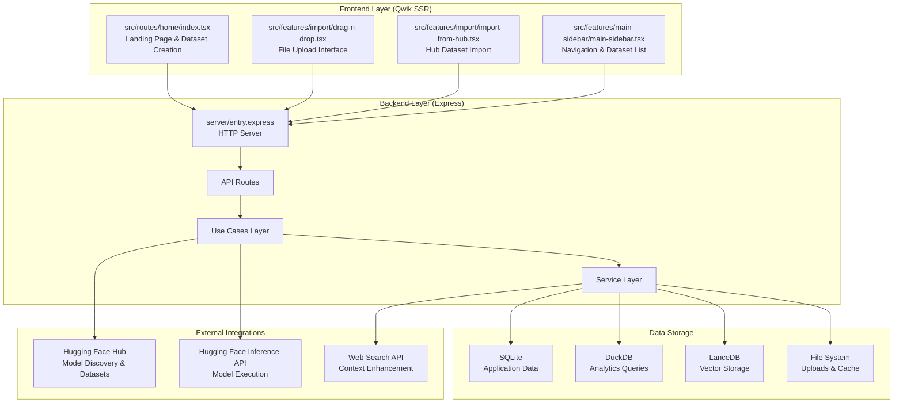
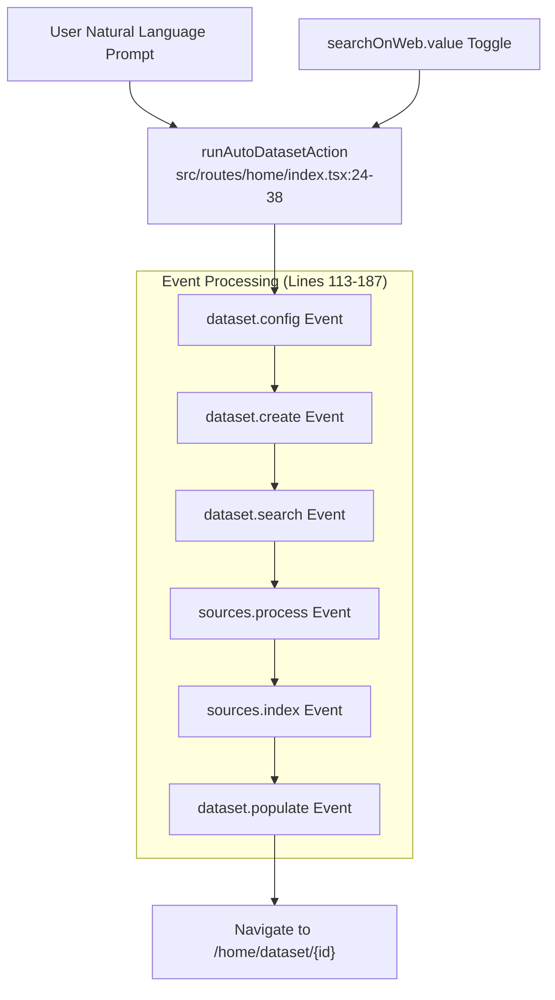
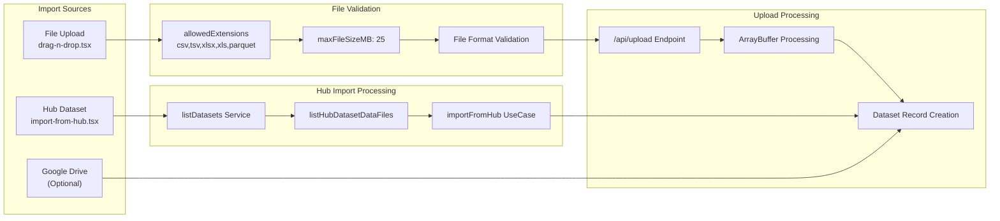
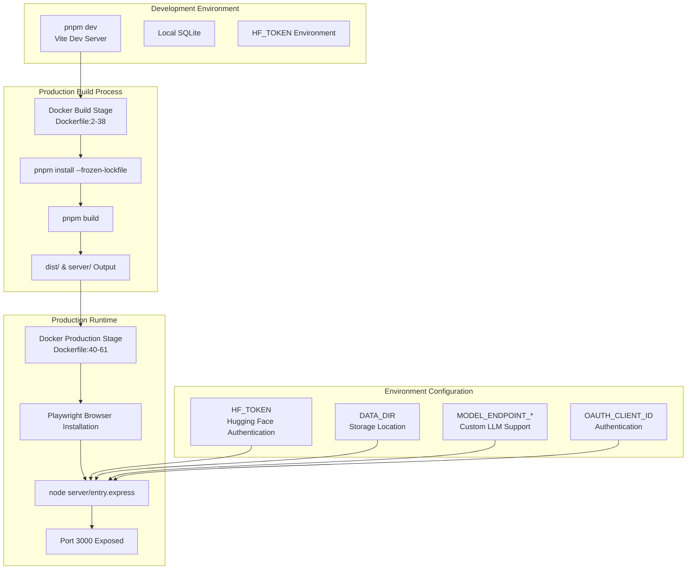
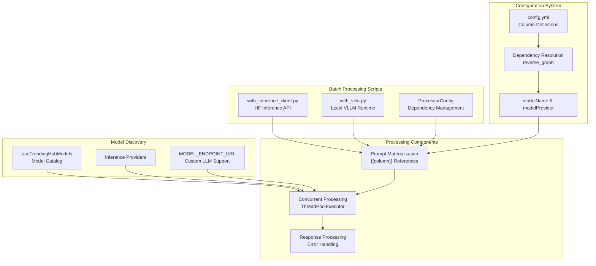

<!-- source: DeepWiki mcp.deepwiki.com · repo huggingface/aisheets · page 1 Overview · fetched 2026-10-26 -->

# Overview

Relevant source files

The following files were used as context for generating this wiki page:

- [Dockerfile](Dockerfile)
- [README.md](README.md)
- [package.json](package.json)
- [pnpm-lock.yaml](pnpm-lock.yaml)
- [public/dnd-background.svg](public/dnd-background.svg)
- [scripts/extend_dataset/prompt.jailbreak_detector.config.yml](scripts/extend_dataset/prompt.jailbreak_detector.config.yml)
- [scripts/extend_dataset/topics_extraction.config.yml](scripts/extend_dataset/topics_extraction.config.yml)
- [scripts/extend_dataset/with_inference_client.py](scripts/extend_dataset/with_inference_client.py)
- [scripts/extend_dataset/with_vllm.py](scripts/extend_dataset/with_vllm.py)
- [src/features/import/drag-n-drop.tsx](src/features/import/drag-n-drop.tsx)
- [src/features/import/import-from-hub.tsx](src/features/import/import-from-hub.tsx)
- [src/features/main-sidebar/main-sidebar.tsx](src/features/main-sidebar/main-sidebar.tsx)
- [src/routes/home/index.tsx](src/routes/home/index.tsx)

## Purpose and Scope

AI Sheets is a no-code platform for building, enriching, and transforming datasets using AI models with web search enhancement. This document provides a technical overview of the system architecture, core components, and data processing workflows. The platform enables users to create structured datasets from natural language descriptions, import existing datasets, and enhance them using hundreds of AI models from the Hugging Face ecosystem.

For detailed information about specific subsystems, see [Dataset Management](#3.1), [Table Interface](#3.2), [AI Integration](#3.3), and [Data Storage](#3.4).

## System Architecture Overview

AI Sheets follows a modern web application architecture with a Qwik-based frontend, Express backend, and multi-database storage strategy. The system integrates deeply with the Hugging Face ecosystem for model discovery and inference.

### High-Level System Architecture

Sources: [src/routes/home/index.tsx:1-494](), [src/features/import/drag-n-drop.tsx:1-259](), [src/features/import/import-from-hub.tsx:1-350](), [src/features/main-sidebar/main-sidebar.tsx:1-185](), [package.json:70-94](), [Dockerfile:1-61]()

## Core Dataset Creation Workflow

The primary user workflow involves creating datasets through natural language prompts, which triggers an automated pipeline for schema generation, web search, and AI-powered content creation.

### Dataset Creation Pipeline

Sources: [src/routes/home/index.tsx:24-200]()

## Data Import and Processing Systems

AI Sheets supports multiple data ingestion methods, each handling different file formats and sources with validation and transformation pipelines.

### Import Methods and File Processing

Sources: [src/features/import/drag-n-drop.tsx:33-84](), [src/features/import/import-from-hub.tsx:25-136]()

## Technology Stack and Dependencies

The system leverages a modern JavaScript/TypeScript stack with specialized databases and AI/ML libraries for comprehensive dataset processing capabilities.

### Core Dependencies

| Category | Technology | Purpose | Package Reference |
|----------|------------|---------|-------------------|
| **Frontend Framework** | Qwik 1.14.1 | SSR Web Framework | `@builder.io/qwik` |
| **Backend Runtime** | Express 4.20.0 | HTTP Server | `express` |
| **Application Database** | SQLite 3 | Structured Data Storage | `sqlite3`, `sequelize` |
| **Analytics Database** | DuckDB | Query Processing | `@duckdb/node-api` |
| **Vector Database** | LanceDB | Embeddings & Search | `@lancedb/lancedb` |
| **AI/ML Integration** | Hugging Face Suite | Model Access & Inference | `@huggingface/hub`, `@huggingface/inference` |
| **Web Automation** | Playwright | Content Extraction | `playwright` |
| **Content Processing** | Marked | Markdown Processing | `marked` |

Sources: [package.json:70-94]()

## Deployment and Infrastructure

AI Sheets supports multiple deployment strategies with containerized production builds and development environments optimized for AI workloads.

### Deployment Architecture

Sources: [Dockerfile:1-61](), [package.json:14-34](), [README.md:92-189]()

## AI Model Integration and Processing

The system provides extensive AI model integration capabilities with support for custom inference endpoints and batch processing workflows for large-scale dataset enhancement.

### Model Processing Pipeline

Sources: [scripts/extend_dataset/with_inference_client.py:1-492](), [scripts/extend_dataset/with_vllm.py:1-339](), [scripts/extend_dataset/topics_extraction.config.yml:1-31]()

## Data Storage Architecture

AI Sheets implements a multi-database strategy optimized for different data access patterns, from transactional operations to analytics and vector similarity search.

### Database Integration Layer

```mermaid
graph TB
    subgraph "Application Data (SQLite)"
        UserSessions["User Sessions"]
        DatasetMetadata["Dataset Metadata"]
        ColumnDefinitions["Column Definitions"]
        ProcessTracking["Process Status"]
    end
    
    subgraph "Analytics Data (DuckDB)"
        DataProcessing["Data Processing Queries"]
        AggregationOps["Aggregation Operations"]
        ColumnAnalysis["Column Analysis"]
    end
    
    subgraph "Vector Data (LanceDB)"
        TextEmbeddings["Text Embeddings"]
        SourceIndexing["Source Document Index"]
        SimilaritySearch["Vector Similarity Queries"]
    end
    
    subgraph "File System Storage"
        UploadedFiles["Uploaded Dataset Files"]
        CacheData["Processing Cache"]
        TempFiles["Temporary Files"]
    end
    
    subgraph "Service Layer Access"
        SequelizeORM["Sequelize ORM<br/>SQLite Operations"]
        DuckDBAPI["@duckdb/node-api<br/>Analytics Queries"]
        LanceDBClient["@lancedb/lancedb<br/>Vector Operations"]
        FileOperations["Node.js fs Module"]
    end
    
    UserSessions --> SequelizeORM
    DatasetMetadata --> SequelizeORM
    ColumnDefinitions --> SequelizeORM
    ProcessTracking --> SequelizeORM
    
    DataProcessing --> DuckDBAPI
    AggregationOps --> DuckDBAPI
    ColumnAnalysis --> DuckDBAPI
    
    TextEmbeddings --> LanceDBClient
    SourceIndexing --> LanceDBClient
    SimilaritySearch --> LanceDBClient
    
    UploadedFiles --> FileOperations
    CacheData --> FileOperations
    TempFiles --> FileOperations
```

Sources: [package.json:71-77](), [package.json:91-92]()

---

