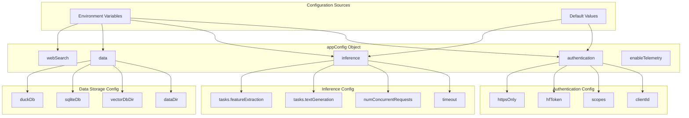
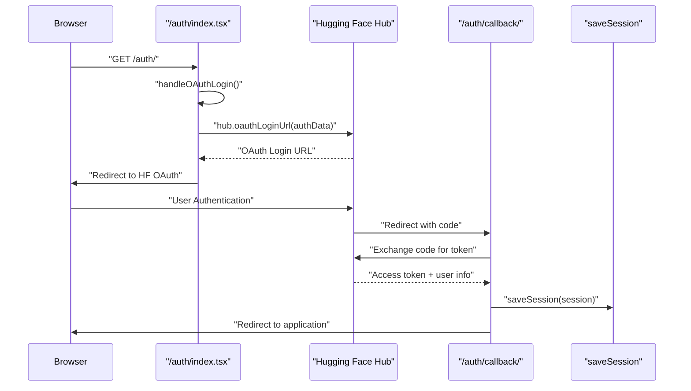
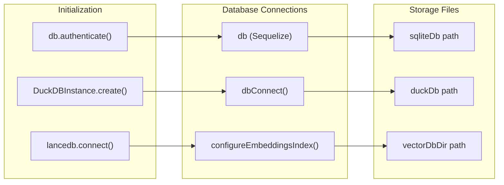
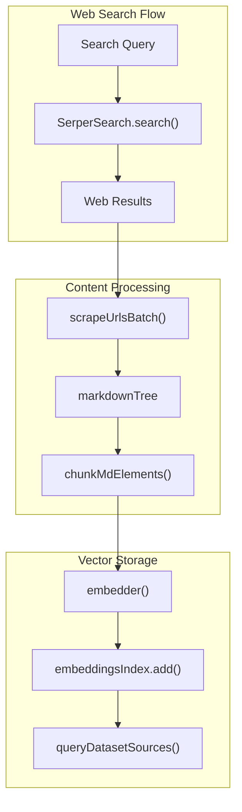

<!-- source: DeepWiki mcp.deepwiki.com · repo huggingface/aisheets · page 2 Getting Started · fetched 2026-10-26 -->

# Getting Started

<details>
<summary>Relevant source files</summary>

The following files were used as context for generating this wiki page:

- [CUSTOMIZATION.md](CUSTOMIZATION.md)
- [Dockerfile](Dockerfile)
- [package.json](package.json)
- [pnpm-lock.yaml](pnpm-lock.yaml)
- [src/config.ts](src/config.ts)
- [src/routes/api/upload/index.ts](src/routes/api/upload/index.ts)
- [src/routes/auth/index.tsx](src/routes/auth/index.tsx)
- [src/services/db/db.ts](src/services/db/db.ts)
- [src/services/db/duckdb.ts](src/services/db/duckdb.ts)
- [src/services/websearch/embed/engine.ts](src/services/websearch/embed/engine.ts)
- [src/services/websearch/search-sources.ts](src/services/websearch/search-sources.ts)

</details>


This document covers installation, configuration, and initial setup for AI Sheets. It provides step-by-step instructions for deploying the application locally or with Docker, configuring authentication, and customizing AI model endpoints.

For detailed information about the core functional systems, see [Core Systems](#3). For UI component documentation, see [UI Components](#5).

## System Requirements

AI Sheets requires Node.js 18.17.0 or higher and uses several key technologies:

| Component | Purpose | Storage Location |
|-----------|---------|------------------|
| SQLite | Application data | `DATA_DIR/.sqlite3` |
| DuckDB | Analytics queries | `DATA_DIR/duckdb` |
| LanceDB | Vector embeddings | `DATA_DIR/embeddings` |
| File System | Uploads and temp files | `DATA_DIR/uploads` |

The system supports multiple AI inference providers and can be configured with custom LLM endpoints that follow the OpenAI API specification.

**Sources:** [package.json:4-6](), [src/config.ts:35](), [src/config.ts:282-287]()

## Installation Methods

### Local Development Setup

Install dependencies and start the development server:

```bash
# Install dependencies with pnpm
pnpm install

# Start development server with SSR
pnpm dev

# Alternative: start with browser opening
pnpm start
```

The application will be available at `http://localhost:5173` in development mode.

**Sources:** [package.json:22](), [package.json:30]()

### Docker Deployment

Build and run the application using the provided Dockerfile:

```bash
# Build the Docker image
docker build -t ai-sheets .

# Run the container
docker run -p 3000:3000 -v $(pwd)/data:/usr/src/app/data ai-sheets
```

The Docker build process uses a multi-stage approach with Debian-based Node.js images and includes Playwright for web scraping capabilities.

**Sources:** [Dockerfile:1-61]()

## Configuration Architecture

The application configuration is centralized in the `appConfig` object, which consolidates environment variables and defaults:



**Sources:** [src/config.ts:247-295]()

## Authentication Setup

AI Sheets supports two authentication methods through the `appConfig.authentication` configuration:

### OAuth Flow (Recommended)

Set up OAuth authentication with Hugging Face:

```bash
export OAUTH_CLIENT_ID="your_client_id"
export OAUTH_SCOPES="openid profile inference-api manage-repos"
export OAUTH_HTTPS_ONLY="true"  # Set to false for local development
```

The OAuth flow is handled by the `/auth/` route handlers:



**Sources:** [src/routes/auth/index.tsx:20-58](), [src/config.ts:248-253]()

### HF Token Authentication

For development or automated setups, use a Hugging Face token directly:

```bash
export HF_TOKEN="your_huggingface_token"
```

The token authentication bypasses OAuth and directly validates the token with Hugging Face's `whoAmI` API.

**Sources:** [src/routes/auth/index.tsx:60-86](), [src/config.ts:8]()

## Database Initialization

AI Sheets automatically initializes its multi-database architecture on startup:



The databases serve different purposes:
- **SQLite** (`db`): Application data models via Sequelize ORM
- **DuckDB** (`dbConnect`): Analytics and large dataset operations  
- **LanceDB** (`embeddingsIndex`): Vector storage for semantic search

**Sources:** [src/services/db/db.ts:11-24](), [src/services/db/duckdb.ts:8-40](), [src/services/websearch/embed/engine.ts:71-108]()

## AI Model Configuration

### Default Inference Setup

The default configuration uses Hugging Face Inference API with these settings:

```bash
export DEFAULT_MODEL="meta-llama/Llama-3.3-70B-Instruct"
export DEFAULT_MODEL_PROVIDER="nebius"
export NUM_CONCURRENT_REQUESTS="5"  # Max 10
export INFERENCE_TIMEOUT="90000"  # 90 seconds
```

**Sources:** [src/config.ts:66-74](), [src/config.ts:54-60](), [src/config.ts:45]()

### Custom LLM Endpoints

To use custom LLM endpoints (e.g., Ollama, custom OpenAI-compatible servers):

```bash
export MODEL_ENDPOINT_URL="http://localhost:11434"
export MODEL_ENDPOINT_NAME="llama3"
```

When these variables are set, the application routes text generation requests to your custom endpoint instead of the default Hugging Face providers. The endpoint must implement the OpenAI API specification.

**Example Ollama Setup:**

```bash
# Start Ollama server
export OLLAMA_NOHISTORY=1
ollama serve

# Run your model
ollama run llama3

# Configure AI Sheets
export MODEL_ENDPOINT_URL="http://localhost:11434" 
export MODEL_ENDPOINT_NAME="llama3"

# Start AI Sheets
pnpm serve
```

**Sources:** [CUSTOMIZATION.md:9-23](), [src/config.ts:90-100]()

## Web Search Integration

Enable web search capabilities for AI-enhanced data enrichment:

```bash
export SERPER_API_KEY="your_serper_api_key"
export BLOCKED_URLS="youtube.com,x.com,bloomberg.com,nytimes.com"
```

The web search system integrates with the vector embedding pipeline to provide context for AI generation:



**Sources:** [src/config.ts:184](), [src/config.ts:191-193](), [src/services/websearch/search-sources.ts:177-224]()

## Environment Configuration File

Create a `.env` file in the project root with your configuration:

```bash
# Authentication (choose one)
OAUTH_CLIENT_ID=your_oauth_client_id
# OR
HF_TOKEN=your_hugging_face_token

# Data Directory
DATA_DIR=./data

# AI Models (optional - uses defaults if not set)
DEFAULT_MODEL=meta-llama/Llama-3.3-70B-Instruct
DEFAULT_MODEL_PROVIDER=nebius

# Custom LLM (optional)
MODEL_ENDPOINT_URL=http://localhost:11434
MODEL_ENDPOINT_NAME=llama3

# Web Search (optional)
SERPER_API_KEY=your_serper_api_key

# Performance Tuning (optional)
NUM_CONCURRENT_REQUESTS=5
INFERENCE_TIMEOUT=90000
```

**Sources:** [src/config.ts:8-295]()

## Verification and First Run

After configuration, verify the setup:

1. **Start the application** using your chosen method (local or Docker)
2. **Access the interface** at `http://localhost:5173` (dev) or `http://localhost:3000` (production)
3. **Complete authentication** through the `/auth/` endpoint
4. **Check database initialization** in the console logs for successful connections
5. **Test file upload** functionality via the `/api/upload/` endpoint

The application creates the necessary directories and database files automatically on first run based on your `DATA_DIR` configuration.

**Sources:** [package.json:22](), [package.json:29](), [src/routes/api/upload/index.ts:11-36]()

---

