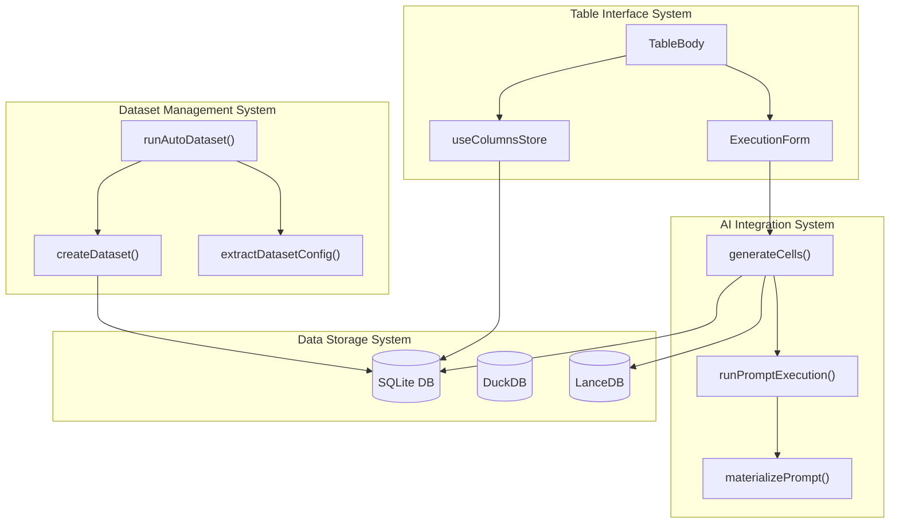
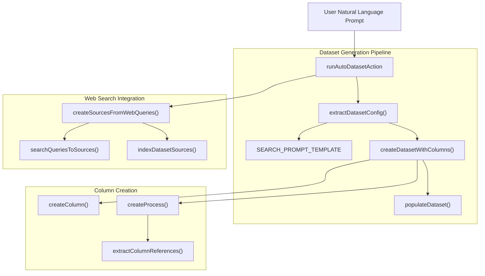
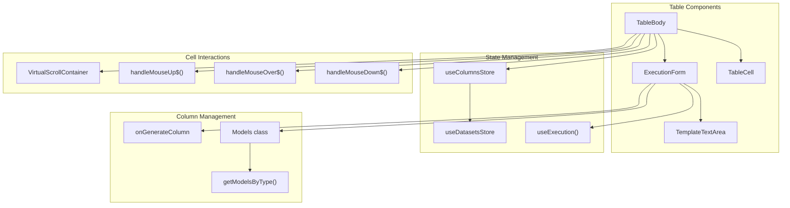
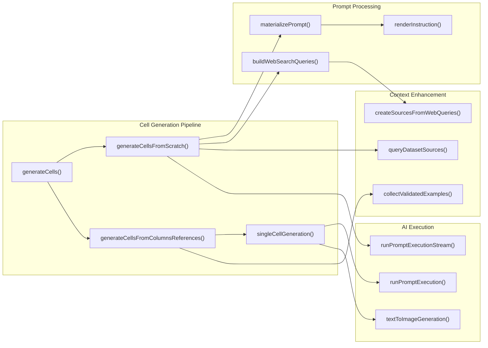
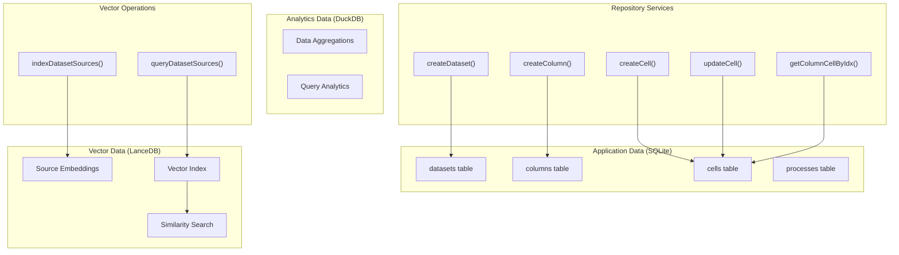
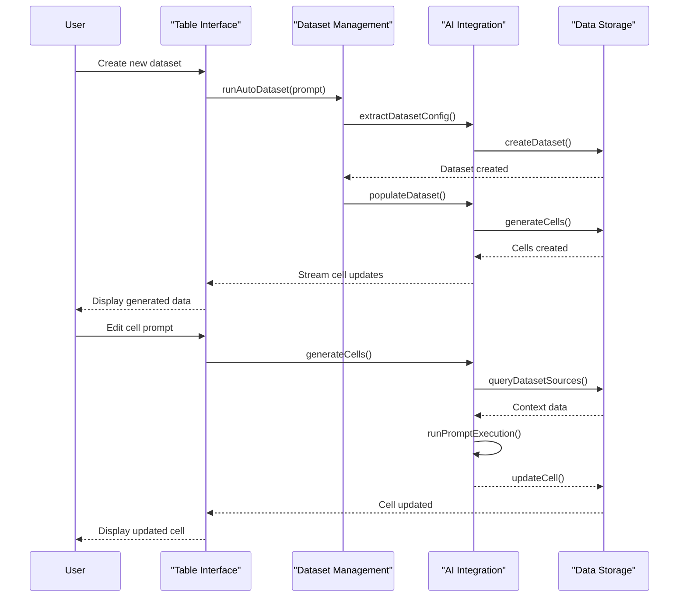

<!-- source: DeepWiki mcp.deepwiki.com · repo huggingface/aisheets · page 3 Core Systems · fetched 2026-10-26 -->

# Core Systems

Relevant source files

The following files were used as context for generating this wiki page:

- [src/features/add-column/components/template-textarea.tsx](src/features/add-column/components/template-textarea.tsx)
- [src/features/add-column/form/execution-form.tsx](src/features/add-column/form/execution-form.tsx)
- [src/features/table/table-body.tsx](src/features/table/table-body.tsx)
- [src/services/inference/run-prompt-execution.ts](src/services/inference/run-prompt-execution.ts)
- [src/services/repository/hub/telemetry.ts](src/services/repository/hub/telemetry.ts)
- [src/usecases/generate-cells.ts](src/usecases/generate-cells.ts)
- [src/usecases/run-autodataset.ts](src/usecases/run-autodataset.ts)

This document provides an overview of the four primary functional systems that make up AI Sheets: Dataset Management, Table Interface, AI Integration, and Data Storage. These systems work together to enable no-code AI-powered dataset creation and enrichment.

For detailed information about specific aspects of these systems, see [Dataset Management](#3.1), [Table Interface](#3.2), [AI Integration](#3.3), and [Data Storage](#3.4). For implementation details of the frontend and backend architecture, see [Frontend Architecture](#4.1) and [Backend Architecture](#4.2).

## System Overview

AI Sheets is built around four interconnected core systems that handle different aspects of the platform's functionality.

Sources: [src/usecases/run-autodataset.ts:1-684](), [src/features/table/table-body.tsx:1-470](), [src/features/add-column/form/execution-form.tsx:1-565](), [src/usecases/generate-cells.ts:1-711]()

## Dataset Management System

The Dataset Management system handles the creation, import, and export of datasets. It includes AI-powered dataset generation from natural language prompts.

The system uses structured prompts to extract dataset configuration from user instructions. The `SEARCH_PROMPT_TEMPLATE` and `NO_SEARCH_PROMPT_TEMPLATE` constants define the format for AI responses, ensuring consistent parsing of dataset names, columns, and search queries.

**Key Components:**
- `runAutoDataset()` - Main orchestrator function that processes user prompts into datasets
- `extractDatasetConfig()` - Parses LLM responses into structured dataset configurations  
- `createDatasetWithColumns()` - Creates database records for datasets and their columns
- `extractColumnReferences()` - Identifies column dependencies using `{{column_name}}` syntax

Sources: [src/usecases/run-autodataset.ts:46-683](), [src/usecases/run-autodataset.ts:188-234](), [src/usecases/run-autodataset.ts:340-416](), [src/usecases/run-autodataset.ts:421-437]()

## Table Interface System

The Table Interface system provides an interactive spreadsheet-like interface for viewing and editing datasets. It handles cell rendering, column management, and user interactions.

The interface supports virtual scrolling for large datasets and provides drag-to-generate functionality where users can select cell ranges for batch AI generation.

**Key Components:**
- `TableBody` - Main table component with virtual scrolling and cell interaction handlers
- `ExecutionForm` - Configuration panel for AI model selection and prompt editing  
- `TemplateTextArea` - Prompt editor with variable substitution using `{{column_name}}` syntax
- `Models` class - Manages available AI models and filters by supported types (text/image)

Sources: [src/features/table/table-body.tsx:36-442](), [src/features/add-column/form/execution-form.tsx:72-564](), [src/features/add-column/components/template-textarea.tsx:30-257](), [src/features/add-column/form/execution-form.tsx:51-70]()

## AI Integration System

The AI Integration system orchestrates the generation of cell content using various AI models and providers. It handles prompt materialization, context enhancement, and streaming responses.

The system supports two generation modes: generating cells from scratch using prompts, and generating cells based on references to other columns. It includes web search integration and streaming responses for real-time updates.

**Key Components:**
- `generateCells()` - Main generator function that yields cell updates as they're processed
- `materializePrompt()` - Replaces template variables with actual data values
- `buildWebSearchQueries()` - Creates search queries from prompts for context enhancement
- `runPromptExecution()` and `runPromptExecutionStream()` - Execute AI inference with caching

Sources: [src/usecases/generate-cells.ts:72-132](), [src/usecases/generate-cells.ts:533-613](), [src/services/inference/run-prompt-execution.ts:43-108](), [src/services/inference/run-prompt-execution.ts:110-179]()

## Data Storage System

The Data Storage system uses a multi-database architecture to handle different types of data efficiently. Each database serves a specific purpose in the overall system.

**Database Responsibilities:**

| Database | Purpose | Key Operations |
|----------|---------|----------------|
| SQLite | Application state, user data | `createDataset()`, `createColumn()`, `updateCell()` |
| DuckDB | Analytics queries, aggregations | Data analysis, reporting |
| LanceDB | Vector embeddings, similarity search | `indexDatasetSources()`, `queryDatasetSources()` |

The storage layer provides repository services that abstract database operations and handle data consistency across the three database systems.

Sources: [src/services/repository/cells:21-24](), [src/services/websearch/embed:26-27](), [src/usecases/generate-cells.ts:198-207](), [src/usecases/generate-cells.ts:658-667]()

## System Interactions

The four core systems work together through well-defined interfaces and shared state management:

The systems communicate through:
- **Event streaming** for real-time updates during AI generation
- **State stores** (`useColumnsStore`, `useDatasetsStore`) for reactive UI updates  
- **Repository pattern** for consistent data access across storage systems
- **Generator functions** for handling long-running AI operations with progress updates

Sources: [src/state:40-42](), [src/features/add-column/form/execution.ts:33](), [src/usecases/generate-cells.ts:72-132](), [src/usecases/run-autodataset.ts:594-683]()

---

