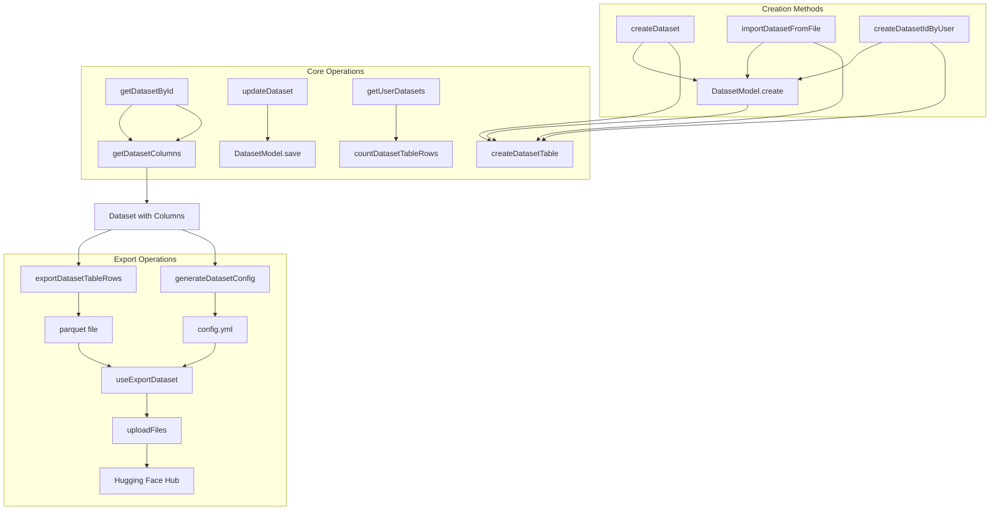
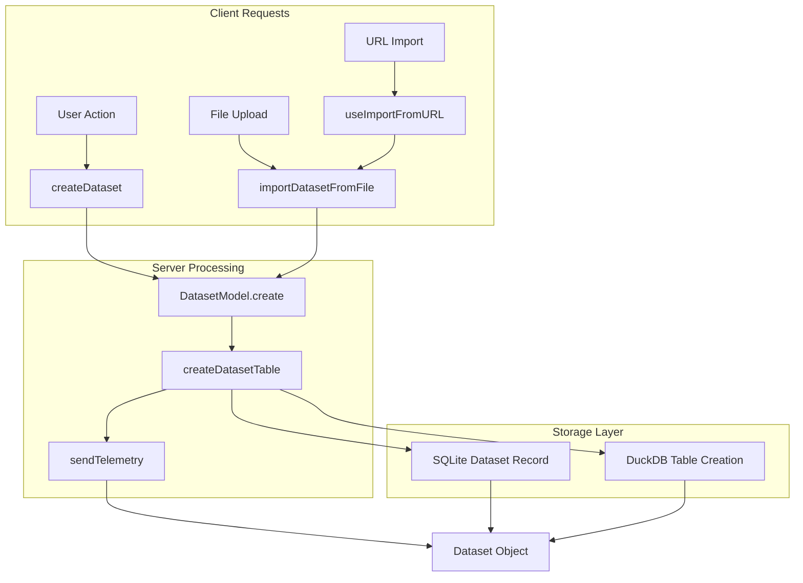
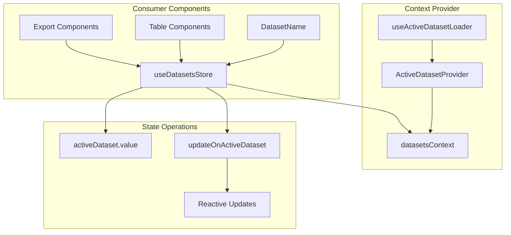
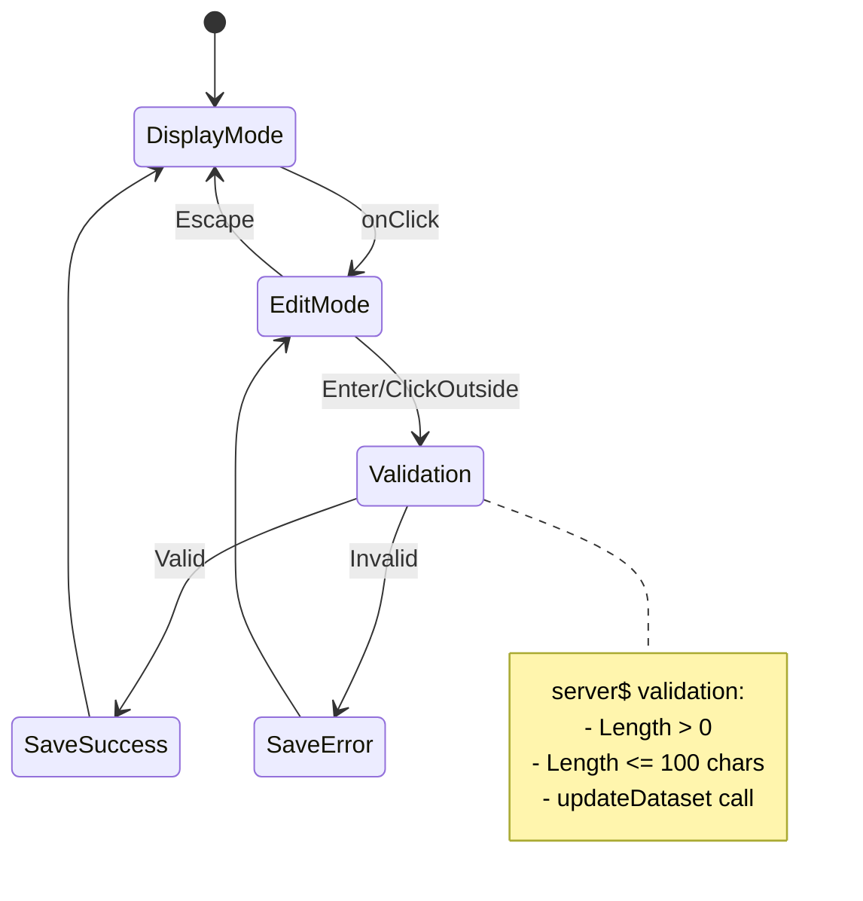
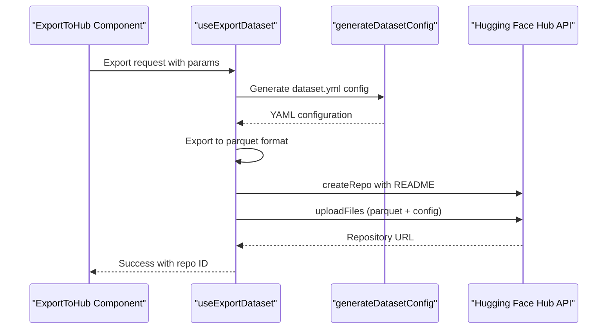
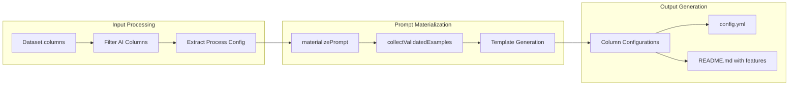
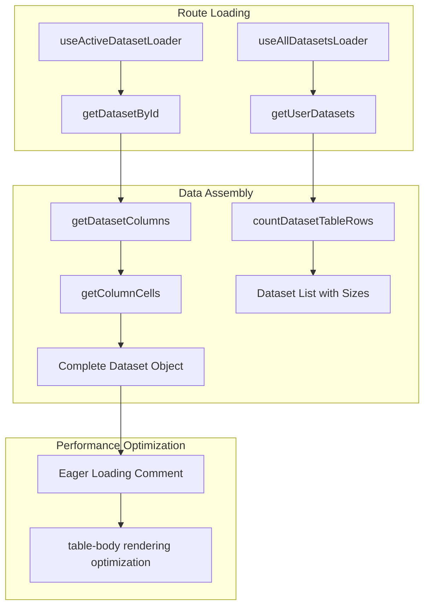
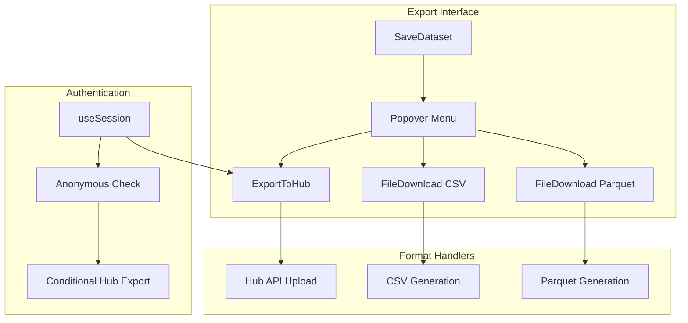

<!-- source: DeepWiki mcp.deepwiki.com · repo huggingface/aisheets · page 3.1 Dataset Management · fetched 2026-10-26 -->

# Dataset Management

Relevant source files

The following files were used as context for generating this wiki page:

- [.gitignore](.gitignore)
- [src/features/datasets/dataset-name.tsx](src/features/datasets/dataset-name.tsx)
- [src/features/export/export-to-hub.tsx](src/features/export/export-to-hub.tsx)
- [src/features/export/save-dataset.tsx](src/features/export/save-dataset.tsx)
- [src/loaders/dataset.ts](src/loaders/dataset.ts)
- [src/routes/home/dataset/[id]/json/index.tsx](src/routes/home/dataset/[id]/json/index.tsx)
- [src/routes/home/dataset/[id]/json/utils.ts](src/routes/home/dataset/[id]/json/utils.ts)
- [src/services/repository/datasets.ts](src/services/repository/datasets.ts)
- [src/state/datasets.tsx](src/state/datasets.tsx)
- [src/usecases/create-dataset-config.ts](src/usecases/create-dataset-config.ts)
- [src/usecases/export-to-hub.usecase.ts](src/usecases/export-to-hub.usecase.ts)
- [src/usecases/import-from-url.usecase.ts](src/usecases/import-from-url.usecase.ts)

This document covers the comprehensive dataset management system in AI Sheets, including creation, import, export, and storage operations. The dataset management layer serves as the foundation for all data operations within the platform, providing CRUD operations, file imports, and integration with external data sources including Hugging Face Hub.

For information about the table interface and user interactions with dataset contents, see [Table Interface](#3.2). For details about the underlying data storage architecture, see [Data Storage](#3.4).

## Dataset Lifecycle Overview

The dataset management system handles the complete lifecycle from creation through deletion, supporting multiple creation methods and export formats.

**Sources:** [src/services/repository/datasets.ts:18-145](), [src/usecases/export-to-hub.usecase.ts:21-83]()

## Dataset Creation

### Basic Dataset Creation

The system provides multiple pathways for dataset creation, each serving different use cases and data sources.

**Sources:** [src/services/repository/datasets.ts:115-145](), [src/usecases/import-from-url.usecase.ts:6-34]()

The `createDataset` function in [src/services/repository/datasets.ts:115-145]() handles basic dataset creation with name validation and automatic table creation. The system enforces a 100-character limit on dataset names and ensures proper cleanup on creation failure.

### File-Based Import

The `importDatasetFromFile` function supports multiple file formats and external data sources:

| Format | Support | Limitations |
|--------|---------|-------------|
| CSV | Full | Row limit configurable |
| Parquet | Full | Native DuckDB support |
| JSON | Full | Automatic schema detection |
| Google Sheets | Partial | Requires secret token |

**Sources:** [src/services/repository/datasets.ts:58-113](), [src/usecases/import-from-url.usecase.ts:21-34]()

## Dataset State Management

### Active Dataset Context

The dataset state management uses Qwik's context system to provide reactive access to the currently active dataset across components.

**Sources:** [src/state/datasets.tsx:25-41](), [src/loaders/dataset.ts:13-28]()

The `useDatasetsStore` hook provides access to the active dataset and update functions. The `updateOnActiveDataset` function enables reactive updates across the application when dataset properties change.

## Dataset Name Management

### Inline Editing System

The dataset name editing system provides a seamless user experience with validation and error handling.

**Sources:** [src/features/datasets/dataset-name.tsx:29-59](), [src/features/datasets/dataset-name.tsx:88-100]()

The `DatasetName` component implements real-time validation with server-side enforcement through the `updateDataset` repository function.

## Export System

### Hugging Face Hub Integration

The export system provides seamless integration with Hugging Face Hub for dataset publishing and sharing.

**Sources:** [src/usecases/export-to-hub.usecase.ts:21-83](), [src/features/export/export-to-hub.tsx:45-63]()

The export process generates comprehensive metadata including dataset configuration, feature information, and structured README files that comply with Hugging Face dataset standards.

### Configuration Generation

The `generateDatasetConfig` function creates detailed metadata for exported datasets:

**Sources:** [src/usecases/create-dataset-config.ts:6-49](), [src/usecases/export-to-hub.usecase.ts:85-136]()

## Data Retrieval and Loading

### Dataset Loading Pipeline

The system implements efficient dataset loading with eager column and cell loading for optimal performance.

**Sources:** [src/services/repository/datasets.ts:147-177](), [src/loaders/dataset.ts:13-36]()

The comment in [src/services/repository/datasets.ts:165-167]() indicates performance optimization through eager loading to prevent rendering issues in the table-body component.

## File Export Options

### Multiple Format Support

The system supports various export formats through a unified interface:

**Sources:** [src/features/export/save-dataset.tsx:12-47]()

The export system conditionally displays Hugging Face Hub export options based on user authentication status, while file downloads are always available.

## Database Integration

### Multi-Database Architecture

The dataset management system coordinates between multiple database systems for different purposes:

| Database | Purpose | Operations |
|----------|---------|------------|
| SQLite | Dataset metadata | `DatasetModel.create`, `findByPk` |
| DuckDB | Table data storage | `createDatasetTable`, `exportDatasetTableRows` |
| LanceDB | Vector embeddings | Source indexing, similarity search |

**Sources:** [src/services/repository/datasets.ts:26-28](), [src/services/repository/tables.ts]()

The `createDatasetTable` function bridges SQLite metadata with DuckDB table creation, while the export functions generate Parquet files directly from DuckDB queries for optimal performance.

---

