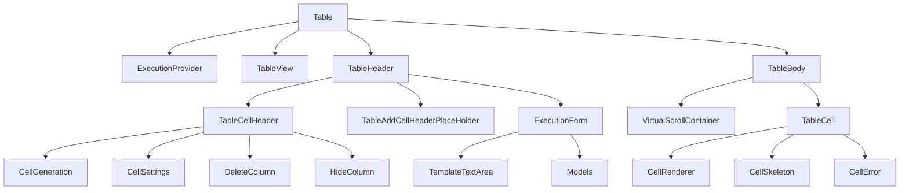
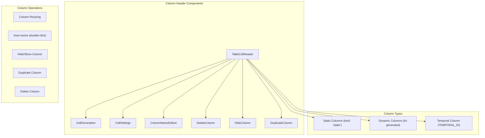
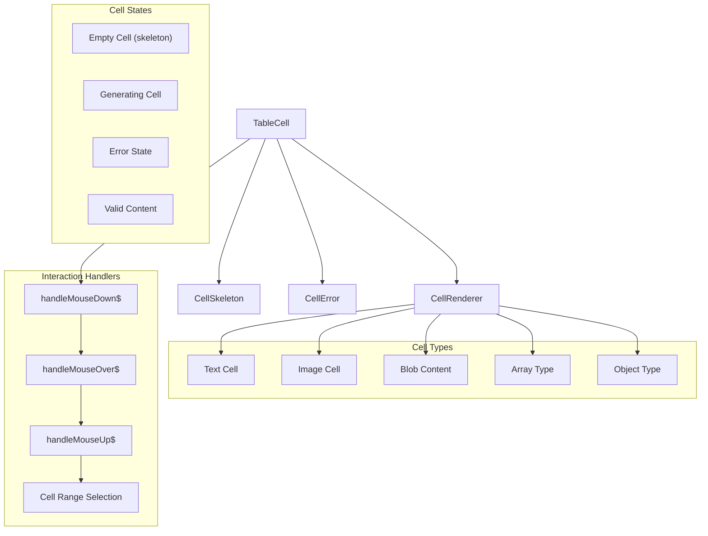
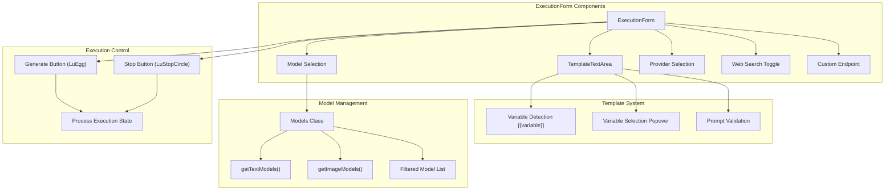
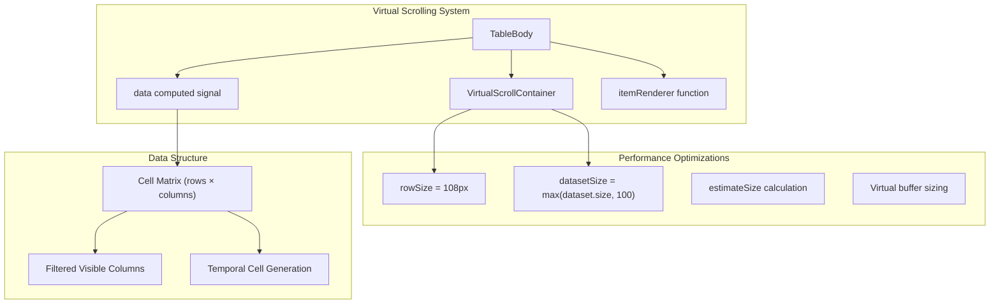
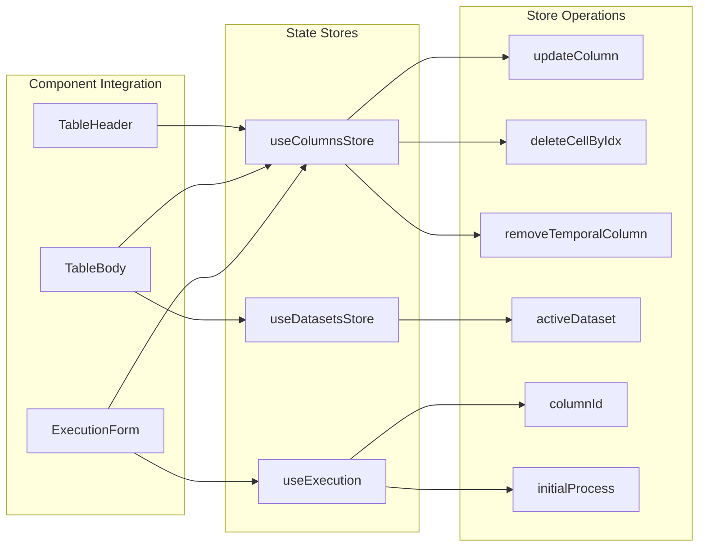

<!-- source: DeepWiki mcp.deepwiki.com · repo huggingface/aisheets · page 3.2 Table Interface · fetched 2026-10-26 -->

# Table Interface

Relevant source files

The following files were used as context for generating this wiki page:

- [src/features/add-column/components/template-textarea.tsx](src/features/add-column/components/template-textarea.tsx)
- [src/features/add-column/form/execution-form.tsx](src/features/add-column/form/execution-form.tsx)
- [src/features/table/components/header/cell-header.tsx](src/features/table/components/header/cell-header.tsx)
- [src/features/table/table-body.tsx](src/features/table/table-body.tsx)
- [src/features/table/table-cell.tsx](src/features/table/table-cell.tsx)
- [src/features/table/table-header.tsx](src/features/table/table-header.tsx)
- [src/features/table/table-view.tsx](src/features/table/table-view.tsx)
- [src/features/table/table.tsx](src/features/table/table.tsx)
- [src/features/user/username.tsx](src/features/user/username.tsx)

The Table Interface is the primary interactive component for displaying and manipulating datasets in AI Sheets. It provides a spreadsheet-like interface with dynamic column generation, AI-powered cell population, virtual scrolling for performance, and comprehensive user interaction capabilities. For information about dataset creation and management, see [Dataset Management](#3.1). For details about column-specific operations, see [Column Management](#3.2.1).

## System Architecture

The Table Interface is built as a hierarchical component system with clear separation of concerns between layout, data presentation, and user interactions.

**Sources:** [src/features/table/table.tsx:1-22](), [src/features/table/table-header.tsx:1-279](), [src/features/table/table-body.tsx:1-469](), [src/features/table/table-cell.tsx:1-21]()

## Main Table Component Structure

The root `Table` component establishes the layout and provides context for all child components through the `ExecutionProvider`.

| Component | Purpose | Key Features |
|-----------|---------|--------------|
| `Table` | Root container | Provides execution context, layout structure |
| `TableView` | Column visibility controls | Toggle column visibility, multi-column management |
| `TableHeader` | Column headers and controls | Column titles, resizing, execution forms |
| `TableBody` | Data rows and cells | Virtual scrolling, cell interactions, row selection |

The table uses CSS Grid for layout with virtual scrolling implemented through `VirtualScrollContainer`. The structure supports both static columns and dynamic AI-generated columns.

**Sources:** [src/features/table/table.tsx:7-22](), [src/features/table/table-view.tsx:7-35]()

## Column Management System

The table header manages column operations including creation, configuration, and deletion. Each column header contains multiple interactive elements.

The column header system supports resizable columns with a maximum width of 1000px. Auto-resize functionality measures text content to determine optimal column width.

**Sources:** [src/features/table/components/header/cell-header.tsx:20-91](), [src/features/table/table-header.tsx:34-101]()

## Cell Rendering Pipeline

Each cell in the table goes through a structured rendering pipeline that handles different data types, states, and user interactions.

Cells support drag selection for batch operations and AI generation across multiple rows. The rendering system handles temporal cells for skeleton display during data loading.

**Sources:** [src/features/table/table-cell.tsx:7-21](), [src/features/table/table-body.tsx:131-224]()

## Execution Form System

The Execution Form provides the interface for configuring AI-powered column generation. It appears as an expandable section within the table header when adding or editing columns.

The execution form supports variable substitution using `{{variable}}` syntax, allowing users to reference other columns in their prompts. The form maintains execution state and provides cancellation capabilities.

**Sources:** [src/features/add-column/form/execution-form.tsx:72-564](), [src/features/add-column/components/template-textarea.tsx:30-257]()

## Virtual Scrolling Implementation

The table body implements virtual scrolling for performance optimization when handling large datasets. The system renders only visible rows plus a buffer.

The virtual scrolling system creates a computed signal that generates a matrix of cells based on visible columns and dataset size. Temporal cells are created for empty positions to maintain consistent layout.

**Sources:** [src/features/table/table-body.tsx:47-84](), [src/features/table/table-body.tsx:249-441]()

## User Interaction Patterns

The table supports various user interaction patterns for data manipulation and selection.

| Interaction | Trigger | Behavior | Implementation |
|-------------|---------|----------|----------------|
| Cell Selection | Mouse down | Single cell selection | `handleMouseDown$` |
| Range Selection | Mouse drag | Multi-cell selection | `handleMouseOver$` + `handleMouseUp$` |
| Row Selection | Click row number | Single/multi-row selection | `handleSelectRow$` |
| Row Deletion | Right-click row | Context menu deletion | `handleDeleteClick$` |
| Column Resizing | Drag column border | Resize column width | `handleResizeStart` |
| Auto-resize | Double-click border | Auto-fit content | `autoResize` function |
| Batch Generation | Drag cell handle | Generate cells in range | `onGenerateColumn` |

The drag selection system supports scrolling during selection by detecting cursor position relative to viewport boundaries and automatically scrolling the table container.

**Sources:** [src/features/table/table-body.tsx:117-247](), [src/features/table/table-header.tsx:34-101]()

## State Management Integration

The Table Interface integrates with the application's state management system through several store hooks.

The table components maintain reactive connections to the state stores, automatically updating the UI when data changes occur. The execution system manages column generation state and process tracking.

**Sources:** [src/features/table/table-body.tsx:41-44](), [src/features/add-column/form/execution-form.tsx:75-77](), [src/features/table/table-header.tsx:22-22]()

---

