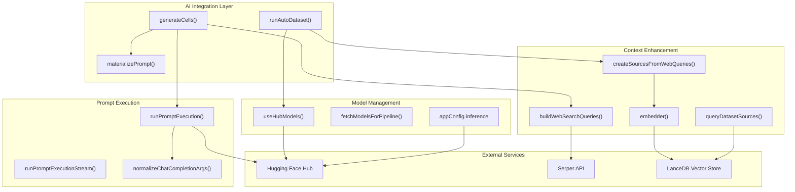
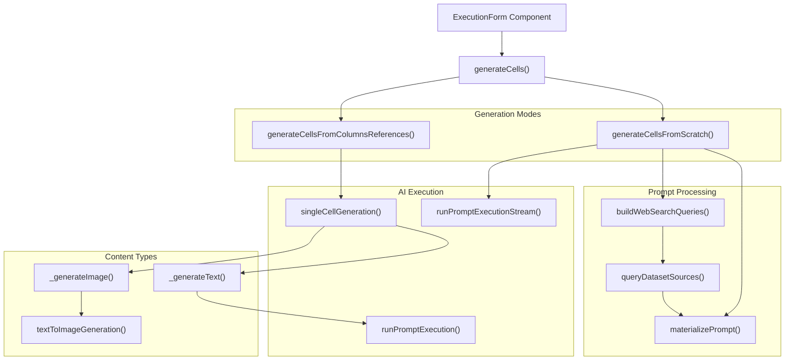
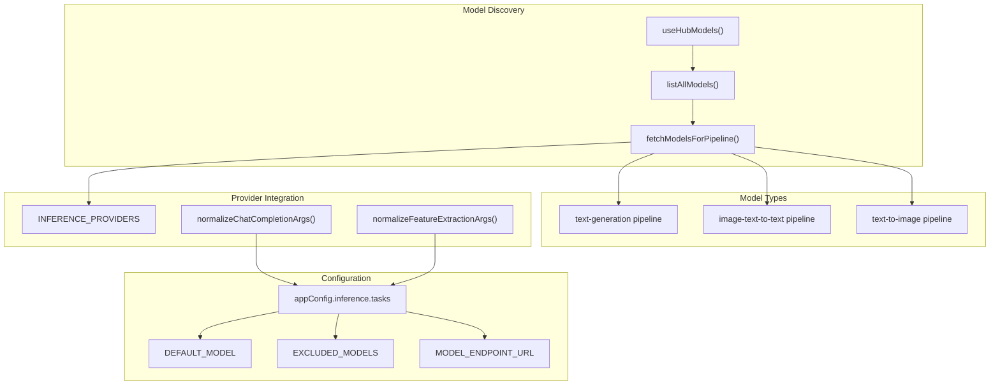
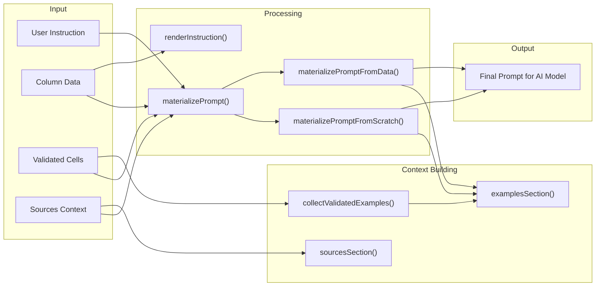
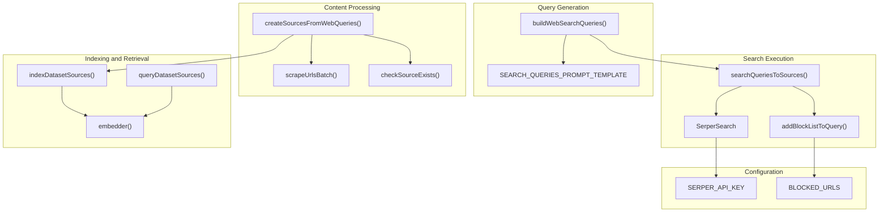
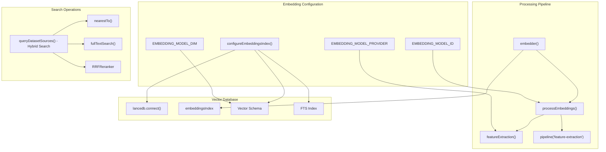
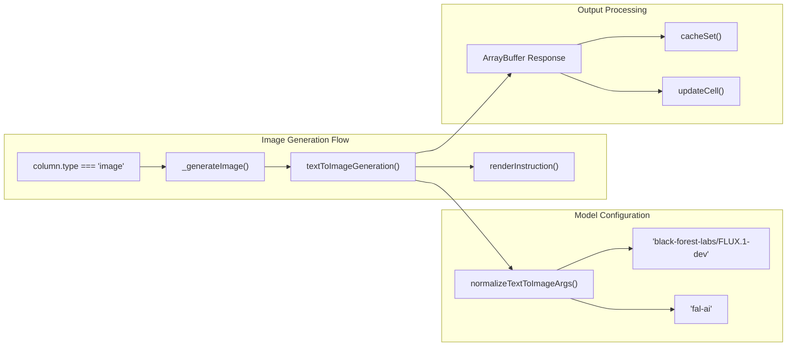
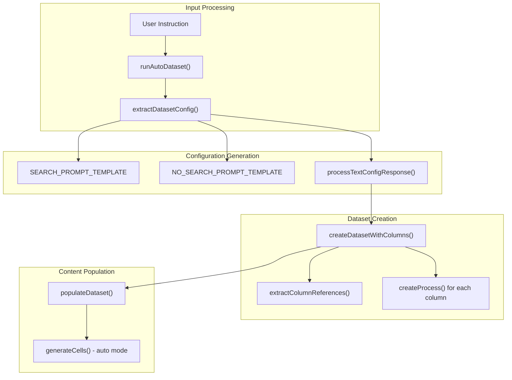

<!-- source: DeepWiki mcp.deepwiki.com · repo huggingface/aisheets · page 3.3 AI Integration · fetched 2026-10-26 -->

# AI Integration

<details>
<summary>Relevant source files</summary>

The following files were used as context for generating this wiki page:

- [src/config.ts](src/config.ts)
- [src/loaders/hub-models.ts](src/loaders/hub-models.ts)
- [src/services/inference/materialize-prompt.ts](src/services/inference/materialize-prompt.ts)
- [src/services/inference/run-prompt-execution.spec.tsx](src/services/inference/run-prompt-execution.spec.tsx)
- [src/services/inference/run-prompt-execution.ts](src/services/inference/run-prompt-execution.ts)
- [src/services/inference/text-to-image.ts](src/services/inference/text-to-image.ts)
- [src/services/repository/hub/telemetry.ts](src/services/repository/hub/telemetry.ts)
- [src/services/websearch/embed/engine.ts](src/services/websearch/embed/engine.ts)
- [src/services/websearch/search-sources.ts](src/services/websearch/search-sources.ts)
- [src/usecases/collect-examples.ts](src/usecases/collect-examples.ts)
- [src/usecases/generate-cells.ts](src/usecases/generate-cells.ts)
- [src/usecases/run-autodataset.ts](src/usecases/run-autodataset.ts)

</details>


This document covers the AI integration systems in AI Sheets, including model management, cell generation pipelines, prompt engineering, web search enhancement, and vector embeddings. For information about the table interface and user interactions, see [Table Interface](#3.2). For details about data storage and persistence, see [Data Storage](#3.4).

## Architecture Overview

AI Sheets integrates multiple AI systems to provide intelligent dataset creation and enrichment capabilities. The system supports both text and image generation through Hugging Face models, with context enhancement via web search and vector embeddings.

### Core AI Systems Architecture



Sources: [src/usecases/generate-cells.ts:1-711](), [src/usecases/run-autodataset.ts:1-683](), [src/services/inference/run-prompt-execution.ts:1-282](), [src/loaders/hub-models.ts:1-235]()

## Cell Generation Pipeline

The cell generation system is the core AI functionality that populates dataset cells with AI-generated content. The pipeline supports two main modes: generation from scratch and generation based on column references.

### Cell Generation Flow



Sources: [src/usecases/generate-cells.ts:72-132](), [src/usecases/generate-cells.ts:134-284](), [src/usecases/generate-cells.ts:447-498]()

### Generation Parameters

The `GenerateCellsParams` interface defines the configuration for cell generation:

| Parameter | Type | Description |
|-----------|------|-------------|
| `column` | `Column` | Target column for generation |
| `process` | `Process` | Contains model, prompt, and configuration |
| `session` | `Session` | Authentication and user context |
| `limit` | `number` | Maximum cells to generate |
| `offset` | `number` | Starting index for generation |
| `validatedCells` | `Cell[]` | Examples for prompt context |
| `stream` | `boolean` | Enable streaming responses |
| `updateOnly` | `boolean` | Only update existing cells |
| `timeout` | `number` | Generation timeout in milliseconds |

Sources: [src/usecases/generate-cells.ts:31-41]()

## Model Integration and Management

AI Sheets integrates with the Hugging Face ecosystem to provide access to both text and image generation models. The system dynamically loads available models and manages provider-specific configurations.

### Model Loading Architecture



Sources: [src/loaders/hub-models.ts:57-92](), [src/loaders/hub-models.ts:95-177](), [src/config.ts:66-130](), [src/services/inference/run-prompt-execution.ts:215-249]()

### Model Configuration

The system supports multiple configuration options for AI models:

| Configuration | Environment Variable | Default | Description |
|---------------|---------------------|---------|-------------|
| `DEFAULT_MODEL` | `DEFAULT_MODEL` | `meta-llama/Llama-3.3-70B-Instruct` | Default text generation model |
| `DEFAULT_MODEL_PROVIDER` | `DEFAULT_MODEL_PROVIDER` | `nebius` | Default inference provider |
| `MODEL_ENDPOINT_URL` | `MODEL_ENDPOINT_URL` | `undefined` | Custom endpoint URL |
| `EMBEDDING_MODEL_ID` | `EMBEDDING_MODEL` | `Xenova/all-MiniLM-L6-v2` | Embedding model for vectors |
| `NUM_CONCURRENT_REQUESTS` | `NUM_CONCURRENT_REQUESTS` | `5` | Concurrent generation requests |
| `INFERENCE_TIMEOUT` | - | `90000` | Request timeout in milliseconds |

Sources: [src/config.ts:66-81](), [src/config.ts:140-153](), [src/config.ts:54-60](), [src/config.ts:45-45]()

## Prompt Engineering System

The prompt engineering system transforms user instructions into structured prompts with examples, context, and formatting optimized for AI model consumption.

### Prompt Materialization Pipeline



Sources: [src/services/inference/materialize-prompt.ts:24-33](), [src/services/inference/materialize-prompt.ts:35-87](), [src/services/inference/materialize-prompt.ts:89-137]()

### Context Size Management

The system manages prompt context sizes to stay within model token limits:

| Context Type | Environment Variable | Default | Description |
|--------------|---------------------|---------|-------------|
| Examples | `EXAMPLES_PROMPT_MAX_CONTEXT_SIZE` | `8192` | Maximum characters for examples |
| Sources | `SOURCES_PROMPT_MAX_CONTEXT_SIZE` | `61440` | Maximum characters for web sources |

Sources: [src/config.ts:204-223](), [src/services/inference/materialize-prompt.ts:176-176](), [src/services/inference/materialize-prompt.ts:215-215]()

## Web Search and Context Enhancement

AI Sheets enhances AI responses by incorporating relevant web search results as context. The system automatically generates search queries from prompts and indexes the results for semantic retrieval.

### Web Search Integration Flow



Sources: [src/usecases/generate-cells.ts:533-613](), [src/services/websearch/search-sources.ts:162-225](), [src/services/websearch/search-sources.ts:57-160]()

### Search Configuration

| Configuration | Environment Variable | Default | Description |
|---------------|---------------------|---------|-------------|
| `SERPER_API_KEY` | `SERPER_API_KEY` | `undefined` | API key for Serper search service |
| `BLOCKED_URLS` | `BLOCKED_URLS` | `youtube.com, x.com, bloomberg.com, nytimes.com` | Domains to exclude from search |

Sources: [src/config.ts:184-193]()

## Vector Embeddings and Semantic Search

The system uses vector embeddings to enable semantic search across indexed web sources, providing relevant context for AI generation.

### Embedding Architecture



Sources: [src/services/websearch/embed/engine.ts:71-108](), [src/services/websearch/embed/engine.ts:14-69](), [src/services/websearch/embed/engine.ts:242-315]()

### Vector Database Schema

The LanceDB schema for embeddings includes:

| Field | Type | Description |
|-------|------|-------------|
| `dataset_id` | `Utf8` | Dataset identifier for filtering |
| `source_uri` | `Utf8` | Original URL of the content |
| `text` | `Utf8` | Content chunk text |
| `embedding` | `FixedSizeList<Float32>` | Vector representation |

Sources: [src/services/websearch/embed/engine.ts:75-86]()

## Image Generation Support

AI Sheets supports image generation alongside text generation, using specialized models and providers for visual content creation.

### Image Generation Pipeline

The system handles image generation through a dedicated pipeline that processes prompts and returns image data:



Sources: [src/usecases/generate-cells.ts:355-386](), [src/services/inference/text-to-image.ts:43-100](), [src/usecases/run-autodataset.ts:380-384]()

## Auto-Dataset Generation

The `runAutoDataset` function provides intelligent dataset structure generation from natural language descriptions, automatically creating columns, search queries, and initial content.

### Auto-Dataset Flow



Sources: [src/usecases/run-autodataset.ts:594-683](), [src/usecases/run-autodataset.ts:188-234](), [src/usecases/run-autodataset.ts:340-416]()

### Dataset Configuration Templates

The system uses structured templates to extract dataset configurations from LLM responses:

| Template | Purpose | Output Format |
|----------|---------|---------------|
| `SEARCH_PROMPT_TEMPLATE` | With web search enabled | Dataset name, columns with prompts, search queries |
| `NO_SEARCH_PROMPT_TEMPLATE` | Without web search | Dataset name, columns with prompts |

Sources: [src/usecases/run-autodataset.ts:49-124](), [src/usecases/run-autodataset.ts:129-183]()

## Configuration and Customization

AI Sheets provides extensive configuration options for customizing AI integration behavior, model selection, and performance tuning.

### Key Configuration Areas

| Category | Key Options | Configuration Location |
|----------|-------------|----------------------|
| **Models** | Default models, excluded models, custom endpoints | [src/config.ts:66-130]() |
| **Performance** | Concurrent requests, timeouts, context sizes | [src/config.ts:54-60](), [src/config.ts:45-45]() |
| **Search** | API keys, blocked domains | [src/config.ts:184-193]() |
| **Embeddings** | Model selection, dimensions, providers | [src/config.ts:140-178]() |
| **Authentication** | HF tokens, OAuth settings | [src/config.ts:8-29]() |

### Environment Variables

The system supports extensive environment-based configuration:

```typescript
// Model Configuration
DEFAULT_MODEL="meta-llama/Llama-3.3-70B-Instruct"
DEFAULT_MODEL_PROVIDER="nebius"
MODEL_ENDPOINT_URL="https://your-endpoint.com"

// Performance Tuning
NUM_CONCURRENT_REQUESTS="5"
EXAMPLES_PROMPT_MAX_CONTEXT_SIZE="8192"
SOURCES_PROMPT_MAX_CONTEXT_SIZE="61440"

// Search Integration
SERPER_API_KEY="your-api-key"
BLOCKED_URLS="youtube.com,x.com"

// Embedding Configuration
EMBEDDING_MODEL="Xenova/all-MiniLM-L6-v2"
EMBEDDING_DIM="384"
EMBEDDING_MODEL_PROVIDER="hf-inference"
```

Sources: [src/config.ts:1-296]()

---

