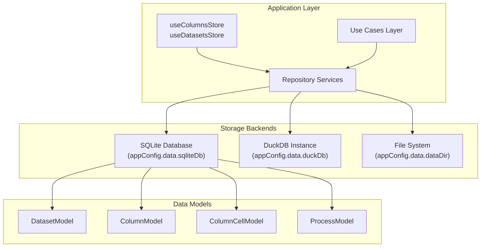
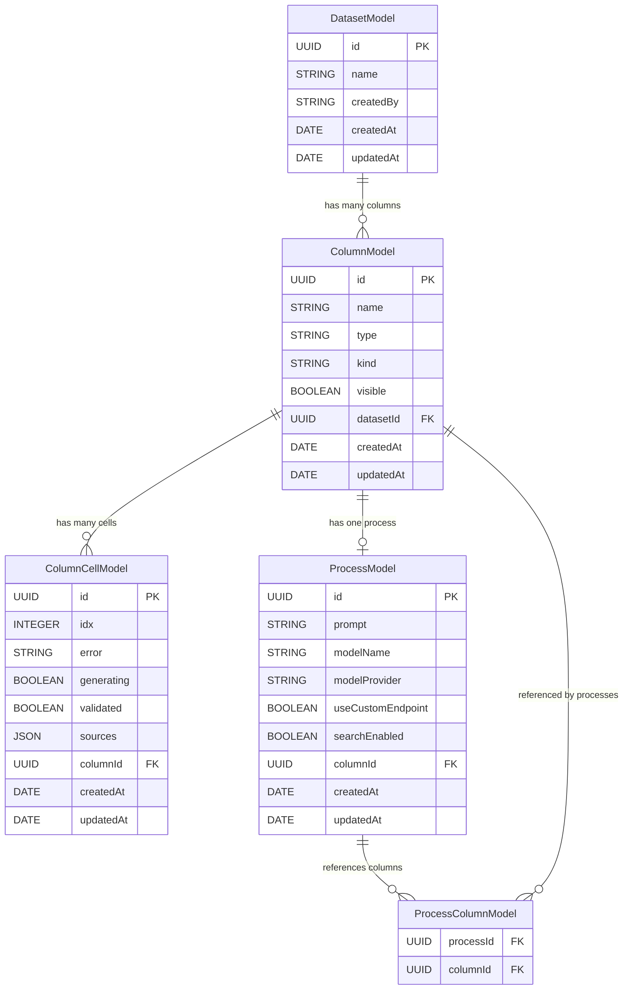
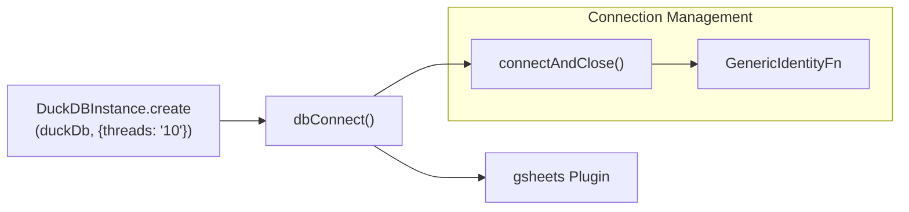
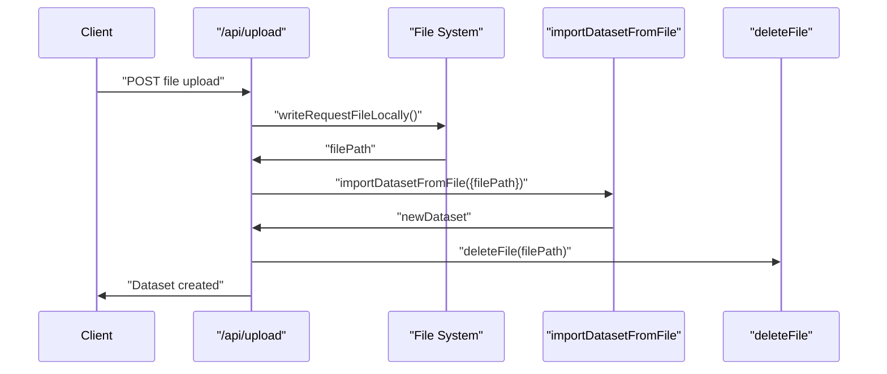
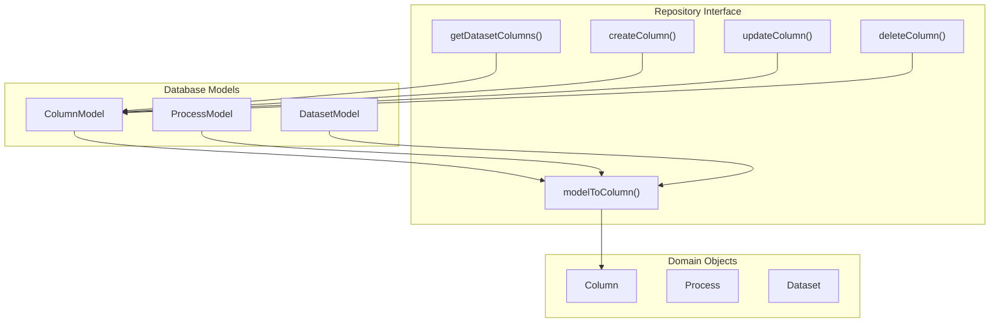
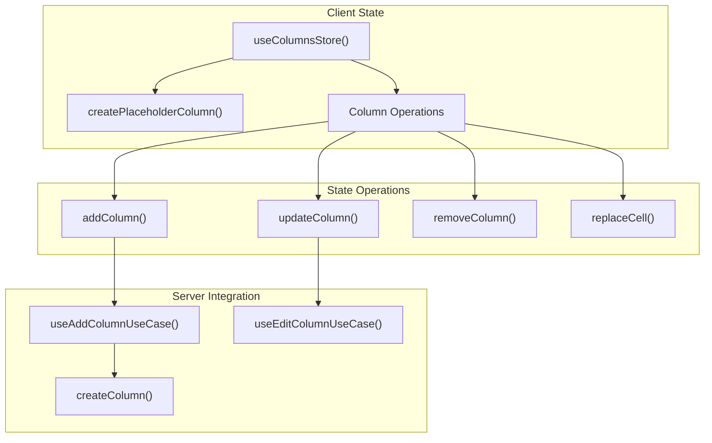

<!-- source: DeepWiki mcp.deepwiki.com · repo huggingface/aisheets · page 3.4 Data Storage · fetched 2026-10-26 -->

# Data Storage

<details>
<summary>Relevant source files</summary>

The following files were used as context for generating this wiki page:

- [CUSTOMIZATION.md](CUSTOMIZATION.md)
- [src/routes/api/upload/index.ts](src/routes/api/upload/index.ts)
- [src/routes/auth/index.tsx](src/routes/auth/index.tsx)
- [src/services/db/db.ts](src/services/db/db.ts)
- [src/services/db/duckdb.ts](src/services/db/duckdb.ts)
- [src/services/db/models/cell.ts](src/services/db/models/cell.ts)
- [src/services/db/models/column.ts](src/services/db/models/column.ts)
- [src/services/db/models/dataset.ts](src/services/db/models/dataset.ts)
- [src/services/repository/columns.ts](src/services/repository/columns.ts)
- [src/state/columns.ts](src/state/columns.ts)
- [src/usecases/add-column.usecase.ts](src/usecases/add-column.usecase.ts)
- [src/usecases/edit-column.usecase.ts](src/usecases/edit-column.usecase.ts)

</details>


This document covers the multi-database storage architecture used in AI Sheets, including SQLite for application data, DuckDB for analytics, file system storage for uploads, and the data persistence patterns used throughout the application.

For information about dataset management operations, see [Dataset Management](#3.1). For details about the table interface and how data is displayed, see [Table Interface](#3.2).

## Multi-Database Architecture

AI Sheets employs a multi-database strategy to handle different types of data and use cases efficiently. The system uses three primary storage backends, each optimized for specific requirements.



Sources: [src/services/db/db.ts:1-25](), [src/services/db/duckdb.ts:1-41](), [src/config.ts]()

## SQLite Database - Application Data

The primary application database uses SQLite with Sequelize ORM for managing structured application data including datasets, columns, cells, and AI processing configurations.

### Database Configuration

The SQLite database is configured in [src/services/db/db.ts:11-15]() and provides the main persistence layer for application entities.



Sources: [src/services/db/models/dataset.ts:15-66](), [src/services/db/models/column.ts:16-144](), [src/services/db/models/cell.ts:21-81]()

### Core Data Models

The application defines several Sequelize models that represent the core entities:

| Model | Purpose | Key Fields |
|-------|---------|------------|
| `DatasetModel` | Container for datasets | `id`, `name`, `createdBy` |
| `ColumnModel` | Dataset columns (static/dynamic) | `id`, `name`, `type`, `kind`, `visible` |
| `ColumnCellModel` | Individual cell values | `id`, `idx`, `validated`, `generating`, `sources` |
| `ProcessModel` | AI generation configuration | `id`, `prompt`, `modelName`, `searchEnabled` |

The models include computed fields like `numberOfCells` in `ColumnModel` which uses SQL aggregation for performance [src/services/db/models/column.ts:83-96]().

Sources: [src/services/db/models/dataset.ts:33-53](), [src/services/db/models/column.ts:50-97](), [src/services/db/models/cell.ts:44-80]()

## DuckDB - Analytics Database

DuckDB serves as the analytics engine, particularly useful for handling large dataset operations and providing advanced SQL capabilities with plugins.

### DuckDB Configuration



The DuckDB instance is configured with threading support and includes community plugins like `gsheets` for enhanced data source integration [src/services/db/duckdb.ts:33-40]().

### Connection Management Pattern

DuckDB uses a connection pooling pattern with automatic cleanup:

```typescript
export const connectAndClose = async <T>(
  func: GenericIdentityFn<T>,
): Promise<T>
```

This ensures connections are properly managed and closed after operations complete [src/services/db/duckdb.ts:18-31]().

Sources: [src/services/db/duckdb.ts:1-41]()

## File System Storage

Temporary file storage is used for dataset imports and uploads, with automatic cleanup after processing.

### Upload Processing Flow



Files are written to `appConfig.data.dataDir/uploads/files` with UUID-based naming to prevent conflicts [src/routes/api/upload/index.ts:38-58]().

Sources: [src/routes/api/upload/index.ts:11-66]()

## Repository Pattern

The application uses a repository pattern to abstract database operations and provide a clean interface between the domain logic and data persistence.

### Column Repository Operations



The repository layer handles the conversion between database models and domain objects through functions like `modelToColumn()` [src/services/repository/columns.ts:8-38]().

### Key Repository Functions

| Function | Purpose | Return Type |
|----------|---------|-------------|
| `getDatasetColumns()` | Fetch all columns for a dataset | `Promise<Column[]>` |
| `createColumn()` | Create new column with process | `Promise<Column>` |
| `updateColumn()` | Update existing column | `Promise<Column>` |
| `getColumnById()` | Fetch single column by ID | `Promise<Column \| null>` |
| `deleteColumn()` | Remove column and dependencies | `Promise<void>` |

Sources: [src/services/repository/columns.ts:40-220]()

## State Management Integration

The client-side state management integrates with the persistence layer through reactive stores that maintain synchronization between UI state and server data.

### Column State Management



The state management uses a temporal ID pattern (`TEMPORAL_ID = '-1'`) for optimistic updates before server confirmation [src/state/columns.ts:81]().

### Cell and Column Synchronization

The system maintains bidirectional synchronization between client state and server persistence through streaming updates during AI generation:

```typescript
for await (const { cell } of generateCells({...})) {
  this.signal.onabort = () => {
    cell.generating = false;
    updateCell(cell);
  };
  yield { cell };
}
```

This pattern ensures real-time updates while maintaining data consistency [src/usecases/add-column.usecase.ts:43-58]().

Sources: [src/state/columns.ts:82-307](), [src/usecases/add-column.usecase.ts:11-59](), [src/usecases/edit-column.usecase.ts:6-46]()

## Data Types and Validation

The system supports multiple data types for columns and implements validation patterns for cell content.

### Column and Cell Types

| Interface | Key Properties | Usage |
|-----------|---------------|--------|
| `Column` | `id`, `name`, `type`, `kind`, `visible`, `process` | Main column structure |
| `Cell` | `idx`, `value`, `validated`, `generating`, `sources` | Individual cell data |
| `Process` | `prompt`, `modelName`, `searchEnabled`, `columnsReferences` | AI generation config |
| `CellSource` | `url`, `snippet` | Web search context data |

Cell validation is tracked through the `validated` boolean field, while `generating` indicates active AI processing [src/state/columns.ts:50-63]().

### Process Configuration

Dynamic columns include process configuration for AI generation:

```typescript
export interface Process {
  id?: string;
  prompt: string;
  modelName: string;
  modelProvider: string;
  useEndpointURL?: boolean;
  columnsReferences: string[];
  searchEnabled: boolean;
  // Runtime state
  isExecuting?: boolean;
  cancellable?: NoSerialize<AbortController>;
}
```

The process includes both persistent configuration and transient execution state [src/state/columns.ts:7-22]().

Sources: [src/state/columns.ts:5-79](), [src/services/db/models/cell.ts:16-19]()

---

