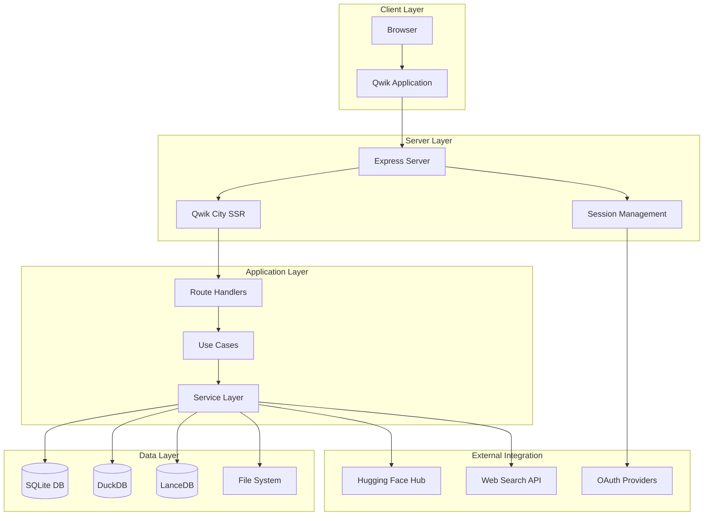
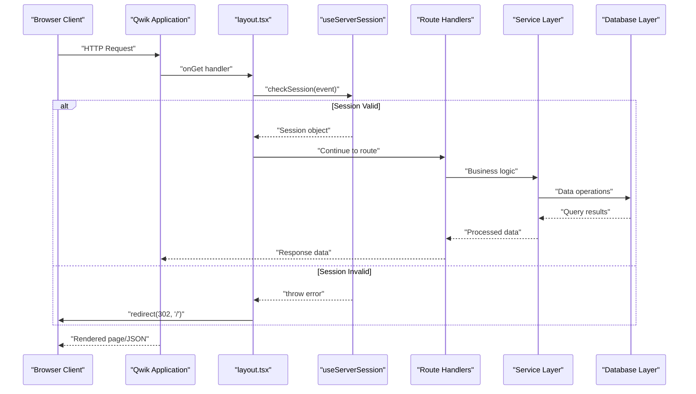
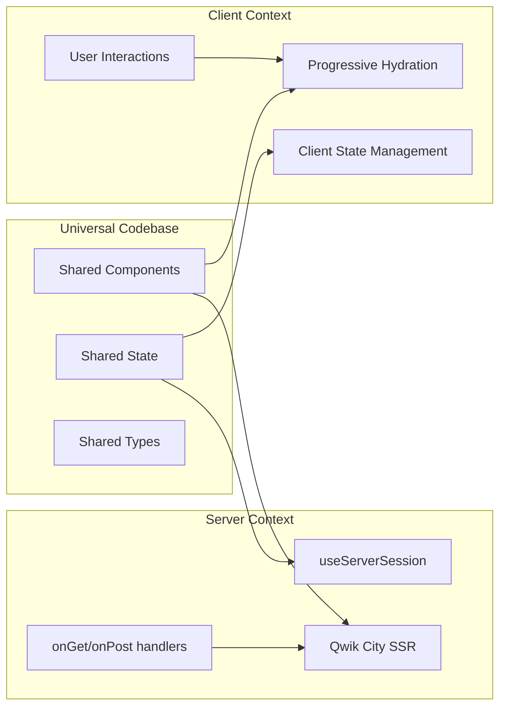
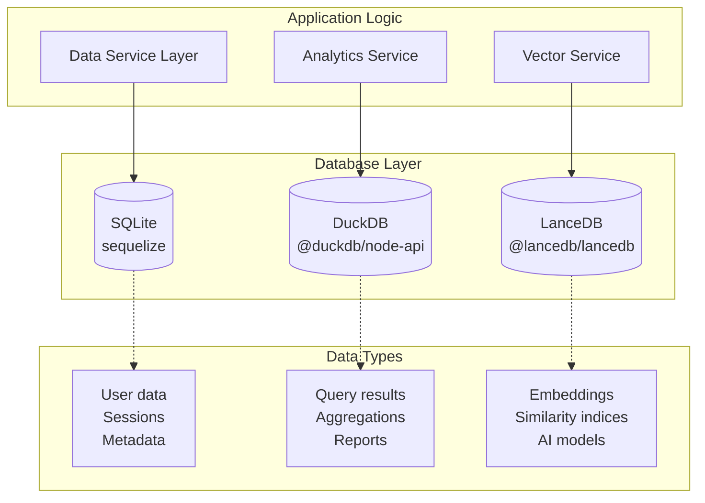
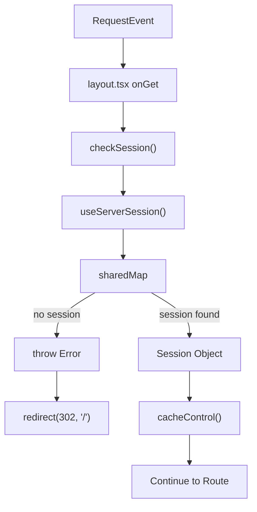
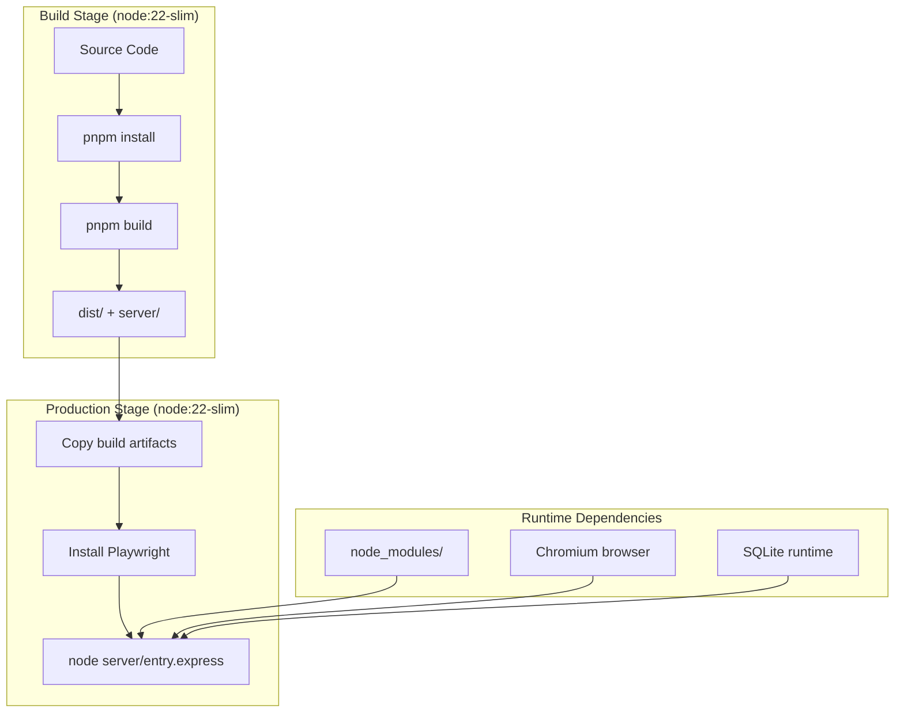
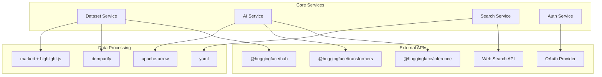

<!-- source: DeepWiki mcp.deepwiki.com · repo huggingface/aisheets · page 4 Architecture · fetched 2026-10-26 -->

# Architecture

Relevant source files

The following files were used as context for generating this wiki page:

- [Dockerfile](Dockerfile)
- [package.json](package.json)
- [pnpm-lock.yaml](pnpm-lock.yaml)
- [src/routes/index.tsx](src/routes/index.tsx)
- [src/routes/layout.tsx](src/routes/layout.tsx)
- [src/state/session.ts](src/state/session.ts)

This document provides a technical overview of AI Sheets' overall system architecture, covering the frontend/backend separation, request handling patterns, and core design principles. For detailed information about frontend components and state management, see [Frontend Architecture](#4.1). For backend services, API endpoints, and deployment details, see [Backend Architecture](#4.2).

## System Overview

AI Sheets follows a modern full-stack architecture built on Qwik and Express.js, designed as a no-code AI-powered dataset creation and enrichment platform. The system employs a multi-database strategy and integrates deeply with the Hugging Face ecosystem for AI model access and inference.

### High-Level Architecture

Sources: [package.json:1-105](), [src/routes/layout.tsx:1-29](), [Dockerfile:1-61]()

## Request Flow Architecture

The system implements a hybrid SSR/SPA architecture where Qwik handles both server-side rendering and client-side interactivity through a unified request pipeline.

Sources: [src/routes/layout.tsx:8-28](), [src/state/session.ts:14-26](), [src/routes/index.tsx:3-7]()

## Core Architectural Patterns

### 1. Universal JavaScript Architecture

The application uses Qwik's universal JavaScript approach where the same codebase runs on both client and server, enabling:

- **Server-Side Rendering (SSR)**: Initial page loads are rendered on the server
- **Progressive Hydration**: Client-side interactivity is added incrementally  
- **Resumable Applications**: State is serialized and resumed without re-execution

Sources: [package.json:38-39](), [src/routes/layout.tsx:19-28](), [src/state/session.ts:14-19]()

### 2. Multi-Database Strategy

AI Sheets employs a specialized multi-database architecture where each database serves specific use cases:

| Database | Purpose | Key Use Cases |
|----------|---------|---------------|
| SQLite | Application data | User sessions, dataset metadata, configuration |
| DuckDB | Analytics | OLAP queries, data analysis, large dataset processing |
| LanceDB | Vector operations | Embeddings, similarity search, AI model storage |

Sources: [package.json:71-77](), [package.json:91-92]()

### 3. Session Management Pattern

The application implements server-side session management with automatic redirection for unauthenticated requests:

Sources: [src/routes/layout.tsx:8-28](), [src/state/session.ts:14-26]()

## Build and Deployment Architecture

The system uses a multi-stage Docker build process optimized for production deployment:

### Build Pipeline

Sources: [Dockerfile:1-61](), [package.json:16-22](), [package.json:29]()

### Environment Configuration

The build process includes several optimization strategies:

- **Memory Management**: `NODE_OPTIONS="--max-old-space-size=4096"` for build stage
- **Dependency Optimization**: `SKIP_POSTINSTALL=1` during Docker build
- **Browser Automation**: Playwright with Chromium for web scraping capabilities
- **Database Runtime**: Native SQLite support with build tools

Sources: [Dockerfile:7-10](), [Dockerfile:50-54](), [package.json:15-16]()

## Integration Architecture

The system integrates with external services through a service layer abstraction:

Sources: [package.json:72-75](), [package.json:80-94]()

This architecture provides a scalable foundation for AI-powered dataset operations while maintaining clear separation of concerns between presentation, business logic, and data persistence layers.

---

