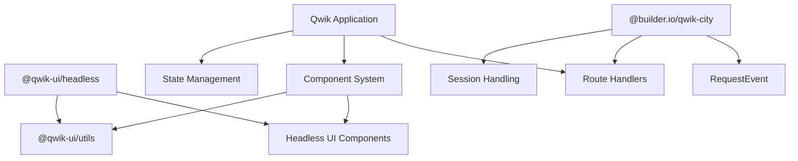
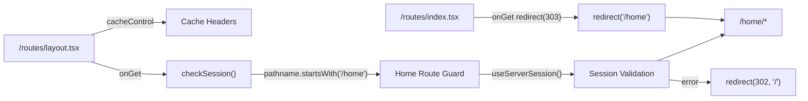
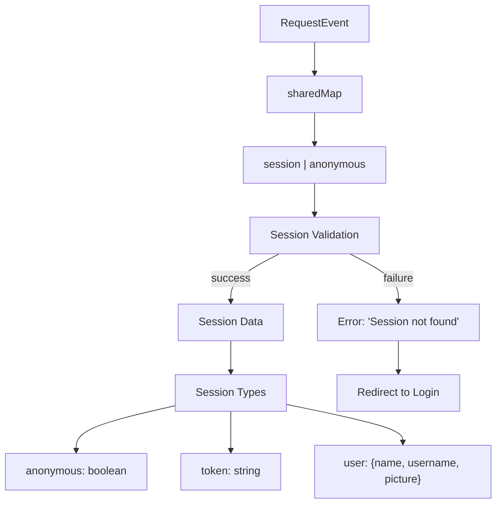
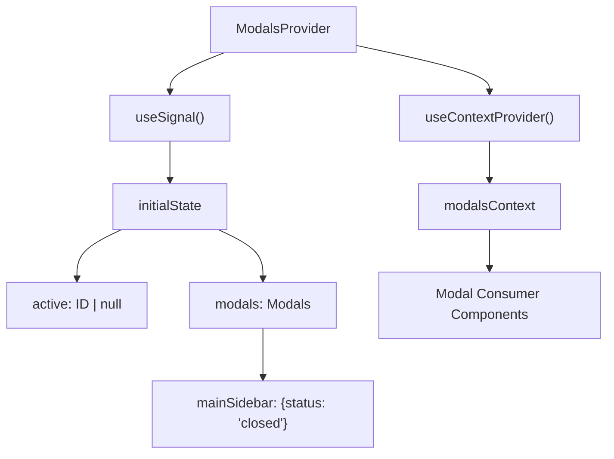
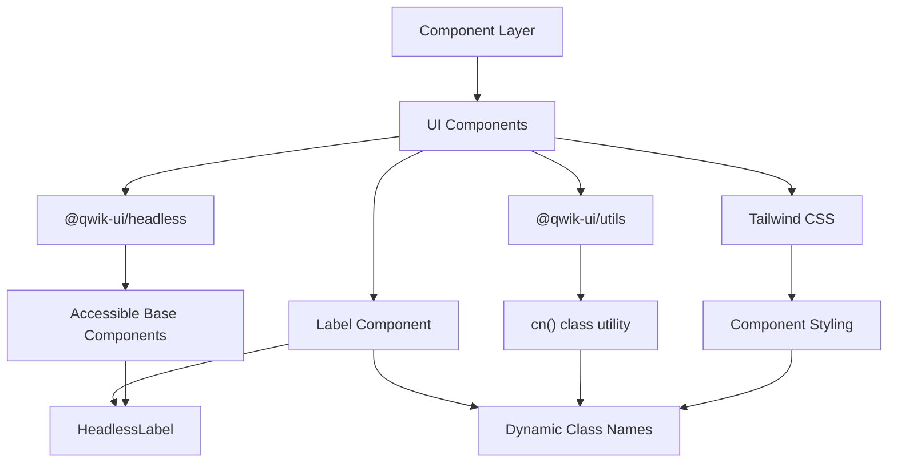
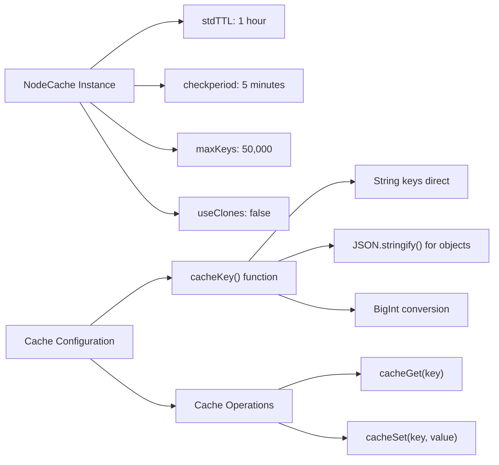
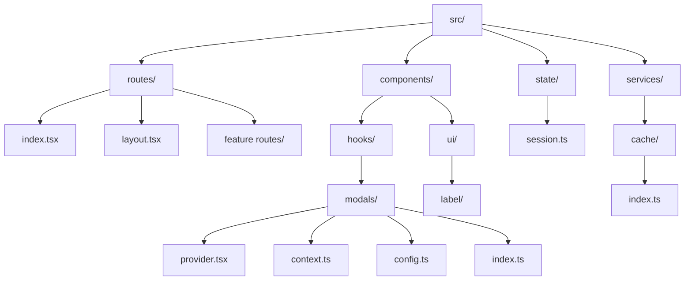

<!-- source: DeepWiki mcp.deepwiki.com · repo huggingface/aisheets · page 4.1 Frontend Architecture · fetched 2026-10-26 -->

# Frontend Architecture

<details>
<summary>Relevant source files</summary>

The following files were used as context for generating this wiki page:

- [src/components/hooks/index.ts](src/components/hooks/index.ts)
- [src/components/hooks/modals/config.ts](src/components/hooks/modals/config.ts)
- [src/components/hooks/modals/context.ts](src/components/hooks/modals/context.ts)
- [src/components/hooks/modals/index.ts](src/components/hooks/modals/index.ts)
- [src/components/hooks/modals/provider.tsx](src/components/hooks/modals/provider.tsx)
- [src/components/ui/label/label.tsx](src/components/ui/label/label.tsx)
- [src/routes/index.tsx](src/routes/index.tsx)
- [src/routes/layout.tsx](src/routes/layout.tsx)
- [src/services/cache/index.ts](src/services/cache/index.ts)
- [src/state/session.ts](src/state/session.ts)

</details>


This document covers the frontend architecture of AI Sheets, including the Qwik framework implementation, component organization, state management patterns, routing system, and session handling. For backend API integration details, see [Backend Architecture](#4.2). For specific UI component documentation, see [UI Components](#5).

## Framework Overview

AI Sheets uses **Qwik** as its primary frontend framework, leveraging its server-side rendering capabilities and reactive state management. The application follows Qwik's file-based routing convention and component architecture patterns.

### Qwik Integration Points



**Framework Component Integration**
- **RouteHandlers**: Handle server-side logic via `onGet` functions
- **RequestEvent**: Core request handling and redirects
- **HeadlessComponents**: Unstyled, accessible UI components
- **SessionHandling**: Server-side session validation

Sources: [src/routes/layout.tsx:1-5](), [src/components/ui/label/label.tsx:2-3]()

## Routing Architecture

The routing system uses Qwik City's file-based routing with server-side request handling and session management integration.



**Route Protection Flow**
- **index.tsx**: Immediate redirect to `/home` via 303 status
- **layout.tsx**: Global session checking for home routes
- **checkSession**: Validates session before accessing protected routes
- **useServerSession**: Server-side session retrieval and validation

### Session Management Integration

The routing system integrates deeply with session management through the `checkSession` function:

| Route Pattern | Session Required | Redirect Target |
|---------------|------------------|-----------------|
| `/` | No | `/home` |
| `/home/*` | Yes | `/` (login) |
| Other routes | No | - |

Sources: [src/routes/index.tsx:3-6](), [src/routes/layout.tsx:19-28]()

## Session Management

Session handling operates through server-side context sharing using Qwik's `sharedMap` system.



**Session Data Structure**
- **anonymous**: Boolean flag for anonymous sessions
- **token**: Authentication token for API access
- **user**: User profile information from authentication provider

### Browser vs Server Context

The session system enforces server-side only usage through runtime checks:

```typescript
// From useServerSession implementation
if (isBrowser) {
  throw new Error('useServerSession must be used on the server.');
}
```

Sources: [src/state/session.ts:4-26]()

## State Management: Modal System

The application implements a centralized modal management system using Qwik's context API and reactive signals.

### Modal Context Architecture



**Modal State Structure**
- **active**: Currently active modal ID or null
- **modals**: Configuration object for all available modals
- **status**: Modal state ("open" | "closed")

### Modal Types and Configuration

The modal system defines a type-safe configuration structure:

| Modal ID | Type | Initial Status |
|----------|------|----------------|
| `mainSidebar` | `Modal` | `closed` |

```typescript
// Modal type definitions
type ID = 'mainSidebar';
type Status = 'open' | 'closed';
```

### Provider Implementation Pattern

The `ModalsProvider` component wraps the application and provides modal state to all child components:

```typescript
// Provider pattern implementation
const modal = useSignal<State>(initialState);
useContextProvider(modalsContext, modal);
```

Sources: [src/components/hooks/modals/provider.tsx:10-12](), [src/components/hooks/modals/config.ts:1-16](), [src/components/hooks/modals/context.ts:4-13]()

## Component Architecture

The component system follows a layered architecture with headless UI components, utility functions, and custom styling integration.



**Component Implementation Pattern**
- **Base Layer**: Headless UI components for accessibility
- **Utility Layer**: Class name utilities and helper functions
- **Styling Layer**: Tailwind CSS for visual presentation
- **Component Layer**: Custom components combining all layers

### Label Component Example

The `Label` component demonstrates the typical component architecture pattern:

```typescript
// Component composition pattern
<HeadlessLabel
  {...props}
  class={cn(
    'font-medium peer-disabled:cursor-not-allowed peer-disabled:opacity-70',
    props.class,
  )}
>
  <Slot />
</HeadlessLabel>
```

**Component Features**
- **Props spreading**: Inherits all label props
- **Class composition**: Combines default and custom classes
- **Slot pattern**: Flexible content projection
- **Accessibility**: Built on headless UI foundation

Sources: [src/components/ui/label/label.tsx:7-18]()

## Caching Strategy

The frontend integrates with a server-side caching layer using NodeCache for performance optimization.

### Cache Configuration



**Cache Settings**
- **TTL**: 1 hour default expiration
- **Cleanup**: 5-minute check intervals
- **Capacity**: 50,000 key limit
- **Performance**: Cloning disabled for speed

### Key Serialization Strategy

The cache system handles various key types through a unified serialization approach:

| Key Type | Handling Strategy |
|----------|------------------|
| String | Direct usage |
| Object | JSON.stringify with BigInt conversion |
| BigInt | Convert to string representation |
| Undefined/Null | Return undefined, log warning |

Sources: [src/services/cache/index.ts:5-39]()

## File Organization Structure

The frontend follows a structured file organization pattern aligned with Qwik conventions and functional domains.

### Directory Structure Overview



**Organization Principles**
- **Routes**: File-based routing following Qwik conventions
- **Components**: Reusable UI components and custom hooks
- **State**: Global state management and session handling  
- **Services**: Cross-cutting concerns like caching and external integrations

### Module Export Strategy

The codebase uses barrel exports for clean import paths:

```typescript
// Hook exports
export * from './modals';

// Modal system exports  
export * from './provider';
export * from './use-modals';
```

Sources: [src/components/hooks/index.ts:1](), [src/components/hooks/modals/index.ts:1-2]()

---

