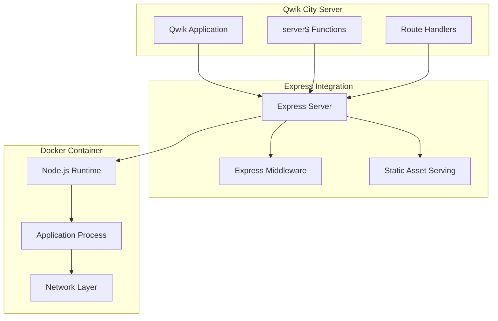
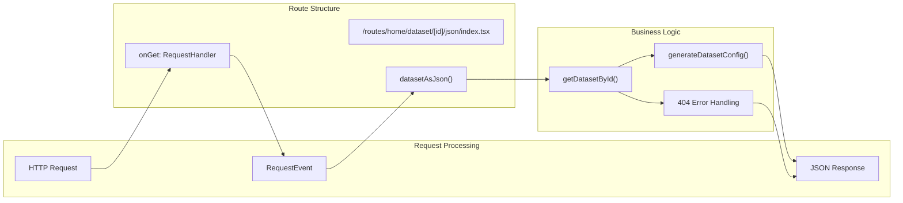
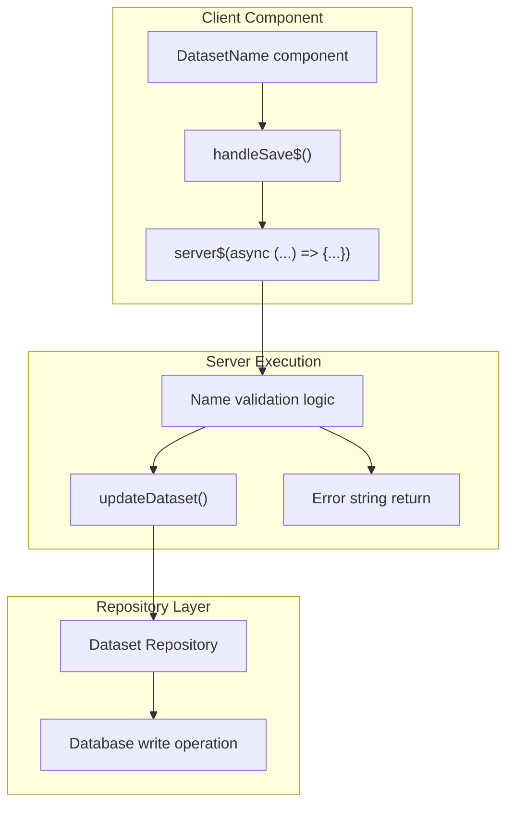
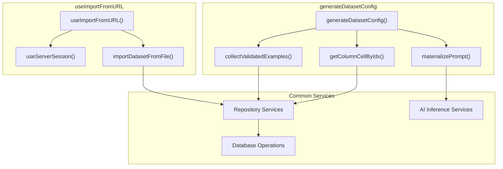
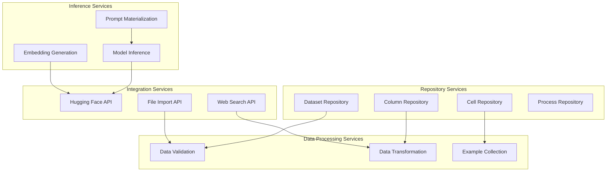
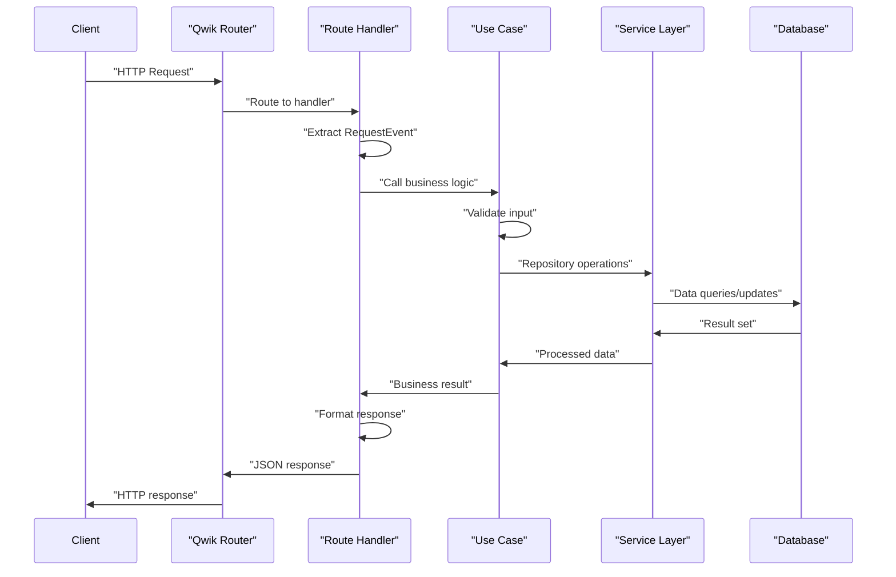
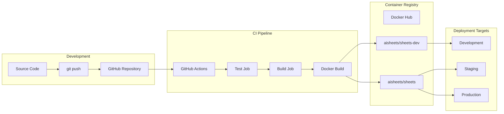
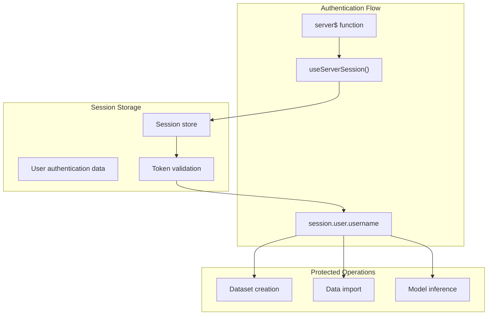

<!-- source: DeepWiki mcp.deepwiki.com · repo huggingface/aisheets · page 4.2 Backend Architecture · fetched 2026-10-26 -->

# Backend Architecture

Relevant source files

The following files were used as context for generating this wiki page:

- [.github/workflows/ci.buld.yml](.github/workflows/ci.buld.yml)
- [.gitignore](.gitignore)
- [src/features/datasets/dataset-name.tsx](src/features/datasets/dataset-name.tsx)
- [src/routes/home/dataset/[id]/json/index.tsx](src/routes/home/dataset/[id]/json/index.tsx)
- [src/routes/home/dataset/[id]/json/utils.ts](src/routes/home/dataset/[id]/json/utils.ts)
- [src/usecases/create-dataset-config.ts](src/usecases/create-dataset-config.ts)
- [src/usecases/import-from-url.usecase.ts](src/usecases/import-from-url.usecase.ts)

This document covers the server-side architecture of AI Sheets, including the Express server setup, API endpoints, use cases pattern, service layer organization, and deployment infrastructure. For frontend architecture details including Qwik components and client-side state management, see [Frontend Architecture](#4.1). For specific data storage patterns and database configurations, see [Data Storage](#3.4).

## Overview

AI Sheets uses a hybrid architecture combining Qwik's server-side rendering capabilities with a traditional Express server backend. The backend follows a layered architecture pattern with clear separation between API routes, use cases, and services. The system is deployed via Docker containers with automated CI/CD pipelines.

## Server Framework and Setup

AI Sheets leverages Qwik City's full-stack capabilities, which provides both server-side rendering and API route handling built on top of Express. The backend uses `server$` functions for server-side logic and traditional HTTP handlers for API endpoints.

### Core Server Components

The server architecture integrates Qwik's reactive server-side rendering with traditional API endpoints for data operations and external integrations.

Sources: [.github/workflows/ci.buld.yml:1-96](), [src/routes/home/dataset/[id]/json/index.tsx:1-6]()

## API Layer Architecture

The API layer is organized using Qwik City's file-based routing system, where route handlers are defined in the `src/routes/` directory structure. Each route can export HTTP method handlers (`onGet`, `onPost`, etc.) that handle incoming requests.

### Route Handler Pattern

Route handlers follow a consistent pattern where they extract parameters from the `RequestEvent`, delegate to business logic functions, and return structured JSON responses.

Sources: [src/routes/home/dataset/[id]/json/index.tsx:1-6](), [src/routes/home/dataset/[id]/json/utils.ts:1-24]()

### Server Function Integration

The backend extensively uses Qwik's `server$` pattern for component-driven server logic. These functions provide type-safe server-side operations callable from client components.

Sources: [src/features/datasets/dataset-name.tsx:43-58]()

## Use Cases Layer

The use cases layer encapsulates business logic and orchestrates service interactions. Use cases are typically implemented as `server$` functions that can be called from the frontend while maintaining server-side execution.

### Use Case Implementation Pattern

| Use Case | Purpose | Key Services |
|----------|---------|--------------|
| `useImportFromURL` | Import datasets from external URLs | `importDatasetFromFile`, session management |
| `generateDatasetConfig` | Create dataset configuration for export | `materializePrompt`, `getColumnCellByIdx` |

Use cases handle authentication, validation, and orchestration while delegating specific operations to appropriate services.

Sources: [src/usecases/import-from-url.usecase.ts:1-34](), [src/usecases/create-dataset-config.ts:1-105]()

## Service Layer Organization

The service layer is organized into specialized modules that handle specific domains of functionality. Services are typically pure functions that can be composed within use cases.

### Key Service Categories

Services are designed to be stateless and composable, allowing use cases to combine multiple service operations into complex workflows.

Sources: [src/usecases/create-dataset-config.ts:1-105](), [src/usecases/import-from-url.usecase.ts:1-34]()

## Request Processing Flow

The backend processes requests through a standardized flow that handles authentication, validation, business logic execution, and response formatting.

### Typical Request Flow

This flow ensures consistent error handling, validation, and response formatting across all API endpoints.

Sources: [src/routes/home/dataset/[id]/json/utils.ts:5-24](), [src/features/datasets/dataset-name.tsx:43-58]()

## Deployment Architecture

AI Sheets uses containerized deployment with Docker, featuring automated builds and multi-platform support through GitHub Actions CI/CD pipeline.

### Docker and CI/CD Pipeline

The pipeline supports different image variants based on branch conditions and provides multi-architecture builds for ARM64 and AMD64 platforms.

### Container Configuration

| Environment Variable | Purpose | Default |
|---------------------|---------|---------|
| `DOCKER_IMAGE` | Target image name | `aisheets/sheets-dev` |
| `PLATFORMS` | Build architectures | `linux/amd64` |
| `IMAGE_TAG` | Version tag | Branch name or `dev`/`latest` |

The CI pipeline automatically determines the appropriate image name and platforms based on the Git branch:
- `main` branch → `aisheets/sheets:dev` 
- `stable` branch or version tags → `aisheets/sheets:latest`
- Other branches → `aisheets/sheets-dev:branch-name`

Sources: [.github/workflows/ci.buld.yml:36-96](), [.gitignore:49-54]()

## Session and Authentication Integration

The backend integrates with the authentication system through session management, providing secure access to protected endpoints and user context for operations.

The session system ensures that all backend operations are properly attributed to authenticated users and that access controls are enforced consistently.

Sources: [src/usecases/import-from-url.usecase.ts:19-24]()

---

