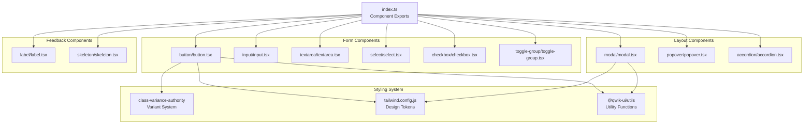
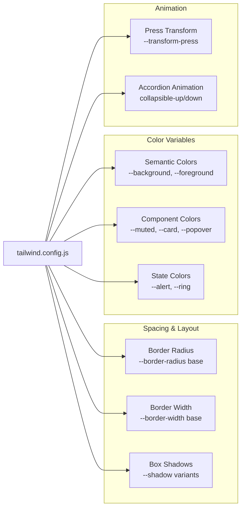
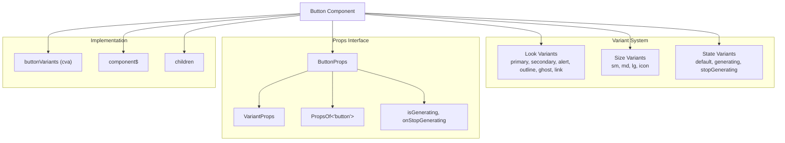
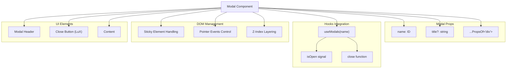
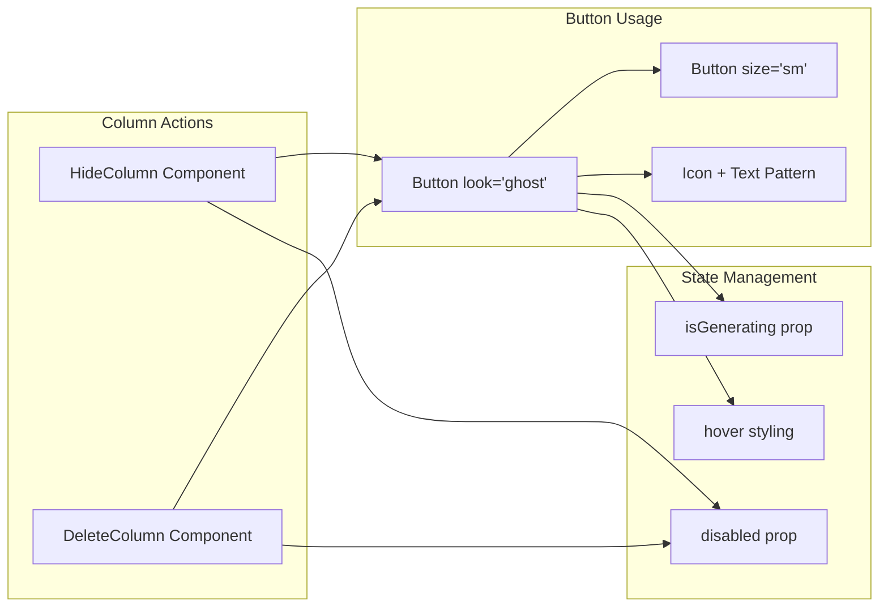

<!-- source: DeepWiki mcp.deepwiki.com · repo huggingface/aisheets · page 5 UI Components · fetched 2026-10-26 -->

# UI Components

Relevant source files

The following files were used as context for generating this wiki page:

- [src/components/ui/button/button.tsx](src/components/ui/button/button.tsx)
- [src/components/ui/index.ts](src/components/ui/index.ts)
- [src/components/ui/modal/modal.tsx](src/components/ui/modal/modal.tsx)
- [src/features/table/components/header/delete-column.tsx](src/features/table/components/header/delete-column.tsx)
- [src/features/table/components/header/hide-column.tsx](src/features/table/components/header/hide-column.tsx)
- [tailwind.config.js](tailwind.config.js)

This page documents the reusable UI component library that provides the visual building blocks for AI Sheets. It covers the design system, component architecture, styling approach, and individual component APIs. For information about how these components are integrated into the table interface, see [Table Interface](#3.2). For broader frontend architecture patterns, see [Frontend Architecture](#4.1).

## Component Architecture

AI Sheets uses Qwik's component system to build a modular, reusable UI library. All UI components are centralized in the `src/components/ui/` directory and follow consistent patterns for styling, variants, and behavior.

**Sources:** [src/components/ui/index.ts:1-13](), [src/components/ui/button/button.tsx:1-89](), [src/components/ui/modal/modal.tsx:1-72]()

## Design System

The design system is built on Tailwind CSS with a comprehensive set of design tokens that ensure visual consistency across the application.

### Color Palette

The color system uses HSL values with semantic naming and multiple shade variations:

| Color Group | Purpose | Shades Available |
|-------------|---------|------------------|
| **Primary** | Main brand color, primary actions | 50, 100, 200, 300, 400, 500, 600, DEFAULT |
| **Secondary** | Secondary actions, success states | 50, 100, 200, 300, 400, 500, 600, DEFAULT |
| **Neutral** | Text, borders, backgrounds | 50, 100, 200, 300, 400, 500, 600, 700, DEFAULT |
| **Alert** | Error states, destructive actions | DEFAULT, foreground |
| **Green** | Success indicators | 50, 100, 200, 300, 400, 500, 600 |

### Design Tokens

**Sources:** [tailwind.config.js:6-124]()

## Core UI Components

### Button Component

The `Button` component is the most feature-rich UI component, supporting multiple visual variants, sizes, and states including AI generation feedback.

The button variants are defined using `class-variance-authority` for type-safe styling:

- **Look variants**: Control visual appearance from primary brand styling to subtle ghost buttons
- **Size variants**: Standard sizing from small (`sm`) to large (`lg`) plus square icon variant
- **State variants**: Special `generating` state provides visual feedback during AI operations

**Sources:** [src/components/ui/button/button.tsx:5-89]()

### Modal Component

The `Modal` component integrates with the application's modal management system and provides overlay functionality with proper accessibility and DOM manipulation.

The modal system handles complex DOM interactions including temporarily removing sticky positioning from elements and managing pointer events on the main content area.

**Sources:** [src/components/ui/modal/modal.tsx:1-72](), [src/components/hooks/modals/config.ts]()

## Usage Patterns

### Button Integration in Table Features

UI components are extensively used throughout the table interface, particularly in column management operations:

**Sources:** [src/features/table/components/header/hide-column.tsx:36-50](), [src/features/table/components/header/delete-column.tsx:40-66]()

### Styling Conventions

Components follow consistent patterns for styling and behavior:

| Pattern | Implementation | Usage |
|---------|----------------|-------|
| **Ghost Buttons** | `look="ghost"` with hover backgrounds | Action buttons in dropdowns, toolbars |
| **Icon + Text** | Lucide icons with text labels | Column actions, toolbar buttons |
| **Disabled States** | Conditional `disabled` prop with opacity styling | Context-dependent action availability |
| **Responsive Sizing** | `size="sm"` for compact interfaces | Table headers, modal controls |

The component system emphasizes consistency through shared styling utilities and standardized prop interfaces across all UI components.

**Sources:** [src/components/ui/button/button.tsx:5-39](), [tailwind.config.js:127-133]()

---

