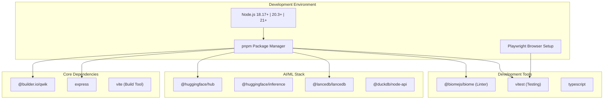
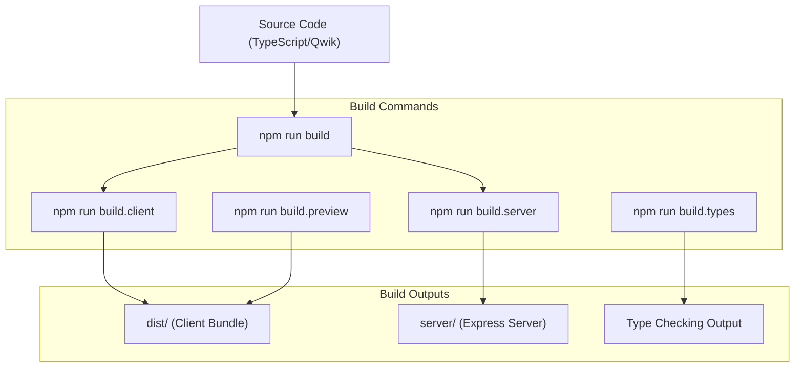
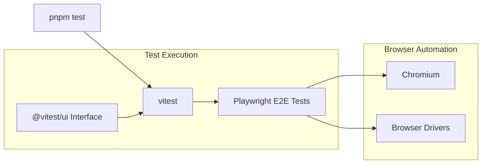
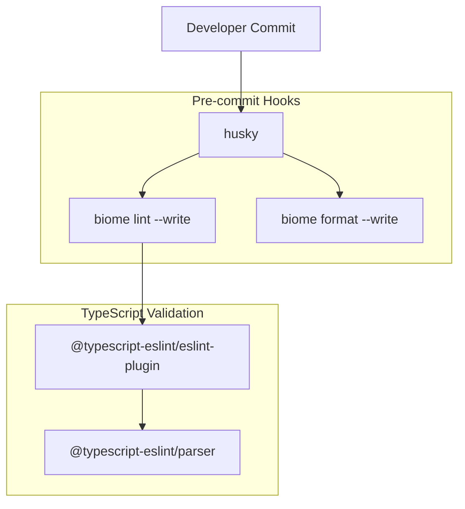
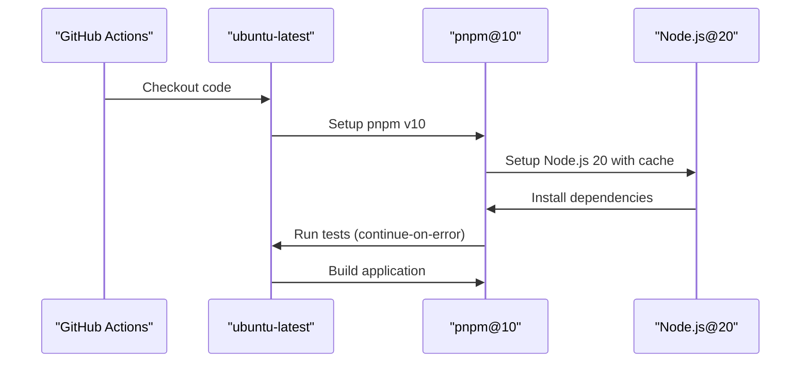
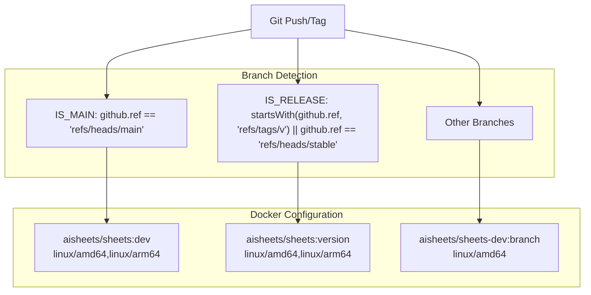
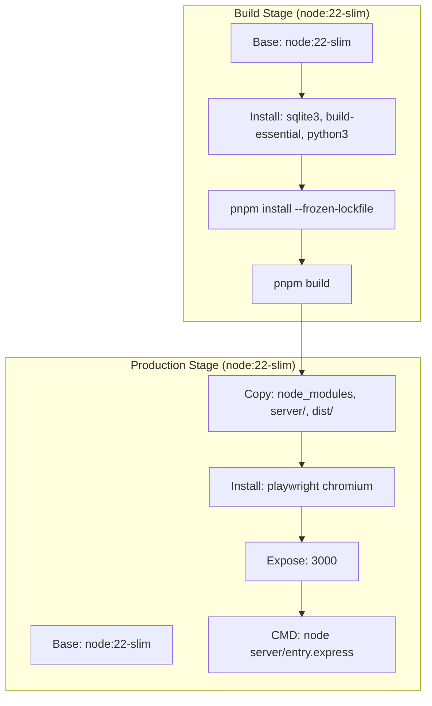
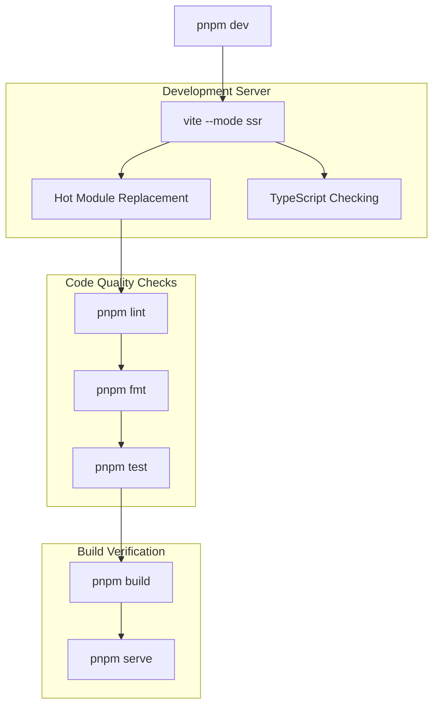

<!-- source: DeepWiki mcp.deepwiki.com · repo huggingface/aisheets · page 6 Development Guide · fetched 2026-10-26 -->

# Development Guide

Relevant source files

The following files were used as context for generating this wiki page:

- [.github/workflows/ci.buld.yml](.github/workflows/ci.buld.yml)
- [Dockerfile](Dockerfile)
- [package.json](package.json)
- [pnpm-lock.yaml](pnpm-lock.yaml)

This document provides comprehensive guidance for developers working on the AI Sheets codebase, covering development environment setup, build processes, testing workflows, code quality standards, and deployment procedures. It serves as the primary reference for contributors and maintainers.

For information about the overall system architecture, see [Architecture](#4). For details about UI component development, see [UI Components](#5).

## Development Environment Setup

AI Sheets uses a modern JavaScript/TypeScript stack built on Qwik with Express.js backend integration. The development environment requires specific Node.js versions and uses pnpm as the package manager.

### Prerequisites and Dependencies

The application requires Node.js versions `^18.17.0 || ^20.3.0 || >=21.0.0` as specified in [package.json:4-6](). The development stack includes:

- **Package Manager**: pnpm for dependency management
- **Frontend Framework**: Qwik with SSR capabilities  
- **Backend**: Express.js server
- **Databases**: SQLite, DuckDB, and LanceDB
- **AI/ML**: Hugging Face ecosystem integration
- **Testing**: Vitest with Playwright for E2E testing

**Sources**: [package.json:4-6](), [package.json:70-94](), [package.json:36-69]()

### Local Development Setup

The development server runs in SSR mode using Vite with custom adapter configuration. The setup process includes automatic Playwright browser installation through the postinstall hook.

| Script | Command | Purpose |
|--------|---------|---------|
| `dev` | `vite --mode ssr` | Start development server with SSR |
| `dev.debug` | `node --inspect-brk ./node_modules/vite/bin/vite.js --mode ssr --force` | Debug development server |
| `start` | `vite --open --mode ssr` | Start dev server and open browser |

The postinstall script at [package.json:15]() handles Playwright installation with conditional skipping via `SKIP_POSTINSTALL` environment variable for Docker builds.

**Sources**: [package.json:14-15](), [package.json:22-30]()

## Build System Architecture

The build system uses Qwik's multi-target compilation approach with Vite as the underlying bundler. The system supports both client-side and server-side rendering with separate build targets.

### Build Targets and Output

The primary build command `qwik build` orchestrates multiple compilation targets:

- **Client Build**: `vite build` - Creates optimized client bundle in `dist/`
- **Server Build**: `vite build -c adapters/express/vite.config.ts` - Compiles Express adapter
- **Preview Build**: `vite build --ssr src/entry.preview.tsx` - Preview deployment target
- **Type Checking**: `tsc --incremental --noEmit` - TypeScript validation without output

**Sources**: [package.json:16-21]()

### Production Deployment

The production server runs the compiled Express application using `node server/entry.express` as specified in [package.json:29](). The serve command directly executes the built server without development tooling.

**Sources**: [package.json:29]()

## Testing Strategy

The testing framework uses Vitest as the primary test runner with Playwright integration for end-to-end testing. The configuration supports both unit testing and UI-driven testing workflows.

### Test Execution Commands

| Command | Purpose | Configuration |
|---------|---------|---------------|
| `test` | `vitest` | Run all tests |
| `test.unit.ui` | `vitest --ui` | Interactive test UI |

The test setup includes automatic Playwright installation through the postinstall hook, ensuring browser dependencies are available for E2E tests. The `@vitest/ui` package provides a web-based test interface for development.

**Sources**: [package.json:31-32](), [package.json:53](), [package.json:88-89]()

## Code Quality and Linting

Code quality is maintained through Biome, a modern linter and formatter that replaces traditional ESLint/Prettier setups. The project also includes TypeScript ESLint configuration for additional type-aware linting rules.

### Biome Configuration

The primary code quality tools are:

- **Linting**: `biome lint . --write` - Lint and auto-fix issues
- **Formatting**: `biome format . --write` - Format code according to style rules  
- **Check Mode**: `biome lint .` and `biome format .` - Validation without changes

### Git Hooks Integration

Husky is configured to run pre-commit hooks ensuring code quality standards. The prepare script sets up git hooks automatically during development setup.

**Sources**: [package.json:24-27](), [package.json:34](), [package.json:58](), [package.json:123-128]()

## CI/CD Pipeline Architecture

The continuous integration pipeline is implemented using GitHub Actions with separate build and Docker deployment workflows. The pipeline supports multi-architecture builds and environment-specific deployments.

### Build Workflow

The build job runs on Ubuntu and executes the complete test and build cycle:

The workflow executes these commands in sequence:
1. `pnpm install` - Install dependencies
2. `pnpm test` - Run test suite (non-blocking)
3. `pnpm build` - Build for production

**Sources**: [.github/workflows/ci.buld.yml:1-35]()

### Docker Deployment Strategy  

The Docker workflow implements environment-specific deployment with multi-architecture support:

| Branch/Tag | Image | Platforms | Tag |
|------------|-------|-----------|-----|
| `main` | `aisheets/sheets` | `linux/amd64,linux/arm64` | `dev` |
| `stable` | `aisheets/sheets` | `linux/amd64,linux/arm64` | `latest` |
| `v*` tags | `aisheets/sheets` | `linux/amd64,linux/arm64` | version |
| Other branches | `aisheets/sheets-dev` | `linux/amd64` | branch name |

The deployment logic uses environment variable conditions to determine the target configuration:

**Sources**: [.github/workflows/ci.buld.yml:36-96](), [.github/workflows/ci.buld.yml:56-71]()

## Docker Development and Deployment

The Docker configuration uses a multi-stage build approach optimizing for both development convenience and production efficiency. The build process handles native dependencies and browser automation requirements.

### Multi-Stage Build Process

### Build Optimizations

The build stage includes several optimizations:

- **Skip Postinstall**: `ENV SKIP_POSTINSTALL=1` prevents Playwright installation during build
- **Memory Allocation**: `ENV NODE_OPTIONS="--max-old-space-size=4096"` increases heap size
- **Frozen Lockfile**: `--frozen-lockfile` ensures reproducible builds
- **Playwright Optimization**: Browser installation only in production stage

The production stage configures Playwright for headless operation:
- `PLAYWRIGHT_BROWSERS_PATH=/home/node/ms-playwright` sets browser location
- `playwright install-deps && playwright install chromium --only-shell` installs minimal browser setup

**Sources**: [Dockerfile:1-61]()

## Development Workflow

The typical development workflow integrates the build system, testing framework, and code quality tools into an efficient development cycle.

### Local Development Cycle

### Pre-commit Workflow

The Husky pre-commit hooks ensure code quality before commits:

1. **Formatting**: `biome format . --write` - Auto-format code
2. **Linting**: `biome lint . --write` - Fix linting issues
3. **Type Checking**: TypeScript validation via ESLint rules

**Sources**: [package.json:22-34]()

## Contribution Guidelines

Contributors should follow the established development patterns and quality standards maintained through the automated tooling and CI pipeline.

### Development Standards

- **Node.js Version**: Use supported versions specified in [package.json:4-6]()
- **Package Manager**: Use pnpm exclusively for consistent dependency resolution
- **Code Style**: Follow Biome formatting and linting rules
- **Testing**: Ensure test coverage for new features using Vitest
- **Type Safety**: Maintain TypeScript strict mode compliance

### Build Verification

Before submitting contributions, verify the complete build process:

1. `pnpm install` - Install dependencies
2. `pnpm lint` - Check code quality
3. `pnpm test` - Run test suite
4. `pnpm build` - Verify production build
5. `pnpm serve` - Test built application

The CI pipeline will automatically validate these steps, but local verification prevents build failures and accelerates the review process.

**Sources**: [package.json:14-34](), [.github/workflows/ci.buld.yml:25-33]()