# Page: Overview

# Overview

<details>
<summary>Relevant source files</summary>

The following files were used as context for generating this wiki page:

- [Dockerfile](Dockerfile)
- [README.md](README.md)
- [package.json](package.json)
- [pnpm-lock.yaml](pnpm-lock.yaml)
- [public/dnd-background.svg](public/dnd-background.svg)
- [scripts/extend_dataset/prompt.jailbreak_detector.config.yml](scripts/extend_dataset/prompt.jailbreak_detector.config.yml)
- [scripts/extend_dataset/topics_extraction.config.yml](scripts/extend_dataset/topics_extraction.config.yml)
- [scripts/extend_dataset/with_inference_client.py](scripts/extend_dataset/with_inference_client.py)
- [scripts/extend_dataset/with_vllm.py](scripts/extend_dataset/with_vllm.py)
- [src/features/import/drag-n-drop.tsx](src/features/import/drag-n-drop.tsx)
- [src/features/import/import-from-hub.tsx](src/features/import/import-from-hub.tsx)
- [src/features/main-sidebar/main-sidebar.tsx](src/features/main-sidebar/main-sidebar.tsx)
- [src/routes/home/index.tsx](src/routes/home/index.tsx)

</details>


## Purpose and Scope

AI Sheets is a no-code platform for building, enriching, and transforming datasets using AI models with web search enhancement. This document provides a technical overview of the system architecture, core components, and data processing workflows. The platform enables users to create structured datasets from natural language descriptions, import existing datasets, and enhance them using hundreds of AI models from the Hugging Face ecosystem.

For detailed information about specific subsystems, see [Dataset Management](#3.1), [Table Interface](#3.2), [AI Integration](#3.3), and [Data Storage](#3.4).

## System Architecture Overview

AI Sheets follows a modern web application architecture with a Qwik-based frontend, Express backend, and multi-database storage strategy. The system integrates deeply with the Hugging Face ecosystem for model discovery and inference.

### High-Level System Architecture

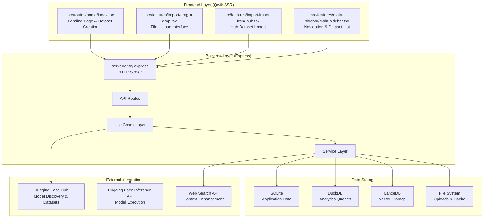

Sources: [src/routes/home/index.tsx:1-494](), [src/features/import/drag-n-drop.tsx:1-259](), [src/features/import/import-from-hub.tsx:1-350](), [src/features/main-sidebar/main-sidebar.tsx:1-185](), [package.json:70-94](), [Dockerfile:1-61]()

## Core Dataset Creation Workflow

The primary user workflow involves creating datasets through natural language prompts, which triggers an automated pipeline for schema generation, web search, and AI-powered content creation.

### Dataset Creation Pipeline

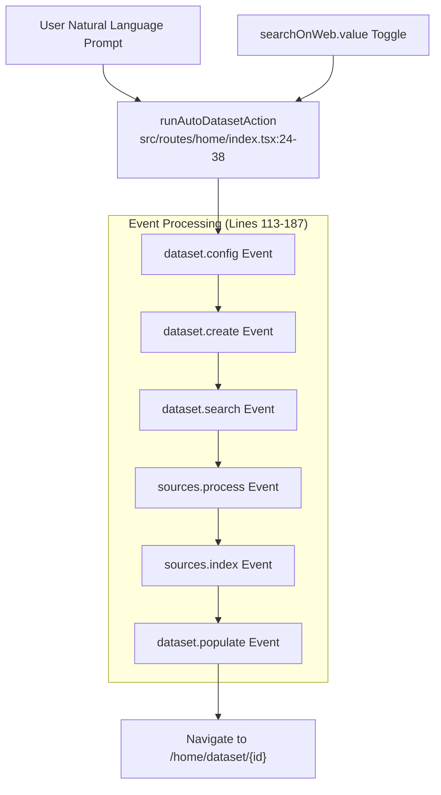

Sources: [src/routes/home/index.tsx:24-200]()

## Data Import and Processing Systems

AI Sheets supports multiple data ingestion methods, each handling different file formats and sources with validation and transformation pipelines.

### Import Methods and File Processing

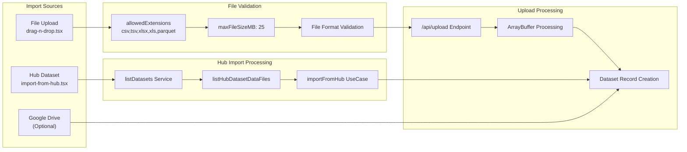

Sources: [src/features/import/drag-n-drop.tsx:33-84](), [src/features/import/import-from-hub.tsx:25-136]()

## Technology Stack and Dependencies

The system leverages a modern JavaScript/TypeScript stack with specialized databases and AI/ML libraries for comprehensive dataset processing capabilities.

### Core Dependencies

| Category | Technology | Purpose | Package Reference |
|----------|------------|---------|-------------------|
| **Frontend Framework** | Qwik 1.14.1 | SSR Web Framework | `@builder.io/qwik` |
| **Backend Runtime** | Express 4.20.0 | HTTP Server | `express` |
| **Application Database** | SQLite 3 | Structured Data Storage | `sqlite3`, `sequelize` |
| **Analytics Database** | DuckDB | Query Processing | `@duckdb/node-api` |
| **Vector Database** | LanceDB | Embeddings & Search | `@lancedb/lancedb` |
| **AI/ML Integration** | Hugging Face Suite | Model Access & Inference | `@huggingface/hub`, `@huggingface/inference` |
| **Web Automation** | Playwright | Content Extraction | `playwright` |
| **Content Processing** | Marked | Markdown Processing | `marked` |

Sources: [package.json:70-94]()

## Deployment and Infrastructure

AI Sheets supports multiple deployment strategies with containerized production builds and development environments optimized for AI workloads.

### Deployment Architecture

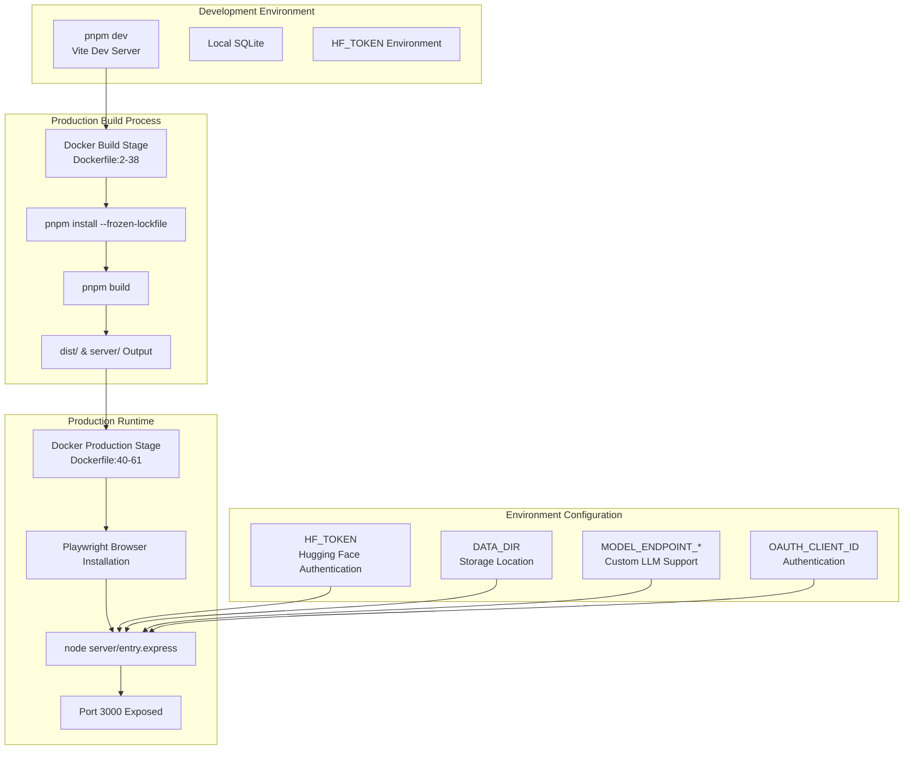

Sources: [Dockerfile:1-61](), [package.json:14-34](), [README.md:92-189]()

## AI Model Integration and Processing

The system provides extensive AI model integration capabilities with support for custom inference endpoints and batch processing workflows for large-scale dataset enhancement.

### Model Processing Pipeline

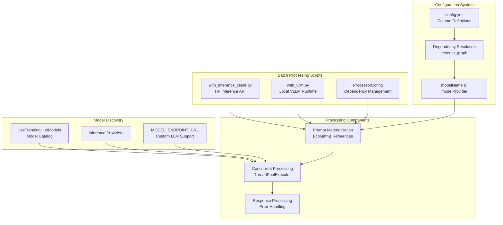

Sources: [scripts/extend_dataset/with_inference_client.py:1-492](), [scripts/extend_dataset/with_vllm.py:1-339](), [scripts/extend_dataset/topics_extraction.config.yml:1-31]()

## Data Storage Architecture

AI Sheets implements a multi-database strategy optimized for different data access patterns, from transactional operations to analytics and vector similarity search.

### Database Integration Layer

```mermaid
graph TB
    subgraph "Application Data (SQLite)"
        UserSessions["User Sessions"]
        DatasetMetadata["Dataset Metadata"]
        ColumnDefinitions["Column Definitions"]
        ProcessTracking["Process Status"]
    end
    
    subgraph "Analytics Data (DuckDB)"
        DataProcessing["Data Processing Queries"]
        AggregationOps["Aggregation Operations"]
        ColumnAnalysis["Column Analysis"]
    end
    
    subgraph "Vector Data (LanceDB)"
        TextEmbeddings["Text Embeddings"]
        SourceIndexing["Source Document Index"]
        SimilaritySearch["Vector Similarity Queries"]
    end
    
    subgraph "File System Storage"
        UploadedFiles["Uploaded Dataset Files"]
        CacheData["Processing Cache"]
        TempFiles["Temporary Files"]
    end
    
    subgraph "Service Layer Access"
        SequelizeORM["Sequelize ORM<br/>SQLite Operations"]
        DuckDBAPI["@duckdb/node-api<br/>Analytics Queries"]
        LanceDBClient["@lancedb/lancedb<br/>Vector Operations"]
        FileOperations["Node.js fs Module"]
    end
    
    UserSessions --> SequelizeORM
    DatasetMetadata --> SequelizeORM
    ColumnDefinitions --> SequelizeORM
    ProcessTracking --> SequelizeORM
    
    DataProcessing --> DuckDBAPI
    AggregationOps --> DuckDBAPI
    ColumnAnalysis --> DuckDBAPI
    
    TextEmbeddings --> LanceDBClient
    SourceIndexing --> LanceDBClient
    SimilaritySearch --> LanceDBClient
    
    UploadedFiles --> FileOperations
    CacheData --> FileOperations
    TempFiles --> FileOperations
```

Sources: [package.json:71-77](), [package.json:91-92]()

---

# Page: Getting Started

# Getting Started

<details>
<summary>Relevant source files</summary>

The following files were used as context for generating this wiki page:

- [CUSTOMIZATION.md](CUSTOMIZATION.md)
- [Dockerfile](Dockerfile)
- [package.json](package.json)
- [pnpm-lock.yaml](pnpm-lock.yaml)
- [src/config.ts](src/config.ts)
- [src/routes/api/upload/index.ts](src/routes/api/upload/index.ts)
- [src/routes/auth/index.tsx](src/routes/auth/index.tsx)
- [src/services/db/db.ts](src/services/db/db.ts)
- [src/services/db/duckdb.ts](src/services/db/duckdb.ts)
- [src/services/websearch/embed/engine.ts](src/services/websearch/embed/engine.ts)
- [src/services/websearch/search-sources.ts](src/services/websearch/search-sources.ts)

</details>


This document covers installation, configuration, and initial setup for AI Sheets. It provides step-by-step instructions for deploying the application locally or with Docker, configuring authentication, and customizing AI model endpoints.

For detailed information about the core functional systems, see [Core Systems](#3). For UI component documentation, see [UI Components](#5).

## System Requirements

AI Sheets requires Node.js 18.17.0 or higher and uses several key technologies:

| Component | Purpose | Storage Location |
|-----------|---------|------------------|
| SQLite | Application data | `DATA_DIR/.sqlite3` |
| DuckDB | Analytics queries | `DATA_DIR/duckdb` |
| LanceDB | Vector embeddings | `DATA_DIR/embeddings` |
| File System | Uploads and temp files | `DATA_DIR/uploads` |

The system supports multiple AI inference providers and can be configured with custom LLM endpoints that follow the OpenAI API specification.

**Sources:** [package.json:4-6](), [src/config.ts:35](), [src/config.ts:282-287]()

## Installation Methods

### Local Development Setup

Install dependencies and start the development server:

```bash
# Install dependencies with pnpm
pnpm install

# Start development server with SSR
pnpm dev

# Alternative: start with browser opening
pnpm start
```

The application will be available at `http://localhost:5173` in development mode.

**Sources:** [package.json:22](), [package.json:30]()

### Docker Deployment

Build and run the application using the provided Dockerfile:

```bash
# Build the Docker image
docker build -t ai-sheets .

# Run the container
docker run -p 3000:3000 -v $(pwd)/data:/usr/src/app/data ai-sheets
```

The Docker build process uses a multi-stage approach with Debian-based Node.js images and includes Playwright for web scraping capabilities.

**Sources:** [Dockerfile:1-61]()

## Configuration Architecture

The application configuration is centralized in the `appConfig` object, which consolidates environment variables and defaults:

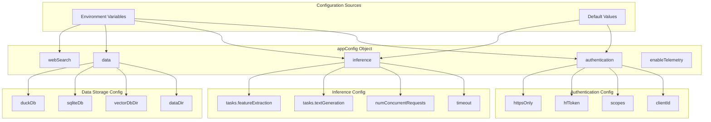

**Sources:** [src/config.ts:247-295]()

## Authentication Setup

AI Sheets supports two authentication methods through the `appConfig.authentication` configuration:

### OAuth Flow (Recommended)

Set up OAuth authentication with Hugging Face:

```bash
export OAUTH_CLIENT_ID="your_client_id"
export OAUTH_SCOPES="openid profile inference-api manage-repos"
export OAUTH_HTTPS_ONLY="true"  # Set to false for local development
```

The OAuth flow is handled by the `/auth/` route handlers:

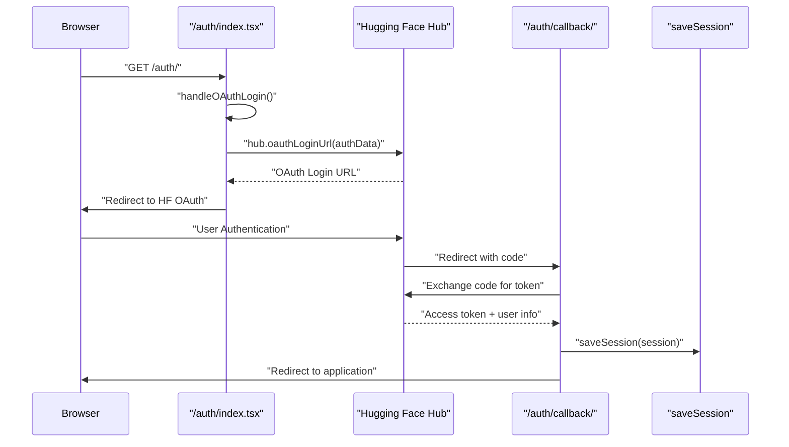

**Sources:** [src/routes/auth/index.tsx:20-58](), [src/config.ts:248-253]()

### HF Token Authentication

For development or automated setups, use a Hugging Face token directly:

```bash
export HF_TOKEN="your_huggingface_token"
```

The token authentication bypasses OAuth and directly validates the token with Hugging Face's `whoAmI` API.

**Sources:** [src/routes/auth/index.tsx:60-86](), [src/config.ts:8]()

## Database Initialization

AI Sheets automatically initializes its multi-database architecture on startup:

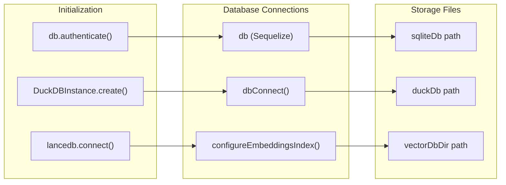

The databases serve different purposes:
- **SQLite** (`db`): Application data models via Sequelize ORM
- **DuckDB** (`dbConnect`): Analytics and large dataset operations  
- **LanceDB** (`embeddingsIndex`): Vector storage for semantic search

**Sources:** [src/services/db/db.ts:11-24](), [src/services/db/duckdb.ts:8-40](), [src/services/websearch/embed/engine.ts:71-108]()

## AI Model Configuration

### Default Inference Setup

The default configuration uses Hugging Face Inference API with these settings:

```bash
export DEFAULT_MODEL="meta-llama/Llama-3.3-70B-Instruct"
export DEFAULT_MODEL_PROVIDER="nebius"
export NUM_CONCURRENT_REQUESTS="5"  # Max 10
export INFERENCE_TIMEOUT="90000"  # 90 seconds
```

**Sources:** [src/config.ts:66-74](), [src/config.ts:54-60](), [src/config.ts:45]()

### Custom LLM Endpoints

To use custom LLM endpoints (e.g., Ollama, custom OpenAI-compatible servers):

```bash
export MODEL_ENDPOINT_URL="http://localhost:11434"
export MODEL_ENDPOINT_NAME="llama3"
```

When these variables are set, the application routes text generation requests to your custom endpoint instead of the default Hugging Face providers. The endpoint must implement the OpenAI API specification.

**Example Ollama Setup:**

```bash
# Start Ollama server
export OLLAMA_NOHISTORY=1
ollama serve

# Run your model
ollama run llama3

# Configure AI Sheets
export MODEL_ENDPOINT_URL="http://localhost:11434" 
export MODEL_ENDPOINT_NAME="llama3"

# Start AI Sheets
pnpm serve
```

**Sources:** [CUSTOMIZATION.md:9-23](), [src/config.ts:90-100]()

## Web Search Integration

Enable web search capabilities for AI-enhanced data enrichment:

```bash
export SERPER_API_KEY="your_serper_api_key"
export BLOCKED_URLS="youtube.com,x.com,bloomberg.com,nytimes.com"
```

The web search system integrates with the vector embedding pipeline to provide context for AI generation:

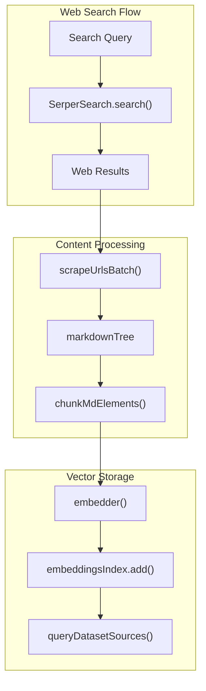

**Sources:** [src/config.ts:184](), [src/config.ts:191-193](), [src/services/websearch/search-sources.ts:177-224]()

## Environment Configuration File

Create a `.env` file in the project root with your configuration:

```bash
# Authentication (choose one)
OAUTH_CLIENT_ID=your_oauth_client_id
# OR
HF_TOKEN=your_hugging_face_token

# Data Directory
DATA_DIR=./data

# AI Models (optional - uses defaults if not set)
DEFAULT_MODEL=meta-llama/Llama-3.3-70B-Instruct
DEFAULT_MODEL_PROVIDER=nebius

# Custom LLM (optional)
MODEL_ENDPOINT_URL=http://localhost:11434
MODEL_ENDPOINT_NAME=llama3

# Web Search (optional)
SERPER_API_KEY=your_serper_api_key

# Performance Tuning (optional)
NUM_CONCURRENT_REQUESTS=5
INFERENCE_TIMEOUT=90000
```

**Sources:** [src/config.ts:8-295]()

## Verification and First Run

After configuration, verify the setup:

1. **Start the application** using your chosen method (local or Docker)
2. **Access the interface** at `http://localhost:5173` (dev) or `http://localhost:3000` (production)
3. **Complete authentication** through the `/auth/` endpoint
4. **Check database initialization** in the console logs for successful connections
5. **Test file upload** functionality via the `/api/upload/` endpoint

The application creates the necessary directories and database files automatically on first run based on your `DATA_DIR` configuration.

**Sources:** [package.json:22](), [package.json:29](), [src/routes/api/upload/index.ts:11-36]()

---

# Page: Core Systems

# Core Systems

<details>
<summary>Relevant source files</summary>

The following files were used as context for generating this wiki page:

- [src/features/add-column/components/template-textarea.tsx](src/features/add-column/components/template-textarea.tsx)
- [src/features/add-column/form/execution-form.tsx](src/features/add-column/form/execution-form.tsx)
- [src/features/table/table-body.tsx](src/features/table/table-body.tsx)
- [src/services/inference/run-prompt-execution.ts](src/services/inference/run-prompt-execution.ts)
- [src/services/repository/hub/telemetry.ts](src/services/repository/hub/telemetry.ts)
- [src/usecases/generate-cells.ts](src/usecases/generate-cells.ts)
- [src/usecases/run-autodataset.ts](src/usecases/run-autodataset.ts)

</details>


This document provides an overview of the four primary functional systems that make up AI Sheets: Dataset Management, Table Interface, AI Integration, and Data Storage. These systems work together to enable no-code AI-powered dataset creation and enrichment.

For detailed information about specific aspects of these systems, see [Dataset Management](#3.1), [Table Interface](#3.2), [AI Integration](#3.3), and [Data Storage](#3.4). For implementation details of the frontend and backend architecture, see [Frontend Architecture](#4.1) and [Backend Architecture](#4.2).

## System Overview

AI Sheets is built around four interconnected core systems that handle different aspects of the platform's functionality.

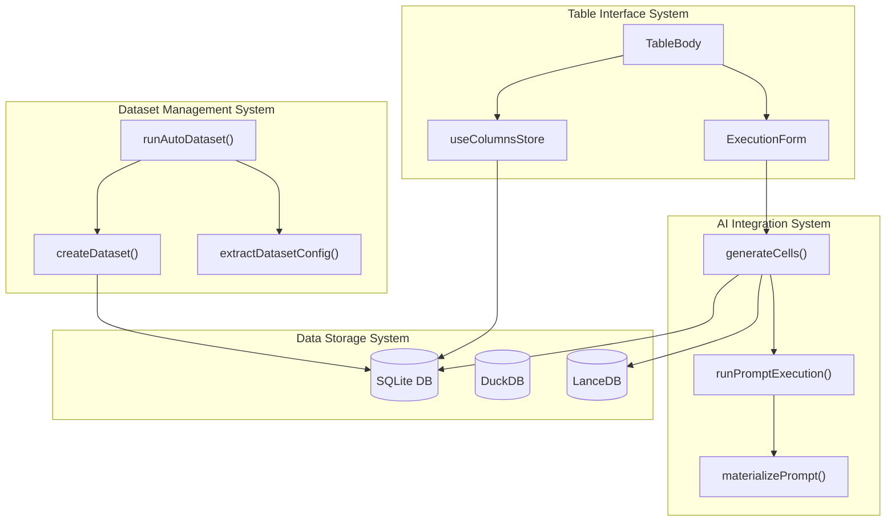

Sources: [src/usecases/run-autodataset.ts:1-684](), [src/features/table/table-body.tsx:1-470](), [src/features/add-column/form/execution-form.tsx:1-565](), [src/usecases/generate-cells.ts:1-711]()

## Dataset Management System

The Dataset Management system handles the creation, import, and export of datasets. It includes AI-powered dataset generation from natural language prompts.

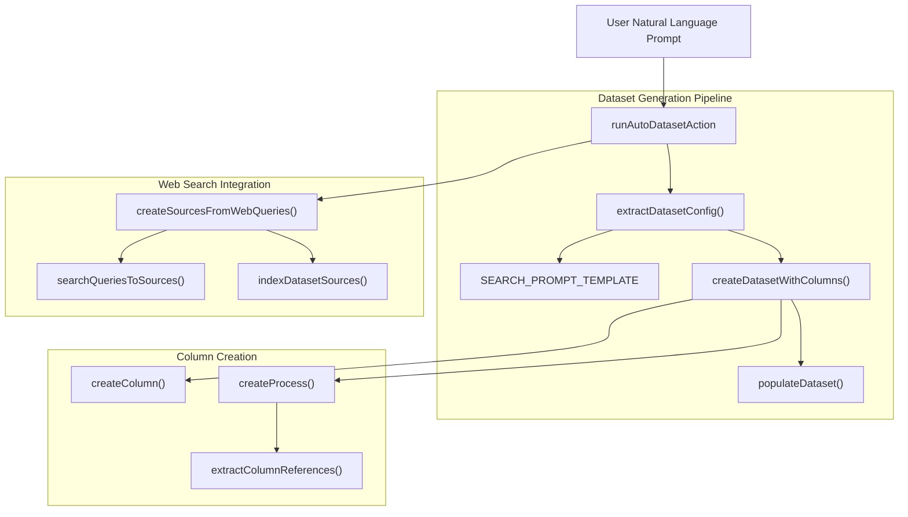

The system uses structured prompts to extract dataset configuration from user instructions. The `SEARCH_PROMPT_TEMPLATE` and `NO_SEARCH_PROMPT_TEMPLATE` constants define the format for AI responses, ensuring consistent parsing of dataset names, columns, and search queries.

**Key Components:**
- `runAutoDataset()` - Main orchestrator function that processes user prompts into datasets
- `extractDatasetConfig()` - Parses LLM responses into structured dataset configurations  
- `createDatasetWithColumns()` - Creates database records for datasets and their columns
- `extractColumnReferences()` - Identifies column dependencies using `{{column_name}}` syntax

Sources: [src/usecases/run-autodataset.ts:46-683](), [src/usecases/run-autodataset.ts:188-234](), [src/usecases/run-autodataset.ts:340-416](), [src/usecases/run-autodataset.ts:421-437]()

## Table Interface System

The Table Interface system provides an interactive spreadsheet-like interface for viewing and editing datasets. It handles cell rendering, column management, and user interactions.

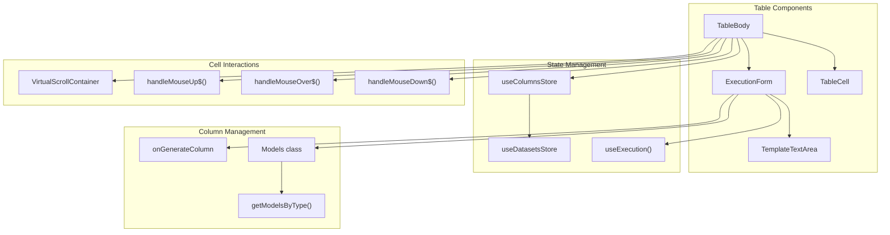

The interface supports virtual scrolling for large datasets and provides drag-to-generate functionality where users can select cell ranges for batch AI generation.

**Key Components:**
- `TableBody` - Main table component with virtual scrolling and cell interaction handlers
- `ExecutionForm` - Configuration panel for AI model selection and prompt editing  
- `TemplateTextArea` - Prompt editor with variable substitution using `{{column_name}}` syntax
- `Models` class - Manages available AI models and filters by supported types (text/image)

Sources: [src/features/table/table-body.tsx:36-442](), [src/features/add-column/form/execution-form.tsx:72-564](), [src/features/add-column/components/template-textarea.tsx:30-257](), [src/features/add-column/form/execution-form.tsx:51-70]()

## AI Integration System

The AI Integration system orchestrates the generation of cell content using various AI models and providers. It handles prompt materialization, context enhancement, and streaming responses.

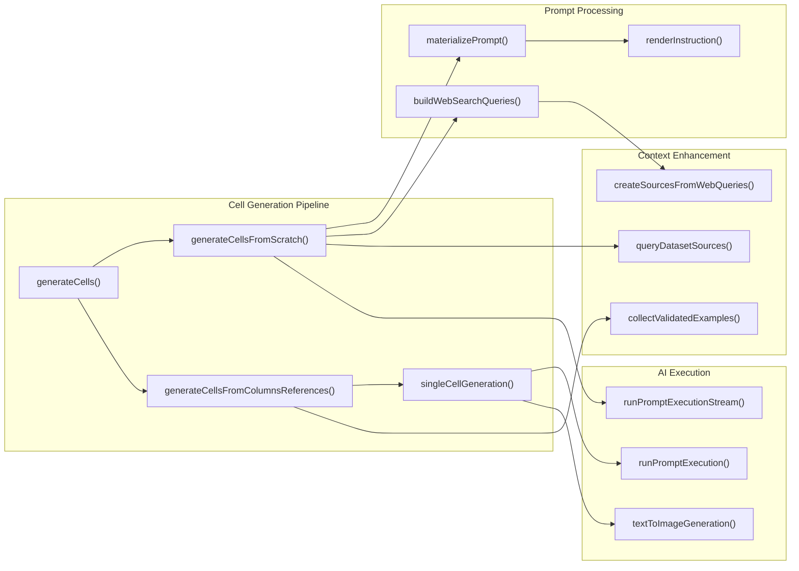

The system supports two generation modes: generating cells from scratch using prompts, and generating cells based on references to other columns. It includes web search integration and streaming responses for real-time updates.

**Key Components:**
- `generateCells()` - Main generator function that yields cell updates as they're processed
- `materializePrompt()` - Replaces template variables with actual data values
- `buildWebSearchQueries()` - Creates search queries from prompts for context enhancement
- `runPromptExecution()` and `runPromptExecutionStream()` - Execute AI inference with caching

Sources: [src/usecases/generate-cells.ts:72-132](), [src/usecases/generate-cells.ts:533-613](), [src/services/inference/run-prompt-execution.ts:43-108](), [src/services/inference/run-prompt-execution.ts:110-179]()

## Data Storage System

The Data Storage system uses a multi-database architecture to handle different types of data efficiently. Each database serves a specific purpose in the overall system.

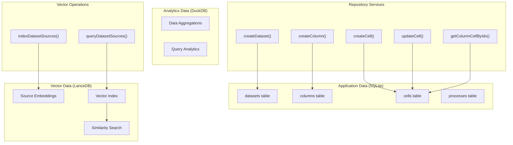

**Database Responsibilities:**

| Database | Purpose | Key Operations |
|----------|---------|----------------|
| SQLite | Application state, user data | `createDataset()`, `createColumn()`, `updateCell()` |
| DuckDB | Analytics queries, aggregations | Data analysis, reporting |
| LanceDB | Vector embeddings, similarity search | `indexDatasetSources()`, `queryDatasetSources()` |

The storage layer provides repository services that abstract database operations and handle data consistency across the three database systems.

Sources: [src/services/repository/cells:21-24](), [src/services/websearch/embed:26-27](), [src/usecases/generate-cells.ts:198-207](), [src/usecases/generate-cells.ts:658-667]()

## System Interactions

The four core systems work together through well-defined interfaces and shared state management:

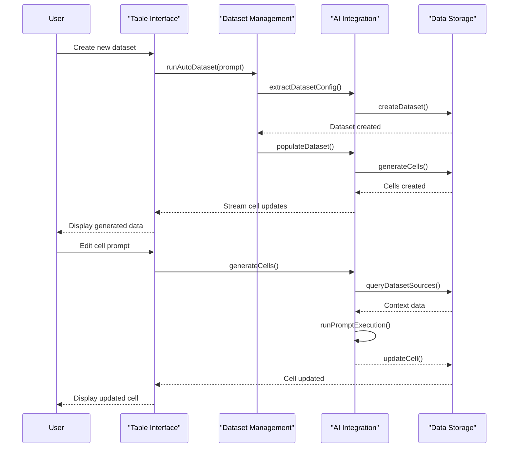

The systems communicate through:
- **Event streaming** for real-time updates during AI generation
- **State stores** (`useColumnsStore`, `useDatasetsStore`) for reactive UI updates  
- **Repository pattern** for consistent data access across storage systems
- **Generator functions** for handling long-running AI operations with progress updates

Sources: [src/state:40-42](), [src/features/add-column/form/execution.ts:33](), [src/usecases/generate-cells.ts:72-132](), [src/usecases/run-autodataset.ts:594-683]()

---

# Page: Dataset Management

# Dataset Management

<details>
<summary>Relevant source files</summary>

The following files were used as context for generating this wiki page:

- [.gitignore](.gitignore)
- [src/features/datasets/dataset-name.tsx](src/features/datasets/dataset-name.tsx)
- [src/features/export/export-to-hub.tsx](src/features/export/export-to-hub.tsx)
- [src/features/export/save-dataset.tsx](src/features/export/save-dataset.tsx)
- [src/loaders/dataset.ts](src/loaders/dataset.ts)
- [src/routes/home/dataset/[id]/json/index.tsx](src/routes/home/dataset/[id]/json/index.tsx)
- [src/routes/home/dataset/[id]/json/utils.ts](src/routes/home/dataset/[id]/json/utils.ts)
- [src/services/repository/datasets.ts](src/services/repository/datasets.ts)
- [src/state/datasets.tsx](src/state/datasets.tsx)
- [src/usecases/create-dataset-config.ts](src/usecases/create-dataset-config.ts)
- [src/usecases/export-to-hub.usecase.ts](src/usecases/export-to-hub.usecase.ts)
- [src/usecases/import-from-url.usecase.ts](src/usecases/import-from-url.usecase.ts)

</details>


This document covers the comprehensive dataset management system in AI Sheets, including creation, import, export, and storage operations. The dataset management layer serves as the foundation for all data operations within the platform, providing CRUD operations, file imports, and integration with external data sources including Hugging Face Hub.

For information about the table interface and user interactions with dataset contents, see [Table Interface](#3.2). For details about the underlying data storage architecture, see [Data Storage](#3.4).

## Dataset Lifecycle Overview

The dataset management system handles the complete lifecycle from creation through deletion, supporting multiple creation methods and export formats.

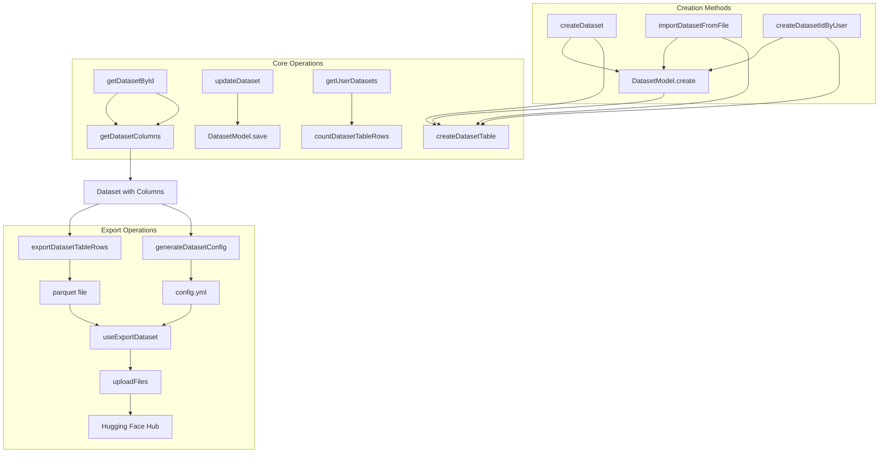

**Sources:** [src/services/repository/datasets.ts:18-145](), [src/usecases/export-to-hub.usecase.ts:21-83]()

## Dataset Creation

### Basic Dataset Creation

The system provides multiple pathways for dataset creation, each serving different use cases and data sources.

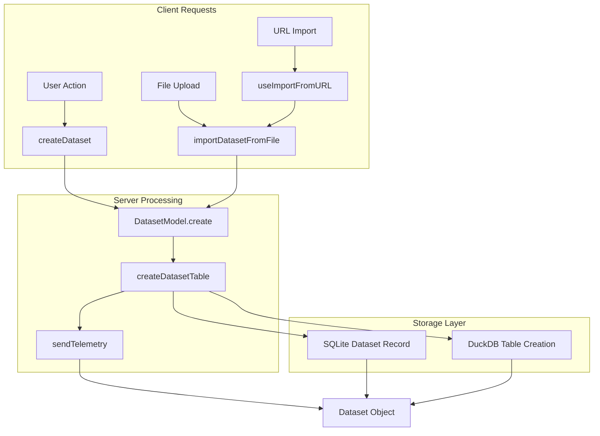

**Sources:** [src/services/repository/datasets.ts:115-145](), [src/usecases/import-from-url.usecase.ts:6-34]()

The `createDataset` function in [src/services/repository/datasets.ts:115-145]() handles basic dataset creation with name validation and automatic table creation. The system enforces a 100-character limit on dataset names and ensures proper cleanup on creation failure.

### File-Based Import

The `importDatasetFromFile` function supports multiple file formats and external data sources:

| Format | Support | Limitations |
|--------|---------|-------------|
| CSV | Full | Row limit configurable |
| Parquet | Full | Native DuckDB support |
| JSON | Full | Automatic schema detection |
| Google Sheets | Partial | Requires secret token |

**Sources:** [src/services/repository/datasets.ts:58-113](), [src/usecases/import-from-url.usecase.ts:21-34]()

## Dataset State Management

### Active Dataset Context

The dataset state management uses Qwik's context system to provide reactive access to the currently active dataset across components.

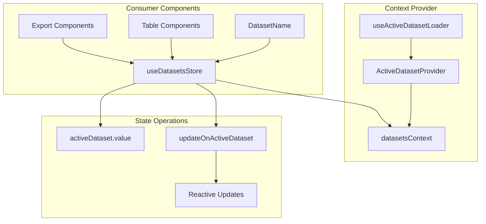

**Sources:** [src/state/datasets.tsx:25-41](), [src/loaders/dataset.ts:13-28]()

The `useDatasetsStore` hook provides access to the active dataset and update functions. The `updateOnActiveDataset` function enables reactive updates across the application when dataset properties change.

## Dataset Name Management

### Inline Editing System

The dataset name editing system provides a seamless user experience with validation and error handling.

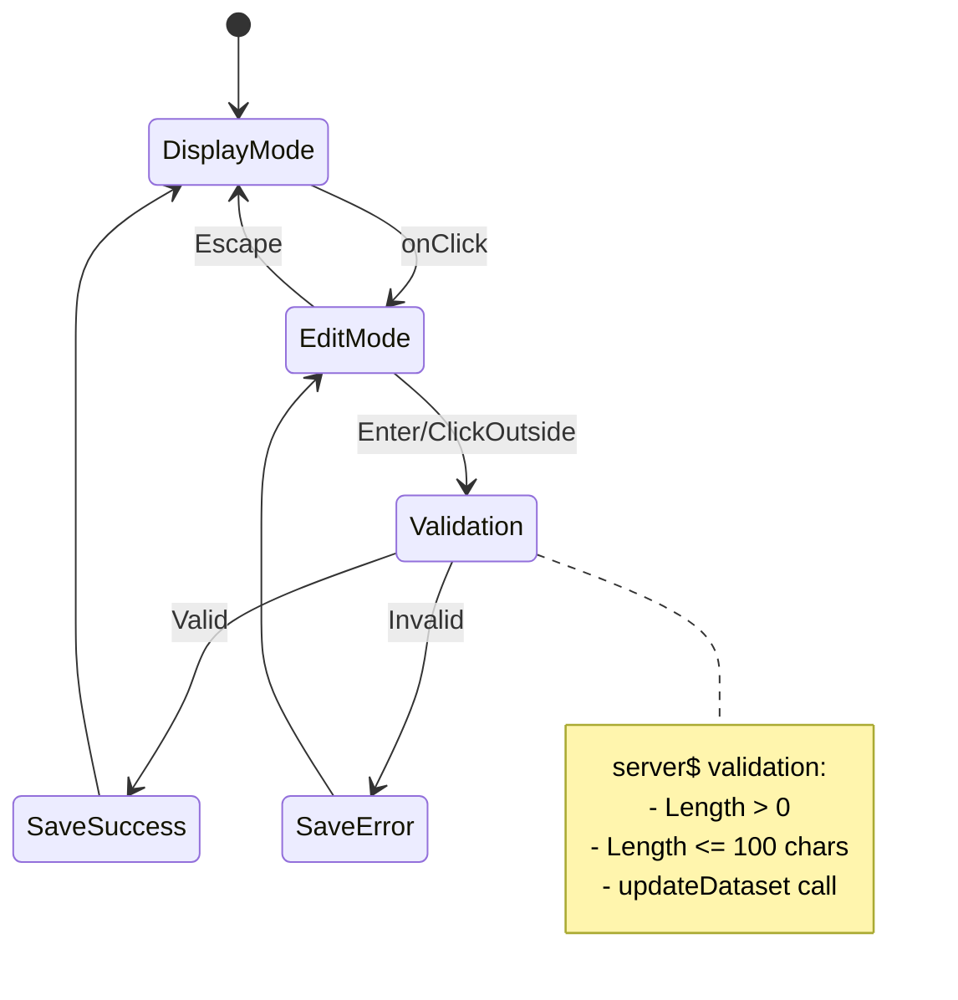

**Sources:** [src/features/datasets/dataset-name.tsx:29-59](), [src/features/datasets/dataset-name.tsx:88-100]()

The `DatasetName` component implements real-time validation with server-side enforcement through the `updateDataset` repository function.

## Export System

### Hugging Face Hub Integration

The export system provides seamless integration with Hugging Face Hub for dataset publishing and sharing.

```mermaid
sequenceDiagram
    participant UI as "ExportToHub Component"
    participant Server as "useExportDataset"
    participant Config as "generateDatasetConfig"
    participant Hub as "Hugging Face Hub API"
    
    UI->>Server: Export request with params
    Server->>Config: Generate dataset.yml config
    Config-->>Server: YAML configuration
    Server->>Server: Export to parquet format
    Server->>Hub: createRepo with README
    Server->>Hub: uploadFiles (parquet + config)
    Hub-->>Server: Repository URL
    Server-->>UI: Success with repo ID
```

**Sources:** [src/usecases/export-to-hub.usecase.ts:21-83](), [src/features/export/export-to-hub.tsx:45-63]()

The export process generates comprehensive metadata including dataset configuration, feature information, and structured README files that comply with Hugging Face dataset standards.

### Configuration Generation

The `generateDatasetConfig` function creates detailed metadata for exported datasets:

```mermaid
graph LR
    subgraph "Input Processing"
        A["Dataset.columns"] --> B[Filter AI Columns]
        B --> C[Extract Process Config]
    end
    
    subgraph "Prompt Materialization"
        C --> D[materializePrompt]
        D --> E[collectValidatedExamples]
        E --> F[Template Generation]
    end
    
    subgraph "Output Generation"
        F --> G["Column Configurations"]
        G --> H[config.yml]
        G --> I[README.md with features]
    end
```

**Sources:** [src/usecases/create-dataset-config.ts:6-49](), [src/usecases/export-to-hub.usecase.ts:85-136]()

## Data Retrieval and Loading

### Dataset Loading Pipeline

The system implements efficient dataset loading with eager column and cell loading for optimal performance.

```mermaid
graph TD
    subgraph "Route Loading"
        A[useActiveDatasetLoader] --> B[getDatasetById]
        C[useAllDatasetsLoader] --> D[getUserDatasets]
    end
    
    subgraph "Data Assembly"
        B --> E[getDatasetColumns]
        E --> F[getColumnCells]
        F --> G["Complete Dataset Object"]
        D --> H[countDatasetTableRows]
        H --> I["Dataset List with Sizes"]
    end
    
    subgraph "Performance Optimization"
        G --> J["Eager Loading Comment"]
        J --> K["table-body rendering optimization"]
    end
```

**Sources:** [src/services/repository/datasets.ts:147-177](), [src/loaders/dataset.ts:13-36]()

The comment in [src/services/repository/datasets.ts:165-167]() indicates performance optimization through eager loading to prevent rendering issues in the table-body component.

## File Export Options

### Multiple Format Support

The system supports various export formats through a unified interface:

```mermaid
graph TB
    subgraph "Export Interface"
        A[SaveDataset] --> B[Popover Menu]
        B --> C[ExportToHub]
        B --> D[FileDownload CSV]
        B --> E[FileDownload Parquet]
    end
    
    subgraph "Format Handlers"
        C --> F[Hub API Upload]
        D --> G[CSV Generation]
        E --> H[Parquet Generation]
    end
    
    subgraph "Authentication"
        I[useSession] --> C
        I --> J[Anonymous Check]
        J --> K[Conditional Hub Export]
    end
```

**Sources:** [src/features/export/save-dataset.tsx:12-47]()

The export system conditionally displays Hugging Face Hub export options based on user authentication status, while file downloads are always available.

## Database Integration

### Multi-Database Architecture

The dataset management system coordinates between multiple database systems for different purposes:

| Database | Purpose | Operations |
|----------|---------|------------|
| SQLite | Dataset metadata | `DatasetModel.create`, `findByPk` |
| DuckDB | Table data storage | `createDatasetTable`, `exportDatasetTableRows` |
| LanceDB | Vector embeddings | Source indexing, similarity search |

**Sources:** [src/services/repository/datasets.ts:26-28](), [src/services/repository/tables.ts]()

The `createDatasetTable` function bridges SQLite metadata with DuckDB table creation, while the export functions generate Parquet files directly from DuckDB queries for optimal performance.

---

# Page: Table Interface

# Table Interface

<details>
<summary>Relevant source files</summary>

The following files were used as context for generating this wiki page:

- [src/features/add-column/components/template-textarea.tsx](src/features/add-column/components/template-textarea.tsx)
- [src/features/add-column/form/execution-form.tsx](src/features/add-column/form/execution-form.tsx)
- [src/features/table/components/header/cell-header.tsx](src/features/table/components/header/cell-header.tsx)
- [src/features/table/table-body.tsx](src/features/table/table-body.tsx)
- [src/features/table/table-cell.tsx](src/features/table/table-cell.tsx)
- [src/features/table/table-header.tsx](src/features/table/table-header.tsx)
- [src/features/table/table-view.tsx](src/features/table/table-view.tsx)
- [src/features/table/table.tsx](src/features/table/table.tsx)
- [src/features/user/username.tsx](src/features/user/username.tsx)

</details>


The Table Interface is the primary interactive component for displaying and manipulating datasets in AI Sheets. It provides a spreadsheet-like interface with dynamic column generation, AI-powered cell population, virtual scrolling for performance, and comprehensive user interaction capabilities. For information about dataset creation and management, see [Dataset Management](#3.1). For details about column-specific operations, see [Column Management](#3.2.1).

## System Architecture

The Table Interface is built as a hierarchical component system with clear separation of concerns between layout, data presentation, and user interactions.

```mermaid
graph TD
    Table["Table"] --> ExecutionProvider["ExecutionProvider"]
    Table --> TableView["TableView"]
    Table --> TableHeader["TableHeader"]
    Table --> TableBody["TableBody"]
    
    TableHeader --> TableCellHeader["TableCellHeader"]
    TableHeader --> TableAddCellHeaderPlaceHolder["TableAddCellHeaderPlaceHolder"]
    TableHeader --> ExecutionForm["ExecutionForm"]
    
    TableBody --> VirtualScrollContainer["VirtualScrollContainer"]
    TableBody --> TableCell["TableCell"]
    
    TableCell --> CellRenderer["CellRenderer"]
    TableCell --> CellSkeleton["CellSkeleton"]
    TableCell --> CellError["CellError"]
    
    ExecutionForm --> TemplateTextArea["TemplateTextArea"]
    ExecutionForm --> Models["Models"]
    
    TableCellHeader --> CellGeneration["CellGeneration"]
    TableCellHeader --> CellSettings["CellSettings"]
    TableCellHeader --> DeleteColumn["DeleteColumn"]
    TableCellHeader --> HideColumn["HideColumn"]
```

**Sources:** [src/features/table/table.tsx:1-22](), [src/features/table/table-header.tsx:1-279](), [src/features/table/table-body.tsx:1-469](), [src/features/table/table-cell.tsx:1-21]()

## Main Table Component Structure

The root `Table` component establishes the layout and provides context for all child components through the `ExecutionProvider`.

| Component | Purpose | Key Features |
|-----------|---------|--------------|
| `Table` | Root container | Provides execution context, layout structure |
| `TableView` | Column visibility controls | Toggle column visibility, multi-column management |
| `TableHeader` | Column headers and controls | Column titles, resizing, execution forms |
| `TableBody` | Data rows and cells | Virtual scrolling, cell interactions, row selection |

The table uses CSS Grid for layout with virtual scrolling implemented through `VirtualScrollContainer`. The structure supports both static columns and dynamic AI-generated columns.

**Sources:** [src/features/table/table.tsx:7-22](), [src/features/table/table-view.tsx:7-35]()

## Column Management System

The table header manages column operations including creation, configuration, and deletion. Each column header contains multiple interactive elements.

```mermaid
flowchart TD
    subgraph "Column Header Components"
        TableCellHeader["TableCellHeader"]
        TableCellHeader --> CellGeneration["CellGeneration"]
        TableCellHeader --> CellSettings["CellSettings"]
        TableCellHeader --> ColumnNameEdition["ColumnNameEdition"]
        TableCellHeader --> DeleteColumn["DeleteColumn"]
        TableCellHeader --> HideColumn["HideColumn"]
        TableCellHeader --> DuplicateColumn["DuplicateColumn"]
    end
    
    subgraph "Column Types"
        StaticColumn["Static Columns (kind: 'static')"]
        DynamicColumn["Dynamic Columns (AI-generated)"]
        TemporalColumn["Temporal Column (TEMPORAL_ID)"]
    end
    
    subgraph "Column Operations"
        Resize["Column Resizing"]
        AutoResize["Auto-resize (double-click)"]
        VisibilityToggle["Hide/Show Column"]
        DuplicateOp["Duplicate Column"]
        DeleteOp["Delete Column"]
    end
    
    TableCellHeader --> StaticColumn
    TableCellHeader --> DynamicColumn
    TableCellHeader --> TemporalColumn
```

The column header system supports resizable columns with a maximum width of 1000px. Auto-resize functionality measures text content to determine optimal column width.

**Sources:** [src/features/table/components/header/cell-header.tsx:20-91](), [src/features/table/table-header.tsx:34-101]()

## Cell Rendering Pipeline

Each cell in the table goes through a structured rendering pipeline that handles different data types, states, and user interactions.

```mermaid
flowchart TD
    TableCell["TableCell"] --> CellSkeleton["CellSkeleton"]
    TableCell --> CellError["CellError"]
    TableCell --> CellRenderer["CellRenderer"]
    
    subgraph "Cell States"
        EmptyCell["Empty Cell (skeleton)"]
        LoadingCell["Generating Cell"]
        ErrorCell["Error State"]
        ValidCell["Valid Content"]
    end
    
    subgraph "Cell Types"
        TextCell["Text Cell"]
        ImageCell["Image Cell"]
        BlobCell["Blob Content"]
        ArrayCell["Array Type"]
        ObjectCell["Object Type"]
    end
    
    CellRenderer --> TextCell
    CellRenderer --> ImageCell
    CellRenderer --> BlobCell
    CellRenderer --> ArrayCell
    CellRenderer --> ObjectCell
    
    subgraph "Interaction Handlers"
        MouseDown["handleMouseDown$"]
        MouseOver["handleMouseOver$"]
        MouseUp["handleMouseUp$"]
        DragSelection["Cell Range Selection"]
    end
    
    TableCell --> MouseDown
    MouseDown --> MouseOver
    MouseOver --> MouseUp
    MouseUp --> DragSelection
```

Cells support drag selection for batch operations and AI generation across multiple rows. The rendering system handles temporal cells for skeleton display during data loading.

**Sources:** [src/features/table/table-cell.tsx:7-21](), [src/features/table/table-body.tsx:131-224]()

## Execution Form System

The Execution Form provides the interface for configuring AI-powered column generation. It appears as an expandable section within the table header when adding or editing columns.

```mermaid
graph TB
    subgraph "ExecutionForm Components"
        ExecutionForm["ExecutionForm"]
        ExecutionForm --> TemplateTextArea["TemplateTextArea"]
        ExecutionForm --> ModelSelection["Model Selection"]
        ExecutionForm --> ProviderSelection["Provider Selection"]
        ExecutionForm --> WebSearchToggle["Web Search Toggle"]
        ExecutionForm --> CustomEndpoint["Custom Endpoint"]
    end
    
    subgraph "Template System"
        TemplateTextArea --> VariableDetection["Variable Detection {{variable}}"]
        TemplateTextArea --> VariablePopover["Variable Selection Popover"]
        TemplateTextArea --> PromptValidation["Prompt Validation"]
    end
    
    subgraph "Model Management"
        Models["Models Class"]
        Models --> TextModels["getTextModels()"]
        Models --> ImageModels["getImageModels()"]
        Models --> FilteredModels["Filtered Model List"]
    end
    
    subgraph "Execution Control"
        GenerateButton["Generate Button (LuEgg)"]
        StopButton["Stop Button (LuStopCircle)"]
        ExecutionState["Process Execution State"]
    end
    
    ModelSelection --> Models
    ExecutionForm --> GenerateButton
    ExecutionForm --> StopButton
    GenerateButton --> ExecutionState
    StopButton --> ExecutionState
```

The execution form supports variable substitution using `{{variable}}` syntax, allowing users to reference other columns in their prompts. The form maintains execution state and provides cancellation capabilities.

**Sources:** [src/features/add-column/form/execution-form.tsx:72-564](), [src/features/add-column/components/template-textarea.tsx:30-257]()

## Virtual Scrolling Implementation

The table body implements virtual scrolling for performance optimization when handling large datasets. The system renders only visible rows plus a buffer.

```mermaid
graph TD
    subgraph "Virtual Scrolling System"
        TableBody["TableBody"]
        TableBody --> VirtualScrollContainer["VirtualScrollContainer"]
        TableBody --> DataComputed["data computed signal"]
        TableBody --> ItemRenderer["itemRenderer function"]
    end
    
    subgraph "Performance Optimizations"
        RowSize["rowSize = 108px"]
        DatasetSize["datasetSize = max(dataset.size, 100)"]
        EstimateSize["estimateSize calculation"]
        BufferSize["Virtual buffer sizing"]
    end
    
    subgraph "Data Structure"
        CellMatrix["Cell Matrix (rows × columns)"]
        VisibleColumns["Filtered Visible Columns"]
        TemporalCells["Temporal Cell Generation"]
    end
    
    VirtualScrollContainer --> RowSize
    VirtualScrollContainer --> DatasetSize
    DataComputed --> CellMatrix
    CellMatrix --> VisibleColumns
    CellMatrix --> TemporalCells
```

The virtual scrolling system creates a computed signal that generates a matrix of cells based on visible columns and dataset size. Temporal cells are created for empty positions to maintain consistent layout.

**Sources:** [src/features/table/table-body.tsx:47-84](), [src/features/table/table-body.tsx:249-441]()

## User Interaction Patterns

The table supports various user interaction patterns for data manipulation and selection.

| Interaction | Trigger | Behavior | Implementation |
|-------------|---------|----------|----------------|
| Cell Selection | Mouse down | Single cell selection | `handleMouseDown$` |
| Range Selection | Mouse drag | Multi-cell selection | `handleMouseOver$` + `handleMouseUp$` |
| Row Selection | Click row number | Single/multi-row selection | `handleSelectRow$` |
| Row Deletion | Right-click row | Context menu deletion | `handleDeleteClick$` |
| Column Resizing | Drag column border | Resize column width | `handleResizeStart` |
| Auto-resize | Double-click border | Auto-fit content | `autoResize` function |
| Batch Generation | Drag cell handle | Generate cells in range | `onGenerateColumn` |

The drag selection system supports scrolling during selection by detecting cursor position relative to viewport boundaries and automatically scrolling the table container.

**Sources:** [src/features/table/table-body.tsx:117-247](), [src/features/table/table-header.tsx:34-101]()

## State Management Integration

The Table Interface integrates with the application's state management system through several store hooks.

```mermaid
graph LR
    subgraph "State Stores"
        useColumnsStore["useColumnsStore"]
        useDatasetsStore["useDatasetsStore"]
        useExecution["useExecution"]
    end
    
    subgraph "Store Operations"
        useColumnsStore --> UpdateColumn["updateColumn"]
        useColumnsStore --> DeleteCellByIdx["deleteCellByIdx"]
        useColumnsStore --> RemoveTemporalColumn["removeTemporalColumn"]
        useDatasetsStore --> ActiveDataset["activeDataset"]
        useExecution --> ColumnId["columnId"]
        useExecution --> InitialProcess["initialProcess"]
    end
    
    subgraph "Component Integration"
        TableHeader --> useColumnsStore
        TableBody --> useColumnsStore
        TableBody --> useDatasetsStore
        ExecutionForm --> useExecution
        ExecutionForm --> useColumnsStore
    end
```

The table components maintain reactive connections to the state stores, automatically updating the UI when data changes occur. The execution system manages column generation state and process tracking.

**Sources:** [src/features/table/table-body.tsx:41-44](), [src/features/add-column/form/execution-form.tsx:75-77](), [src/features/table/table-header.tsx:22-22]()

---

# Page: Column Management

# Column Management

<details>
<summary>Relevant source files</summary>

The following files were used as context for generating this wiki page:

- [src/features/table/components/header/add-column-placeholder.tsx](src/features/table/components/header/add-column-placeholder.tsx)
- [src/features/table/components/header/cell-generation.tsx](src/features/table/components/header/cell-generation.tsx)
- [src/features/table/components/header/cell-settings.tsx](src/features/table/components/header/cell-settings.tsx)
- [src/services/repository/columns.ts](src/services/repository/columns.ts)
- [src/state/columns.ts](src/state/columns.ts)
- [src/usecases/add-column.usecase.ts](src/usecases/add-column.usecase.ts)
- [src/usecases/edit-column.usecase.ts](src/usecases/edit-column.usecase.ts)

</details>


## Purpose and Scope

Column Management encompasses the creation, modification, and lifecycle management of table columns within AI Sheets datasets. This system handles both static data columns and dynamic AI-powered columns that generate content through machine learning processes. Column management includes the user interface for adding columns, the state management layer for column operations, and the persistence layer for storing column metadata and configurations.

For information about cell rendering and editing within columns, see [Cell Rendering and Interaction](#3.2.2). For broader dataset operations, see [Dataset Management](#3.1).

## Column Types and Data Model

The column system distinguishes between two fundamental column types defined by the `ColumnKind` enumeration:

| Column Kind | Description | Use Case |
|-------------|-------------|----------|
| `static` | Contains manually entered or imported data | User-provided content, imported dataset columns |
| `dynamic` | Generated through AI processes with prompts | AI-generated content, computed columns |

The core data structures include:

- `Column` interface representing persisted columns with metadata, cells, and optional AI processes
- `CreateColumn` interface for column creation requests
- `Process` interface defining AI generation parameters including model selection, prompts, and column references
- `Cell` interface representing individual table cells with generation state and validation status

**Column Lifecycle States:**
```mermaid
flowchart LR
    A[placeholder] --> B[temporal]
    B --> C[persisted]
    C --> D[updated]
    C --> E[deleted]
    
    A --> |"createPlaceholderColumn"| B
    B --> |"useAddColumnUseCase"| C
    C --> |"useEditColumnUseCase"| D
    C --> |"deleteColumn"| E
```

Sources: [src/state/columns.ts:5-79](), [src/state/columns.ts:82-307]()

## Column Creation Workflow

The column creation process involves a multi-stage workflow from user interaction to persistent storage:

```mermaid
sequenceDiagram
    participant UI as "TableAddCellHeaderPlaceHolder"
    participant Store as "useColumnsStore"
    participant UseCase as "useAddColumnUseCase"
    participant Repo as "columns repository"
    participant Gen as "generateCells"
    
    UI->>Store: "addTemporalColumn(type)"
    Store->>Store: "createPlaceholderColumn"
    UI->>UseCase: "server$ CreateColumn"
    UseCase->>Repo: "createColumn"
    Repo->>UseCase: "Column with id"
    UseCase->>Gen: "generateCells for each row"
    Gen-->>UseCase: "yield Cell updates"
    UseCase-->>UI: "yield Column and Cell updates"
```

**Column Creation Process:**

1. **Placeholder Creation**: The `createPlaceholderColumn` function generates a temporary column with `TEMPORAL_ID` constant for UI preview
2. **Template Selection**: Users select from predefined prompts (translate, extractKeywords, summarize, textToImage, custom) via `TableAddCellHeaderPlaceHolder`
3. **Persistence**: The `useAddColumnUseCase` server function creates the column record and initiates cell generation
4. **Cell Generation**: The system generates cells asynchronously using the configured AI process

Sources: [src/features/table/components/header/add-column-placeholder.tsx:50-157](), [src/usecases/add-column.usecase.ts:11-59](), [src/state/columns.ts:85-217]()

## Column State Management

The column state management is centralized through the `useColumnsStore` hook, which provides reactive state management using Qwik's signal system:

```mermaid
graph TD
    A["useColumnsStore"] --> B["activeDataset.columns"]
    B --> C["createPlaceholderColumn"]
    B --> D["addTemporalColumn"]
    B --> E["removeTemporalColumn"]
    B --> F["addColumn"]
    B --> G["removeColumn"]
    B --> H["updateColumn"]
    B --> I["deleteColumn"]
    B --> J["replaceCell"]
    B --> K["deleteCellByIdx"]
    
    A --> L["firstColumn computed$"]
    A --> M["columns computed$"]
    A --> N["replaceColumns"]
```

**Key State Management Functions:**

| Function | Purpose | Parameters |
|----------|---------|------------|
| `addTemporalColumn` | Creates UI placeholder column | `type?: string, name?: string` |
| `removeTemporalColumn` | Removes temporary UI column | None |
| `addColumn` | Adds persisted column to state | `newbie: Column` |
| `updateColumn` | Updates existing column metadata | `updated: Column` |
| `replaceCell` | Updates or adds cell to column | `cell: Cell` |
| `deleteCellByIdx` | Removes cells by row index | `...idxs: number[]` |

Sources: [src/state/columns.ts:82-307]()

## Column UI Interactions

The table header provides multiple interaction points for column management through specialized components:

```mermaid
graph LR
    A["TableHeader"] --> B["TableAddCellHeaderPlaceHolder"]
    A --> C["CellSettings"]
    A --> D["CellGeneration"]
    
    B --> E["Popover with column templates"]
    B --> F["handleNewColumn"]
    
    C --> G["useExecution open edit mode"]
    D --> H["useGenerateColumn onRegenerateCells"]
    
    E --> I["COLUMN_PROMPTS templates"]
    F --> J["addTemporalColumn + open execution form"]
```

**Column Template Prompts:**

The system provides predefined column templates through the `COLUMN_PROMPTS` constant:

- `translate`: English to French translation with cultural adaptation
- `extractKeywords`: Salient keyword extraction from text
- `summarize`: Text condensation preserving key points
- `textToImage`: Image generation from text descriptions
- `custom`: Empty template for user-defined prompts

Each template uses `{{REPLACE_ME}}` placeholders that are automatically replaced with column references like `{{Column 1}}`.

Sources: [src/features/table/components/header/add-column-placeholder.tsx:17-46](), [src/features/table/components/header/cell-settings.tsx:7-38](), [src/features/table/components/header/cell-generation.tsx:7-28]()

## Column Persistence Layer

The persistence layer implements a repository pattern through the columns service module, handling database operations for column metadata:

```mermaid
graph TB
    A["Repository Functions"] --> B["createColumn"]
    A --> C["updateColumn"]
    A --> D["deleteColumn"]
    A --> E["getColumnById"]
    A --> F["getDatasetColumns"]
    A --> G["listColumnsByIds"]
    
    B --> H["ColumnModel.create"]
    B --> I["createDatasetTableColumn"]
    B --> J["createProcess"]
    
    H --> K["SQLite columns table"]
    I --> L["DuckDB dataset table"]
    J --> M["SQLite processes table"]
    
    N["modelToColumn"] --> O["ColumnModel to Column mapping"]
```

**Database Schema Interactions:**

- **ColumnModel**: SQLite table storing column metadata (id, name, type, kind, visible, datasetId)
- **ProcessModel**: SQLite table storing AI process configurations linked to columns
- **Dataset Tables**: DuckDB tables with dynamic columns for actual data storage

**Key Repository Functions:**

| Function | Database Operation | Returns |
|----------|-------------------|---------|
| `createColumn` | INSERT column + process + DuckDB column | `Promise<Column>` |
| `updateColumn` | UPDATE column metadata and process | `Promise<Column>` |
| `getDatasetColumns` | SELECT columns with processes and references | `Promise<Column[]>` |
| `deleteColumn` | DELETE column and cascade to cells | `Promise<void>` |

Sources: [src/services/repository/columns.ts:8-219]()

---

# Page: Cell Rendering and Interaction

# Cell Rendering and Interaction

<details>
<summary>Relevant source files</summary>

The following files were used as context for generating this wiki page:

- [src/features/execution/useGenerateColumn.ts](src/features/execution/useGenerateColumn.ts)
- [src/features/table/components/body/cell-renderer.tsx](src/features/table/components/body/cell-renderer.tsx)
- [src/features/table/components/body/renderer/components/cell/table-renderer.tsx](src/features/table/components/body/renderer/components/cell/table-renderer.tsx)
- [src/features/table/components/body/renderer/components/preview/preview-raw-renderer.tsx](src/features/table/components/body/renderer/components/preview/preview-raw-renderer.tsx)
- [src/features/table/components/body/renderer/components/preview/preview-renderer.tsx](src/features/table/components/body/renderer/components/preview/preview-renderer.tsx)
- [src/features/utils/columns.ts](src/features/utils/columns.ts)
- [src/services/repository/cells.ts](src/services/repository/cells.ts)
- [src/usecases/validate-cell.usecase.ts](src/usecases/validate-cell.usecase.ts)

</details>


This document covers the cell rendering system and user interaction mechanisms within the AI Sheets table interface. It details how different data types are displayed, how users can edit cell content, and the validation pipeline for cell updates. For information about column management and generation, see [Column Management](#3.2.1). For broader AI integration concepts, see [AI Integration](#3.3).

## Cell Rendering System

The cell rendering system dynamically selects appropriate renderers based on column types and content detection. The main entry point is `CellRenderer` component which orchestrates both display and editing functionality.

### Renderer Selection Pipeline

```mermaid
flowchart TD
    Cell["Cell Data"] --> CellRenderer["CellRenderer"]
    CellRenderer --> TableRenderer["TableRenderer"]
    TableRenderer --> TypeCheck{"Type Detection"}
    
    TypeCheck --> BlobCheck{"hasBlobContent()"}
    BlobCheck -->|true| TableBlobRenderer["TableBlobRenderer"]
    
    BlobCheck -->|false| ObjectCheck{"isObjectType()"}
    ObjectCheck -->|true| TableObjectRenderer["TableObjectRenderer"]
    
    ObjectCheck -->|false| ArrayCheck{"isArrayType()"}
    ArrayCheck -->|true| TableArrayRenderer["TableArrayRenderer"]
    
    ArrayCheck -->|false| MarkdownCheck{"isMarkDown()"}
    MarkdownCheck -->|true| TableMarkDownRenderer["TableMarkDownRenderer"]
    
    MarkdownCheck -->|false| HTMLCheck{"isHTMLContent()"}
    HTMLCheck -->|true| TableHTMLRenderer["TableHTMLRenderer"]
    
    HTMLCheck -->|false| TableRawRenderer["TableRawRenderer"]
    
    TableBlobRenderer --> Display["Cell Display"]
    TableObjectRenderer --> Display
    TableArrayRenderer --> Display
    TableMarkDownRenderer --> Display
    TableHTMLRenderer --> Display
    TableRawRenderer --> Display
```

The system uses utility functions from `columns.ts` to determine content types:

| Function | Purpose | Detection Logic |
|----------|---------|----------------|
| `hasBlobContent()` | Detects binary/image data | Checks for `BLOB` type or image columns |
| `isObjectType()` | Identifies structured data | Matches `STRUCT` or `MAP` types |
| `isArrayType()` | Finds array data | Looks for `[]` in type name |
| `isMarkDown()` | Detects markdown content | Pattern matching against markdown syntax |
| `isHTMLContent()` | Identifies HTML content | Regex pattern for HTML tags |

Sources: [src/features/table/components/body/renderer/components/cell/table-renderer.tsx:18-49](), [src/features/utils/columns.ts:7-86]()

### Content Processing

Cells undergo content processing to handle AI-generated thinking tags and format content appropriately:

```mermaid
graph LR
    RawValue["Raw Cell Value"] --> removeThinking["removeThinking()"]
    RawValue --> getThinking["getThinking()"]
    
    removeThinking --> DisplayValue["Processed Display Value"]
    getThinking --> ThinkingSteps["Extracted Reasoning Steps"]
    
    DisplayValue --> Renderer["Type-specific Renderer"]
    ThinkingSteps --> PreviewRenderer["Preview with Reasoning"]
```

Sources: [src/features/utils/columns.ts:69-86](), [src/features/table/components/body/renderer/components/preview/preview-renderer.tsx:26-31]()

## Cell Interaction Workflow

Cell interaction follows a modal-based editing system with dual-mode display capabilities.

### Editing State Machine

```mermaid
stateDiagram-v2
    [*] --> Display
    Display --> Expanded : "Double-click"
    Display --> Display : "Single-click"
    
    Expanded --> EditMode : "Edit button"
    Expanded --> Display : "Close overlay"
    
    EditMode --> WriteMode : "Write tab"
    EditMode --> PreviewMode : "Preview tab"
    
    WriteMode --> PreviewMode : "Tab switch"
    PreviewMode --> WriteMode : "Tab switch"
    
    EditMode --> Validating : "Save button"
    EditMode --> Display : "Cancel button"
    
    Validating --> Display : "Success"
    Validating --> EditMode : "Validation error"
```

The interaction flow is managed by `CellRenderer` component with these key states:

- `isExpanded`: Controls modal overlay display
- `isEditing`: Toggles between view and edit modes  
- `mode`: Switches between 'write' and 'preview' in edit mode

Sources: [src/features/table/components/body/cell-renderer.tsx:16-46]()

### Cell Validation and Persistence

```mermaid
sequenceDiagram
    participant User
    participant CellRenderer
    participant validateCellUseCase as "validateCellUseCase"
    participant updateCell as "updateCell"
    participant createCell as "createCell"
    participant ColumnsStore as "useColumnsStore"

    User->>CellRenderer: "Edit cell content"
    CellRenderer->>CellRenderer: "Update newValue signal"
    User->>CellRenderer: "Click Save"
    CellRenderer->>validateCellUseCase: "validateCell(cell, newValue)"
    
    validateCellUseCase->>updateCell: "Try update existing cell"
    
    alt Cell exists
        updateCell-->>validateCellUseCase: "Updated cell"
    else Cell doesn't exist
        updateCell-->>validateCellUseCase: "Error"
        validateCellUseCase->>createCell: "Create new cell"
        createCell-->>validateCellUseCase: "Created cell"
    end
    
    validateCellUseCase->>ColumnsStore: "replaceCell(updatedCell)"
    ColumnsStore-->>CellRenderer: "State updated"
    CellRenderer->>User: "Close edit modal"
```

The validation system handles both cell updates and creation through `validateCellUseCase`. The use case attempts to update existing cells first, falling back to creation if the cell doesn't exist in the database.

Sources: [src/usecases/validate-cell.usecase.ts:18-66](), [src/features/table/components/body/cell-renderer.tsx:39-46]()

## Data Flow Architecture

### Client-Server Cell Operations

```mermaid
graph TB
    subgraph "Client State"
        CellState["Cell State Signals"]
        ColumnsStore["useColumnsStore"]
    end
    
    subgraph "Use Cases Layer"
        ValidateCell["validateCellUseCase"]
        GenerateColumn["useGenerateColumn"]
    end
    
    subgraph "Server Services"
        CellsRepository["cells.ts repository"]
        UpdateCell["updateCell()"]
        CreateCell["createCell()"]
        GetCell["getColumnCellById()"]
    end
    
    subgraph "Database Layer"
        ColumnCellModel["ColumnCellModel"]
        DatasetTable["Dataset Table (DuckDB)"]
    end
    
    CellState --> ValidateCell
    ValidateCell --> UpdateCell
    ValidateCell --> CreateCell
    UpdateCell --> CellsRepository
    CreateCell --> CellsRepository
    
    GenerateColumn --> GetCell
    GetCell --> CellsRepository
    
    CellsRepository --> ColumnCellModel
    CellsRepository --> DatasetTable
    
    UpdateCell --> ColumnsStore
    CreateCell --> ColumnsStore
    GetCell --> ColumnsStore
```

The system maintains cell data in two locations:
- `ColumnCellModel` (SQLite): Stores metadata, validation status, errors, and sources
- Dataset Table (DuckDB): Stores actual cell values for efficient querying

Sources: [src/services/repository/cells.ts:14-89](), [src/usecases/validate-cell.usecase.ts:21-32]()

### Cell Model Structure

The `Cell` type represents the complete cell state:

```typescript
interface Cell {
  id?: string;              // Database ID
  idx: number;              // Row index
  value?: string;           // Cell content
  error?: string;           // Validation error
  validated: boolean;       // Validation status
  column: {                 // Column reference
    id: string;
    type: string;
  };
  updatedAt: Date;          // Last modification
  generating: boolean;      // AI generation status
  sources?: CellSource[];   // Source references for AI-generated content
}
```

Sources: [src/state:Cell](), [src/services/repository/cells.ts:42-56]()

## Component Hierarchy

### Renderer Component Tree

```mermaid
graph TD
    CellRenderer --> TableRenderer
    CellRenderer --> PreviewRenderer
    
    TableRenderer --> TableBlobRenderer
    TableRenderer --> TableObjectRenderer  
    TableRenderer --> TableArrayRenderer
    TableRenderer --> TableMarkDownRenderer
    TableRenderer --> TableHTMLRenderer
    TableRenderer --> TableRawRenderer
    
    PreviewRenderer --> PreviewBlobRenderer
    PreviewRenderer --> PreviewObjectRenderer
    PreviewRenderer --> PreviewArrayRenderer  
    PreviewRenderer --> PreviewMarkDownRenderer
    PreviewRenderer --> PreviewHtmlRenderer
    PreviewRenderer --> PreviewRawRenderer
    
    CellRenderer --> CellRawEditor
    CellRenderer --> ToggleGroup
```

Each renderer type handles specific data formats:

- **Raw**: Plain text content
- **Markdown**: Formatted markdown with syntax highlighting
- **HTML**: Rendered HTML content
- **Blob**: Binary data and images  
- **Array**: List/array data structures
- **Object**: Structured object data

Sources: [src/features/table/components/body/cell-renderer.tsx:12](), [src/features/table/components/body/renderer/components/cell/table-renderer.tsx:18-49]()

### Cell Edit Modal Structure

The edit modal provides a comprehensive editing experience with preview capabilities:

```mermaid
graph TD
    Modal["Edit Modal Overlay"] --> Header["Header with Tab Controls"]
    Modal --> Content["Content Area"]  
    Modal --> Actions["Action Buttons"]
    
    Header --> WriteTab["Write Tab"]
    Header --> PreviewTab["Preview Tab"]
    
    Content --> CellRawEditor["Raw Text Editor"]
    Content --> PreviewRenderer["Live Preview"]
    
    Actions --> SaveButton["Save Button"]
    Actions --> CancelButton["Cancel Button"]
    
    CellRawEditor -.->|"mode === 'write'"| Content
    PreviewRenderer -.->|"mode === 'preview'"| Content
```

The modal supports real-time preview switching, allowing users to see formatted output while editing raw content.

Sources: [src/features/table/components/body/cell-renderer.tsx:80-168]()

---

# Page: AI Integration

# AI Integration

<details>
<summary>Relevant source files</summary>

The following files were used as context for generating this wiki page:

- [src/config.ts](src/config.ts)
- [src/loaders/hub-models.ts](src/loaders/hub-models.ts)
- [src/services/inference/materialize-prompt.ts](src/services/inference/materialize-prompt.ts)
- [src/services/inference/run-prompt-execution.spec.tsx](src/services/inference/run-prompt-execution.spec.tsx)
- [src/services/inference/run-prompt-execution.ts](src/services/inference/run-prompt-execution.ts)
- [src/services/inference/text-to-image.ts](src/services/inference/text-to-image.ts)
- [src/services/repository/hub/telemetry.ts](src/services/repository/hub/telemetry.ts)
- [src/services/websearch/embed/engine.ts](src/services/websearch/embed/engine.ts)
- [src/services/websearch/search-sources.ts](src/services/websearch/search-sources.ts)
- [src/usecases/collect-examples.ts](src/usecases/collect-examples.ts)
- [src/usecases/generate-cells.ts](src/usecases/generate-cells.ts)
- [src/usecases/run-autodataset.ts](src/usecases/run-autodataset.ts)

</details>


This document covers the AI integration systems in AI Sheets, including model management, cell generation pipelines, prompt engineering, web search enhancement, and vector embeddings. For information about the table interface and user interactions, see [Table Interface](#3.2). For details about data storage and persistence, see [Data Storage](#3.4).

## Architecture Overview

AI Sheets integrates multiple AI systems to provide intelligent dataset creation and enrichment capabilities. The system supports both text and image generation through Hugging Face models, with context enhancement via web search and vector embeddings.

### Core AI Systems Architecture

```mermaid
graph TB
    subgraph "AI Integration Layer"
        generateCells["generateCells()"]
        runAutoDataset["runAutoDataset()"]
        materializePrompt["materializePrompt()"]
    end
    
    subgraph "Model Management"
        useHubModels["useHubModels()"]
        fetchModelsForPipeline["fetchModelsForPipeline()"]
        appConfig_inference["appConfig.inference"]
    end
    
    subgraph "Prompt Execution"
        runPromptExecution["runPromptExecution()"]
        runPromptExecutionStream["runPromptExecutionStream()"]
        normalizeChatCompletionArgs["normalizeChatCompletionArgs()"]
    end
    
    subgraph "Context Enhancement"
        buildWebSearchQueries["buildWebSearchQueries()"]
        createSourcesFromWebQueries["createSourcesFromWebQueries()"]
        embedder["embedder()"]
        queryDatasetSources["queryDatasetSources()"]
    end
    
    subgraph "External Services"
        HuggingFaceHub["Hugging Face Hub"]
        SerperAPI["Serper API"]
        LanceDB["LanceDB Vector Store"]
    end
    
    generateCells --> materializePrompt
    generateCells --> runPromptExecution
    generateCells --> buildWebSearchQueries
    
    runAutoDataset --> useHubModels
    runAutoDataset --> createSourcesFromWebQueries
    
    runPromptExecution --> normalizeChatCompletionArgs
    runPromptExecution --> HuggingFaceHub
    
    buildWebSearchQueries --> SerperAPI
    createSourcesFromWebQueries --> embedder
    embedder --> LanceDB
    queryDatasetSources --> LanceDB
    
    useHubModels --> HuggingFaceHub
    appConfig_inference --> HuggingFaceHub
```

Sources: [src/usecases/generate-cells.ts:1-711](), [src/usecases/run-autodataset.ts:1-683](), [src/services/inference/run-prompt-execution.ts:1-282](), [src/loaders/hub-models.ts:1-235]()

## Cell Generation Pipeline

The cell generation system is the core AI functionality that populates dataset cells with AI-generated content. The pipeline supports two main modes: generation from scratch and generation based on column references.

### Cell Generation Flow

```mermaid
graph TD
    ExecutionForm["ExecutionForm Component"]
    generateCells["generateCells()"]
    
    subgraph "Generation Modes"
        generateCellsFromScratch["generateCellsFromScratch()"]
        generateCellsFromColumnsReferences["generateCellsFromColumnsReferences()"]
    end
    
    subgraph "Prompt Processing"
        materializePrompt["materializePrompt()"]
        buildWebSearchQueries["buildWebSearchQueries()"]
        queryDatasetSources["queryDatasetSources()"]
    end
    
    subgraph "AI Execution"
        runPromptExecution["runPromptExecution()"]
        runPromptExecutionStream["runPromptExecutionStream()"]
        singleCellGeneration["singleCellGeneration()"]
    end
    
    subgraph "Content Types"
        _generateText["_generateText()"]
        _generateImage["_generateImage()"]
        textToImageGeneration["textToImageGeneration()"]
    end
    
    ExecutionForm --> generateCells
    generateCells --> generateCellsFromScratch
    generateCells --> generateCellsFromColumnsReferences
    
    generateCellsFromScratch --> materializePrompt
    generateCellsFromScratch --> buildWebSearchQueries
    generateCellsFromScratch --> runPromptExecutionStream
    
    generateCellsFromColumnsReferences --> singleCellGeneration
    singleCellGeneration --> _generateText
    singleCellGeneration --> _generateImage
    
    buildWebSearchQueries --> queryDatasetSources
    queryDatasetSources --> materializePrompt
    
    _generateText --> runPromptExecution
    _generateImage --> textToImageGeneration
```

Sources: [src/usecases/generate-cells.ts:72-132](), [src/usecases/generate-cells.ts:134-284](), [src/usecases/generate-cells.ts:447-498]()

### Generation Parameters

The `GenerateCellsParams` interface defines the configuration for cell generation:

| Parameter | Type | Description |
|-----------|------|-------------|
| `column` | `Column` | Target column for generation |
| `process` | `Process` | Contains model, prompt, and configuration |
| `session` | `Session` | Authentication and user context |
| `limit` | `number` | Maximum cells to generate |
| `offset` | `number` | Starting index for generation |
| `validatedCells` | `Cell[]` | Examples for prompt context |
| `stream` | `boolean` | Enable streaming responses |
| `updateOnly` | `boolean` | Only update existing cells |
| `timeout` | `number` | Generation timeout in milliseconds |

Sources: [src/usecases/generate-cells.ts:31-41]()

## Model Integration and Management

AI Sheets integrates with the Hugging Face ecosystem to provide access to both text and image generation models. The system dynamically loads available models and manages provider-specific configurations.

### Model Loading Architecture

```mermaid
graph TB
    subgraph "Model Discovery"
        useHubModels["useHubModels()"]
        listAllModels["listAllModels()"]
        fetchModelsForPipeline["fetchModelsForPipeline()"]
    end
    
    subgraph "Model Types"
        TextGeneration["text-generation pipeline"]
        ImageTextToText["image-text-to-text pipeline"]
        TextToImage["text-to-image pipeline"]
    end
    
    subgraph "Provider Integration"
        INFERENCE_PROVIDERS["INFERENCE_PROVIDERS"]
        normalizeChatCompletionArgs["normalizeChatCompletionArgs()"]
        normalizeFeatureExtractionArgs["normalizeFeatureExtractionArgs()"]
    end
    
    subgraph "Configuration"
        appConfig_inference["appConfig.inference.tasks"]
        DEFAULT_MODEL["DEFAULT_MODEL"]
        EXCLUDED_MODELS["EXCLUDED_MODELS"]
        MODEL_ENDPOINT_URL["MODEL_ENDPOINT_URL"]
    end
    
    useHubModels --> listAllModels
    listAllModels --> fetchModelsForPipeline
    
    fetchModelsForPipeline --> TextGeneration
    fetchModelsForPipeline --> ImageTextToText
    fetchModelsForPipeline --> TextToImage
    
    fetchModelsForPipeline --> INFERENCE_PROVIDERS
    
    normalizeChatCompletionArgs --> appConfig_inference
    normalizeFeatureExtractionArgs --> appConfig_inference
    
    appConfig_inference --> DEFAULT_MODEL
    appConfig_inference --> EXCLUDED_MODELS
    appConfig_inference --> MODEL_ENDPOINT_URL
```

Sources: [src/loaders/hub-models.ts:57-92](), [src/loaders/hub-models.ts:95-177](), [src/config.ts:66-130](), [src/services/inference/run-prompt-execution.ts:215-249]()

### Model Configuration

The system supports multiple configuration options for AI models:

| Configuration | Environment Variable | Default | Description |
|---------------|---------------------|---------|-------------|
| `DEFAULT_MODEL` | `DEFAULT_MODEL` | `meta-llama/Llama-3.3-70B-Instruct` | Default text generation model |
| `DEFAULT_MODEL_PROVIDER` | `DEFAULT_MODEL_PROVIDER` | `nebius` | Default inference provider |
| `MODEL_ENDPOINT_URL` | `MODEL_ENDPOINT_URL` | `undefined` | Custom endpoint URL |
| `EMBEDDING_MODEL_ID` | `EMBEDDING_MODEL` | `Xenova/all-MiniLM-L6-v2` | Embedding model for vectors |
| `NUM_CONCURRENT_REQUESTS` | `NUM_CONCURRENT_REQUESTS` | `5` | Concurrent generation requests |
| `INFERENCE_TIMEOUT` | - | `90000` | Request timeout in milliseconds |

Sources: [src/config.ts:66-81](), [src/config.ts:140-153](), [src/config.ts:54-60](), [src/config.ts:45-45]()

## Prompt Engineering System

The prompt engineering system transforms user instructions into structured prompts with examples, context, and formatting optimized for AI model consumption.

### Prompt Materialization Pipeline

```mermaid
graph LR
    subgraph "Input"
        UserInstruction["User Instruction"]
        ColumnData["Column Data"]
        ValidatedCells["Validated Cells"]
        SourcesContext["Sources Context"]
    end
    
    subgraph "Processing"
        materializePrompt["materializePrompt()"]
        renderInstruction["renderInstruction()"]
        materializePromptFromScratch["materializePromptFromScratch()"]
        materializePromptFromData["materializePromptFromData()"]
    end
    
    subgraph "Context Building"
        examplesSection["examplesSection()"]
        sourcesSection["sourcesSection()"]
        collectValidatedExamples["collectValidatedExamples()"]
    end
    
    subgraph "Output"
        FinalPrompt["Final Prompt for AI Model"]
    end
    
    UserInstruction --> materializePrompt
    ColumnData --> materializePrompt
    ValidatedCells --> materializePrompt
    SourcesContext --> materializePrompt
    
    materializePrompt --> materializePromptFromScratch
    materializePrompt --> materializePromptFromData
    
    materializePromptFromScratch --> examplesSection
    materializePromptFromData --> examplesSection
    
    ValidatedCells --> collectValidatedExamples
    collectValidatedExamples --> examplesSection
    
    SourcesContext --> sourcesSection
    
    ColumnData --> renderInstruction
    
    materializePromptFromScratch --> FinalPrompt
    materializePromptFromData --> FinalPrompt
```

Sources: [src/services/inference/materialize-prompt.ts:24-33](), [src/services/inference/materialize-prompt.ts:35-87](), [src/services/inference/materialize-prompt.ts:89-137]()

### Context Size Management

The system manages prompt context sizes to stay within model token limits:

| Context Type | Environment Variable | Default | Description |
|--------------|---------------------|---------|-------------|
| Examples | `EXAMPLES_PROMPT_MAX_CONTEXT_SIZE` | `8192` | Maximum characters for examples |
| Sources | `SOURCES_PROMPT_MAX_CONTEXT_SIZE` | `61440` | Maximum characters for web sources |

Sources: [src/config.ts:204-223](), [src/services/inference/materialize-prompt.ts:176-176](), [src/services/inference/materialize-prompt.ts:215-215]()

## Web Search and Context Enhancement

AI Sheets enhances AI responses by incorporating relevant web search results as context. The system automatically generates search queries from prompts and indexes the results for semantic retrieval.

### Web Search Integration Flow

```mermaid
graph TB
    subgraph "Query Generation"
        buildWebSearchQueries["buildWebSearchQueries()"]
        SEARCH_QUERIES_PROMPT_TEMPLATE["SEARCH_QUERIES_PROMPT_TEMPLATE"]
    end
    
    subgraph "Search Execution"
        searchQueriesToSources["searchQueriesToSources()"]
        SerperSearch["SerperSearch"]
        addBlockListToQuery["addBlockListToQuery()"]
    end
    
    subgraph "Content Processing"
        scrapeUrlsBatch["scrapeUrlsBatch()"]
        createSourcesFromWebQueries["createSourcesFromWebQueries()"]
        checkSourceExists["checkSourceExists()"]
    end
    
    subgraph "Indexing and Retrieval"
        indexDatasetSources["indexDatasetSources()"]
        queryDatasetSources["queryDatasetSources()"]
        embedder["embedder()"]
    end
    
    subgraph "Configuration"
        SERPER_API_KEY["SERPER_API_KEY"]
        BLOCKED_URLS["BLOCKED_URLS"]
    end
    
    buildWebSearchQueries --> SEARCH_QUERIES_PROMPT_TEMPLATE
    buildWebSearchQueries --> searchQueriesToSources
    
    searchQueriesToSources --> SerperSearch
    searchQueriesToSources --> addBlockListToQuery
    
    createSourcesFromWebQueries --> checkSourceExists
    createSourcesFromWebQueries --> scrapeUrlsBatch
    createSourcesFromWebQueries --> indexDatasetSources
    
    indexDatasetSources --> embedder
    queryDatasetSources --> embedder
    
    SerperSearch --> SERPER_API_KEY
    addBlockListToQuery --> BLOCKED_URLS
```

Sources: [src/usecases/generate-cells.ts:533-613](), [src/services/websearch/search-sources.ts:162-225](), [src/services/websearch/search-sources.ts:57-160]()

### Search Configuration

| Configuration | Environment Variable | Default | Description |
|---------------|---------------------|---------|-------------|
| `SERPER_API_KEY` | `SERPER_API_KEY` | `undefined` | API key for Serper search service |
| `BLOCKED_URLS` | `BLOCKED_URLS` | `youtube.com, x.com, bloomberg.com, nytimes.com` | Domains to exclude from search |

Sources: [src/config.ts:184-193]()

## Vector Embeddings and Semantic Search

The system uses vector embeddings to enable semantic search across indexed web sources, providing relevant context for AI generation.

### Embedding Architecture

```mermaid
graph TB
    subgraph "Embedding Configuration"
        configureEmbeddingsIndex["configureEmbeddingsIndex()"]
        EMBEDDING_MODEL_ID["EMBEDDING_MODEL_ID"]
        EMBEDDING_MODEL_DIM["EMBEDDING_MODEL_DIM"]
        EMBEDDING_MODEL_PROVIDER["EMBEDDING_MODEL_PROVIDER"]
    end
    
    subgraph "Processing Pipeline"
        processEmbeddings["processEmbeddings()"]
        featureExtraction["featureExtraction()"]
        pipeline_transformers["pipeline('feature-extraction')"]
        embedder["embedder()"]
    end
    
    subgraph "Vector Database"
        LanceDB_Connection["lancedb.connect()"]
        embeddingsIndex["embeddingsIndex"]
        Vector_Schema["Vector Schema"]
        FTS_Index["FTS Index"]
    end
    
    subgraph "Search Operations"
        queryDatasetSources_hybrid["queryDatasetSources() - Hybrid Search"]
        nearestTo["nearestTo()"]
        fullTextSearch["fullTextSearch()"]
        RRFReranker["RRFReranker"]
    end
    
    configureEmbeddingsIndex --> LanceDB_Connection
    configureEmbeddingsIndex --> Vector_Schema
    configureEmbeddingsIndex --> FTS_Index
    
    processEmbeddings --> featureExtraction
    processEmbeddings --> pipeline_transformers
    
    embedder --> processEmbeddings
    embedder --> embeddingsIndex
    
    queryDatasetSources_hybrid --> nearestTo
    queryDatasetSources_hybrid --> fullTextSearch
    queryDatasetSources_hybrid --> RRFReranker
    
    EMBEDDING_MODEL_ID --> processEmbeddings
    EMBEDDING_MODEL_DIM --> Vector_Schema
    EMBEDDING_MODEL_PROVIDER --> featureExtraction
```

Sources: [src/services/websearch/embed/engine.ts:71-108](), [src/services/websearch/embed/engine.ts:14-69](), [src/services/websearch/embed/engine.ts:242-315]()

### Vector Database Schema

The LanceDB schema for embeddings includes:

| Field | Type | Description |
|-------|------|-------------|
| `dataset_id` | `Utf8` | Dataset identifier for filtering |
| `source_uri` | `Utf8` | Original URL of the content |
| `text` | `Utf8` | Content chunk text |
| `embedding` | `FixedSizeList<Float32>` | Vector representation |

Sources: [src/services/websearch/embed/engine.ts:75-86]()

## Image Generation Support

AI Sheets supports image generation alongside text generation, using specialized models and providers for visual content creation.

### Image Generation Pipeline

The system handles image generation through a dedicated pipeline that processes prompts and returns image data:

```mermaid
graph LR
    subgraph "Image Generation Flow"
        Column_Type_Image["column.type === 'image'"]
        _generateImage["_generateImage()"]
        textToImageGeneration["textToImageGeneration()"]
        renderInstruction_Image["renderInstruction()"]
    end
    
    subgraph "Model Configuration"
        Image_Model["'black-forest-labs/FLUX.1-dev'"]
        Image_Provider["'fal-ai'"]
        normalizeTextToImageArgs["normalizeTextToImageArgs()"]
    end
    
    subgraph "Output Processing"
        ArrayBuffer_Response["ArrayBuffer Response"]
        Cache_Image["cacheSet()"]
        Cell_Update["updateCell()"]
    end
    
    Column_Type_Image --> _generateImage
    _generateImage --> textToImageGeneration
    textToImageGeneration --> renderInstruction_Image
    textToImageGeneration --> normalizeTextToImageArgs
    
    normalizeTextToImageArgs --> Image_Model
    normalizeTextToImageArgs --> Image_Provider
    
    textToImageGeneration --> ArrayBuffer_Response
    ArrayBuffer_Response --> Cache_Image
    ArrayBuffer_Response --> Cell_Update
```

Sources: [src/usecases/generate-cells.ts:355-386](), [src/services/inference/text-to-image.ts:43-100](), [src/usecases/run-autodataset.ts:380-384]()

## Auto-Dataset Generation

The `runAutoDataset` function provides intelligent dataset structure generation from natural language descriptions, automatically creating columns, search queries, and initial content.

### Auto-Dataset Flow

```mermaid
graph TD
    subgraph "Input Processing"
        User_Instruction["User Instruction"]
        runAutoDataset["runAutoDataset()"]
        extractDatasetConfig["extractDatasetConfig()"]
    end
    
    subgraph "Configuration Generation"
        SEARCH_PROMPT_TEMPLATE["SEARCH_PROMPT_TEMPLATE"]
        NO_SEARCH_PROMPT_TEMPLATE["NO_SEARCH_PROMPT_TEMPLATE"]
        processTextConfigResponse["processTextConfigResponse()"]
    end
    
    subgraph "Dataset Creation"
        createDatasetWithColumns["createDatasetWithColumns()"]
        extractColumnReferences["extractColumnReferences()"]
        createProcess_for_columns["createProcess() for each column"]
    end
    
    subgraph "Content Population"
        populateDataset["populateDataset()"]
        generateCells_auto["generateCells() - auto mode"]
    end
    
    User_Instruction --> runAutoDataset
    runAutoDataset --> extractDatasetConfig
    
    extractDatasetConfig --> SEARCH_PROMPT_TEMPLATE
    extractDatasetConfig --> NO_SEARCH_PROMPT_TEMPLATE
    extractDatasetConfig --> processTextConfigResponse
    
    processTextConfigResponse --> createDatasetWithColumns
    createDatasetWithColumns --> extractColumnReferences
    createDatasetWithColumns --> createProcess_for_columns
    
    createDatasetWithColumns --> populateDataset
    populateDataset --> generateCells_auto
```

Sources: [src/usecases/run-autodataset.ts:594-683](), [src/usecases/run-autodataset.ts:188-234](), [src/usecases/run-autodataset.ts:340-416]()

### Dataset Configuration Templates

The system uses structured templates to extract dataset configurations from LLM responses:

| Template | Purpose | Output Format |
|----------|---------|---------------|
| `SEARCH_PROMPT_TEMPLATE` | With web search enabled | Dataset name, columns with prompts, search queries |
| `NO_SEARCH_PROMPT_TEMPLATE` | Without web search | Dataset name, columns with prompts |

Sources: [src/usecases/run-autodataset.ts:49-124](), [src/usecases/run-autodataset.ts:129-183]()

## Configuration and Customization

AI Sheets provides extensive configuration options for customizing AI integration behavior, model selection, and performance tuning.

### Key Configuration Areas

| Category | Key Options | Configuration Location |
|----------|-------------|----------------------|
| **Models** | Default models, excluded models, custom endpoints | [src/config.ts:66-130]() |
| **Performance** | Concurrent requests, timeouts, context sizes | [src/config.ts:54-60](), [src/config.ts:45-45]() |
| **Search** | API keys, blocked domains | [src/config.ts:184-193]() |
| **Embeddings** | Model selection, dimensions, providers | [src/config.ts:140-178]() |
| **Authentication** | HF tokens, OAuth settings | [src/config.ts:8-29]() |

### Environment Variables

The system supports extensive environment-based configuration:

```typescript
// Model Configuration
DEFAULT_MODEL="meta-llama/Llama-3.3-70B-Instruct"
DEFAULT_MODEL_PROVIDER="nebius"
MODEL_ENDPOINT_URL="https://your-endpoint.com"

// Performance Tuning
NUM_CONCURRENT_REQUESTS="5"
EXAMPLES_PROMPT_MAX_CONTEXT_SIZE="8192"
SOURCES_PROMPT_MAX_CONTEXT_SIZE="61440"

// Search Integration
SERPER_API_KEY="your-api-key"
BLOCKED_URLS="youtube.com,x.com"

// Embedding Configuration
EMBEDDING_MODEL="Xenova/all-MiniLM-L6-v2"
EMBEDDING_DIM="384"
EMBEDDING_MODEL_PROVIDER="hf-inference"
```

Sources: [src/config.ts:1-296]()

---

# Page: Data Storage

# Data Storage

<details>
<summary>Relevant source files</summary>

The following files were used as context for generating this wiki page:

- [CUSTOMIZATION.md](CUSTOMIZATION.md)
- [src/routes/api/upload/index.ts](src/routes/api/upload/index.ts)
- [src/routes/auth/index.tsx](src/routes/auth/index.tsx)
- [src/services/db/db.ts](src/services/db/db.ts)
- [src/services/db/duckdb.ts](src/services/db/duckdb.ts)
- [src/services/db/models/cell.ts](src/services/db/models/cell.ts)
- [src/services/db/models/column.ts](src/services/db/models/column.ts)
- [src/services/db/models/dataset.ts](src/services/db/models/dataset.ts)
- [src/services/repository/columns.ts](src/services/repository/columns.ts)
- [src/state/columns.ts](src/state/columns.ts)
- [src/usecases/add-column.usecase.ts](src/usecases/add-column.usecase.ts)
- [src/usecases/edit-column.usecase.ts](src/usecases/edit-column.usecase.ts)

</details>


This document covers the multi-database storage architecture used in AI Sheets, including SQLite for application data, DuckDB for analytics, file system storage for uploads, and the data persistence patterns used throughout the application.

For information about dataset management operations, see [Dataset Management](#3.1). For details about the table interface and how data is displayed, see [Table Interface](#3.2).

## Multi-Database Architecture

AI Sheets employs a multi-database strategy to handle different types of data and use cases efficiently. The system uses three primary storage backends, each optimized for specific requirements.

```mermaid
graph TB
    subgraph "Application Layer"
        StateManagement["useColumnsStore<br/>useDatasetsStore"]
        RepositoryServices["Repository Services"]
        UseCases["Use Cases Layer"]
    end
    
    subgraph "Storage Backends"
        SQLiteDB["SQLite Database<br/>(appConfig.data.sqliteDb)"]
        DuckDBInstance["DuckDB Instance<br/>(appConfig.data.duckDb)"]
        FileSystem["File System<br/>(appConfig.data.dataDir)"]
    end
    
    subgraph "Data Models"
        DatasetModel["DatasetModel"]
        ColumnModel["ColumnModel"]
        ColumnCellModel["ColumnCellModel"]
        ProcessModel["ProcessModel"]
    end
    
    StateManagement --> RepositoryServices
    UseCases --> RepositoryServices
    RepositoryServices --> SQLiteDB
    RepositoryServices --> DuckDBInstance
    RepositoryServices --> FileSystem
    
    SQLiteDB --> DatasetModel
    SQLiteDB --> ColumnModel
    SQLiteDB --> ColumnCellModel
    SQLiteDB --> ProcessModel
```

Sources: [src/services/db/db.ts:1-25](), [src/services/db/duckdb.ts:1-41](), [src/config.ts]()

## SQLite Database - Application Data

The primary application database uses SQLite with Sequelize ORM for managing structured application data including datasets, columns, cells, and AI processing configurations.

### Database Configuration

The SQLite database is configured in [src/services/db/db.ts:11-15]() and provides the main persistence layer for application entities.

```mermaid
erDiagram
    DatasetModel {
        UUID id PK
        STRING name
        STRING createdBy
        DATE createdAt
        DATE updatedAt
    }
    
    ColumnModel {
        UUID id PK
        STRING name
        STRING type
        STRING kind
        BOOLEAN visible
        UUID datasetId FK
        DATE createdAt
        DATE updatedAt
    }
    
    ColumnCellModel {
        UUID id PK
        INTEGER idx
        STRING error
        BOOLEAN generating
        BOOLEAN validated
        JSON sources
        UUID columnId FK
        DATE createdAt
        DATE updatedAt
    }
    
    ProcessModel {
        UUID id PK
        STRING prompt
        STRING modelName
        STRING modelProvider
        BOOLEAN useCustomEndpoint
        BOOLEAN searchEnabled
        UUID columnId FK
        DATE createdAt
        DATE updatedAt
    }
    
    ProcessColumnModel {
        UUID processId FK
        UUID columnId FK
    }
    
    DatasetModel ||--o{ ColumnModel : "has many columns"
    ColumnModel ||--o{ ColumnCellModel : "has many cells"
    ColumnModel ||--o| ProcessModel : "has one process"
    ProcessModel ||--o{ ProcessColumnModel : "references columns"
    ColumnModel ||--o{ ProcessColumnModel : "referenced by processes"
```

Sources: [src/services/db/models/dataset.ts:15-66](), [src/services/db/models/column.ts:16-144](), [src/services/db/models/cell.ts:21-81]()

### Core Data Models

The application defines several Sequelize models that represent the core entities:

| Model | Purpose | Key Fields |
|-------|---------|------------|
| `DatasetModel` | Container for datasets | `id`, `name`, `createdBy` |
| `ColumnModel` | Dataset columns (static/dynamic) | `id`, `name`, `type`, `kind`, `visible` |
| `ColumnCellModel` | Individual cell values | `id`, `idx`, `validated`, `generating`, `sources` |
| `ProcessModel` | AI generation configuration | `id`, `prompt`, `modelName`, `searchEnabled` |

The models include computed fields like `numberOfCells` in `ColumnModel` which uses SQL aggregation for performance [src/services/db/models/column.ts:83-96]().

Sources: [src/services/db/models/dataset.ts:33-53](), [src/services/db/models/column.ts:50-97](), [src/services/db/models/cell.ts:44-80]()

## DuckDB - Analytics Database

DuckDB serves as the analytics engine, particularly useful for handling large dataset operations and providing advanced SQL capabilities with plugins.

### DuckDB Configuration

```mermaid
graph LR
    DuckDBConfig["DuckDBInstance.create<br/>(duckDb, {threads: '10'})"]
    ConnectionPool["dbConnect()"]
    PluginSystem["gsheets Plugin"]
    
    DuckDBConfig --> ConnectionPool
    ConnectionPool --> PluginSystem
    
    subgraph "Connection Management"
        ConnectAndClose["connectAndClose<T>()"]
        GenericFunction["GenericIdentityFn<T>"]
    end
    
    ConnectionPool --> ConnectAndClose
    ConnectAndClose --> GenericFunction
```

The DuckDB instance is configured with threading support and includes community plugins like `gsheets` for enhanced data source integration [src/services/db/duckdb.ts:33-40]().

### Connection Management Pattern

DuckDB uses a connection pooling pattern with automatic cleanup:

```typescript
export const connectAndClose = async <T>(
  func: GenericIdentityFn<T>,
): Promise<T>
```

This ensures connections are properly managed and closed after operations complete [src/services/db/duckdb.ts:18-31]().

Sources: [src/services/db/duckdb.ts:1-41]()

## File System Storage

Temporary file storage is used for dataset imports and uploads, with automatic cleanup after processing.

### Upload Processing Flow

```mermaid
sequenceDiagram
    participant Client
    participant UploadAPI as "/api/upload"
    participant FileSystem as "File System"
    participant ImportService as "importDatasetFromFile"
    participant Cleanup as "deleteFile"
    
    Client->>UploadAPI: "POST file upload"
    UploadAPI->>FileSystem: "writeRequestFileLocally()"
    FileSystem->>UploadAPI: "filePath"
    UploadAPI->>ImportService: "importDatasetFromFile({filePath})"
    ImportService->>UploadAPI: "newDataset"
    UploadAPI->>Cleanup: "deleteFile(filePath)"
    UploadAPI->>Client: "Dataset created"
```

Files are written to `appConfig.data.dataDir/uploads/files` with UUID-based naming to prevent conflicts [src/routes/api/upload/index.ts:38-58]().

Sources: [src/routes/api/upload/index.ts:11-66]()

## Repository Pattern

The application uses a repository pattern to abstract database operations and provide a clean interface between the domain logic and data persistence.

### Column Repository Operations

```mermaid
graph TB
    subgraph "Repository Interface"
        ModelToColumn["modelToColumn()"]
        GetDatasetColumns["getDatasetColumns()"]
        CreateColumn["createColumn()"]
        UpdateColumn["updateColumn()"]
        DeleteColumn["deleteColumn()"]
    end
    
    subgraph "Database Models"
        ColumnModelDB["ColumnModel"]
        ProcessModelDB["ProcessModel"]
        DatasetModelDB["DatasetModel"]
    end
    
    subgraph "Domain Objects"
        ColumnDomain["Column"]
        ProcessDomain["Process"]
        DatasetDomain["Dataset"]
    end
    
    GetDatasetColumns --> ColumnModelDB
    CreateColumn --> ColumnModelDB
    UpdateColumn --> ColumnModelDB
    DeleteColumn --> ColumnModelDB
    
    ModelToColumn --> ColumnDomain
    ColumnModelDB --> ModelToColumn
    ProcessModelDB --> ModelToColumn
    DatasetModelDB --> ModelToColumn
```

The repository layer handles the conversion between database models and domain objects through functions like `modelToColumn()` [src/services/repository/columns.ts:8-38]().

### Key Repository Functions

| Function | Purpose | Return Type |
|----------|---------|-------------|
| `getDatasetColumns()` | Fetch all columns for a dataset | `Promise<Column[]>` |
| `createColumn()` | Create new column with process | `Promise<Column>` |
| `updateColumn()` | Update existing column | `Promise<Column>` |
| `getColumnById()` | Fetch single column by ID | `Promise<Column \| null>` |
| `deleteColumn()` | Remove column and dependencies | `Promise<void>` |

Sources: [src/services/repository/columns.ts:40-220]()

## State Management Integration

The client-side state management integrates with the persistence layer through reactive stores that maintain synchronization between UI state and server data.

### Column State Management

```mermaid
graph TB
    subgraph "Client State"
        ColumnsStore["useColumnsStore()"]
        PlaceholderColumn["createPlaceholderColumn()"]
        ColumnOperations["Column Operations"]
    end
    
    subgraph "State Operations"
        AddColumn["addColumn()"]
        UpdateColumn["updateColumn()"]
        RemoveColumn["removeColumn()"]
        ReplaceCell["replaceCell()"]
    end
    
    subgraph "Server Integration"
        AddColumnUseCase["useAddColumnUseCase()"]
        EditColumnUseCase["useEditColumnUseCase()"]
        CreateColumnService["createColumn()"]
    end
    
    ColumnsStore --> PlaceholderColumn
    ColumnsStore --> ColumnOperations
    ColumnOperations --> AddColumn
    ColumnOperations --> UpdateColumn
    ColumnOperations --> RemoveColumn
    ColumnOperations --> ReplaceCell
    
    AddColumn --> AddColumnUseCase
    UpdateColumn --> EditColumnUseCase
    AddColumnUseCase --> CreateColumnService
```

The state management uses a temporal ID pattern (`TEMPORAL_ID = '-1'`) for optimistic updates before server confirmation [src/state/columns.ts:81]().

### Cell and Column Synchronization

The system maintains bidirectional synchronization between client state and server persistence through streaming updates during AI generation:

```typescript
for await (const { cell } of generateCells({...})) {
  this.signal.onabort = () => {
    cell.generating = false;
    updateCell(cell);
  };
  yield { cell };
}
```

This pattern ensures real-time updates while maintaining data consistency [src/usecases/add-column.usecase.ts:43-58]().

Sources: [src/state/columns.ts:82-307](), [src/usecases/add-column.usecase.ts:11-59](), [src/usecases/edit-column.usecase.ts:6-46]()

## Data Types and Validation

The system supports multiple data types for columns and implements validation patterns for cell content.

### Column and Cell Types

| Interface | Key Properties | Usage |
|-----------|---------------|--------|
| `Column` | `id`, `name`, `type`, `kind`, `visible`, `process` | Main column structure |
| `Cell` | `idx`, `value`, `validated`, `generating`, `sources` | Individual cell data |
| `Process` | `prompt`, `modelName`, `searchEnabled`, `columnsReferences` | AI generation config |
| `CellSource` | `url`, `snippet` | Web search context data |

Cell validation is tracked through the `validated` boolean field, while `generating` indicates active AI processing [src/state/columns.ts:50-63]().

### Process Configuration

Dynamic columns include process configuration for AI generation:

```typescript
export interface Process {
  id?: string;
  prompt: string;
  modelName: string;
  modelProvider: string;
  useEndpointURL?: boolean;
  columnsReferences: string[];
  searchEnabled: boolean;
  // Runtime state
  isExecuting?: boolean;
  cancellable?: NoSerialize<AbortController>;
}
```

The process includes both persistent configuration and transient execution state [src/state/columns.ts:7-22]().

Sources: [src/state/columns.ts:5-79](), [src/services/db/models/cell.ts:16-19]()

---

# Page: Architecture

# Architecture

<details>
<summary>Relevant source files</summary>

The following files were used as context for generating this wiki page:

- [Dockerfile](Dockerfile)
- [package.json](package.json)
- [pnpm-lock.yaml](pnpm-lock.yaml)
- [src/routes/index.tsx](src/routes/index.tsx)
- [src/routes/layout.tsx](src/routes/layout.tsx)
- [src/state/session.ts](src/state/session.ts)

</details>


This document provides a technical overview of AI Sheets' overall system architecture, covering the frontend/backend separation, request handling patterns, and core design principles. For detailed information about frontend components and state management, see [Frontend Architecture](#4.1). For backend services, API endpoints, and deployment details, see [Backend Architecture](#4.2).

## System Overview

AI Sheets follows a modern full-stack architecture built on Qwik and Express.js, designed as a no-code AI-powered dataset creation and enrichment platform. The system employs a multi-database strategy and integrates deeply with the Hugging Face ecosystem for AI model access and inference.

### High-Level Architecture

```mermaid
graph TB
    subgraph "Client Layer"
        Browser["Browser"]
        QwikApp["Qwik Application"]
    end
    
    subgraph "Server Layer"
        ExpressServer["Express Server"]
        QwikCity["Qwik City SSR"]
        SessionMgmt["Session Management"]
    end
    
    subgraph "Application Layer"
        Routes["Route Handlers"]
        UseCases["Use Cases"]
        Services["Service Layer"]
    end
    
    subgraph "Data Layer"
        SQLite[("SQLite DB")]
        DuckDB[("DuckDB")]
        LanceDB[("LanceDB")]
        FileSystem["File System"]
    end
    
    subgraph "External Integration"
        HuggingFace["Hugging Face Hub"]
        WebSearch["Web Search API"]
        OAuth["OAuth Providers"]
    end
    
    Browser --> QwikApp
    QwikApp --> ExpressServer
    ExpressServer --> QwikCity
    ExpressServer --> SessionMgmt
    
    QwikCity --> Routes
    Routes --> UseCases
    UseCases --> Services
    
    Services --> SQLite
    Services --> DuckDB  
    Services --> LanceDB
    Services --> FileSystem
    
    Services --> HuggingFace
    Services --> WebSearch
    SessionMgmt --> OAuth
```

Sources: [package.json:1-105](), [src/routes/layout.tsx:1-29](), [Dockerfile:1-61]()

## Request Flow Architecture

The system implements a hybrid SSR/SPA architecture where Qwik handles both server-side rendering and client-side interactivity through a unified request pipeline.

```mermaid
sequenceDiagram
    participant Client as "Browser Client"
    participant QwikApp as "Qwik Application"  
    participant Layout as "layout.tsx"
    participant Session as "useServerSession"
    participant Routes as "Route Handlers"
    participant Services as "Service Layer"
    participant DB as "Database Layer"
    
    Client->>QwikApp: "HTTP Request"
    QwikApp->>Layout: "onGet handler"
    Layout->>Session: "checkSession(event)"
    
    alt Session Valid
        Session-->>Layout: "Session object"
        Layout->>Routes: "Continue to route"
        Routes->>Services: "Business logic"
        Services->>DB: "Data operations"
        DB-->>Services: "Query results"
        Services-->>Routes: "Processed data"
        Routes-->>QwikApp: "Response data"
    else Session Invalid
        Session-->>Layout: "throw error"
        Layout->>Client: "redirect(302, '/')"
    end
    
    QwikApp-->>Client: "Rendered page/JSON"
```

Sources: [src/routes/layout.tsx:8-28](), [src/state/session.ts:14-26](), [src/routes/index.tsx:3-7]()

## Core Architectural Patterns

### 1. Universal JavaScript Architecture

The application uses Qwik's universal JavaScript approach where the same codebase runs on both client and server, enabling:

- **Server-Side Rendering (SSR)**: Initial page loads are rendered on the server
- **Progressive Hydration**: Client-side interactivity is added incrementally  
- **Resumable Applications**: State is serialized and resumed without re-execution

```mermaid
graph LR
    subgraph "Universal Codebase"
        SharedComponents["Shared Components"]
        SharedState["Shared State"]
        SharedTypes["Shared Types"]
    end
    
    subgraph "Server Context"
        SSREngine["Qwik City SSR"]
        ServerSession["useServerSession"]
        RouteHandlers["onGet/onPost handlers"]
    end
    
    subgraph "Client Context"  
        ClientHydration["Progressive Hydration"]
        ClientState["Client State Management"]
        UserInteractions["User Interactions"]
    end
    
    SharedComponents --> SSREngine
    SharedComponents --> ClientHydration
    SharedState --> ServerSession
    SharedState --> ClientState
    RouteHandlers --> SSREngine
    UserInteractions --> ClientHydration
```

Sources: [package.json:38-39](), [src/routes/layout.tsx:19-28](), [src/state/session.ts:14-19]()

### 2. Multi-Database Strategy

AI Sheets employs a specialized multi-database architecture where each database serves specific use cases:

| Database | Purpose | Key Use Cases |
|----------|---------|---------------|
| SQLite | Application data | User sessions, dataset metadata, configuration |
| DuckDB | Analytics | OLAP queries, data analysis, large dataset processing |
| LanceDB | Vector operations | Embeddings, similarity search, AI model storage |

```mermaid
graph TB
    subgraph "Application Logic"
        DataService["Data Service Layer"]
        AnalyticsService["Analytics Service"]  
        VectorService["Vector Service"]
    end
    
    subgraph "Database Layer"
        SQLiteDB[("SQLite<br/>sequelize")]
        DuckDBInstance[("DuckDB<br/>@duckdb/node-api")]
        LanceDBInstance[("LanceDB<br/>@lancedb/lancedb")]
    end
    
    subgraph "Data Types"
        AppData["User data<br/>Sessions<br/>Metadata"]
        AnalyticsData["Query results<br/>Aggregations<br/>Reports"]
        VectorData["Embeddings<br/>Similarity indices<br/>AI models"]
    end
    
    DataService --> SQLiteDB
    AnalyticsService --> DuckDBInstance
    VectorService --> LanceDBInstance
    
    SQLiteDB -.-> AppData
    DuckDBInstance -.-> AnalyticsData
    LanceDBInstance -.-> VectorData
```

Sources: [package.json:71-77](), [package.json:91-92]()

### 3. Session Management Pattern

The application implements server-side session management with automatic redirection for unauthenticated requests:

```mermaid
graph TD
    RequestEvent["RequestEvent"]
    LayoutHandler["layout.tsx onGet"]
    CheckSession["checkSession()"]
    UseServerSession["useServerSession()"]
    SharedMap["sharedMap"]
    
    RequestEvent --> LayoutHandler
    LayoutHandler --> CheckSession
    CheckSession --> UseServerSession
    UseServerSession --> SharedMap
    
    SharedMap -->|"session found"| SessionObject["Session Object"]
    SharedMap -->|"no session"| ThrowError["throw Error"]
    ThrowError --> RedirectLogin["redirect(302, '/')"]
    
    SessionObject --> CacheControl["cacheControl()"]
    CacheControl --> ContinueRequest["Continue to Route"]
```

Sources: [src/routes/layout.tsx:8-28](), [src/state/session.ts:14-26]()

## Build and Deployment Architecture

The system uses a multi-stage Docker build process optimized for production deployment:

### Build Pipeline

```mermaid
graph TD
    subgraph "Build Stage (node:22-slim)"
        SourceCode["Source Code"]
        PnpmInstall["pnpm install"]
        QwikBuild["pnpm build"]
        BuildArtifacts["dist/ + server/"]
    end
    
    subgraph "Production Stage (node:22-slim)"  
        CopyArtifacts["Copy build artifacts"]
        PlaywrightInstall["Install Playwright"]
        ExpressStart["node server/entry.express"]
    end
    
    subgraph "Runtime Dependencies"
        NodeModules["node_modules/"]
        PlaywrightBrowsers["Chromium browser"]
        SQLiteRuntime["SQLite runtime"]
    end
    
    SourceCode --> PnpmInstall
    PnpmInstall --> QwikBuild
    QwikBuild --> BuildArtifacts
    
    BuildArtifacts --> CopyArtifacts
    CopyArtifacts --> PlaywrightInstall
    PlaywrightInstall --> ExpressStart
    
    NodeModules --> ExpressStart
    PlaywrightBrowsers --> ExpressStart
    SQLiteRuntime --> ExpressStart
```

Sources: [Dockerfile:1-61](), [package.json:16-22](), [package.json:29]()

### Environment Configuration

The build process includes several optimization strategies:

- **Memory Management**: `NODE_OPTIONS="--max-old-space-size=4096"` for build stage
- **Dependency Optimization**: `SKIP_POSTINSTALL=1` during Docker build
- **Browser Automation**: Playwright with Chromium for web scraping capabilities
- **Database Runtime**: Native SQLite support with build tools

Sources: [Dockerfile:7-10](), [Dockerfile:50-54](), [package.json:15-16]()

## Integration Architecture

The system integrates with external services through a service layer abstraction:

```mermaid
graph TB
    subgraph "Core Services"
        DatasetService["Dataset Service"]
        AIService["AI Service"] 
        SearchService["Search Service"]
        AuthService["Auth Service"]
    end
    
    subgraph "External APIs"
        HFHub["@huggingface/hub"]
        HFInference["@huggingface/inference"] 
        HFTransformers["@huggingface/transformers"]
        WebSearchAPI["Web Search API"]
        OAuthProvider["OAuth Provider"]
    end
    
    subgraph "Data Processing"
        ArrowJS["apache-arrow"]
        DOMPurify["dompurify"]
        MarkdownParser["marked + highlight.js"]
        YAMLParser["yaml"]
    end
    
    DatasetService --> HFHub
    AIService --> HFInference
    AIService --> HFTransformers
    SearchService --> WebSearchAPI
    AuthService --> OAuthProvider
    
    AIService --> ArrowJS
    DatasetService --> DOMPurify
    DatasetService --> MarkdownParser
    SearchService --> YAMLParser
```

Sources: [package.json:72-75](), [package.json:80-94]()

This architecture provides a scalable foundation for AI-powered dataset operations while maintaining clear separation of concerns between presentation, business logic, and data persistence layers.

---

# Page: Frontend Architecture

# Frontend Architecture

<details>
<summary>Relevant source files</summary>

The following files were used as context for generating this wiki page:

- [src/components/hooks/index.ts](src/components/hooks/index.ts)
- [src/components/hooks/modals/config.ts](src/components/hooks/modals/config.ts)
- [src/components/hooks/modals/context.ts](src/components/hooks/modals/context.ts)
- [src/components/hooks/modals/index.ts](src/components/hooks/modals/index.ts)
- [src/components/hooks/modals/provider.tsx](src/components/hooks/modals/provider.tsx)
- [src/components/ui/label/label.tsx](src/components/ui/label/label.tsx)
- [src/routes/index.tsx](src/routes/index.tsx)
- [src/routes/layout.tsx](src/routes/layout.tsx)
- [src/services/cache/index.ts](src/services/cache/index.ts)
- [src/state/session.ts](src/state/session.ts)

</details>


This document covers the frontend architecture of AI Sheets, including the Qwik framework implementation, component organization, state management patterns, routing system, and session handling. For backend API integration details, see [Backend Architecture](#4.2). For specific UI component documentation, see [UI Components](#5).

## Framework Overview

AI Sheets uses **Qwik** as its primary frontend framework, leveraging its server-side rendering capabilities and reactive state management. The application follows Qwik's file-based routing convention and component architecture patterns.

### Qwik Integration Points

```mermaid
graph TD
    QwikApp["Qwik Application"]
    QwikCity["@builder.io/qwik-city"]
    QwikUI["@qwik-ui/headless"]
    
    QwikApp --> RouteHandlers["Route Handlers"]
    QwikApp --> Components["Component System"]
    QwikApp --> StateManagement["State Management"]
    
    QwikCity --> RequestEvents["RequestEvent"]
    QwikCity --> RouteHandlers
    QwikCity --> SessionHandling["Session Handling"]
    
    QwikUI --> HeadlessComponents["Headless UI Components"]
    QwikUI --> UtilityFunctions["@qwik-ui/utils"]
    
    Components --> HeadlessComponents
    Components --> UtilityFunctions
```

**Framework Component Integration**
- **RouteHandlers**: Handle server-side logic via `onGet` functions
- **RequestEvent**: Core request handling and redirects
- **HeadlessComponents**: Unstyled, accessible UI components
- **SessionHandling**: Server-side session validation

Sources: [src/routes/layout.tsx:1-5](), [src/components/ui/label/label.tsx:2-3]()

## Routing Architecture

The routing system uses Qwik City's file-based routing with server-side request handling and session management integration.

```mermaid
graph LR
    RootRoute["/routes/index.tsx"]
    LayoutRoute["/routes/layout.tsx"]
    HomeRoute["/home/*"]
    
    RootRoute -->|"onGet redirect(303)"| HomeRedirect["redirect('/home')"]
    LayoutRoute -->|"onGet"| SessionCheck["checkSession()"]
    LayoutRoute -->|"cacheControl"| CacheHeaders["Cache Headers"]
    
    SessionCheck -->|"pathname.startsWith('/home')"| HomeGuard["Home Route Guard"]
    HomeGuard -->|"useServerSession()"| SessionValidation["Session Validation"]
    SessionValidation -->|"error"| LoginRedirect["redirect(302, '/')"]
    
    HomeRedirect --> HomeRoute
    SessionValidation --> HomeRoute
```

**Route Protection Flow**
- **index.tsx**: Immediate redirect to `/home` via 303 status
- **layout.tsx**: Global session checking for home routes
- **checkSession**: Validates session before accessing protected routes
- **useServerSession**: Server-side session retrieval and validation

### Session Management Integration

The routing system integrates deeply with session management through the `checkSession` function:

| Route Pattern | Session Required | Redirect Target |
|---------------|------------------|-----------------|
| `/` | No | `/home` |
| `/home/*` | Yes | `/` (login) |
| Other routes | No | - |

Sources: [src/routes/index.tsx:3-6](), [src/routes/layout.tsx:19-28]()

## Session Management

Session handling operates through server-side context sharing using Qwik's `sharedMap` system.

```mermaid
graph TB
    RequestEvent["RequestEvent"]
    SharedMap["sharedMap"]
    SessionTypes["Session Types"]
    
    RequestEvent --> SharedMap
    SharedMap --> SessionLookup["session | anonymous"]
    SessionLookup --> SessionValidation["Session Validation"]
    
    SessionValidation -->|"success"| SessionData["Session Data"]
    SessionValidation -->|"failure"| SessionError["Error: 'Session not found'"]
    
    SessionData --> SessionTypes
    SessionTypes --> Anonymous["anonymous: boolean"]
    SessionTypes --> Token["token: string"]
    SessionTypes --> UserInfo["user: {name, username, picture}"]
    
    SessionError --> RedirectFlow["Redirect to Login"]
```

**Session Data Structure**
- **anonymous**: Boolean flag for anonymous sessions
- **token**: Authentication token for API access
- **user**: User profile information from authentication provider

### Browser vs Server Context

The session system enforces server-side only usage through runtime checks:

```typescript
// From useServerSession implementation
if (isBrowser) {
  throw new Error('useServerSession must be used on the server.');
}
```

Sources: [src/state/session.ts:4-26]()

## State Management: Modal System

The application implements a centralized modal management system using Qwik's context API and reactive signals.

### Modal Context Architecture

```mermaid
graph TD
    ModalsProvider["ModalsProvider"]
    ModalsContext["modalsContext"]
    InitialState["initialState"]
    
    ModalsProvider --> ContextProvider["useContextProvider()"]
    ModalsProvider --> StateSignal["useSignal<State>()"]
    
    ContextProvider --> ModalsContext
    StateSignal --> InitialState
    
    InitialState --> ActiveModal["active: ID | null"]
    InitialState --> ModalsConfig["modals: Modals"]
    
    ModalsConfig --> MainSidebar["mainSidebar: {status: 'closed'}"]
    
    ModalsContext --> ConsumerComponents["Modal Consumer Components"]
```

**Modal State Structure**
- **active**: Currently active modal ID or null
- **modals**: Configuration object for all available modals
- **status**: Modal state ("open" | "closed")

### Modal Types and Configuration

The modal system defines a type-safe configuration structure:

| Modal ID | Type | Initial Status |
|----------|------|----------------|
| `mainSidebar` | `Modal` | `closed` |

```typescript
// Modal type definitions
type ID = 'mainSidebar';
type Status = 'open' | 'closed';
```

### Provider Implementation Pattern

The `ModalsProvider` component wraps the application and provides modal state to all child components:

```typescript
// Provider pattern implementation
const modal = useSignal<State>(initialState);
useContextProvider(modalsContext, modal);
```

Sources: [src/components/hooks/modals/provider.tsx:10-12](), [src/components/hooks/modals/config.ts:1-16](), [src/components/hooks/modals/context.ts:4-13]()

## Component Architecture

The component system follows a layered architecture with headless UI components, utility functions, and custom styling integration.

```mermaid
graph TD
    ComponentLayer["Component Layer"]
    HeadlessUI["@qwik-ui/headless"]
    Utils["@qwik-ui/utils"]
    TailwindCSS["Tailwind CSS"]
    
    ComponentLayer --> UIComponents["UI Components"]
    UIComponents --> HeadlessUI
    UIComponents --> Utils
    UIComponents --> TailwindCSS
    
    HeadlessUI --> AccessibleComponents["Accessible Base Components"]
    Utils --> ClassUtilities["cn() class utility"]
    TailwindCSS --> Styling["Component Styling"]
    
    UIComponents --> LabelComponent["Label Component"]
    LabelComponent --> HeadlessLabel["HeadlessLabel"]
    LabelComponent --> ClassNames["Dynamic Class Names"]
    
    AccessibleComponents --> HeadlessLabel
    ClassUtilities --> ClassNames
    Styling --> ClassNames
```

**Component Implementation Pattern**
- **Base Layer**: Headless UI components for accessibility
- **Utility Layer**: Class name utilities and helper functions
- **Styling Layer**: Tailwind CSS for visual presentation
- **Component Layer**: Custom components combining all layers

### Label Component Example

The `Label` component demonstrates the typical component architecture pattern:

```typescript
// Component composition pattern
<HeadlessLabel
  {...props}
  class={cn(
    'font-medium peer-disabled:cursor-not-allowed peer-disabled:opacity-70',
    props.class,
  )}
>
  <Slot />
</HeadlessLabel>
```

**Component Features**
- **Props spreading**: Inherits all label props
- **Class composition**: Combines default and custom classes
- **Slot pattern**: Flexible content projection
- **Accessibility**: Built on headless UI foundation

Sources: [src/components/ui/label/label.tsx:7-18]()

## Caching Strategy

The frontend integrates with a server-side caching layer using NodeCache for performance optimization.

### Cache Configuration

```mermaid
graph LR
    NodeCache["NodeCache Instance"]
    CacheConfig["Cache Configuration"]
    CacheOperations["Cache Operations"]
    
    NodeCache --> TTL["stdTTL: 1 hour"]
    NodeCache --> CheckPeriod["checkperiod: 5 minutes"]
    NodeCache --> MaxKeys["maxKeys: 50,000"]
    NodeCache --> Performance["useClones: false"]
    
    CacheConfig --> CacheKey["cacheKey() function"]
    CacheConfig --> CacheOperations
    
    CacheOperations --> CacheGet["cacheGet(key)"]
    CacheOperations --> CacheSet["cacheSet(key, value)"]
    
    CacheKey --> StringKey["String keys direct"]
    CacheKey --> ObjectKey["JSON.stringify() for objects"]
    CacheKey --> BigIntHandling["BigInt conversion"]
```

**Cache Settings**
- **TTL**: 1 hour default expiration
- **Cleanup**: 5-minute check intervals
- **Capacity**: 50,000 key limit
- **Performance**: Cloning disabled for speed

### Key Serialization Strategy

The cache system handles various key types through a unified serialization approach:

| Key Type | Handling Strategy |
|----------|------------------|
| String | Direct usage |
| Object | JSON.stringify with BigInt conversion |
| BigInt | Convert to string representation |
| Undefined/Null | Return undefined, log warning |

Sources: [src/services/cache/index.ts:5-39]()

## File Organization Structure

The frontend follows a structured file organization pattern aligned with Qwik conventions and functional domains.

### Directory Structure Overview

```mermaid
graph TD
    SrcRoot["src/"]
    
    SrcRoot --> Routes["routes/"]
    SrcRoot --> Components["components/"]
    SrcRoot --> State["state/"]
    SrcRoot --> Services["services/"]
    
    Routes --> IndexRoute["index.tsx"]
    Routes --> LayoutRoute["layout.tsx"]
    Routes --> FeatureRoutes["feature routes/"]
    
    Components --> Hooks["hooks/"]
    Components --> UI["ui/"]
    
    Hooks --> Modals["modals/"]
    UI --> LabelUI["label/"]
    
    Modals --> ModalsProvider["provider.tsx"]
    Modals --> ModalsContext["context.ts"]
    Modals --> ModalsConfig["config.ts"]
    Modals --> ModalsIndex["index.ts"]
    
    State --> SessionState["session.ts"]
    
    Services --> Cache["cache/"]
    Cache --> CacheIndex["index.ts"]
```

**Organization Principles**
- **Routes**: File-based routing following Qwik conventions
- **Components**: Reusable UI components and custom hooks
- **State**: Global state management and session handling  
- **Services**: Cross-cutting concerns like caching and external integrations

### Module Export Strategy

The codebase uses barrel exports for clean import paths:

```typescript
// Hook exports
export * from './modals';

// Modal system exports  
export * from './provider';
export * from './use-modals';
```

Sources: [src/components/hooks/index.ts:1](), [src/components/hooks/modals/index.ts:1-2]()

---

# Page: Backend Architecture

# Backend Architecture

<details>
<summary>Relevant source files</summary>

The following files were used as context for generating this wiki page:

- [.github/workflows/ci.buld.yml](.github/workflows/ci.buld.yml)
- [.gitignore](.gitignore)
- [src/features/datasets/dataset-name.tsx](src/features/datasets/dataset-name.tsx)
- [src/routes/home/dataset/[id]/json/index.tsx](src/routes/home/dataset/[id]/json/index.tsx)
- [src/routes/home/dataset/[id]/json/utils.ts](src/routes/home/dataset/[id]/json/utils.ts)
- [src/usecases/create-dataset-config.ts](src/usecases/create-dataset-config.ts)
- [src/usecases/import-from-url.usecase.ts](src/usecases/import-from-url.usecase.ts)

</details>


This document covers the server-side architecture of AI Sheets, including the Express server setup, API endpoints, use cases pattern, service layer organization, and deployment infrastructure. For frontend architecture details including Qwik components and client-side state management, see [Frontend Architecture](#4.1). For specific data storage patterns and database configurations, see [Data Storage](#3.4).

## Overview

AI Sheets uses a hybrid architecture combining Qwik's server-side rendering capabilities with a traditional Express server backend. The backend follows a layered architecture pattern with clear separation between API routes, use cases, and services. The system is deployed via Docker containers with automated CI/CD pipelines.

## Server Framework and Setup

AI Sheets leverages Qwik City's full-stack capabilities, which provides both server-side rendering and API route handling built on top of Express. The backend uses `server$` functions for server-side logic and traditional HTTP handlers for API endpoints.

### Core Server Components

```mermaid
graph TB
    subgraph "Qwik City Server"
        QwikApp["Qwik Application"]
        ServerFunctions["server$ Functions"]
        RouteHandlers["Route Handlers"]
    end
    
    subgraph "Express Integration"
        ExpressServer["Express Server"]
        Middleware["Express Middleware"]
        StaticAssets["Static Asset Serving"]
    end
    
    subgraph "Docker Container"
        NodeRuntime["Node.js Runtime"]
        AppProcess["Application Process"]
        NetworkLayer["Network Layer"]
    end
    
    QwikApp --> ExpressServer
    ServerFunctions --> ExpressServer
    RouteHandlers --> ExpressServer
    ExpressServer --> Middleware
    ExpressServer --> StaticAssets
    
    ExpressServer --> NodeRuntime
    NodeRuntime --> AppProcess
    AppProcess --> NetworkLayer
```

The server architecture integrates Qwik's reactive server-side rendering with traditional API endpoints for data operations and external integrations.

Sources: [.github/workflows/ci.buld.yml:1-96](), [src/routes/home/dataset/[id]/json/index.tsx:1-6]()

## API Layer Architecture

The API layer is organized using Qwik City's file-based routing system, where route handlers are defined in the `src/routes/` directory structure. Each route can export HTTP method handlers (`onGet`, `onPost`, etc.) that handle incoming requests.

### Route Handler Pattern

```mermaid
graph LR
    subgraph "Route Structure"
        RouteFile["/routes/home/dataset/[id]/json/index.tsx"]
        HandlerExport["onGet: RequestHandler"]
        UtilFunction["datasetAsJson()"]
    end
    
    subgraph "Request Processing"
        IncomingRequest["HTTP Request"]
        EventObject["RequestEvent"]
        ResponseGeneration["JSON Response"]
    end
    
    subgraph "Business Logic"
        DatasetLookup["getDatasetById()"]
        ConfigGeneration["generateDatasetConfig()"]
        ErrorHandling["404 Error Handling"]
    end
    
    IncomingRequest --> HandlerExport
    HandlerExport --> EventObject
    EventObject --> UtilFunction
    UtilFunction --> DatasetLookup
    DatasetLookup --> ConfigGeneration
    ConfigGeneration --> ResponseGeneration
    DatasetLookup --> ErrorHandling
    ErrorHandling --> ResponseGeneration
```

Route handlers follow a consistent pattern where they extract parameters from the `RequestEvent`, delegate to business logic functions, and return structured JSON responses.

Sources: [src/routes/home/dataset/[id]/json/index.tsx:1-6](), [src/routes/home/dataset/[id]/json/utils.ts:1-24]()

### Server Function Integration

The backend extensively uses Qwik's `server$` pattern for component-driven server logic. These functions provide type-safe server-side operations callable from client components.

```mermaid
graph TB
    subgraph "Client Component"
        DatasetName["DatasetName component"]
        HandleSave["handleSave$()"]
        ServerCall["server$(async (...) => {...})"]
    end
    
    subgraph "Server Execution"
        ValidationLogic["Name validation logic"]
        UpdateDataset["updateDataset()"]
        ErrorReturn["Error string return"]
    end
    
    subgraph "Repository Layer"
        DatasetRepo["Dataset Repository"]
        DatabaseWrite["Database write operation"]
    end
    
    DatasetName --> HandleSave
    HandleSave --> ServerCall
    ServerCall --> ValidationLogic
    ValidationLogic --> UpdateDataset
    UpdateDataset --> DatasetRepo
    DatasetRepo --> DatabaseWrite
    ValidationLogic --> ErrorReturn
```

Sources: [src/features/datasets/dataset-name.tsx:43-58]()

## Use Cases Layer

The use cases layer encapsulates business logic and orchestrates service interactions. Use cases are typically implemented as `server$` functions that can be called from the frontend while maintaining server-side execution.

### Use Case Implementation Pattern

| Use Case | Purpose | Key Services |
|----------|---------|--------------|
| `useImportFromURL` | Import datasets from external URLs | `importDatasetFromFile`, session management |
| `generateDatasetConfig` | Create dataset configuration for export | `materializePrompt`, `getColumnCellByIdx` |

```mermaid
graph TB
    subgraph "useImportFromURL"
        ImportUseCase["useImportFromURL()"]
        SessionCheck["useServerSession()"]
        ImportService["importDatasetFromFile()"]
    end
    
    subgraph "generateDatasetConfig"
        ConfigUseCase["generateDatasetConfig()"]
        PromptMaterialization["materializePrompt()"]
        ExampleCollection["collectValidatedExamples()"]
        CellRetrieval["getColumnCellByIdx()"]
    end
    
    subgraph "Common Services"
        RepositoryLayer["Repository Services"]
        DatabaseLayer["Database Operations"]
        InferenceLayer["AI Inference Services"]
    end
    
    ImportUseCase --> SessionCheck
    ImportUseCase --> ImportService
    ImportService --> RepositoryLayer
    
    ConfigUseCase --> PromptMaterialization
    ConfigUseCase --> ExampleCollection
    ConfigUseCase --> CellRetrieval
    PromptMaterialization --> InferenceLayer
    ExampleCollection --> RepositoryLayer
    CellRetrieval --> RepositoryLayer
    
    RepositoryLayer --> DatabaseLayer
```

Use cases handle authentication, validation, and orchestration while delegating specific operations to appropriate services.

Sources: [src/usecases/import-from-url.usecase.ts:1-34](), [src/usecases/create-dataset-config.ts:1-105]()

## Service Layer Organization

The service layer is organized into specialized modules that handle specific domains of functionality. Services are typically pure functions that can be composed within use cases.

### Key Service Categories

```mermaid
graph TB
    subgraph "Repository Services"
        DatasetRepo["Dataset Repository"]
        ColumnRepo["Column Repository"] 
        CellRepo["Cell Repository"]
        ProcessRepo["Process Repository"]
    end
    
    subgraph "Inference Services"
        PromptMaterialization["Prompt Materialization"]
        ModelInference["Model Inference"]
        EmbeddingGeneration["Embedding Generation"]
    end
    
    subgraph "Integration Services"
        HuggingFaceAPI["Hugging Face API"]
        WebSearchAPI["Web Search API"]
        FileImportAPI["File Import API"]
    end
    
    subgraph "Data Processing Services"
        ValidationServices["Data Validation"]
        TransformationServices["Data Transformation"]
        ExampleCollection["Example Collection"]
    end
    
    DatasetRepo --> ValidationServices
    ColumnRepo --> TransformationServices
    CellRepo --> ExampleCollection
    
    PromptMaterialization --> ModelInference
    ModelInference --> HuggingFaceAPI
    EmbeddingGeneration --> HuggingFaceAPI
    
    FileImportAPI --> ValidationServices
    WebSearchAPI --> TransformationServices
```

Services are designed to be stateless and composable, allowing use cases to combine multiple service operations into complex workflows.

Sources: [src/usecases/create-dataset-config.ts:1-105](), [src/usecases/import-from-url.usecase.ts:1-34]()

## Request Processing Flow

The backend processes requests through a standardized flow that handles authentication, validation, business logic execution, and response formatting.

### Typical Request Flow

```mermaid
sequenceDiagram
    participant Client
    participant QwikRouter as "Qwik Router"
    participant RouteHandler as "Route Handler"
    participant UseCase as "Use Case"
    participant Service as "Service Layer"
    participant Database as "Database"
    
    Client->>QwikRouter: "HTTP Request"
    QwikRouter->>RouteHandler: "Route to handler"
    RouteHandler->>RouteHandler: "Extract RequestEvent"
    RouteHandler->>UseCase: "Call business logic"
    
    UseCase->>UseCase: "Validate input"
    UseCase->>Service: "Repository operations"
    Service->>Database: "Data queries/updates"
    Database->>Service: "Result set"
    Service->>UseCase: "Processed data"
    
    UseCase->>RouteHandler: "Business result"
    RouteHandler->>RouteHandler: "Format response"
    RouteHandler->>QwikRouter: "JSON response"
    QwikRouter->>Client: "HTTP response"
```

This flow ensures consistent error handling, validation, and response formatting across all API endpoints.

Sources: [src/routes/home/dataset/[id]/json/utils.ts:5-24](), [src/features/datasets/dataset-name.tsx:43-58]()

## Deployment Architecture

AI Sheets uses containerized deployment with Docker, featuring automated builds and multi-platform support through GitHub Actions CI/CD pipeline.

### Docker and CI/CD Pipeline

```mermaid
graph LR
    subgraph "Development"
        SourceCode["Source Code"]
        GitPush["git push"]
        GitHubRepo["GitHub Repository"]
    end
    
    subgraph "CI Pipeline"
        GitHubActions["GitHub Actions"]
        TestJob["Test Job"]
        BuildJob["Build Job"]
        DockerBuild["Docker Build"]
    end
    
    subgraph "Container Registry"
        DockerHub["Docker Hub"]
        DevImage["aisheets/sheets-dev"]
        ProdImage["aisheets/sheets"]
    end
    
    subgraph "Deployment Targets"
        DevEnvironment["Development"]
        StagingEnvironment["Staging"]
        ProductionEnvironment["Production"]
    end
    
    SourceCode --> GitPush
    GitPush --> GitHubRepo
    GitHubRepo --> GitHubActions
    GitHubActions --> TestJob
    TestJob --> BuildJob
    BuildJob --> DockerBuild
    DockerBuild --> DevImage
    DockerBuild --> ProdImage
    DevImage --> DevEnvironment
    ProdImage --> StagingEnvironment
    ProdImage --> ProductionEnvironment
```

The pipeline supports different image variants based on branch conditions and provides multi-architecture builds for ARM64 and AMD64 platforms.

### Container Configuration

| Environment Variable | Purpose | Default |
|---------------------|---------|---------|
| `DOCKER_IMAGE` | Target image name | `aisheets/sheets-dev` |
| `PLATFORMS` | Build architectures | `linux/amd64` |
| `IMAGE_TAG` | Version tag | Branch name or `dev`/`latest` |

The CI pipeline automatically determines the appropriate image name and platforms based on the Git branch:
- `main` branch → `aisheets/sheets:dev` 
- `stable` branch or version tags → `aisheets/sheets:latest`
- Other branches → `aisheets/sheets-dev:branch-name`

Sources: [.github/workflows/ci.buld.yml:36-96](), [.gitignore:49-54]()

## Session and Authentication Integration

The backend integrates with the authentication system through session management, providing secure access to protected endpoints and user context for operations.

```mermaid
graph TB
    subgraph "Authentication Flow"
        ServerFunction["server$ function"]
        SessionCheck["useServerSession()"]
        UserContext["session.user.username"]
    end
    
    subgraph "Protected Operations"
        DatasetCreation["Dataset creation"]
        DataImport["Data import"]
        ModelInference["Model inference"]
    end
    
    subgraph "Session Storage"
        SessionStore["Session store"]
        UserData["User authentication data"]
        TokenValidation["Token validation"]
    end
    
    ServerFunction --> SessionCheck
    SessionCheck --> SessionStore
    SessionStore --> TokenValidation
    TokenValidation --> UserContext
    UserContext --> DatasetCreation
    UserContext --> DataImport
    UserContext --> ModelInference
```

The session system ensures that all backend operations are properly attributed to authenticated users and that access controls are enforced consistently.

Sources: [src/usecases/import-from-url.usecase.ts:19-24]()

---

# Page: UI Components

# UI Components

<details>
<summary>Relevant source files</summary>

The following files were used as context for generating this wiki page:

- [src/components/ui/button/button.tsx](src/components/ui/button/button.tsx)
- [src/components/ui/index.ts](src/components/ui/index.ts)
- [src/components/ui/modal/modal.tsx](src/components/ui/modal/modal.tsx)
- [src/features/table/components/header/delete-column.tsx](src/features/table/components/header/delete-column.tsx)
- [src/features/table/components/header/hide-column.tsx](src/features/table/components/header/hide-column.tsx)
- [tailwind.config.js](tailwind.config.js)

</details>


This page documents the reusable UI component library that provides the visual building blocks for AI Sheets. It covers the design system, component architecture, styling approach, and individual component APIs. For information about how these components are integrated into the table interface, see [Table Interface](#3.2). For broader frontend architecture patterns, see [Frontend Architecture](#4.1).

## Component Architecture

AI Sheets uses Qwik's component system to build a modular, reusable UI library. All UI components are centralized in the `src/components/ui/` directory and follow consistent patterns for styling, variants, and behavior.

```mermaid
graph TB
    UIIndex["index.ts<br/>Component Exports"]
    
    subgraph "Form Components"
        Button["button/button.tsx"]
        Input["input/input.tsx"] 
        Textarea["textarea/textarea.tsx"]
        Select["select/select.tsx"]
        Checkbox["checkbox/checkbox.tsx"]
        ToggleGroup["toggle-group/toggle-group.tsx"]
    end
    
    subgraph "Layout Components"
        Modal["modal/modal.tsx"]
        Popover["popover/popover.tsx"]
        Accordion["accordion/accordion.tsx"]
    end
    
    subgraph "Feedback Components"
        Label["label/label.tsx"]
        Skeleton["skeleton/skeleton.tsx"]
    end
    
    subgraph "Styling System"
        CVA["class-variance-authority<br/>Variant System"]
        Tailwind["tailwind.config.js<br/>Design Tokens"]
        Utils["@qwik-ui/utils<br/>Utility Functions"]
    end
    
    UIIndex --> Button
    UIIndex --> Input
    UIIndex --> Textarea
    UIIndex --> Select
    UIIndex --> Checkbox
    UIIndex --> ToggleGroup
    UIIndex --> Modal
    UIIndex --> Popover
    UIIndex --> Accordion
    UIIndex --> Label
    UIIndex --> Skeleton
    
    Button --> CVA
    Button --> Tailwind
    Button --> Utils
    Modal --> Tailwind
    Modal --> Utils
```

**Sources:** [src/components/ui/index.ts:1-13](), [src/components/ui/button/button.tsx:1-89](), [src/components/ui/modal/modal.tsx:1-72]()

## Design System

The design system is built on Tailwind CSS with a comprehensive set of design tokens that ensure visual consistency across the application.

### Color Palette

The color system uses HSL values with semantic naming and multiple shade variations:

| Color Group | Purpose | Shades Available |
|-------------|---------|------------------|
| **Primary** | Main brand color, primary actions | 50, 100, 200, 300, 400, 500, 600, DEFAULT |
| **Secondary** | Secondary actions, success states | 50, 100, 200, 300, 400, 500, 600, DEFAULT |
| **Neutral** | Text, borders, backgrounds | 50, 100, 200, 300, 400, 500, 600, 700, DEFAULT |
| **Alert** | Error states, destructive actions | DEFAULT, foreground |
| **Green** | Success indicators | 50, 100, 200, 300, 400, 500, 600 |

### Design Tokens

```mermaid
graph LR
    subgraph "Spacing & Layout"
        BorderRadius["Border Radius<br/>--border-radius base"]
        BorderWidth["Border Width<br/>--border-width base"]
        Shadows["Box Shadows<br/>--shadow variants"]
    end
    
    subgraph "Color Variables"
        Semantic["Semantic Colors<br/>--background, --foreground"]
        Component["Component Colors<br/>--muted, --card, --popover"]
        State["State Colors<br/>--alert, --ring"]
    end
    
    subgraph "Animation"
        Press["Press Transform<br/>--transform-press"]
        Accordion["Accordion Animation<br/>collapsible-up/down"]
    end
    
    TailwindConfig["tailwind.config.js"] --> BorderRadius
    TailwindConfig --> BorderWidth
    TailwindConfig --> Shadows
    TailwindConfig --> Semantic
    TailwindConfig --> Component
    TailwindConfig --> State
    TailwindConfig --> Press
    TailwindConfig --> Accordion
```

**Sources:** [tailwind.config.js:6-124]()

## Core UI Components

### Button Component

The `Button` component is the most feature-rich UI component, supporting multiple visual variants, sizes, and states including AI generation feedback.

```mermaid
graph TB
    ButtonComponent["Button Component"]
    
    subgraph "Variant System"
        Look["Look Variants<br/>primary, secondary, alert, outline, ghost, link"]
        Size["Size Variants<br/>sm, md, lg, icon"]
        State["State Variants<br/>default, generating, stopGenerating"]
    end
    
    subgraph "Props Interface"
        ButtonProps["ButtonProps"]
        VariantProps["VariantProps<buttonVariants>"]
        QwikProps["PropsOf<'button'>"]
        GeneratingProps["isGenerating, onStopGenerating"]
    end
    
    subgraph "Implementation"
        CVAFunction["buttonVariants (cva)"]
        QwikComponent["component$"]
        SlotSystem["<Slot /> children"]
    end
    
    ButtonComponent --> Look
    ButtonComponent --> Size  
    ButtonComponent --> State
    ButtonComponent --> ButtonProps
    ButtonProps --> VariantProps
    ButtonProps --> QwikProps
    ButtonProps --> GeneratingProps
    ButtonComponent --> CVAFunction
    ButtonComponent --> QwikComponent
    ButtonComponent --> SlotSystem
```

The button variants are defined using `class-variance-authority` for type-safe styling:

- **Look variants**: Control visual appearance from primary brand styling to subtle ghost buttons
- **Size variants**: Standard sizing from small (`sm`) to large (`lg`) plus square icon variant
- **State variants**: Special `generating` state provides visual feedback during AI operations

**Sources:** [src/components/ui/button/button.tsx:5-89]()

### Modal Component

The `Modal` component integrates with the application's modal management system and provides overlay functionality with proper accessibility and DOM manipulation.

```mermaid
graph TB
    ModalComponent["Modal Component"]
    
    subgraph "Modal Props"
        ModalName["name: ID"]
        ModalTitle["title?: string"]
        ModalRest["...PropsOf<'div'>"]
    end
    
    subgraph "Hooks Integration"
        UseModals["useModals(name)"]
        IsOpen["isOpen signal"]
        Close["close function"]
    end
    
    subgraph "DOM Management"
        StickyHandling["Sticky Element Handling"]
        PointerEvents["Pointer Events Control"]
        ZIndexManagement["Z-Index Layering"]
    end
    
    subgraph "UI Elements"
        Header["Modal Header"]
        CloseButton["Close Button (LuX)"]
        Content["<Slot /> Content"]
    end
    
    ModalComponent --> ModalName
    ModalComponent --> ModalTitle
    ModalComponent --> ModalRest
    ModalComponent --> UseModals
    UseModals --> IsOpen
    UseModals --> Close
    ModalComponent --> StickyHandling
    ModalComponent --> PointerEvents
    ModalComponent --> ZIndexManagement
    ModalComponent --> Header
    ModalComponent --> CloseButton
    ModalComponent --> Content
```

The modal system handles complex DOM interactions including temporarily removing sticky positioning from elements and managing pointer events on the main content area.

**Sources:** [src/components/ui/modal/modal.tsx:1-72](), [src/components/hooks/modals/config.ts]()

## Usage Patterns

### Button Integration in Table Features

UI components are extensively used throughout the table interface, particularly in column management operations:

```mermaid
graph LR
    subgraph "Column Actions"
        HideColumn["HideColumn Component"]
        DeleteColumn["DeleteColumn Component"]
    end
    
    subgraph "Button Usage"
        GhostButton["Button look='ghost'"]
        SizeSmall["Button size='sm'"]
        IconButton["Icon + Text Pattern"]
    end
    
    subgraph "State Management"
        Disabled["disabled prop"]
        Loading["isGenerating prop"]
        Hover["hover styling"]
    end
    
    HideColumn --> GhostButton
    DeleteColumn --> GhostButton
    GhostButton --> SizeSmall
    GhostButton --> IconButton
    
    HideColumn --> Disabled
    DeleteColumn --> Disabled
    GhostButton --> Loading
    GhostButton --> Hover
```

**Sources:** [src/features/table/components/header/hide-column.tsx:36-50](), [src/features/table/components/header/delete-column.tsx:40-66]()

### Styling Conventions

Components follow consistent patterns for styling and behavior:

| Pattern | Implementation | Usage |
|---------|----------------|-------|
| **Ghost Buttons** | `look="ghost"` with hover backgrounds | Action buttons in dropdowns, toolbars |
| **Icon + Text** | Lucide icons with text labels | Column actions, toolbar buttons |
| **Disabled States** | Conditional `disabled` prop with opacity styling | Context-dependent action availability |
| **Responsive Sizing** | `size="sm"` for compact interfaces | Table headers, modal controls |

The component system emphasizes consistency through shared styling utilities and standardized prop interfaces across all UI components.

**Sources:** [src/components/ui/button/button.tsx:5-39](), [tailwind.config.js:127-133]()

---

# Page: Development Guide

# Development Guide

<details>
<summary>Relevant source files</summary>

The following files were used as context for generating this wiki page:

- [.github/workflows/ci.buld.yml](.github/workflows/ci.buld.yml)
- [Dockerfile](Dockerfile)
- [package.json](package.json)
- [pnpm-lock.yaml](pnpm-lock.yaml)

</details>


This document provides comprehensive guidance for developers working on the AI Sheets codebase, covering development environment setup, build processes, testing workflows, code quality standards, and deployment procedures. It serves as the primary reference for contributors and maintainers.

For information about the overall system architecture, see [Architecture](#4). For details about UI component development, see [UI Components](#5).

## Development Environment Setup

AI Sheets uses a modern JavaScript/TypeScript stack built on Qwik with Express.js backend integration. The development environment requires specific Node.js versions and uses pnpm as the package manager.

### Prerequisites and Dependencies

The application requires Node.js versions `^18.17.0 || ^20.3.0 || >=21.0.0` as specified in [package.json:4-6](). The development stack includes:

- **Package Manager**: pnpm for dependency management
- **Frontend Framework**: Qwik with SSR capabilities  
- **Backend**: Express.js server
- **Databases**: SQLite, DuckDB, and LanceDB
- **AI/ML**: Hugging Face ecosystem integration
- **Testing**: Vitest with Playwright for E2E testing

```mermaid
graph TB
    subgraph "Development Environment"
        NodeJS["Node.js 18.17+ | 20.3+ | 21+"]
        PNPM["pnpm Package Manager"]
        PlaywrightSetup["Playwright Browser Setup"]
    end
    
    subgraph "Core Dependencies"
        QwikCore["@builder.io/qwik"]
        ExpressJS["express"]
        ViteTooling["vite (Build Tool)"]
    end
    
    subgraph "AI/ML Stack"
        HFHub["@huggingface/hub"]
        HFInference["@huggingface/inference"]
        LanceDBLib["@lancedb/lancedb"]
        DuckDBLib["@duckdb/node-api"]
    end
    
    subgraph "Development Tools"
        Biome["@biomejs/biome (Linter)"]
        Vitest["vitest (Testing)"]
        TypeScript["typescript"]
    end
    
    NodeJS --> PNPM
    PNPM --> QwikCore
    PNPM --> ExpressJS  
    PNPM --> HFHub
    PNPM --> LanceDBLib
    PNPM --> Biome
    PNPM --> Vitest
    PlaywrightSetup --> Vitest
```

**Sources**: [package.json:4-6](), [package.json:70-94](), [package.json:36-69]()

### Local Development Setup

The development server runs in SSR mode using Vite with custom adapter configuration. The setup process includes automatic Playwright browser installation through the postinstall hook.

| Script | Command | Purpose |
|--------|---------|---------|
| `dev` | `vite --mode ssr` | Start development server with SSR |
| `dev.debug` | `node --inspect-brk ./node_modules/vite/bin/vite.js --mode ssr --force` | Debug development server |
| `start` | `vite --open --mode ssr` | Start dev server and open browser |

The postinstall script at [package.json:15]() handles Playwright installation with conditional skipping via `SKIP_POSTINSTALL` environment variable for Docker builds.

**Sources**: [package.json:14-15](), [package.json:22-30]()

## Build System Architecture

The build system uses Qwik's multi-target compilation approach with Vite as the underlying bundler. The system supports both client-side and server-side rendering with separate build targets.

### Build Targets and Output

```mermaid
flowchart TD
    SourceCode["Source Code (TypeScript/Qwik)"]
    
    subgraph "Build Commands"
        BuildMain["npm run build"]
        BuildClient["npm run build.client"]  
        BuildPreview["npm run build.preview"]
        BuildServer["npm run build.server"]
        BuildTypes["npm run build.types"]
    end
    
    subgraph "Build Outputs"
        DistClient["dist/ (Client Bundle)"]
        ServerBundle["server/ (Express Server)"]
        TypesOutput["Type Checking Output"]
    end
    
    SourceCode --> BuildMain
    BuildMain --> BuildClient
    BuildMain --> BuildServer
    
    BuildClient --> DistClient
    BuildServer --> ServerBundle
    BuildTypes --> TypesOutput
    
    BuildPreview --> DistClient
```

The primary build command `qwik build` orchestrates multiple compilation targets:

- **Client Build**: `vite build` - Creates optimized client bundle in `dist/`
- **Server Build**: `vite build -c adapters/express/vite.config.ts` - Compiles Express adapter
- **Preview Build**: `vite build --ssr src/entry.preview.tsx` - Preview deployment target
- **Type Checking**: `tsc --incremental --noEmit` - TypeScript validation without output

**Sources**: [package.json:16-21]()

### Production Deployment

The production server runs the compiled Express application using `node server/entry.express` as specified in [package.json:29](). The serve command directly executes the built server without development tooling.

**Sources**: [package.json:29]()

## Testing Strategy

The testing framework uses Vitest as the primary test runner with Playwright integration for end-to-end testing. The configuration supports both unit testing and UI-driven testing workflows.

### Test Execution Commands

| Command | Purpose | Configuration |
|---------|---------|---------------|
| `test` | `vitest` | Run all tests |
| `test.unit.ui` | `vitest --ui` | Interactive test UI |

The test setup includes automatic Playwright installation through the postinstall hook, ensuring browser dependencies are available for E2E tests. The `@vitest/ui` package provides a web-based test interface for development.

```mermaid
graph LR
    TestCommand["pnpm test"]
    
    subgraph "Test Execution"
        Vitest["vitest"]
        PlaywrightTests["Playwright E2E Tests"]
        VitestUI["@vitest/ui Interface"]
    end
    
    subgraph "Browser Automation"  
        ChromiumBrowser["Chromium"]
        WebDrivers["Browser Drivers"]
    end
    
    TestCommand --> Vitest
    Vitest --> PlaywrightTests
    PlaywrightTests --> ChromiumBrowser
    PlaywrightTests --> WebDrivers
    VitestUI --> Vitest
```

**Sources**: [package.json:31-32](), [package.json:53](), [package.json:88-89]()

## Code Quality and Linting

Code quality is maintained through Biome, a modern linter and formatter that replaces traditional ESLint/Prettier setups. The project also includes TypeScript ESLint configuration for additional type-aware linting rules.

### Biome Configuration

The primary code quality tools are:

- **Linting**: `biome lint . --write` - Lint and auto-fix issues
- **Formatting**: `biome format . --write` - Format code according to style rules  
- **Check Mode**: `biome lint .` and `biome format .` - Validation without changes

### Git Hooks Integration

Husky is configured to run pre-commit hooks ensuring code quality standards. The prepare script sets up git hooks automatically during development setup.

```mermaid
graph TD
    DevCommit["Developer Commit"]
    
    subgraph "Pre-commit Hooks"
        HuskyHook["husky"]
        BiomeLint["biome lint --write"]
        BiomeFormat["biome format --write"]  
    end
    
    subgraph "TypeScript Validation"
        TSLint["@typescript-eslint/eslint-plugin"]
        TSParser["@typescript-eslint/parser"]
    end
    
    DevCommit --> HuskyHook
    HuskyHook --> BiomeLint
    HuskyHook --> BiomeFormat
    BiomeLint --> TSLint
    TSLint --> TSParser
```

**Sources**: [package.json:24-27](), [package.json:34](), [package.json:58](), [package.json:123-128]()

## CI/CD Pipeline Architecture

The continuous integration pipeline is implemented using GitHub Actions with separate build and Docker deployment workflows. The pipeline supports multi-architecture builds and environment-specific deployments.

### Build Workflow

The build job runs on Ubuntu and executes the complete test and build cycle:

```mermaid
sequenceDiagram
    participant GH as "GitHub Actions"
    participant Ubuntu as "ubuntu-latest"
    participant PNPM as "pnpm@10"
    participant Node as "Node.js@20"
    
    GH->>Ubuntu: Checkout code
    Ubuntu->>PNPM: Setup pnpm v10
    PNPM->>Node: Setup Node.js 20 with cache
    Node->>PNPM: Install dependencies
    PNPM->>Ubuntu: Run tests (continue-on-error)
    Ubuntu->>PNPM: Build application
```

The workflow executes these commands in sequence:
1. `pnpm install` - Install dependencies
2. `pnpm test` - Run test suite (non-blocking)
3. `pnpm build` - Build for production

**Sources**: [.github/workflows/ci.buld.yml:1-35]()

### Docker Deployment Strategy  

The Docker workflow implements environment-specific deployment with multi-architecture support:

| Branch/Tag | Image | Platforms | Tag |
|------------|-------|-----------|-----|
| `main` | `aisheets/sheets` | `linux/amd64,linux/arm64` | `dev` |
| `stable` | `aisheets/sheets` | `linux/amd64,linux/arm64` | `latest` |
| `v*` tags | `aisheets/sheets` | `linux/amd64,linux/arm64` | version |
| Other branches | `aisheets/sheets-dev` | `linux/amd64` | branch name |

The deployment logic uses environment variable conditions to determine the target configuration:

```mermaid
flowchart TD
    TriggerPush["Git Push/Tag"]
    
    subgraph "Branch Detection"
        IsMain["IS_MAIN: github.ref == 'refs/heads/main'"]
        IsRelease["IS_RELEASE: startsWith(github.ref, 'refs/tags/v') || github.ref == 'refs/heads/stable'"]
        IsOther["Other Branches"]
    end
    
    subgraph "Docker Configuration"
        MainConfig["aisheets/sheets:dev<br/>linux/amd64,linux/arm64"]
        ReleaseConfig["aisheets/sheets:version<br/>linux/amd64,linux/arm64"]  
        DevConfig["aisheets/sheets-dev:branch<br/>linux/amd64"]
    end
    
    TriggerPush --> IsMain
    TriggerPush --> IsRelease
    TriggerPush --> IsOther
    
    IsMain --> MainConfig
    IsRelease --> ReleaseConfig
    IsOther --> DevConfig
```

**Sources**: [.github/workflows/ci.buld.yml:36-96](), [.github/workflows/ci.buld.yml:56-71]()

## Docker Development and Deployment

The Docker configuration uses a multi-stage build approach optimizing for both development convenience and production efficiency. The build process handles native dependencies and browser automation requirements.

### Multi-Stage Build Process

```mermaid
flowchart TD
    subgraph "Build Stage (node:22-slim)"
        BuildBase["Base: node:22-slim"]
        BuildDeps["Install: sqlite3, build-essential, python3"]
        PnpmInstall["pnpm install --frozen-lockfile"]
        PnpmBuild["pnpm build"]
    end
    
    subgraph "Production Stage (node:22-slim)"
        ProdBase["Base: node:22-slim"]  
        CopyArtifacts["Copy: node_modules, server/, dist/"]
        PlaywrightSetup["Install: playwright chromium"]
        ExposePort["Expose: 3000"]
        StartApp["CMD: node server/entry.express"]
    end
    
    BuildBase --> BuildDeps
    BuildDeps --> PnpmInstall
    PnpmInstall --> PnpmBuild
    
    PnpmBuild --> CopyArtifacts
    CopyArtifacts --> PlaywrightSetup
    PlaywrightSetup --> ExposePort
    ExposePort --> StartApp
```

### Build Optimizations

The build stage includes several optimizations:

- **Skip Postinstall**: `ENV SKIP_POSTINSTALL=1` prevents Playwright installation during build
- **Memory Allocation**: `ENV NODE_OPTIONS="--max-old-space-size=4096"` increases heap size
- **Frozen Lockfile**: `--frozen-lockfile` ensures reproducible builds
- **Playwright Optimization**: Browser installation only in production stage

The production stage configures Playwright for headless operation:
- `PLAYWRIGHT_BROWSERS_PATH=/home/node/ms-playwright` sets browser location
- `playwright install-deps && playwright install chromium --only-shell` installs minimal browser setup

**Sources**: [Dockerfile:1-61]()

## Development Workflow

The typical development workflow integrates the build system, testing framework, and code quality tools into an efficient development cycle.

### Local Development Cycle

```mermaid
graph TD
    StartDev["pnpm dev"]
    
    subgraph "Development Server"
        ViteSSR["vite --mode ssr"]
        HotReload["Hot Module Replacement"]
        TypeCheck["TypeScript Checking"]
    end
    
    subgraph "Code Quality Checks"
        BiomeLint["pnpm lint"]
        BiomeFormat["pnpm fmt"]  
        TestSuite["pnpm test"]
    end
    
    subgraph "Build Verification"
        BuildCheck["pnpm build"]
        ServeTest["pnpm serve"]
    end
    
    StartDev --> ViteSSR
    ViteSSR --> HotReload
    ViteSSR --> TypeCheck
    
    HotReload --> BiomeLint
    BiomeLint --> BiomeFormat
    BiomeFormat --> TestSuite
    TestSuite --> BuildCheck
    BuildCheck --> ServeTest
```

### Pre-commit Workflow

The Husky pre-commit hooks ensure code quality before commits:

1. **Formatting**: `biome format . --write` - Auto-format code
2. **Linting**: `biome lint . --write` - Fix linting issues
3. **Type Checking**: TypeScript validation via ESLint rules

**Sources**: [package.json:22-34]()

## Contribution Guidelines

Contributors should follow the established development patterns and quality standards maintained through the automated tooling and CI pipeline.

### Development Standards

- **Node.js Version**: Use supported versions specified in [package.json:4-6]()
- **Package Manager**: Use pnpm exclusively for consistent dependency resolution
- **Code Style**: Follow Biome formatting and linting rules
- **Testing**: Ensure test coverage for new features using Vitest
- **Type Safety**: Maintain TypeScript strict mode compliance

### Build Verification

Before submitting contributions, verify the complete build process:

1. `pnpm install` - Install dependencies
2. `pnpm lint` - Check code quality
3. `pnpm test` - Run test suite
4. `pnpm build` - Verify production build
5. `pnpm serve` - Test built application

The CI pipeline will automatically validate these steps, but local verification prevents build failures and accelerates the review process.

**Sources**: [package.json:14-34](), [.github/workflows/ci.buld.yml:25-33]()