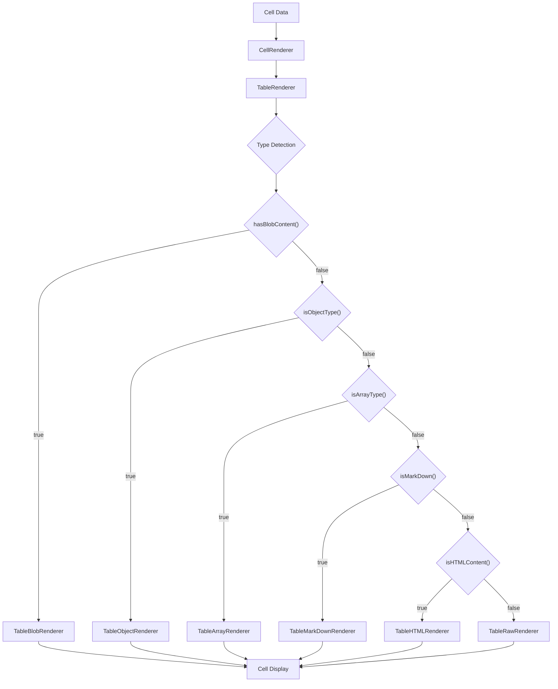
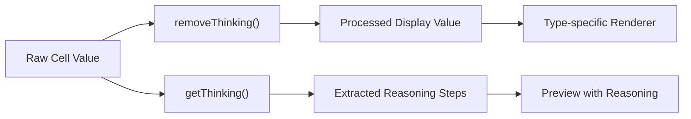
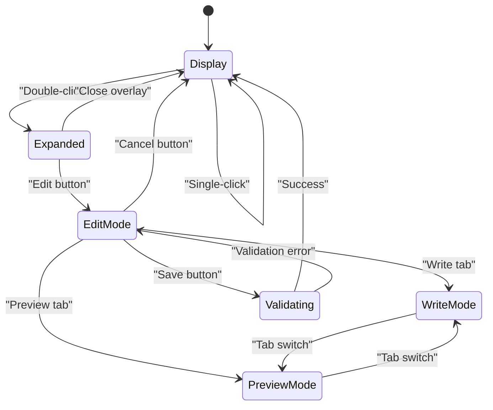
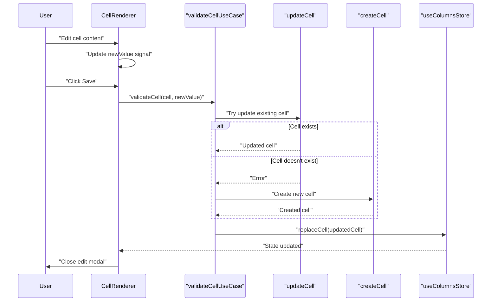
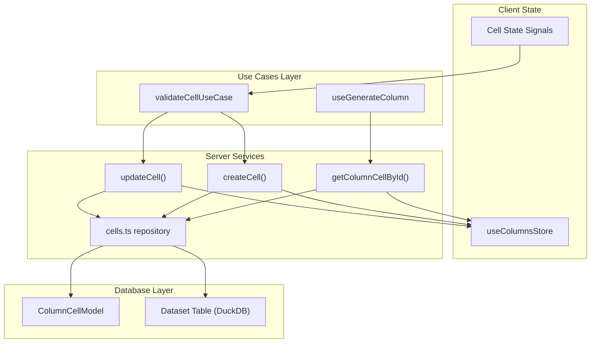
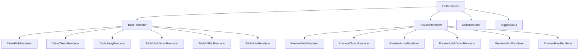
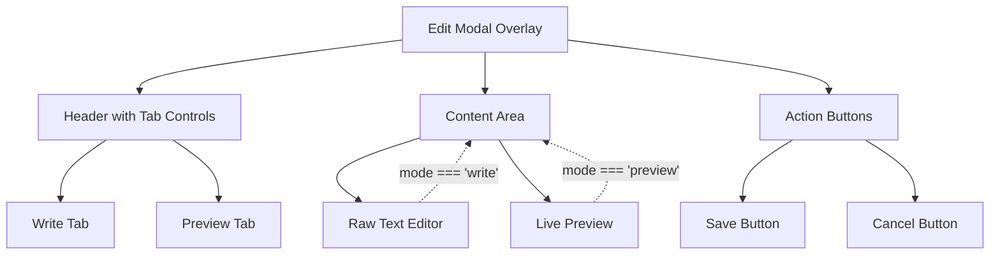

<!-- source: DeepWiki mcp.deepwiki.com · repo huggingface/aisheets · extra page Cell Rendering and Interaction · fetched 2026-10-26 -->

# Cell Rendering and Interaction

<details>
<summary>Relevant source files</summary>

The following files were used as context for generating this wiki page:

- [src/features/execution/useGenerateColumn.ts](src/features/execution/useGenerateColumn.ts)
- [src/features/table/components/body/cell-renderer.tsx](src/features/table/components/body/cell-renderer.tsx)
- [src/features/table/components/body/renderer/components/cell/table-renderer.tsx](src/features/table/components/body/renderer/components/cell/table-renderer.tsx)
- [src/features/table/components/body/renderer/components/preview/preview-raw-renderer.tsx](src/features/table/components/body/renderer/components/preview/preview-raw-renderer.tsx)
- [src/features/table/components/body/renderer/components/preview/preview-renderer.tsx](src/features/table/components/body/renderer/components/preview/preview-renderer.tsx)
- [src/features/utils/columns.ts](src/features/utils/columns.ts)
- [src/services/repository/cells.ts](src/services/repository/cells.ts)
- [src/usecases/validate-cell.usecase.ts](src/usecases/validate-cell.usecase.ts)

</details>


This document covers the cell rendering system and user interaction mechanisms within the AI Sheets table interface. It details how different data types are displayed, how users can edit cell content, and the validation pipeline for cell updates. For information about column management and generation, see [Column Management](#3.2.1). For broader AI integration concepts, see [AI Integration](#3.3).

## Cell Rendering System

The cell rendering system dynamically selects appropriate renderers based on column types and content detection. The main entry point is `CellRenderer` component which orchestrates both display and editing functionality.

### Renderer Selection Pipeline



The system uses utility functions from `columns.ts` to determine content types:

| Function | Purpose | Detection Logic |
|----------|---------|----------------|
| `hasBlobContent()` | Detects binary/image data | Checks for `BLOB` type or image columns |
| `isObjectType()` | Identifies structured data | Matches `STRUCT` or `MAP` types |
| `isArrayType()` | Finds array data | Looks for `[]` in type name |
| `isMarkDown()` | Detects markdown content | Pattern matching against markdown syntax |
| `isHTMLContent()` | Identifies HTML content | Regex pattern for HTML tags |

Sources: [src/features/table/components/body/renderer/components/cell/table-renderer.tsx:18-49](), [src/features/utils/columns.ts:7-86]()

### Content Processing

Cells undergo content processing to handle AI-generated thinking tags and format content appropriately:



Sources: [src/features/utils/columns.ts:69-86](), [src/features/table/components/body/renderer/components/preview/preview-renderer.tsx:26-31]()

## Cell Interaction Workflow

Cell interaction follows a modal-based editing system with dual-mode display capabilities.

### Editing State Machine



The interaction flow is managed by `CellRenderer` component with these key states:

- `isExpanded`: Controls modal overlay display
- `isEditing`: Toggles between view and edit modes  
- `mode`: Switches between 'write' and 'preview' in edit mode

Sources: [src/features/table/components/body/cell-renderer.tsx:16-46]()

### Cell Validation and Persistence



The validation system handles both cell updates and creation through `validateCellUseCase`. The use case attempts to update existing cells first, falling back to creation if the cell doesn't exist in the database.

Sources: [src/usecases/validate-cell.usecase.ts:18-66](), [src/features/table/components/body/cell-renderer.tsx:39-46]()

## Data Flow Architecture

### Client-Server Cell Operations



The system maintains cell data in two locations:
- `ColumnCellModel` (SQLite): Stores metadata, validation status, errors, and sources
- Dataset Table (DuckDB): Stores actual cell values for efficient querying

Sources: [src/services/repository/cells.ts:14-89](), [src/usecases/validate-cell.usecase.ts:21-32]()

### Cell Model Structure

The `Cell` type represents the complete cell state:

```typescript
interface Cell {
  id?: string;              // Database ID
  idx: number;              // Row index
  value?: string;           // Cell content
  error?: string;           // Validation error
  validated: boolean;       // Validation status
  column: {                 // Column reference
    id: string;
    type: string;
  };
  updatedAt: Date;          // Last modification
  generating: boolean;      // AI generation status
  sources?: CellSource[];   // Source references for AI-generated content
}
```

Sources: [src/state:Cell](), [src/services/repository/cells.ts:42-56]()

## Component Hierarchy

### Renderer Component Tree



Each renderer type handles specific data formats:

- **Raw**: Plain text content
- **Markdown**: Formatted markdown with syntax highlighting
- **HTML**: Rendered HTML content
- **Blob**: Binary data and images  
- **Array**: List/array data structures
- **Object**: Structured object data

Sources: [src/features/table/components/body/cell-renderer.tsx:12](), [src/features/table/components/body/renderer/components/cell/table-renderer.tsx:18-49]()

### Cell Edit Modal Structure

The edit modal provides a comprehensive editing experience with preview capabilities:



The modal supports real-time preview switching, allowing users to see formatted output while editing raw content.

Sources: [src/features/table/components/body/cell-renderer.tsx:80-168]()

---

