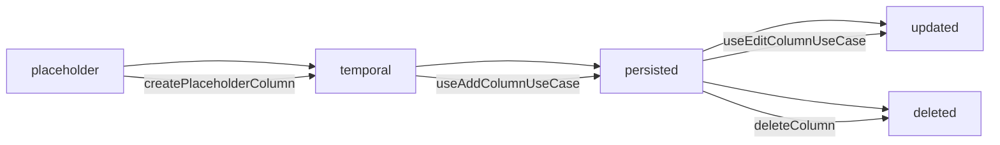
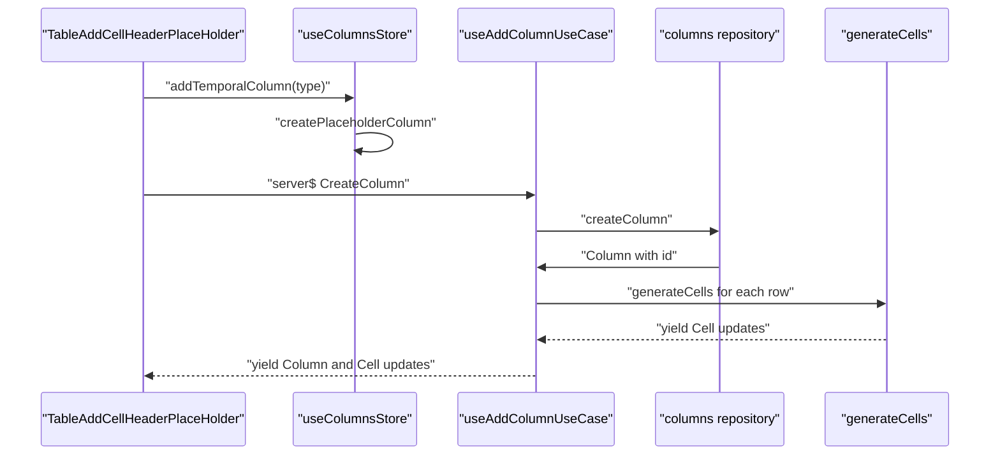
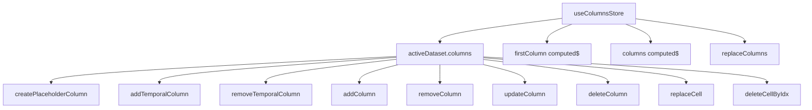
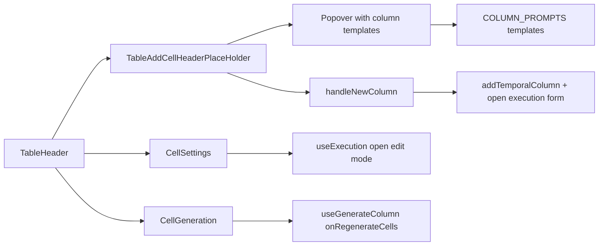
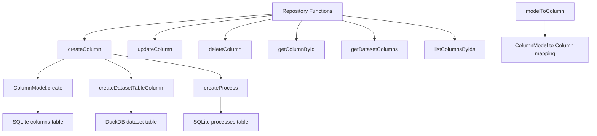

<!-- source: DeepWiki mcp.deepwiki.com · repo huggingface/aisheets · extra page Column Management · fetched 2026-10-26 -->

# Column Management

Relevant source files

The following files were used as context for generating this wiki page:

- [src/features/table/components/header/add-column-placeholder.tsx](src/features/table/components/header/add-column-placeholder.tsx)
- [src/features/table/components/header/cell-generation.tsx](src/features/table/components/header/cell-generation.tsx)
- [src/features/table/components/header/cell-settings.tsx](src/features/table/components/header/cell-settings.tsx)
- [src/services/repository/columns.ts](src/services/repository/columns.ts)
- [src/state/columns.ts](src/state/columns.ts)
- [src/usecases/add-column.usecase.ts](src/usecases/add-column.usecase.ts)
- [src/usecases/edit-column.usecase.ts](src/usecases/edit-column.usecase.ts)

## Purpose and Scope

Column Management encompasses the creation, modification, and lifecycle management of table columns within AI Sheets datasets. This system handles both static data columns and dynamic AI-powered columns that generate content through machine learning processes. Column management includes the user interface for adding columns, the state management layer for column operations, and the persistence layer for storing column metadata and configurations.

For information about cell rendering and editing within columns, see [Cell Rendering and Interaction](#3.2.2). For broader dataset operations, see [Dataset Management](#3.1).

## Column Types and Data Model

The column system distinguishes between two fundamental column types defined by the `ColumnKind` enumeration:

| Column Kind | Description | Use Case |
|-------------|-------------|----------|
| `static` | Contains manually entered or imported data | User-provided content, imported dataset columns |
| `dynamic` | Generated through AI processes with prompts | AI-generated content, computed columns |

The core data structures include:

- `Column` interface representing persisted columns with metadata, cells, and optional AI processes
- `CreateColumn` interface for column creation requests
- `Process` interface defining AI generation parameters including model selection, prompts, and column references
- `Cell` interface representing individual table cells with generation state and validation status

**Column Lifecycle States:**

Sources: [src/state/columns.ts:5-79](), [src/state/columns.ts:82-307]()

## Column Creation Workflow

The column creation process involves a multi-stage workflow from user interaction to persistent storage:

**Column Creation Process:**

1. **Placeholder Creation**: The `createPlaceholderColumn` function generates a temporary column with `TEMPORAL_ID` constant for UI preview
2. **Template Selection**: Users select from predefined prompts (translate, extractKeywords, summarize, textToImage, custom) via `TableAddCellHeaderPlaceHolder`
3. **Persistence**: The `useAddColumnUseCase` server function creates the column record and initiates cell generation
4. **Cell Generation**: The system generates cells asynchronously using the configured AI process

Sources: [src/features/table/components/header/add-column-placeholder.tsx:50-157](), [src/usecases/add-column.usecase.ts:11-59](), [src/state/columns.ts:85-217]()

## Column State Management

The column state management is centralized through the `useColumnsStore` hook, which provides reactive state management using Qwik's signal system:

**Key State Management Functions:**

| Function | Purpose | Parameters |
|----------|---------|------------|
| `addTemporalColumn` | Creates UI placeholder column | `type?: string, name?: string` |
| `removeTemporalColumn` | Removes temporary UI column | None |
| `addColumn` | Adds persisted column to state | `newbie: Column` |
| `updateColumn` | Updates existing column metadata | `updated: Column` |
| `replaceCell` | Updates or adds cell to column | `cell: Cell` |
| `deleteCellByIdx` | Removes cells by row index | `...idxs: number[]` |

Sources: [src/state/columns.ts:82-307]()

## Column UI Interactions

The table header provides multiple interaction points for column management through specialized components:

**Column Template Prompts:**

The system provides predefined column templates through the `COLUMN_PROMPTS` constant:

- `translate`: English to French translation with cultural adaptation
- `extractKeywords`: Salient keyword extraction from text
- `summarize`: Text condensation preserving key points
- `textToImage`: Image generation from text descriptions
- `custom`: Empty template for user-defined prompts

Each template uses `{{REPLACE_ME}}` placeholders that are automatically replaced with column references like `{{Column 1}}`.

Sources: [src/features/table/components/header/add-column-placeholder.tsx:17-46](), [src/features/table/components/header/cell-settings.tsx:7-38](), [src/features/table/components/header/cell-generation.tsx:7-28]()

## Column Persistence Layer

The persistence layer implements a repository pattern through the columns service module, handling database operations for column metadata:

**Database Schema Interactions:**

- **ColumnModel**: SQLite table storing column metadata (id, name, type, kind, visible, datasetId)
- **ProcessModel**: SQLite table storing AI process configurations linked to columns
- **Dataset Tables**: DuckDB tables with dynamic columns for actual data storage

**Key Repository Functions:**

| Function | Database Operation | Returns |
|----------|-------------------|---------|
| `createColumn` | INSERT column + process + DuckDB column | `Promise<Column>` |
| `updateColumn` | UPDATE column metadata and process | `Promise<Column>` |
| `getDatasetColumns` | SELECT columns with processes and references | `Promise<Column[]>` |
| `deleteColumn` | DELETE column and cascade to cells | `Promise<void>` |

Sources: [src/services/repository/columns.ts:8-219]()

---

