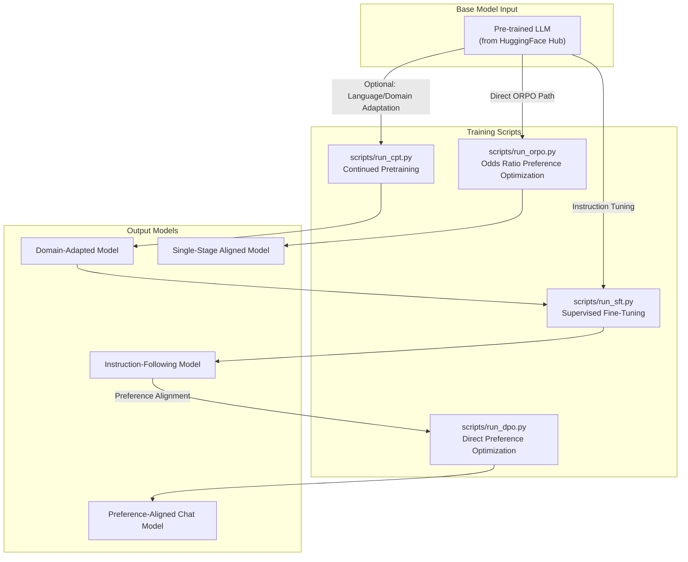
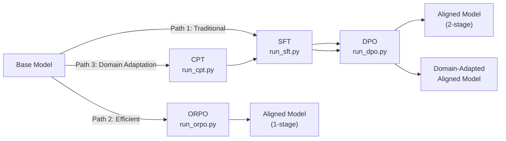
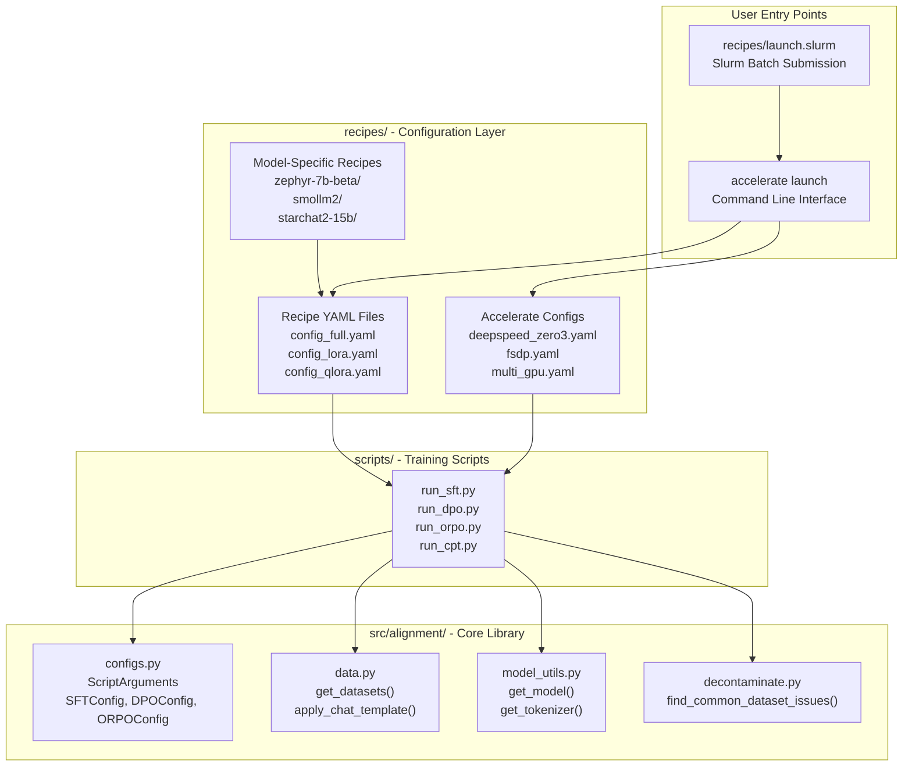
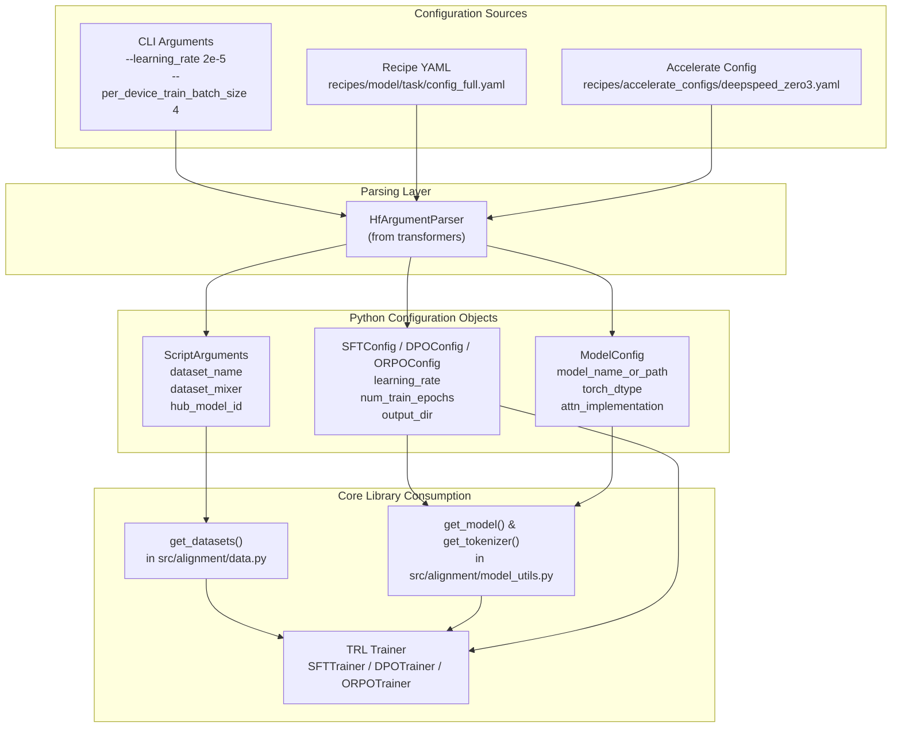

<!-- source: DeepWiki mcp.deepwiki.com · repo huggingface/alignment-handbook · page 1 Overview · fetched 2026-10-26 -->

# Overview

<details>
<summary>Relevant source files</summary>

The following files were used as context for generating this wiki page:

- [README.md](README.md)

</details>


This document provides a high-level introduction to the Alignment Handbook, a comprehensive system for training aligned language models. It covers the purpose, scope, supported training methods, model families, and core architectural components of the codebase.

For specific installation steps, see [Installation and Setup](#1.1). For detailed code organization, see [Project Structure](#1.2). For hands-on usage, see [Quick Start Guide](#1.3).

## Purpose and Scope

The Alignment Handbook is a production-grade training system that provides robust recipes to continue pretraining and align language models with human and AI preferences. The system implements the full pipeline from base model selection through instruction tuning and preference alignment, supporting multiple training methodologies including Supervised Fine-Tuning (SFT), Direct Preference Optimization (DPO), Odds Ratio Preference Optimization (ORPO), and Continued Pretraining (CPT).

The handbook is designed around three core principles:
1. **Reproducibility**: YAML-based recipe configurations enable exact replication of training runs
2. **Flexibility**: Supports multiple training methods, model families, and hardware configurations from single GPU to multi-node clusters
3. **Integration**: Deep integration with the HuggingFace ecosystem (TRL, Transformers, Datasets, Accelerate, Hub)

The codebase has been used to train production models including Zephyr-7B-β, SmolLM2-Instruct, StarChat2-15B, and Zephyr-141B-A35B, with reproducible recipes and published technical reports.

**Sources:** [README.md:1-50]()

## What Models Can Be Trained

The Alignment Handbook supports training aligned language models across a wide range of sizes and domains:

| Model Family | Base Models | Size Range | Primary Use Case |
|--------------|-------------|------------|------------------|
| Zephyr | Mistral-7B, Gemma-7B, Mixtral-8x22B | 7B - 141B | General chat assistants |
| SmolLM | Custom small models | 135M - 3B | Resource-efficient assistants |
| StarChat | StarCoder2-15B | 15B | Code-specialized assistants |
| Constitutional AI | Various | Variable | Safety-aligned models |
| Custom | Any HuggingFace model | Variable | Domain-specific applications |

The system is model-agnostic and can work with any HuggingFace Transformers-compatible model, though pre-configured recipes exist for the families listed above.

**Sources:** [README.md:21-31](), [README.md:34]()

## Training Methods Architecture



**Training Methodology: Code to Concept Mapping**

The handbook implements four core training methodologies, each corresponding to a dedicated script:

**Continued Pretraining (CPT)**
- Script: `scripts/run_cpt.py`
- Purpose: Adapt pre-trained models to new languages, domains, or datasets
- Use case: Language adaptation (e.g., GPT-NL for Dutch) or domain specialization
- Dataset format: Raw text for causal language modeling

**Supervised Fine-Tuning (SFT)**
- Script: `scripts/run_sft.py`
- Purpose: Teach models to follow instructions and respond in chat format
- Trainer: `trl.SFTTrainer`
- Dataset format: Messages with role/content structure (see [Dataset Formats](#8.2))
- Key configuration class: `SFTConfig` (extends `trl.SFTConfig`)

**Direct Preference Optimization (DPO)**
- Script: `scripts/run_dpo.py`
- Purpose: Align models with human preferences through preference pairs
- Trainer: `trl.DPOTrainer`
- Dataset format: Chosen and rejected response pairs
- Key configuration class: `DPOConfig` (extends `trl.DPOConfig`)
- Key parameter: `beta` controls preference strength

**Odds Ratio Preference Optimization (ORPO)**
- Script: `scripts/run_orpo.py`
- Purpose: Combined instruction tuning and preference alignment in single stage
- Trainer: `trl.ORPOTrainer`
- Dataset format: Same as DPO (chosen/rejected pairs)
- Key configuration class: `ORPOConfig` (extends `trl.ORPOConfig`)
- Advantage: More efficient than two-stage SFT→DPO pipeline

**Sources:** [README.md:40](), [README.md:53-61]()

## Training Pipeline Paths

The system supports multiple training pathways depending on your goals and computational resources:



**Pipeline Path Details**

| Path | Stages | Example Model | Computational Cost | Use Case |
|------|--------|---------------|-------------------|----------|
| Traditional 2-Stage | SFT → DPO | Zephyr-7B-β | High | Maximum performance |
| Efficient 1-Stage | ORPO | Zephyr-141B-A35B | Medium | Resource-constrained |
| Domain Adaptation | CPT → SFT → DPO | GPT-NL | Very High | New language/domain |

**Sources:** [README.md:40-41]()

## Code Organization: Repository Structure



**Directory Breakdown**

The codebase follows a clean separation of concerns:

**`scripts/` - Training Execution**
- `run_sft.py`: Supervised fine-tuning script
- `run_dpo.py`: DPO training script  
- `run_orpo.py`: ORPO training script
- `run_cpt.py`: Continued pretraining script
- Each script is a standalone entry point that accepts configuration via CLI args or YAML

**`recipes/` - Configuration and Deployment**
- Model-specific subdirectories (e.g., `zephyr-7b-beta/`, `smollm2/`) containing YAML configs
- `accelerate_configs/`: Distributed training configurations (DeepSpeed, FSDP, DDP)
- `launch.slurm`: Slurm batch script template for HPC cluster deployment
- Recipe files named by training method: `config_full.yaml`, `config_lora.yaml`, `config_qlora.yaml`

**`src/alignment/` - Core Library**
- `configs.py`: Python dataclass configurations (`ScriptArguments`, `SFTConfig`, `DPOConfig`, `ORPOConfig`)
- `data.py`: Dataset loading, mixing, and chat template application (`get_datasets`, `apply_chat_template`)
- `model_utils.py`: Model and tokenizer instantiation (`get_model`, `get_tokenizer`, `get_kbit_device_map`)
- `decontaminate.py`: Dataset quality checks and decontamination utilities

**`tests/` - Test Suite**
- Configuration validation tests
- Data processing tests
- Model loading tests

**Sources:** [README.md:107-119](), [README.md:38-41]()

## Configuration System Flow



**Configuration Priority and Merging**

The configuration system implements a three-tier priority system:
1. **Highest Priority**: CLI arguments (override everything)
2. **Medium Priority**: Recipe YAML files (override defaults)
3. **Lowest Priority**: Default values in Python dataclasses

The `HfArgumentParser` from Transformers merges these sources automatically. This allows reproducible recipe-based training while maintaining flexibility for experimentation via CLI overrides.

For detailed configuration parameters, see [Configuration Parameters](#8.1). For configuration class details, see [Configuration System](#2.1).

**Sources:** [README.md:41]()

## Published Models and Technical Report

The Alignment Handbook has produced several state-of-the-art models with published recipes:

| Model | Size | Key Innovation | Recipe Location |
|-------|------|----------------|-----------------|
| Zephyr-7B-β | 7B | First application of DPO to Mistral | `recipes/zephyr-7b-beta/` |
| SmolLM2-Instruct | 135M-1.7B | Efficient small model alignment | `recipes/smollm2/` |
| SmolLM3-3B | 3B | Hybrid reasoning with APO | `recipes/smollm3/` |
| StarChat2-15B | 15B | Code-specialized ORPO training | `recipes/starchat2-15b/` |
| Zephyr-141B-A35B | 141B | Large-scale ORPO with FSDP | `recipes/zephyr-141b-A35b/` |

All models are published to the HuggingFace Hub under the `alignment-handbook` or `HuggingFaceH4` organizations and can be loaded directly via the `transformers` library.

**Technical Report**

The methodology and findings are documented in the technical report:
- **Paper**: [Technical Report on arXiv](https://arxiv.org/abs/2310.16944)
- **Models & Datasets Collection**: Available on [HuggingFace Hub](https://huggingface.co/collections/alignment-handbook/handbook-v01-models-and-datasets-654e424d22e6880da5ebc015)

The report covers the complete pipeline from data collection through evaluation, including ablation studies on preference alignment methods.

**Sources:** [README.md:6](), [README.md:21-30](), [README.md:34]()

## Getting Started

To begin using the Alignment Handbook:

1. **Set up your environment** following the installation instructions in [Installation and Setup](#1.1)
2. **Understand the code structure** by reviewing [Project Structure](#1.2)
3. **Run your first training job** using the [Quick Start Guide](#1.3)
4. **Explore model recipes** in the [Model Training Recipes](#4) section
5. **Customize for your needs** using guides in [Advanced Topics](#6)

The recommended learning path is to first replicate an existing recipe (e.g., Zephyr-7B-β) to understand the full pipeline, then adapt it to your specific model and dataset requirements.

**Sources:** [README.md:43-48]()

## System Dependencies

The Alignment Handbook builds upon the HuggingFace ecosystem:

| Dependency | Purpose | Key Components Used |
|------------|---------|---------------------|
| **TRL** | Training library | `SFTTrainer`, `DPOTrainer`, `ORPOTrainer`, config base classes |
| **Transformers** | Model library | Model loading, tokenizers, `HfArgumentParser` |
| **Datasets** | Data loading | `load_dataset`, `DatasetDict`, dataset streaming |
| **Accelerate** | Distributed training | Multi-GPU orchestration, DeepSpeed, FSDP integration |
| **PyTorch** | Deep learning framework | Core tensor operations, distributed primitives |
| **Flash Attention 2** | Efficient attention | Memory-efficient attention for long sequences |

Version requirements and installation details are in [Installation and Setup](#1.1).

**Sources:** [README.md:62-103]()

## Citation

If you use the Alignment Handbook in your work, cite it as:

```bibtex
@software{Tunstall_The_Alignment_Handbook,
  author = {Tunstall, Lewis and Beeching, Edward and Lambert, Nathan and Rajani, Nazneen and Huang, Shengyi and Rasul, Kashif and Bartolome, Alvaro, and M. Patiño, Carlos and M. Rush, Alexander and Wolf, Thomas},
  license = {Apache-2.0},
  title = {{The Alignment Handbook}},
  url = {https://github.com/huggingface/alignment-handbook},
  version = {0.4.0.dev0}
}
```

**Sources:** [README.md:121-133]()

---

