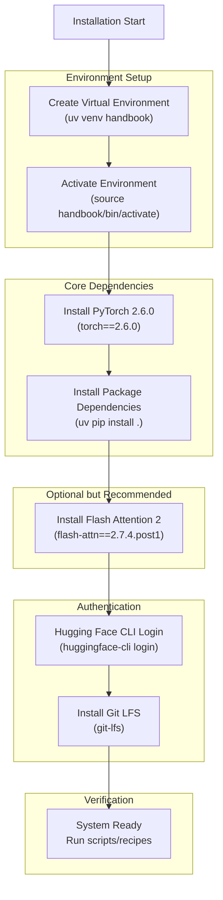
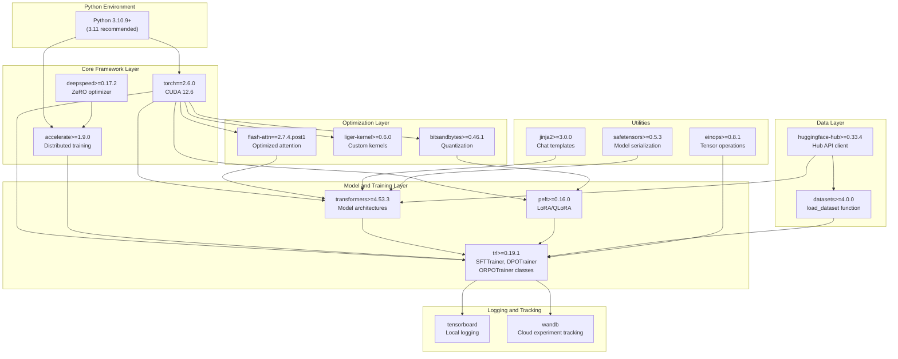
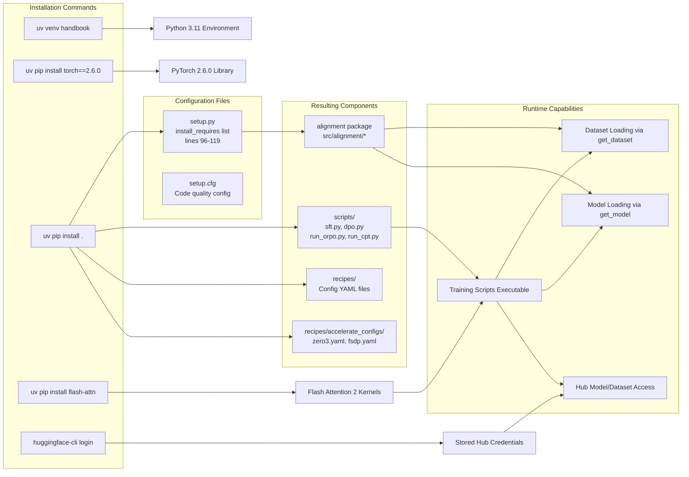

<!-- source: DeepWiki mcp.deepwiki.com · repo huggingface/alignment-handbook · page 1.1 Installation and Setup · fetched 2026-10-26 -->

# Installation and Setup

<details>
<summary>Relevant source files</summary>

The following files were used as context for generating this wiki page:

- [README.md](README.md)
- [setup.py](setup.py)

</details>


This page provides step-by-step instructions for installing the Alignment Handbook and configuring the development environment. It covers Python environment creation, PyTorch installation, dependency management, Flash Attention setup, and Hugging Face authentication. For information about the overall project structure after installation, see [Project Structure](#1.2). For running your first training job after setup, see [Quick Start Guide](#1.3).

## Prerequisites

The Alignment Handbook requires:
- **Python**: Version 3.10.9 or higher (3.11 recommended)
- **CUDA-compatible GPU**: Required for training (CUDA 12.6 recommended for PyTorch 2.6.0)
- **Operating System**: Linux (tested), other Unix-like systems supported
- **Git LFS**: For pushing models to Hugging Face Hub

Sources: [setup.py:136](), [README.md:64-105]()

## Installation Flow Overview



**Installation Flow**: The installation process follows a specific order to ensure compatibility. PyTorch must be installed before package dependencies due to hardware-specific requirements. Flash Attention is installed separately after main dependencies due to compilation requirements.

Sources: [README.md:62-105]()

## Step 1: Environment Setup

Create an isolated Python virtual environment using `uv` (recommended) or standard `venv`:

```bash
# Using uv (recommended)
uv venv handbook --python 3.11 && source handbook/bin/activate && uv pip install --upgrade pip

# Alternative: Using standard venv
python3.11 -m venv handbook && source handbook/bin/activate && pip install --upgrade pip
```

The `uv` tool provides faster dependency resolution and installation compared to standard pip. Installation instructions for `uv` are available at the [UV Installation Guide](https://docs.astral.sh/uv/getting-started/installation/).

Sources: [README.md:64-71]()

## Step 2: PyTorch Installation

Install PyTorch version 2.6.0 with CUDA 12.6 support:

```bash
uv pip install torch==2.6.0 --index-url https://download.pytorch.org/whl/cu126
```

**Version Precision**: The exact PyTorch version (2.6.0) is critical for reproducibility. Hardware-specific variations may require different CUDA versions or wheel URLs. Consult the [PyTorch Installation Page](https://pytorch.org/get-started/locally/) for alternative configurations.

**Dependency Note**: PyTorch must be installed before the main package dependencies because the package's [setup.py:67]() specifies `torch>=2.6.0` as a dependency, but the appropriate wheel must be selected based on your hardware.

Sources: [README.md:73-79](), [setup.py:67]()

## Step 3: Core Package Dependencies

Install the Alignment Handbook package and all dependencies:

```bash
uv pip install .
```

This command executes [setup.py]() which installs all dependencies specified in [setup.py:96-119](). The core dependencies include:

| Category | Key Dependencies | Purpose |
|----------|-----------------|---------|
| **Training** | `accelerate>=1.9.0`, `deepspeed>=0.17.2` | Distributed training orchestration |
| **Models** | `transformers>=4.53.3`, `trl>=0.19.1`, `peft>=0.16.0` | Model loading, trainers, parameter-efficient methods |
| **Data** | `datasets>=4.0.0`, `huggingface-hub>=0.33.4` | Dataset loading and Hub integration |
| **Optimization** | `bitsandbytes>=0.46.1`, `liger-kernel>=0.6.0` | Quantization and kernel optimizations |
| **Logging** | `tensorboard`, `wandb` | Experiment tracking |
| **Utilities** | `einops>=0.8.1`, `safetensors>=0.5.3`, `jinja2>=3.0.0` | Tensor operations, model serialization, templates |

Sources: [README.md:81-85](), [setup.py:43-73](), [setup.py:96-119]()

## Step 4: Flash Attention 2 Installation

Install Flash Attention 2 for optimized attention computation:

```bash
uv pip install "flash-attn==2.7.4.post1" --no-build-isolation
```

**Installation Details**:
- The `--no-build-isolation` flag is required because Flash Attention needs to compile CUDA kernels during installation
- This step requires a CUDA-compatible GPU and NVCC compiler
- Flash Attention 2 provides significant speedups for training but is not strictly required

**Optional**: If Flash Attention installation fails, the system will fall back to standard attention mechanisms with reduced performance.

Sources: [README.md:87-91]()

## Step 5: Hugging Face Authentication

Authenticate with Hugging Face Hub to access models and datasets:

```bash
huggingface-cli login
```

This command:
1. Prompts for your Hugging Face access token
2. Stores credentials locally for API access
3. Enables loading gated models and pushing trained models to Hub

**Token Permissions**: Your token should have `write` permissions if you plan to push models to the Hub.

Sources: [README.md:93-97]()

## Step 6: Git LFS Installation

Install Git Large File Storage for pushing models:

```bash
sudo apt-get install git-lfs
```

Git LFS is required because trained model weights are typically several gigabytes. Without Git LFS, pushing models to the Hub will fail or timeout.

**Alternative Installation**: On non-Debian systems, follow instructions at [git-lfs.com](https://git-lfs.com).

Sources: [README.md:99-103]()

## Dependency Architecture



**Dependency Relationships**: The diagram shows how dependencies build on each other. The TRL library sits at the top of the stack, depending on most other components. Training scripts in `scripts/` use TRL trainers which orchestrate all underlying dependencies.

Sources: [setup.py:43-73](), [setup.py:96-119]()

## Installation Component Mapping



**Installation to Code Mapping**: This diagram connects installation commands to the actual code components they enable. The `uv pip install .` command processes [setup.py]() which installs the `alignment` package from [src/alignment/](), making functions like `get_dataset` and `get_model` available to training scripts.

Sources: [setup.py:96-119](), [setup.py:132-133](), [README.md:109-119]()

## Verification

After installation, verify the setup:

```bash
# Check Python version
python --version  # Should be 3.10.9+

# Check PyTorch and CUDA
python -c "import torch; print(f'PyTorch: {torch.__version__}, CUDA: {torch.cuda.is_available()}')"

# Check alignment package
python -c "import alignment; print(f'Alignment package: {alignment.__version__}')"

# Check Flash Attention (optional)
python -c "import flash_attn; print(f'Flash Attention: {flash_attn.__version__}')"

# Verify Hub authentication
huggingface-cli whoami
```

Expected output:
- Python 3.11.x (or 3.10.9+)
- PyTorch 2.6.0 with `CUDA: True`
- Alignment package version 0.4.0.dev0
- Flash Attention 2.7.4.post1 (if installed)
- Your Hugging Face username

Sources: [setup.py:123]()

## Optional Development Dependencies

For contributors developing the Alignment Handbook, install additional dependencies:

```bash
# Install all development dependencies
uv pip install -e ".[dev]"

# Or install specific groups
uv pip install -e ".[quality]"  # black, isort, flake8
uv pip install -e ".[tests]"    # pytest, parameterized
uv pip install -e ".[docs]"     # hf-doc-builder
```

The extras groups are defined in [setup.py:88-93]():
- `quality`: Code formatting and linting tools
- `tests`: Testing framework dependencies
- `docs`: Documentation building tools
- `dev`: All of the above

For more information on development workflows, see [Development Setup](#7.1).

Sources: [setup.py:88-93]()

## Troubleshooting Common Issues

| Issue | Solution |
|-------|----------|
| **Flash Attention compilation fails** | Install with system compiler: `CC=gcc CXX=g++ uv pip install flash-attn --no-build-isolation` or skip Flash Attention |
| **CUDA version mismatch** | Install PyTorch for your CUDA version from [pytorch.org](https://pytorch.org/get-started/locally/) |
| **Git LFS push fails** | Run `git lfs install` in your repository directory |
| **Hub authentication fails** | Create a new token at [huggingface.co/settings/tokens](https://huggingface.co/settings/tokens) with write permissions |
| **Import errors after installation** | Ensure virtual environment is activated and reinstall with `uv pip install --force-reinstall .` |

For additional troubleshooting, see [Troubleshooting](#8.4).

Sources: [README.md:87-91](), [README.md:93-103]()

## Next Steps

After completing installation:

1. Review the [Project Structure](#1.2) to understand the codebase organization
2. Follow the [Quick Start Guide](#1.3) to run your first training job
3. Explore [Training Methods](#3) to understand SFT, DPO, and ORPO
4. Examine [Model Training Recipes](#4) for pre-configured training examples

Sources: [README.md:45-48](), [README.md:105]()

---

