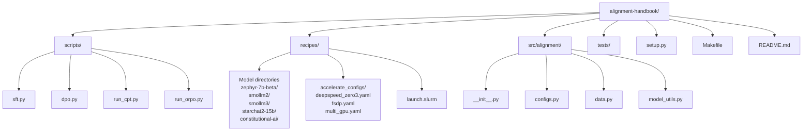
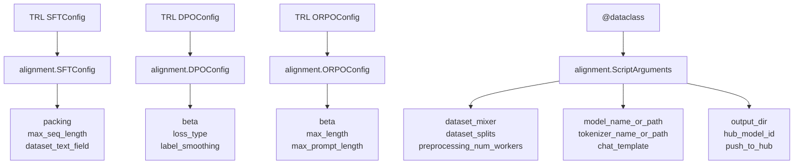
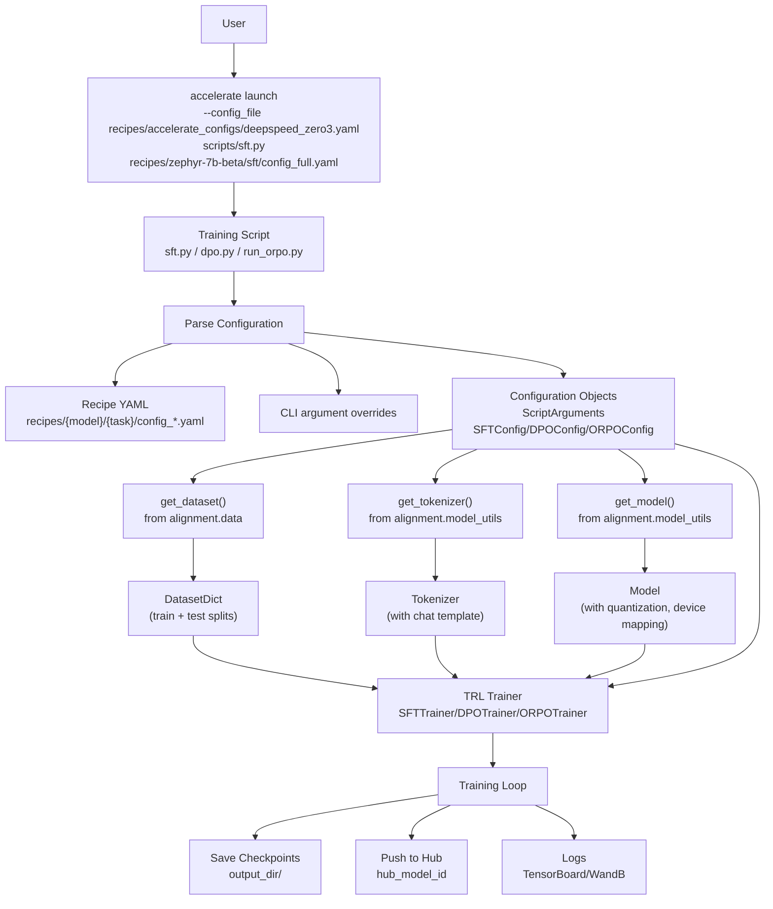

<!-- source: DeepWiki mcp.deepwiki.com · repo huggingface/alignment-handbook · page 1.2 Project Structure · fetched 2026-10-26 -->

# Project Structure

<details>
<summary>Relevant source files</summary>

The following files were used as context for generating this wiki page:

- [README.md](README.md)
- [src/alignment/__init__.py](src/alignment/__init__.py)

</details>


This document explains the organization of the Alignment Handbook codebase, focusing on the three primary components: training scripts (`scripts/`), configuration recipes (`recipes/`), and the core library (`src/alignment/`). For installation information, see page 1.1.

## Repository Organization

The Alignment Handbook follows a modular design that separates execution scripts, configuration recipes, and reusable library components.

**Repository Layout**


Sources: [README.md:107-119](), [src/alignment/__init__.py:1-17]()

## Scripts Directory

The `scripts/` directory contains executable Python scripts for training and aligning language models. Each script implements a specific training methodology:

**Training Scripts**

| Script | Training Method | Primary Use Case |
|--------|----------------|------------------|
| `sft.py` | Supervised Fine-Tuning | Instruction tuning with prompt-response pairs |
| `dpo.py` | Direct Preference Optimization | Preference alignment with chosen/rejected pairs |
| `run_orpo.py` | Odds Ratio Preference Optimization | Combined SFT and preference alignment in one stage |
| `run_cpt.py` | Continued Pre-Training | Domain or language adaptation via causal language modeling |

Each script accepts configuration via YAML files (from `recipes/`) and command-line arguments. They support distributed training strategies including DeepSpeed ZeRO-3, PyTorch FSDP, and parameter-efficient methods like LoRA and QLoRA.

**Execution Pattern**

Scripts are launched using `accelerate launch` with an accelerate configuration file:

```bash
ACCELERATE_LOG_LEVEL=info accelerate launch \
    --config_file recipes/accelerate_configs/deepspeed_zero3.yaml \
    scripts/sft.py \
    recipes/zephyr-7b-beta/sft/config_full.yaml
```

Sources: [README.md:40]()

## Recipes Directory

The `recipes/` directory stores YAML configuration files that define training hyperparameters, dataset specifications, and model settings. Recipes enable reproducible training runs and serve as templates for custom experiments.

**Directory Structure**

```
recipes/
├── accelerate_configs/           # Distributed training configurations
│   ├── deepspeed_zero3.yaml     # DeepSpeed ZeRO-3 for multi-GPU full training
│   ├── fsdp.yaml                # PyTorch FSDP for very large models
│   ├── multi_gpu.yaml           # Standard multi-GPU DDP
│   └── fsdp_qlora.yaml          # FSDP with QLoRA
├── zephyr-7b-beta/              # Zephyr 7B training recipes
│   ├── sft/
│   │   ├── config_full.yaml
│   │   └── config_qlora.yaml
│   └── dpo/
│       ├── config_full.yaml
│       └── config_qlora.yaml
├── smollm2/                      # SmolLM2 small model recipes
├── smollm3/                      # SmolLM3 advanced recipes
├── starchat2-15b/               # StarChat code model recipes
├── constitutional-ai/           # Constitutional AI recipes
└── launch.slurm                 # Slurm cluster submission script
```

**Recipe File Structure**

Each recipe YAML file typically includes:
- Training hyperparameters (learning rate, batch size, number of epochs)
- Dataset configuration (dataset names, mixing weights, column mappings)
- Model configuration (model path, quantization settings, LoRA parameters)
- Output configuration (save paths, Hub push settings, logging)

Example recipe structure:
```yaml
# Model arguments
model_name_or_path: alignment-handbook/zephyr-7b-sft-full

# Dataset configuration
dataset_mixer:
  HuggingFaceH4/ultrafeedback_binarized: 1.0

# Training configuration
learning_rate: 5.0e-7
per_device_train_batch_size: 2
gradient_accumulation_steps: 8
num_train_epochs: 1

# Output configuration
output_dir: data/zephyr-7b-beta
hub_model_id: alignment-handbook/zephyr-7b-beta
```

Sources: [README.md:41]()

## Source Directory (Core Library)

The `src/alignment/` directory implements the core library that provides reusable components for configuration management, data loading, and model initialization. This library is installed as the `alignment` Python package via `setup.py`.

**Core Module Structure**

| Module | Purpose |
|--------|---------|
| `configs.py` | Configuration dataclasses: `ScriptArguments`, `SFTConfig`, `DPOConfig`, `ORPOConfig` |
| `data.py` | Dataset loading and mixing via `get_dataset()` |
| `model_utils.py` | Model and tokenizer initialization via `get_model()` and `get_tokenizer()` |
| `__init__.py` | Package API surface |

**Public API**

The package exports the following symbols from [src/alignment/__init__.py:1-16]():

```python
from alignment import (
    # Configuration classes
    ScriptArguments,      # Common script arguments (dataset names, output paths, etc.)
    SFTConfig,           # Supervised fine-tuning configuration (extends TRL SFTConfig)
    DPOConfig,           # DPO training configuration (extends TRL DPOConfig)
    ORPOConfig,          # ORPO training configuration (extends TRL ORPOConfig)
    
    # Data loading
    get_dataset,         # Load and mix datasets based on configuration
    
    # Model utilities
    get_tokenizer,       # Load and configure tokenizer with chat template
    get_model,           # Load model with quantization and device mapping
)
```

**Configuration Class Hierarchy**



The configuration classes extend TRL's base training configurations with alignment-specific features like dataset mixing and chat template handling.

Sources: [src/alignment/__init__.py:1-16]()

## Component Interaction

The diagram below illustrates how scripts, recipes, and the core library interact during a training run:

**Training Execution Flow**



**Key Interactions:**

1. **Configuration Parsing**: Recipe YAML files are merged with CLI arguments to create typed configuration objects (`ScriptArguments`, `SFTConfig`, etc.)

2. **Data Loading**: `get_dataset()` [data.py]() loads datasets from HuggingFace Hub or local paths, applies dataset mixing with weights, and creates train/test splits

3. **Model Initialization**: `get_tokenizer()` and `get_model()` [model_utils.py]() handle tokenizer loading (with chat templates) and model loading (with quantization and device mapping)

4. **Training**: Configuration objects and loaded resources are passed to TRL trainers (`SFTTrainer`, `DPOTrainer`, `ORPOTrainer`) which execute the training loop

5. **Output**: Trained models are saved locally and optionally pushed to HuggingFace Hub, with metrics logged to TensorBoard or Weights & Biases

Sources: [src/alignment/__init__.py:1-16]()

## Running Training Jobs

The Alignment Handbook provides multiple ways to run training jobs:

1. Direct execution with `accelerate launch`:

```bash
# Full training with ZeRO-3 on 8 GPUs
ACCELERATE_LOG_LEVEL=info accelerate launch --config_file recipes/accelerate_configs/deepspeed_zero3.yaml scripts/run_{task}.py recipes/{model_name}/{task}/config_full.yaml

# QLoRA 4-bit training on a single GPU
ACCELERATE_LOG_LEVEL=info accelerate launch --config_file recipes/accelerate_configs/multi_gpu.yaml --num_processes=1 scripts/run_{task}.py recipes/{model_name}/{task}/config_qlora.yaml
```

2. Launching on a Slurm cluster:

```bash
sbatch --job-name=handbook_{task} --nodes=1 recipes/launch.slurm {model_name} {task} {precision} {accelerator}
```

Sources: [scripts/README.md:14-29](), [scripts/README.md:64-78]()

## Dataset Requirements

For different alignment techniques, datasets need to have specific formats:

**SFT Datasets:**
- Must have a `messages` column containing a list of dictionaries with `role` and `content` fields
- Example: [ultrachat_200k](https://huggingface.co/datasets/HuggingFaceH4/ultrachat_200k)

**DPO and ORPO Datasets:**
- Must have `chosen` and `rejected` columns, each containing lists of dictionaries with `role` and `content` fields
- Example: [ultrafeedback_binarized](https://huggingface.co/datasets/HuggingFaceH4/ultrafeedback_binarized)

Dataset mixing can be configured in YAML files:

```yaml
datasets_mixer:
    dataset_1: 0.5  # Use 50% of training examples
    dataset_2: 0.66 # Use 66% of training examples
dataset_splits:
- train_xxx         # Training splits to mix
- test_xxx          # Test splits to mix
```

Sources: [scripts/README.md:82-115]()

## Version Information

The version information for the Alignment Handbook is maintained in `__init__.py` and updated using the `release.py` script. Current version: 0.3.0.dev0.

Sources: [src/alignment/__init__.py:1](), [src/alignment/release.py:1-126]()

## Conclusion

The Alignment Handbook provides a comprehensive framework for training and aligning language models, with a clear separation of concerns between configuration, data processing, model utilities, and training scripts. The repository is designed to facilitate experimentation and reproducibility, with recipes for recreating specific models and scripts for implementing different alignment techniques.

Sources: [README.md:9-19]()

---

