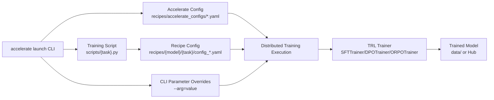
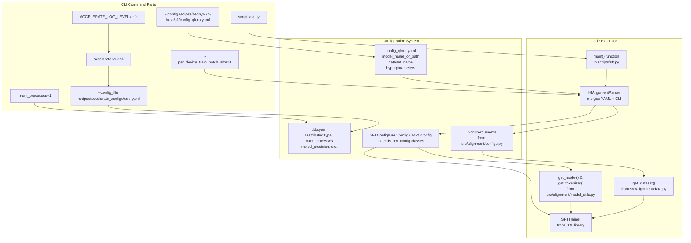
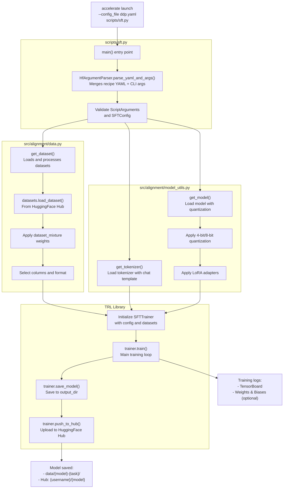
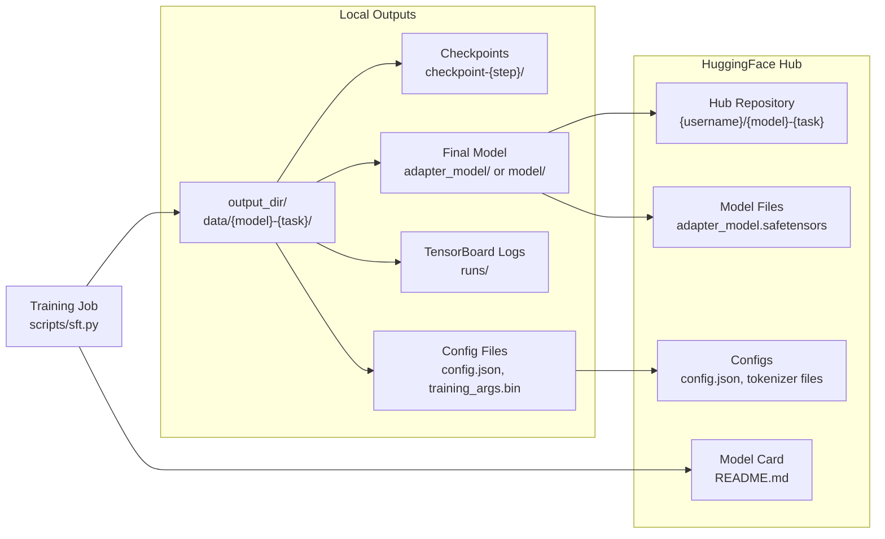

<!-- source: DeepWiki mcp.deepwiki.com · repo huggingface/alignment-handbook · page 1.3 Quick Start Guide · fetched 2026-10-26 -->

# Quick Start Guide

<details>
<summary>Relevant source files</summary>

The following files were used as context for generating this wiki page:

- [README.md](README.md)
- [scripts/README.md](scripts/README.md)

</details>


This guide provides a hands-on introduction to running your first training job with the Alignment Handbook. It covers the basic `accelerate launch` command structure, how to use pre-configured recipes, and how to monitor training progress. 

For detailed installation instructions, see [Installation and Setup](#1.1). For an explanation of the codebase organization, see [Project Structure](#1.2). For comprehensive training method documentation, see [Training Methods](#3).

---

## Command Structure Overview

All training jobs in the Alignment Handbook follow a consistent command pattern that combines three configuration sources:



**Command Template:**
```bash
ACCELERATE_LOG_LEVEL=info accelerate launch \
  --config_file recipes/accelerate_configs/{accelerate_config}.yaml \
  scripts/{task}.py \
  --config recipes/{model_name}/{task}/config_{precision}.yaml \
  [--optional_overrides=value]
```

**Sources:** [README.md:14-16](), [README.md:38-47](), [scripts/README.md:14-29]()

---

## Running Your First Training Job

### Single-GPU QLoRA Training (Recommended for Getting Started)

The simplest way to get started is with QLoRA fine-tuning on a single GPU. This example trains a Zephyr-7B model using supervised fine-tuning:

```bash
# Train SFT model on single GPU with QLoRA
ACCELERATE_LOG_LEVEL=info accelerate launch \
  --config_file recipes/accelerate_configs/ddp.yaml \
  --num_processes=1 \
  scripts/sft.py \
  --config recipes/zephyr-7b-beta/sft/config_qlora.yaml
```

This command will:
1. Load the base model (Mistral-7B-v0.1) in 4-bit quantization
2. Apply LoRA adapters for parameter-efficient training
3. Train on the UltraChat 200k dataset
4. Save outputs to `data/zephyr-7b-beta-sft-qlora/`
5. Push the model to your HuggingFace Hub account as `{username}/zephyr-7b-beta-sft-qlora`

**Sources:** [scripts/README.md:18-19](), [README.md:38-47]()

### Multi-GPU Full Fine-Tuning

For full model training with 8 GPUs using DeepSpeed ZeRO-3:

```bash
# Full SFT training with ZeRO-3 on 8 GPUs
ACCELERATE_LOG_LEVEL=info accelerate launch \
  --config_file recipes/accelerate_configs/zero3.yaml \
  scripts/sft.py \
  --config recipes/zephyr-7b-beta/sft/config_full.yaml
```

**Sources:** [scripts/README.md:15-16](), [README.md:40-44]()

---

## Understanding Command Components

### Component Mapping



**Sources:** [scripts/README.md:14-29](), [scripts/README.md:49-54]()

### Available Training Tasks

| Task | Script | Purpose | Dataset Format |
|------|--------|---------|----------------|
| `sft` | `scripts/sft.py` | Supervised Fine-Tuning | `messages` column with role/content dicts |
| `dpo` | `scripts/dpo.py` | Direct Preference Optimization | `chosen` and `rejected` columns |
| `orpo` | `scripts/run_orpo.py` | Odds Ratio Preference Optimization | `chosen` and `rejected` columns |
| `cpt` | `scripts/run_cpt.py` | Continued Pretraining | Raw text or instruction format |

**Sources:** [scripts/README.md:31-36](), [scripts/README.md:98-114]()

### Available Accelerate Configurations

| Config File | Strategy | Best For | GPU Requirements |
|-------------|----------|----------|------------------|
| `ddp.yaml` | PyTorch DDP | Single GPU or light multi-GPU | 1+ GPUs |
| `zero3.yaml` | DeepSpeed ZeRO-3 | Full training on multi-GPU | 8x 80GB recommended |
| `fsdp.yaml` | PyTorch FSDP | Very large models (Mixtral 8x22B) | 8+ GPUs |
| `fsdp+qlora.yaml` | FSDP + QLoRA | QLoRA on multiple GPUs | 2+ GPUs |

**Sources:** [scripts/README.md:14-29](), [README.md:7-10]()

---

## Training Configuration Examples

### Basic Training Modes

```bash
# 1. QLoRA on single GPU (4-bit quantization)
ACCELERATE_LOG_LEVEL=info accelerate launch \
  --config_file recipes/accelerate_configs/ddp.yaml \
  --num_processes=1 \
  scripts/sft.py \
  --config recipes/zephyr-7b-beta/sft/config_qlora.yaml

# 2. LoRA on single GPU (16-bit precision)
ACCELERATE_LOG_LEVEL=info accelerate launch \
  --config_file recipes/accelerate_configs/ddp.yaml \
  --num_processes=1 \
  scripts/sft.py \
  --config recipes/zephyr-7b-beta/sft/config_qlora.yaml \
  --load_in_4bit=false

# 3. LoRA with ZeRO-3 on multiple GPUs
ACCELERATE_LOG_LEVEL=info accelerate launch \
  --config_file recipes/accelerate_configs/zero3.yaml \
  --num_processes=4 \
  scripts/sft.py \
  --config recipes/zephyr-7b-beta/sft/config_qlora.yaml \
  --load_in_4bit=false

# 4. Full training with DeepSpeed ZeRO-3
ACCELERATE_LOG_LEVEL=info accelerate launch \
  --config_file recipes/accelerate_configs/zero3.yaml \
  scripts/sft.py \
  --config recipes/zephyr-7b-beta/sft/config_full.yaml
```

**Sources:** [scripts/README.md:14-29]()

### Overriding Configuration Parameters

Any parameter from the recipe YAML can be overridden via CLI flags:

```bash
# Override batch size and learning rate
ACCELERATE_LOG_LEVEL=info accelerate launch \
  --config_file recipes/accelerate_configs/ddp.yaml \
  --num_processes=1 \
  scripts/sft.py \
  --config recipes/zephyr-7b-beta/sft/config_qlora.yaml \
  --per_device_train_batch_size=2 \
  --learning_rate=5e-5 \
  --num_train_epochs=3

# Change output directory and Hub repository name
ACCELERATE_LOG_LEVEL=info accelerate launch \
  --config_file recipes/accelerate_configs/ddp.yaml \
  --num_processes=1 \
  scripts/sft.py \
  --config recipes/zephyr-7b-beta/sft/config_qlora.yaml \
  --output_dir=./my_custom_output \
  --hub_model_id=myusername/my-custom-model
```

**Sources:** [scripts/README.md:49-54](), [README.md:49-54]()

---

## Execution Flow Diagram

This diagram shows how the command components flow through the codebase:



**Sources:** [README.md:38-47](), [scripts/README.md:84-115]()

---

## Monitoring Training Progress

### Default Logging (TensorBoard)

By default, training metrics are logged to TensorBoard. To view them:

```bash
# In a separate terminal, start TensorBoard
tensorboard --logdir data/zephyr-7b-beta-sft-qlora/runs

# Navigate to http://localhost:6006 in your browser
```

Logs are saved in the `{output_dir}/runs/` subdirectory.

**Sources:** [scripts/README.md:56-57]()

### Weights & Biases Integration

To log to Weights & Biases instead:

```bash
ACCELERATE_LOG_LEVEL=info accelerate launch \
  --config_file recipes/accelerate_configs/ddp.yaml \
  --num_processes=1 \
  scripts/sft.py \
  --config recipes/zephyr-7b-beta/sft/config_qlora.yaml \
  --report_to=wandb
```

**Sources:** [scripts/README.md:56-61]()

### Understanding Output Locations



**Sources:** [scripts/README.md:49-54](), [README.md:38-47]()

---

## Common Training Patterns

### Two-Stage Alignment (SFT → DPO)

The traditional approach used for Zephyr-7B-β:

```bash
# Stage 1: Supervised Fine-Tuning
ACCELERATE_LOG_LEVEL=info accelerate launch \
  --config_file recipes/accelerate_configs/zero3.yaml \
  scripts/sft.py \
  --config recipes/zephyr-7b-beta/sft/config_full.yaml

# Stage 2: Direct Preference Optimization
# Uses the SFT model from Stage 1 as the base
ACCELERATE_LOG_LEVEL=info accelerate launch \
  --config_file recipes/accelerate_configs/zero3.yaml \
  scripts/dpo.py \
  --config recipes/zephyr-7b-beta/dpo/config_full.yaml
```

**Sources:** [README.md:40-44]()

### Single-Stage ORPO Alignment

A more efficient alternative that combines SFT and preference optimization:

```bash
# Single-stage training with ORPO
ACCELERATE_LOG_LEVEL=info accelerate launch \
  --config_file recipes/accelerate_configs/fsdp.yaml \
  scripts/run_orpo.py \
  --config recipes/zephyr-141b-A35b/orpo/config_full.yaml
```

**Sources:** [README.md:60]()

---

## Next Steps

### Explore Pre-Configured Recipes

The `recipes/` directory contains production-ready configurations for various model families:

| Recipe Directory | Model Family | Training Methods |
|------------------|--------------|------------------|
| `recipes/zephyr-7b-beta/` | Zephyr-7B-β (Mistral-7B base) | SFT + DPO |
| `recipes/zephyr-7b-gemma/` | Zephyr-7B-Gemma | SFT + DPO |
| `recipes/zephyr-141b-A35b/` | Zephyr-141B (Mixtral base) | ORPO |
| `recipes/smollm2/` | SmolLM2 (135M-1.7B) | SFT + DPO |
| `recipes/smollm3/` | SmolLM3-3B | Mid-training + SFT + DPO |
| `recipes/starchat2-15b/` | StarChat2-15B (code-focused) | ORPO |

**Sources:** [README.md:21-30](), [README.md:41]()

### Learn More

- **[Training Methods](#3)**: Deep dive into SFT, DPO, ORPO, and CPT methodologies
- **[Model Training Recipes](#4)**: Detailed guides for specific model families
- **[Distributed Training Configurations](#5.1)**: Scaling to multiple GPUs and nodes
- **[Dataset Mixing and Weighting](#6.1)**: Creating custom dataset mixtures
- **[LoRA and QLoRA Training](#6.2)**: Parameter-efficient fine-tuning details

### Troubleshooting

If you encounter issues:
1. Verify installation with `python -c "import alignment; print(alignment.__version__)"`
2. Check GPU availability with `nvidia-smi`
3. Ensure you're logged into HuggingFace Hub with `huggingface-cli login`
4. Review [Troubleshooting](#8.4) for common issues and solutions

**Sources:** [README.md:62-105]()

---

