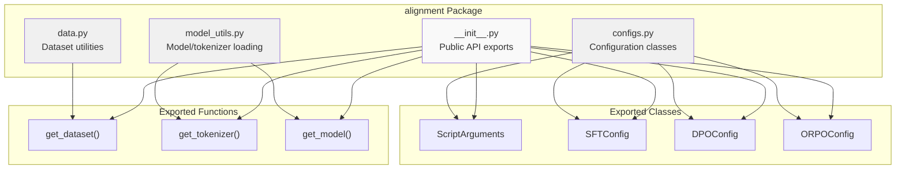
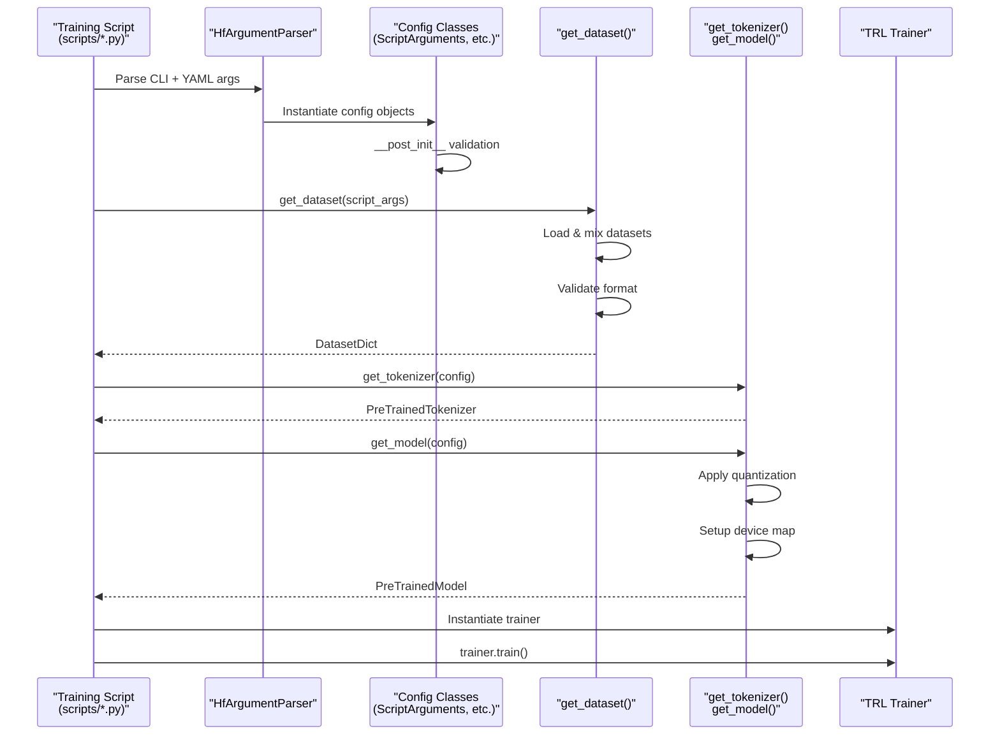
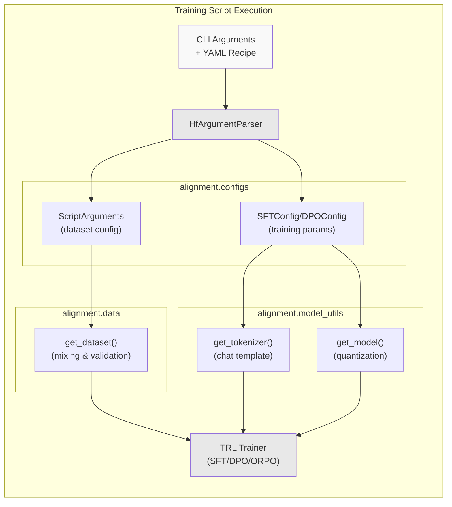

<!-- source: DeepWiki mcp.deepwiki.com · repo huggingface/alignment-handbook · page 2 Core Library (src/alignment) · fetched 2026-10-26 -->

# Core Library (src/alignment)

<details>
<summary>Relevant source files</summary>

The following files were used as context for generating this wiki page:

- [src/alignment/__init__.py](src/alignment/__init__.py)

</details>


The `src/alignment` package is the core Python library that provides reusable components for training aligned language models. It abstracts common functionality needed across different training methods (SFT, DPO, ORPO, etc.) into three main areas: configuration management, dataset loading and mixing, and model instantiation. This page provides an overview of the library's architecture and components.

For detailed documentation on specific subsystems:
- Configuration classes and validation: see [Configuration System](#2.1)
- Model and tokenizer loading: see [Model Loading and Utilities](#2.2)
- Dataset composition and format handling: see [Dataset Loading and Mixing](#2.3)
- Complete API reference: see [Package API Reference](#2.4)

## Package Structure

The `alignment` package exposes a clean public API through its `__init__.py` module. All core functionality is available through direct imports from the package.



**Sources:** [src/alignment/__init__.py:1-17]()

## Core Components

The library is organized into three functional modules, each handling a distinct aspect of the training pipeline:

| Module | Primary Exports | Purpose |
|--------|----------------|---------|
| `configs.py` | `ScriptArguments`, `SFTConfig`, `DPOConfig`, `ORPOConfig` | Configuration dataclasses that extend TRL base configs with alignment-specific parameters and validation logic |
| `data.py` | `get_dataset()` | Dataset loading, mixing, format validation, and train/test splitting |
| `model_utils.py` | `get_model()`, `get_tokenizer()` | Model and tokenizer instantiation with quantization, device mapping, and chat template handling |

### Configuration Classes

The configuration system provides strongly-typed configuration objects that merge parameters from multiple sources (CLI arguments, YAML recipe files, and defaults). Each training method has its own configuration class:

- **`ScriptArguments`**: Common parameters shared across all training methods (dataset names, hub settings, debugging flags)
- **`SFTConfig`**: Extends `trl.SFTConfig` with supervised fine-tuning specific parameters
- **`DPOConfig`**: Extends `trl.DPOConfig` with DPO-specific parameters like beta, label smoothing, and loss types
- **`ORPOConfig`**: Extends `trl.ORPOConfig` with ORPO-specific parameters for odds ratio preference optimization

All configuration classes include `__post_init__` validation to ensure parameter consistency and construct complex nested configurations like `DatasetMixtureConfig`.

**Sources:** [src/alignment/__init__.py:3]()

### Dataset Loading

The `get_dataset()` function provides flexible dataset composition:

- Load single datasets from Hugging Face Hub or local paths
- Mix multiple datasets with configurable weights
- Select specific columns from each dataset
- Validate dataset formats (messages column for SFT, chosen/rejected columns for DPO)
- Split datasets into train/test sets with reproducible seeding

The function returns a `DatasetDict` containing train and optionally test splits, ready for use with TRL trainers.

**Sources:** [src/alignment/__init__.py:4]()

### Model Utilities

The model loading utilities handle the complexity of instantiating models with various configurations:

- **`get_tokenizer()`**: Load and configure tokenizers, apply chat templates, set special tokens
- **`get_model()`**: Instantiate models with quantization (4-bit/8-bit), device mapping, dtype configuration, PEFT adapter integration

These functions abstract away common patterns like handling `BitsAndBytesConfig` for quantization, setting up Flash Attention 2, and configuring torch dtype based on mixed precision settings.

**Sources:** [src/alignment/__init__.py:5]()

## Integration with Training Scripts

The core library provides the foundation for all training scripts. The typical usage pattern follows this sequence:



**Component Flow Diagram:**



**Sources:** [src/alignment/__init__.py:1-17]()

## Design Principles

The core library follows several key design principles:

1. **Separation of Concerns**: Configuration, data, and model loading are cleanly separated into distinct modules
2. **Extensibility**: Configuration classes extend TRL base configs, allowing the library to leverage TRL's trainer infrastructure while adding alignment-specific features
3. **Type Safety**: All configuration parameters are strongly typed using Python dataclasses with validation
4. **Reproducibility**: Seed-based operations and explicit configuration ensure deterministic behavior
5. **Flexibility**: Support for both simple single-dataset scenarios and complex multi-dataset mixtures with weights

## Version Information

The package version is defined in [src/alignment/__init__.py:1]() and follows semantic versioning. The current development version is `0.4.0.dev0`.

**Sources:** [src/alignment/__init__.py:1]()

## Usage Example

Here's how a training script typically uses the core library:

```python
# 1. Parse configuration
parser = HfArgumentParser((ScriptArguments, SFTConfig, ModelConfig))
script_args, training_args, model_config = parser.parse_args_into_dataclasses()

# 2. Load dataset
dataset = get_dataset(script_args)

# 3. Load tokenizer and model
tokenizer = get_tokenizer(model_config, training_args)
model = get_model(model_config, training_args)

# 4. Initialize trainer
trainer = SFTTrainer(
    model=model,
    args=training_args,
    train_dataset=dataset["train"],
    tokenizer=tokenizer,
)

# 5. Train
trainer.train()
```

This pattern is consistent across all training scripts (`scripts/sft.py`, `scripts/dpo.py`, `scripts/run_orpo.py`), demonstrating the library's reusability.

**Sources:** [src/alignment/__init__.py:1-17]()

---

