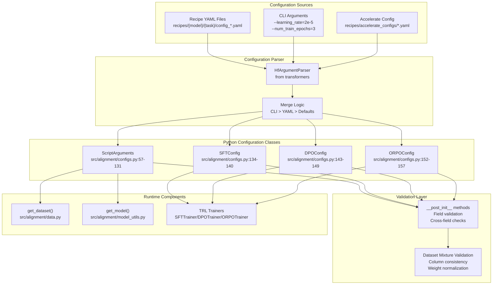
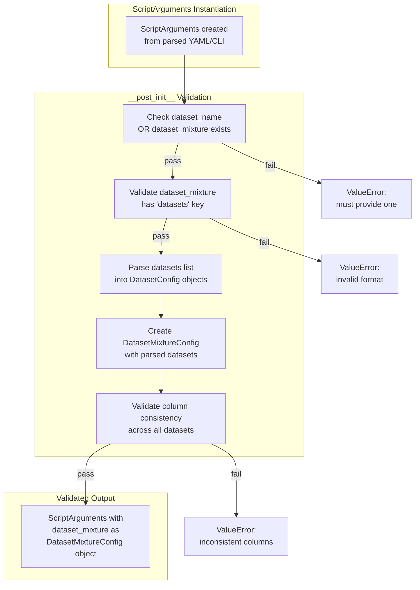
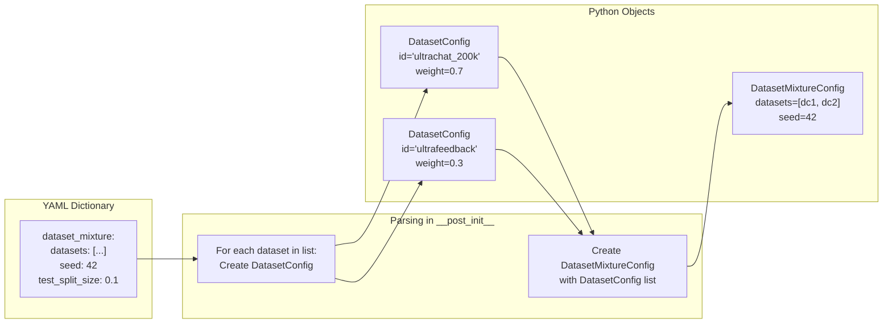
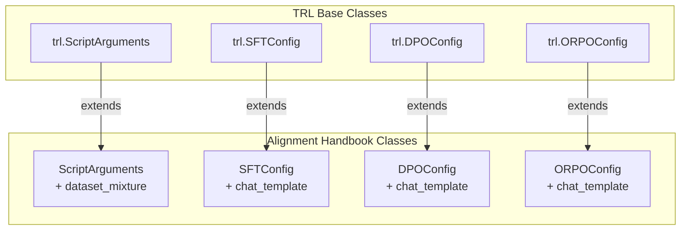
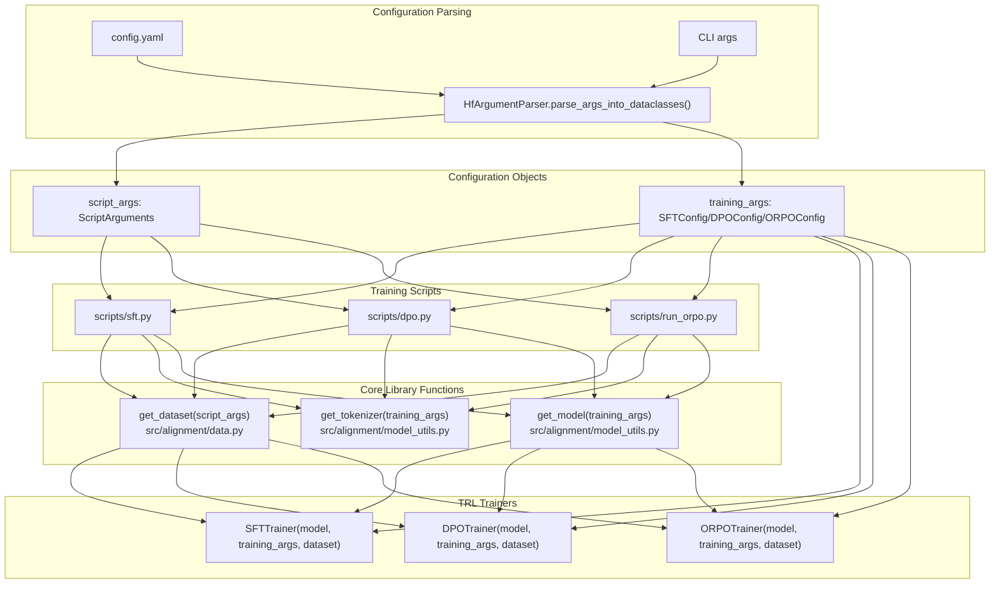

<!-- source: DeepWiki mcp.deepwiki.com · repo huggingface/alignment-handbook · page 2.1 Configuration System · fetched 2026-10-26 -->

# Configuration System

<details>
<summary>Relevant source files</summary>

The following files were used as context for generating this wiki page:

- [src/alignment/configs.py](src/alignment/configs.py)

</details>


## Purpose and Scope

This document describes the configuration system in the Alignment Handbook, which manages all training parameters, dataset specifications, and model settings. The system uses typed Python dataclasses that extend the TRL library's configuration classes to provide type-safe, validated configuration objects for training jobs.

For information about how datasets are loaded and processed using these configurations, see [Dataset Loading and Mixing](#2.3). For details on model loading parameters, see [Model Loading and Utilities](#2.2). For specific training method configurations, see [Training Methods](#3).

## Configuration Architecture

The configuration system operates in three layers: configuration sources (YAML files and CLI arguments), Python configuration classes (typed dataclasses), and validation/merging logic. The system uses Hugging Face's `HfArgumentParser` to merge multiple configuration sources and produce validated configuration objects.



**Figure 1: Configuration System Architecture**

Sources: [src/alignment/configs.py:1-158]()

## Core Configuration Classes

### ScriptArguments

The `ScriptArguments` class extends `trl.ScriptArguments` to add dataset mixture support. It is the primary container for dataset-related configuration and is used across all training scripts.

| Field | Type | Default | Description |
|-------|------|---------|-------------|
| `dataset_name` | `Optional[str]` | `None` | Single dataset identifier (inherited from TRL) |
| `dataset_mixture` | `Optional[dict]` | `None` | Configuration dictionary for dataset mixtures |

The class enforces that either `dataset_name` or `dataset_mixture` must be provided but not both. When `dataset_mixture` is specified, it is parsed and validated in the `__post_init__` method [src/alignment/configs.py:88-131]().



**Figure 2: ScriptArguments Validation Flow**

Sources: [src/alignment/configs.py:57-131]()

### Dataset Configuration Classes

The dataset configuration system uses two dataclasses to define single datasets and mixtures of datasets.

#### DatasetConfig

The `DatasetConfig` class specifies a single dataset in a mixture [src/alignment/configs.py:36-45]():

| Field | Type | Default | Description |
|-------|------|---------|-------------|
| `id` | `str` | Required | Dataset identifier (HF Hub path or local path) |
| `config` | `Optional[str]` | `None` | Dataset configuration name (for multi-config datasets) |
| `split` | `str` | `"train"` | Dataset split to use |
| `columns` | `Optional[list[str]]` | `None` | Columns to retain from the dataset |
| `weight` | `Optional[float]` | `None` | Sampling weight for this dataset in the mixture |

#### DatasetMixtureConfig

The `DatasetMixtureConfig` class specifies a mixture of multiple datasets [src/alignment/configs.py:47-54]():

| Field | Type | Default | Description |
|-------|------|---------|-------------|
| `datasets` | `list[DatasetConfig]` | Required | List of dataset configurations |
| `seed` | `int` | `0` | Random seed for shuffling and sampling |
| `test_split_size` | `Optional[float]` | `None` | Fraction of data to use for test split |

**Example YAML Configuration:**

```yaml
dataset_mixture:
  datasets:
    - id: HuggingFaceH4/ultrachat_200k
      split: train_sft
      columns:
        - messages
      weight: 0.7
    - id: HuggingFaceH4/ultrafeedback_binarized
      split: train_prefs
      columns:
        - messages
      weight: 0.3
  seed: 42
  test_split_size: 0.1
```



**Figure 3: Dataset Mixture Configuration Parsing**

Sources: [src/alignment/configs.py:36-54](), [src/alignment/configs.py:88-131]()

### Training Configuration Classes

The Alignment Handbook extends TRL's training configuration classes to add chat template support. Each training method has its own configuration class.

#### SFTConfig

Extends `trl.SFTConfig` for supervised fine-tuning [src/alignment/configs.py:134-140]():

| Additional Field | Type | Default | Description |
|-----------------|------|---------|-------------|
| `chat_template` | `Optional[str]` | `None` | Custom Jinja2 chat template for message formatting |

Inherits all fields from `trl.SFTConfig`, including:
- Standard training parameters (learning rate, batch size, epochs)
- Packing options for sequence concatenation
- Max sequence length
- Gradient checkpointing settings

#### DPOConfig

Extends `trl.DPOConfig` for direct preference optimization [src/alignment/configs.py:143-149]():

| Additional Field | Type | Default | Description |
|-----------------|------|---------|-------------|
| `chat_template` | `Optional[str]` | `None` | Custom Jinja2 chat template for message formatting |

Inherits all fields from `trl.DPOConfig`, including:
- Beta parameter for KL divergence penalty
- Reference model settings
- Loss type (sigmoid, hinge, ipo, kto)
- Label smoothing

#### ORPOConfig

Extends `trl.ORPOConfig` for odds ratio preference optimization [src/alignment/configs.py:152-157]():

| Additional Field | Type | Default | Description |
|-----------------|------|---------|-------------|
| `chat_template` | `Optional[str]` | `None` | Custom Jinja2 chat template for message formatting |

Inherits all fields from `trl.ORPOConfig`, including:
- Lambda parameter for odds ratio penalty
- Max prompt length and completion length
- Packing options



**Figure 4: Configuration Class Hierarchy**

Sources: [src/alignment/configs.py:57-157]()

## Configuration Source Merging

The configuration system merges values from three sources, with the following precedence (highest to lowest):

1. **Command-line arguments**: Directly specified via `--parameter=value`
2. **YAML configuration files**: Specified via `--config_file=path/to/config.yaml`
3. **Default values**: Defined in the dataclass field definitions

When training scripts invoke `HfArgumentParser`, it performs this merge automatically. For example:

```bash
# YAML file specifies learning_rate: 2e-4
# CLI override: --learning_rate=1e-5
# Result: learning_rate = 1e-5 (CLI takes precedence)
accelerate launch scripts/sft.py \
  --config_file recipes/zephyr-7b-beta/sft/config_full.yaml \
  --learning_rate=1e-5
```

The parser processes arguments in this order:
1. Load default values from dataclass field definitions
2. Override with values from YAML file(s) if provided
3. Override with CLI arguments if provided
4. Call `__post_init__` methods for validation

Sources: [src/alignment/configs.py:1-158]()

## Validation Logic

The configuration system implements validation at two levels: field-level validation (via dataclass field types) and cross-field validation (via `__post_init__` methods).

### ScriptArguments Validation

The `ScriptArguments.__post_init__` method [src/alignment/configs.py:88-131]() performs the following validations:

1. **Mutual Exclusivity Check**: Ensures exactly one of `dataset_name` or `dataset_mixture` is provided
2. **Structure Validation**: Validates that `dataset_mixture` is a dictionary with a `datasets` key
3. **Dataset List Parsing**: Converts raw dictionary entries into `DatasetConfig` objects
4. **Column Consistency Check**: Ensures all datasets in a mixture specify the same columns if columns are specified

**Validation Pseudocode:**

```
if dataset_name is None and dataset_mixture is None:
    raise ValueError("Must provide dataset_name or dataset_mixture")

if dataset_mixture is not None:
    if not isinstance(dataset_mixture, dict) or "datasets" not in dataset_mixture:
        raise ValueError("Invalid dataset_mixture format")
    
    # Parse each dataset config
    for config_dict in dataset_mixture["datasets"]:
        datasets.append(DatasetConfig(**config_dict))
    
    # Check column consistency
    all_columns = [set(d.columns) for d in datasets if d.columns is not None]
    if all_columns and not all consistent:
        raise ValueError("Column names must be consistent")
    
    # Replace dict with DatasetMixtureConfig object
    self.dataset_mixture = DatasetMixtureConfig(datasets, seed, test_split_size)
```

### Column Consistency Example

The system enforces that all datasets in a mixture use the same column names [src/alignment/configs.py:122-130](). This prevents downstream errors during dataset concatenation.

**Valid Configuration:**
```yaml
dataset_mixture:
  datasets:
    - id: dataset1
      columns: ["messages"]
    - id: dataset2
      columns: ["messages"]  # Same columns ✓
```

**Invalid Configuration:**
```yaml
dataset_mixture:
  datasets:
    - id: dataset1
      columns: ["messages"]
    - id: dataset2
      columns: ["prompt", "completion"]  # Different columns ✗
```

Sources: [src/alignment/configs.py:88-131]()

## Configuration Flow to Runtime

Once configurations are parsed and validated, they flow to the training scripts and are used by core library functions. The following diagram shows this flow:



**Figure 5: Configuration Flow from Parsing to Runtime**

### Typical Usage Pattern

Training scripts follow this pattern:

1. Parse configurations using `HfArgumentParser`
2. Extract `ScriptArguments` and training-specific config (e.g., `SFTConfig`)
3. Pass `ScriptArguments` to `get_dataset()` for dataset loading
4. Pass training config to `get_tokenizer()` and `get_model()` for model setup
5. Pass all components to the appropriate TRL trainer

**Example from scripts/sft.py:**

```python
parser = HfArgumentParser((ScriptArguments, SFTConfig, ModelConfig))
script_args, training_args, model_config = parser.parse_args_into_dataclasses()

# Use ScriptArguments for dataset loading
train_dataset, eval_dataset = get_dataset(script_args, ...)

# Use training config for tokenizer/model
tokenizer = get_tokenizer(training_args, ...)
model = get_model(training_args, ...)

# Pass training config to trainer
trainer = SFTTrainer(model, training_args, train_dataset, ...)
```

Sources: [src/alignment/configs.py:1-158]()

## Configuration Extensibility

The configuration system is designed to be extended. To add new configuration parameters:

1. **For dataset-related parameters**: Add fields to `ScriptArguments`
2. **For training parameters**: Add fields to `SFTConfig`, `DPOConfig`, or `ORPOConfig`
3. **For validation logic**: Implement or extend `__post_init__` methods

The system maintains backward compatibility with TRL's base configuration classes, allowing seamless integration with TRL trainers while adding Alignment Handbook-specific features like dataset mixing and custom chat templates.

Sources: [src/alignment/configs.py:1-158]()

---

