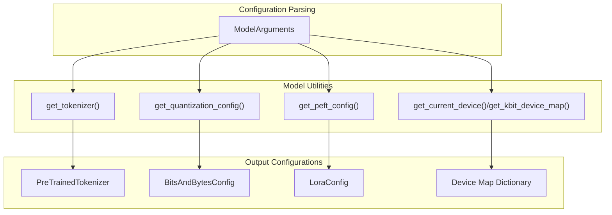
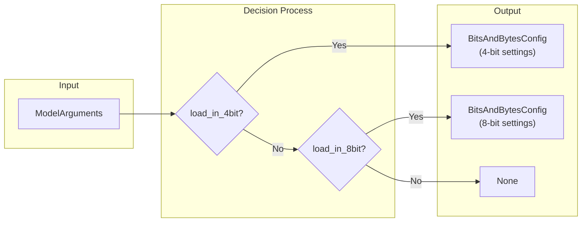
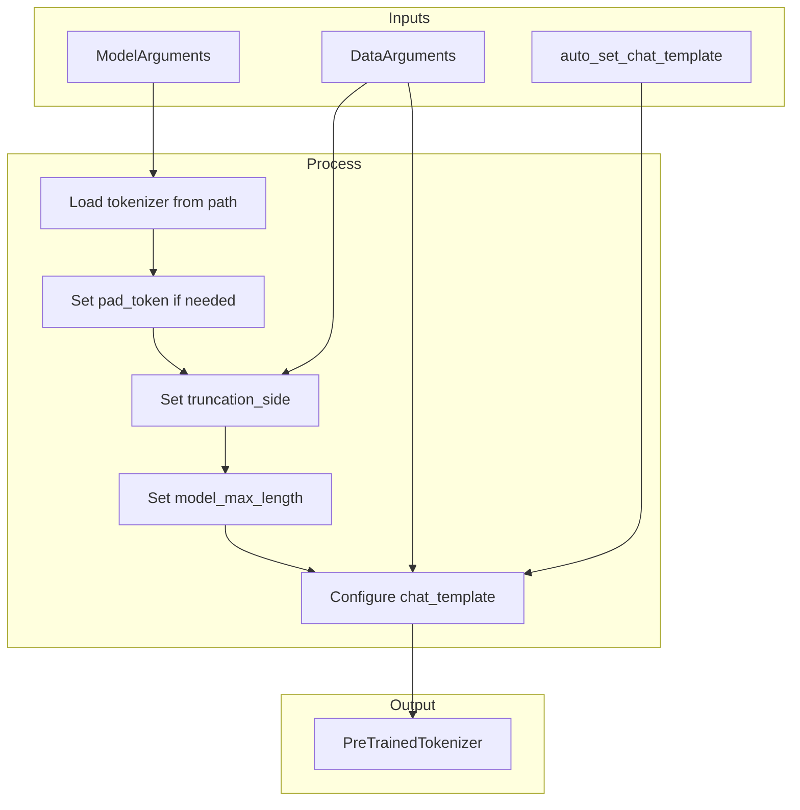
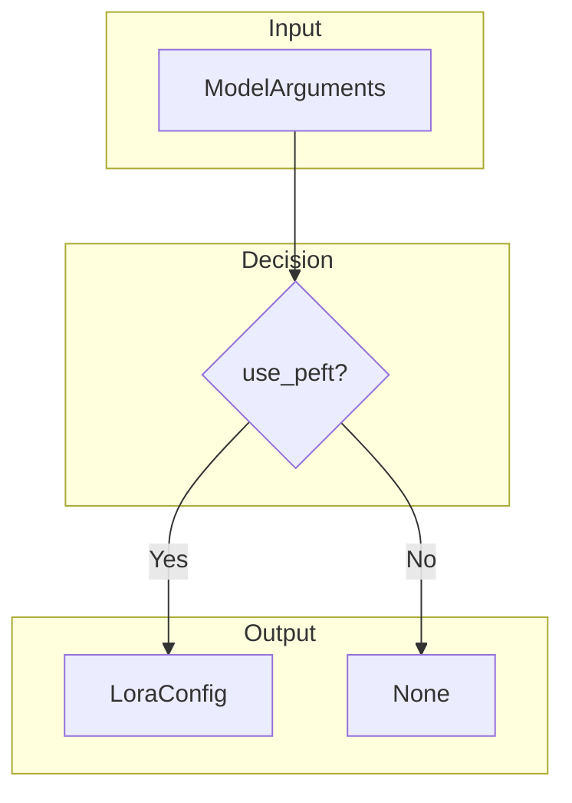
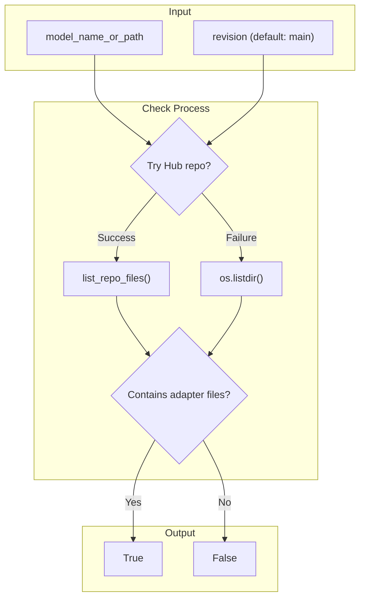
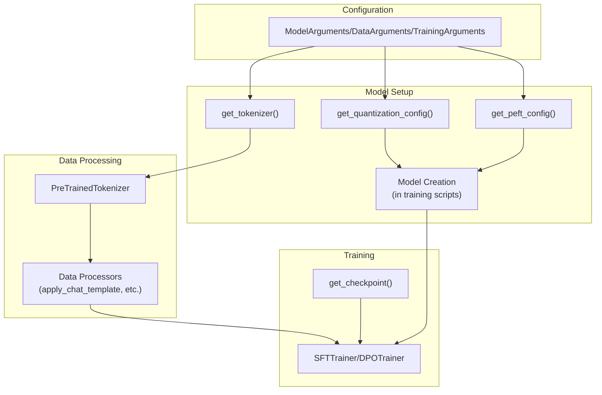

<!-- source: DeepWiki mcp.deepwiki.com · repo huggingface/alignment-handbook · page 2.2 Model Loading and Utilities · fetched 2026-10-26 -->

# Model Utilities

Relevant source files

The following files were used as context for generating this wiki page:

- [src/alignment/model_utils.py](src/alignment/model_utils.py)

## Overview

The Model Utilities module provides essential functions for configuring, loading, and managing language models in the Alignment Handbook. These utilities serve as a bridge between high-level model configuration parameters and the low-level implementation details required by the Hugging Face Transformers, PEFT, and BitsAndBytes libraries.

This module handles several critical aspects of model setup including:
- Tokenizer configuration
- Quantization setup
- Parameter-efficient fine-tuning (PEFT) configuration
- Device mapping
- Checkpoint management

For information about data processing utilities, see [Data Processing](#2.3).

Sources: [src/alignment/model_utils.py:15-129]()

## Model Configuration Flow

Sources: [src/alignment/model_utils.py:33-128]()

## Quantization Utilities

The Alignment Handbook provides built-in support for both 8-bit and 4-bit quantization through the `get_quantization_config` function. This enables memory-efficient loading and fine-tuning of large language models.

### get_quantization_config

The function supports the following quantization options:
- 4-bit quantization with configurable compute dtype
- 4-bit nested quantization (double quantization)
- 8-bit quantization

Sources: [src/alignment/model_utils.py:43-63]()

## Tokenizer Utilities

### get_tokenizer

The `get_tokenizer` function loads and configures a tokenizer based on the provided model and data arguments. It handles several important tokenization aspects:

1. Loading the tokenizer from the specified path
2. Setting default padding token if none exists
3. Configuring truncation side
4. Setting appropriate model maximum length
5. Configuring chat template

Chat templates are particularly important for alignment as they define how to format conversations between users and assistants. The function will:
- Use a custom chat template if specified in `data_args.chat_template`
- Use the model's built-in chat template if available
- Fall back to a default chat template if needed and `auto_set_chat_template` is enabled

Sources: [src/alignment/model_utils.py:66-94](), [tests/test_data.py:124-140]()

## PEFT Configuration Utilities

### get_peft_config

The `get_peft_config` function creates a configuration for Parameter-Efficient Fine-Tuning (PEFT). It specifically configures LoRA (Low-Rank Adaptation), which enables efficient fine-tuning of large models by only updating a small number of adapter parameters rather than the full model weights.

The LoRA configuration includes:
- Rank (`r`): Controls the size of low-rank matrices
- Alpha (`lora_alpha`): Scaling factor for adapted weights
- Dropout (`lora_dropout`): Regularization parameter
- Target modules: Which layers to apply LoRA to
- Modules to save: Which modules to save separately

Sources: [src/alignment/model_utils.py:97-111](), [tests/test_model_utils.py:70-81]()

## Device Management Utilities

The module provides two functions to manage compute devices:

1. **get_current_device**: Returns the local process index for GPU setups or "cpu" for CPU-only environments
2. **get_kbit_device_map**: Returns a device map for running inference with quantized models

These utilities help simplify distributed training and inference across multiple GPUs.

Sources: [src/alignment/model_utils.py:33-40]()

## Checkpoint and Model Type Utilities

### get_checkpoint

The `get_checkpoint` function retrieves the last checkpoint from a training directory. This is useful for resuming training from the last saved checkpoint.

### is_adapter_model

The `is_adapter_model` function determines whether a given model is an adapter model (using PEFT) by checking for the presence of adapter model files in either a Hugging Face Hub repository or a local directory.

Sources: [src/alignment/model_utils.py:114-121](), [tests/test_model_utils.py:84-88]()

## Integration with Training Pipeline

The Model Utilities module integrates with the broader Alignment Handbook pipeline as shown below:

Sources: [src/alignment/model_utils.py:15-129]()

## API Reference

| Function | Purpose | Key Arguments |
|----------|---------|---------------|
| `get_current_device()` | Get current device for computation | None |
| `get_kbit_device_map()` | Get device map for quantized models | None |
| `get_quantization_config(model_args)` | Configure quantization settings | `ModelArguments` object |
| `get_tokenizer(model_args, data_args, auto_set_chat_template)` | Load and configure tokenizer | `ModelArguments`, `DataArguments`, boolean flag |
| `get_peft_config(model_args)` | Configure LoRA for PEFT | `ModelArguments` object |
| `is_adapter_model(model_name_or_path, revision)` | Check if model uses PEFT adapters | Model path, revision name |
| `get_checkpoint(training_args)` | Get last checkpoint from training | `SFTConfig` or `DPOConfig` object |

Sources: [src/alignment/model_utils.py:15-129]()

---

