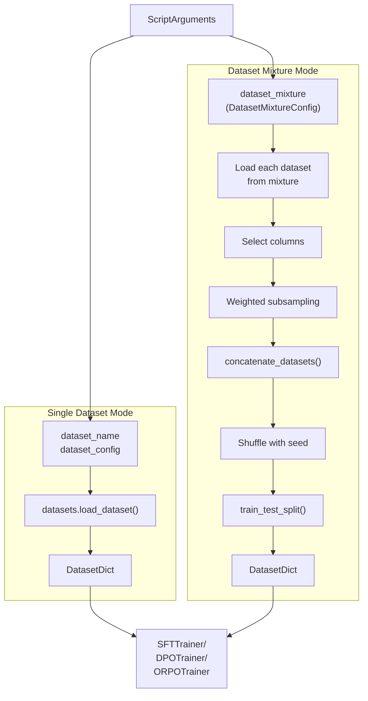
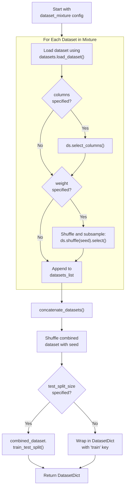
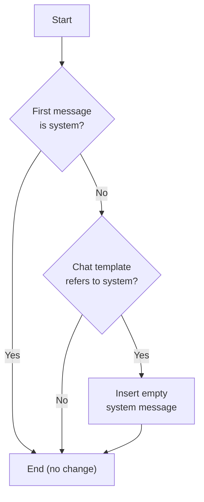
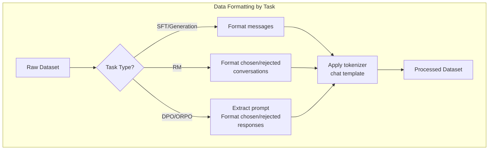
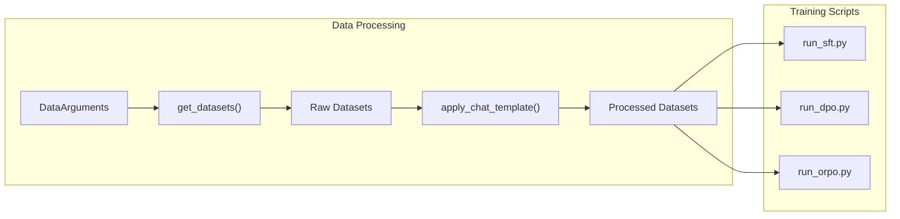

<!-- source: DeepWiki mcp.deepwiki.com · repo huggingface/alignment-handbook · page 2.3 Dataset Loading and Mixing · fetched 2026-10-26 -->

# Dataset Loading and Mixing

<details>
<summary>Relevant source files</summary>

The following files were used as context for generating this wiki page:

- [src/alignment/data.py](src/alignment/data.py)

</details>


This document explains the dataset loading and mixing functionality in the Alignment Handbook. The `get_dataset` function in [src/alignment/data.py]() handles loading either a single dataset or a weighted mixture of multiple datasets. For details on the configuration classes, see page 2.1. For information about model loading, see page 2.2.

## Overview

The `get_dataset` function provides two modes of operation:

1. **Single Dataset Loading**: Load a single dataset from Hugging Face Hub or local path
2. **Dataset Mixture**: Load and combine multiple datasets with configurable weights, column selection, and sampling

The function returns a `DatasetDict` containing train and optionally test splits, ready for use by training scripts (SFT, DPO, ORPO, etc.).



Sources: [src/alignment/data.py:26-79]()
</thinking>

## The get_dataset Function

The main entry point for dataset loading is the `get_dataset` function, which takes a `ScriptArguments` object and returns a `DatasetDict`.

**Function Signature:**
```python
def get_dataset(args: ScriptArguments) -> DatasetDict
```

The function behavior depends on which arguments are provided:
- If `args.dataset_name` is set (and `args.dataset_mixture` is not), it loads a single dataset
- If `args.dataset_mixture` is set, it loads and mixes multiple datasets
- If neither is set, it raises a `ValueError`

Sources: [src/alignment/data.py:26-34]()

## Single Dataset Loading

When `dataset_name` is provided without a `dataset_mixture`, the function performs a straightforward dataset load:

```python
datasets.load_dataset(args.dataset_name, args.dataset_config)
```

This returns the dataset's default `DatasetDict` structure (typically with train/test/validation splits).

**Example Configuration (YAML):**
```yaml
dataset_name: "HuggingFaceH4/ultrachat_200k"
dataset_config: "default"
```

Sources: [src/alignment/data.py:35-37]()

## Dataset Mixture Configuration

The `dataset_mixture` parameter accepts a `DatasetMixtureConfig` object that specifies multiple datasets to combine. Each dataset in the mixture is described by a `DatasetConfig` object.

### DatasetMixtureConfig Structure

The configuration consists of:
- `datasets`: List of `DatasetConfig` objects
- `seed`: Random seed for shuffling and splitting
- `test_split_size`: Optional proportion for train/test split (e.g., 0.1 for 10% test)

### DatasetConfig Structure

Each dataset in the mixture has:

| Field | Type | Description |
|-------|------|-------------|
| `id` | str | Dataset identifier (Hugging Face Hub name or local path) |
| `config` | str | Dataset configuration name (e.g., "default") |
| `split` | str | Which split to load (e.g., "train", "test") |
| `columns` | List[str] | Columns to retain from the dataset |
| `weight` | float | Sampling weight (0.0-1.0) for subsampling |

**Example Configuration (YAML):**
```yaml
dataset_mixture:
  seed: 42
  test_split_size: 0.1
  datasets:
    - id: "HuggingFaceH4/ultrachat_200k"
      config: "default"
      split: "train_sft"
      columns: ["messages"]
      weight: 0.5
    - id: "HuggingFaceH4/helpful-base"
      config: "default"
      split: "train"
      columns: ["messages"]
      weight: 1.0
```

See page 2.1 for complete configuration reference.

Sources: [src/alignment/data.py:38-76]()

## Dataset Mixing Process

When a dataset mixture is configured, the function performs the following steps:

### Step-by-Step Mixing Pipeline



Sources: [src/alignment/data.py:38-76]()

### 1. Load Individual Datasets

For each dataset configuration in the mixture, the function calls:

```python
ds = datasets.load_dataset(
    dataset_config.id,
    dataset_config.config,
    split=dataset_config.split,
)
```

This loads the specified split from each dataset.

Sources: [src/alignment/data.py:43-49]()

### 2. Column Selection

If `columns` is specified for a dataset, only those columns are retained:

```python
if dataset_config.columns is not None:
    ds = ds.select_columns(dataset_config.columns)
```

This prevents schema conflicts when concatenating datasets with different column sets. All datasets in the mixture must have compatible columns after this step.

Sources: [src/alignment/data.py:50-51]()

### 3. Weighted Subsampling

If `weight` is specified (and not `None`), the dataset is subsampled:

```python
if dataset_config.weight is not None:
    ds = ds.shuffle(seed=seed).select(range(int(len(ds) * dataset_config.weight)))
```

The weight parameter works as follows:
- `weight=0.5`: Use 50% of the dataset examples
- `weight=1.0`: Use 100% of the dataset (all examples)
- `weight=0.1`: Use 10% of the dataset

The subsampling is deterministic based on the seed, ensuring reproducibility.

Sources: [src/alignment/data.py:52-56]()

### 4. Concatenation

All processed datasets are concatenated into a single dataset:

```python
combined_dataset = concatenate_datasets(datasets_list)
```

This creates a single dataset containing all examples from all source datasets.

Sources: [src/alignment/data.py:60-61]()

### 5. Shuffling

The combined dataset is shuffled using the specified seed:

```python
combined_dataset = combined_dataset.shuffle(seed=seed)
```

This ensures examples from different source datasets are interleaved, rather than appearing in blocks.

Sources: [src/alignment/data.py:62]()

### 6. Train/Test Splitting

If `test_split_size` is specified, the combined dataset is split:

```python
combined_dataset = combined_dataset.train_test_split(
    test_size=args.dataset_mixture.test_split_size, 
    seed=seed
)
```

This returns a `DatasetDict` with `train` and `test` keys. If `test_split_size` is not specified, the function returns a `DatasetDict` with only a `train` key.

Sources: [src/alignment/data.py:65-72]()

## Chat Template Processing

After datasets are loaded, the next step is to apply chat templates to format the conversations properly for the model.

### Default Chat Template

The framework provides a default chat template that formats messages from different roles (user, system, assistant):

```


{{ '<|user|>\n' + message['content'] + eos_token }}

{{ '<|system|>\n' + message['content'] + eos_token }}

{{ '<|assistant|>\n'  + message['content'] + eos_token }}


{{ '<|assistant|>' }}


```

This template is used when no custom template is provided.

Sources: [src/alignment/data.py:25]()

### System Message Insertion

The `maybe_insert_system_message` function ensures that conversations have a system message:



Sources: [src/alignment/data.py:28-40]()

### Task-Specific Formatting

The `apply_chat_template` function formats examples differently depending on the training task:

| Task | Input | Output |
|------|-------|--------|
| SFT | `messages` | `text` with complete conversation |
| Generation | `messages` | `text` with conversation + generation prompt |
| RM | `chosen`, `rejected` | `text_chosen`, `text_rejected` |
| DPO/ORPO | `chosen`, `rejected` | `text_prompt`, `text_chosen`, `text_rejected` |

Sources: [src/alignment/data.py:42-108]()

### Task-Specific Data Flows



Sources: [src/alignment/data.py:42-108]()

## Integration with Training Pipeline

The processed datasets are used by the training scripts (SFT, DPO, etc.) to train and align language models.



Sources: [src/alignment/data.py:42-108](), [src/alignment/data.py:125-176]()

## Example Usage

Here's a typical flow for processing data for SFT training:

1. Define a dataset configuration:
   ```python
   data_args = DataArguments(
       dataset_mixer={
           "HuggingFaceH4/alpaca_cleaned": 0.5,
           "HuggingFaceH4/helpful_harmless_rlhf": 0.5
       },
       chat_template="chatml"
   )
   ```

2. Load and mix the datasets:
   ```python
   raw_datasets = get_datasets(data_args)
   ```

3. Apply the chat template:
   ```python
   processed_datasets = raw_datasets.map(
       apply_chat_template,
       fn_kwargs={"tokenizer": tokenizer, "task": "sft"}
   )
   ```

4. Use the processed datasets for training.

Sources: [src/alignment/data.py:125-176](), [src/alignment/data.py:42-108]()

## Data Schema Requirements

Different tasks require specific formats:

### SFT and Generation Tasks
Require a `messages` field containing a list of message objects in OpenAI format (each with `role` and `content` keys).

### RM Tasks
Require both `chosen` and `rejected` fields, each containing a list of message objects.

### DPO/ORPO Tasks
Require:
- Either a `prompt` field + `chosen`/`rejected` fields, or
- Just `chosen`/`rejected` fields, where the prompt is extracted from all but the last message of `chosen`

Sources: [src/alignment/data.py:42-108]()

## Format Validation

The `is_openai_format` function checks if messages follow the OpenAI format:
- Must be a list of dictionaries
- Each dictionary must have `role` and `content` keys

This validation is used during template application to ensure properly formatted inputs.

Sources: [src/alignment/data.py:111-122]()

---

