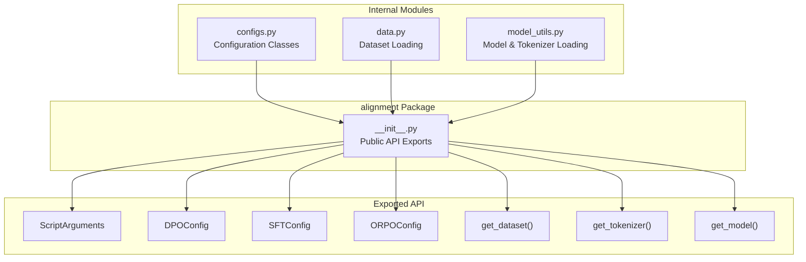
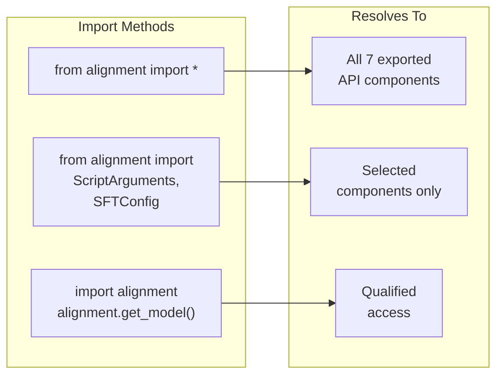
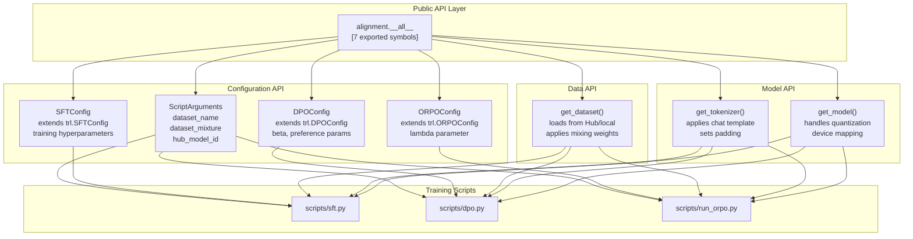
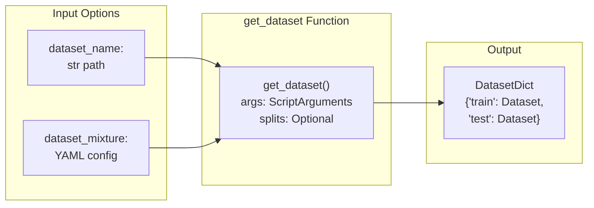
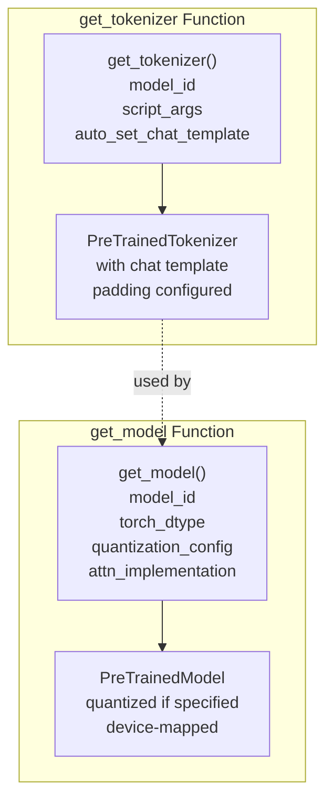

<!-- source: DeepWiki mcp.deepwiki.com · repo huggingface/alignment-handbook · page 2.4 Package API Reference · fetched 2026-10-26 -->

# Package API Reference

<details>
<summary>Relevant source files</summary>

The following files were used as context for generating this wiki page:

- [src/alignment/__init__.py](src/alignment/__init__.py)

</details>


This page documents the public API surface exposed by the `alignment` package, including versioning information and the complete list of exported classes and functions. This reference serves as a quick lookup for developers integrating the Alignment Handbook into their own code or scripts.

For detailed documentation on specific components:
- Configuration classes and their parameters: see [Configuration System](#2.1)
- Model and tokenizer loading functions: see [Model Loading and Utilities](#2.2)
- Dataset loading and mixing functions: see [Dataset Loading and Mixing](#2.3)

## Package Structure

The `alignment` package is a Python library that provides reusable components for training aligned language models. All public API elements are exposed through the top-level `alignment` module via [src/alignment/\_\_init\_\_.py:1-17]().



**Sources:** [src/alignment/\_\_init\_\_.py:1-17]()

## Version Information

The package version follows semantic versioning and is defined in [src/alignment/\_\_init\_\_.py:1]():

```python
__version__ = "0.4.0.dev0"
```

The `.dev0` suffix indicates this is a development version. This version string is accessible as:

```python
import alignment
print(alignment.__version__)  # "0.4.0.dev0"
```

**Sources:** [src/alignment/\_\_init\_\_.py:1]()

## Public API Surface

The complete public API is defined in the `__all__` list in [src/alignment/\_\_init\_\_.py:8-16](). All other symbols in the package are considered internal implementation details and should not be relied upon.

### API Components Table

| Component | Type | Source Module | Purpose |
|-----------|------|---------------|---------|
| `ScriptArguments` | Class | `alignment.configs` | Dataset and script configuration arguments |
| `SFTConfig` | Class | `alignment.configs` | Supervised fine-tuning configuration |
| `DPOConfig` | Class | `alignment.configs` | Direct preference optimization configuration |
| `ORPOConfig` | Class | `alignment.configs` | Odds ratio preference optimization configuration |
| `get_dataset` | Function | `alignment.data` | Load and prepare training datasets with optional mixing |
| `get_tokenizer` | Function | `alignment.model_utils` | Load and configure tokenizers with chat templates |
| `get_model` | Function | `alignment.model_utils` | Load and configure models with quantization support |

**Sources:** [src/alignment/\_\_init\_\_.py:3-5](), [src/alignment/\_\_init\_\_.py:8-16]()

## Import Patterns

The public API supports both individual and collective imports:



### Recommended Import Style

For training scripts:
```python
from alignment import (
    ScriptArguments,
    SFTConfig,
    get_dataset,
    get_model,
    get_tokenizer,
)
```

For library integration:
```python
import alignment

# Access via qualified names
config = alignment.ScriptArguments(...)
dataset = alignment.get_dataset(...)
```

**Sources:** [src/alignment/\_\_init\_\_.py:8-16]()

## API Component Mapping

The following diagram shows how the public API maps to internal modules and their relationships to the training workflow:



**Sources:** [src/alignment/\_\_init\_\_.py:3-5](), [src/alignment/\_\_init\_\_.py:8-16]()

## Configuration Classes API

The four configuration classes form the declarative interface for specifying training parameters:

| Class | Base Class | Primary Use | Key Parameters |
|-------|-----------|-------------|----------------|
| `ScriptArguments` | `dataclass` | Dataset and experiment configuration | `dataset_name`, `dataset_mixture`, `hub_model_id`, `chat_template` |
| `SFTConfig` | `trl.SFTConfig` | Supervised fine-tuning | `packing`, `max_seq_length`, standard training params |
| `DPOConfig` | `trl.DPOConfig` | Preference optimization | `beta`, `loss_type`, reference model handling |
| `ORPOConfig` | `trl.ORPOConfig` | Single-stage alignment | `lambda` (odds ratio weight) |

All configuration classes support:
- YAML-based serialization for recipe files
- CLI argument parsing via `HfArgumentParser`
- Validation through `__post_init__` methods
- Extension of TRL base configurations

**Sources:** [src/alignment/\_\_init\_\_.py:3]()

## Data Loading API

The dataset loading API provides a single function with flexible input formats:



**Function Signature:**
```python
def get_dataset(
    script_args: ScriptArguments,
    splits: Optional[List[str]] = None
) -> DatasetDict
```

The function handles:
- Single dataset loading from Hub or local paths
- Multi-dataset mixing with weighted sampling
- Column selection and validation
- Train/test splitting
- Shuffling with reproducible seeding

**Sources:** [src/alignment/\_\_init\_\_.py:4]()

## Model Utilities API

The model loading API provides two complementary functions:



**Function Signatures:**
```python
def get_tokenizer(
    model_id: str,
    script_args: ScriptArguments,
    auto_set_chat_template: bool = True
) -> PreTrainedTokenizer

def get_model(
    model_id: str,
    torch_dtype: Optional[torch.dtype] = None,
    quantization_config: Optional[BitsAndBytesConfig] = None,
    attn_implementation: Optional[str] = None,
    ...
) -> PreTrainedModel
```

These functions handle:
- Loading from Hugging Face Hub
- Quantization (4-bit, 8-bit)
- Device mapping for distributed training
- Chat template application
- Flash Attention integration

**Sources:** [src/alignment/\_\_init\_\_.py:5]()

## Usage Example

A typical training script imports and uses the API as follows:

```python
from alignment import (
    ScriptArguments,
    SFTConfig,
    get_dataset,
    get_model,
    get_tokenizer,
)

# Parse configuration
parser = HfArgumentParser((ScriptArguments, SFTConfig))
script_args, training_args = parser.parse_yaml_file("config.yaml")

# Load dataset
dataset = get_dataset(script_args, splits=["train", "test"])

# Load tokenizer and model
tokenizer = get_tokenizer(training_args.model_name_or_path, script_args)
model = get_model(
    training_args.model_name_or_path,
    torch_dtype=torch.bfloat16,
)

# Pass to TRL trainer (e.g., SFTTrainer)
trainer = SFTTrainer(
    model=model,
    tokenizer=tokenizer,
    train_dataset=dataset["train"],
    args=training_args,
)
```

**Sources:** [src/alignment/\_\_init\_\_.py:3-5](), [src/alignment/\_\_init\_\_.py:8-16]()

## Stability and Versioning

The public API defined in `__all__` is considered stable within major versions. Any breaking changes will result in a major version increment. Internal modules (those not in `__all__`) may change without notice between minor versions.

Version format: `MAJOR.MINOR.PATCH[.dev0]`
- **MAJOR**: Breaking API changes
- **MINOR**: New features, backward-compatible
- **PATCH**: Bug fixes
- **dev0**: Development/unreleased version

**Sources:** [src/alignment/\_\_init\_\_.py:1](), [src/alignment/\_\_init\_\_.py:8-16]()

---

