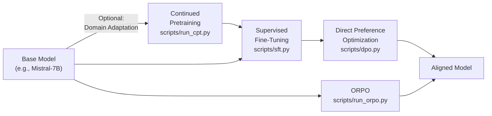
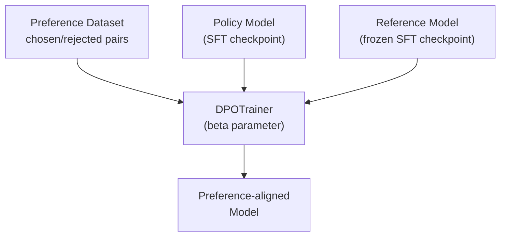
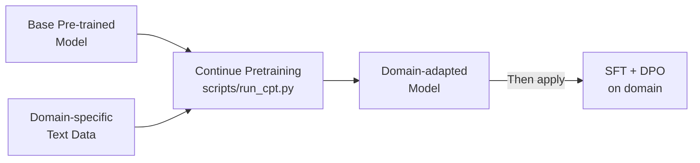
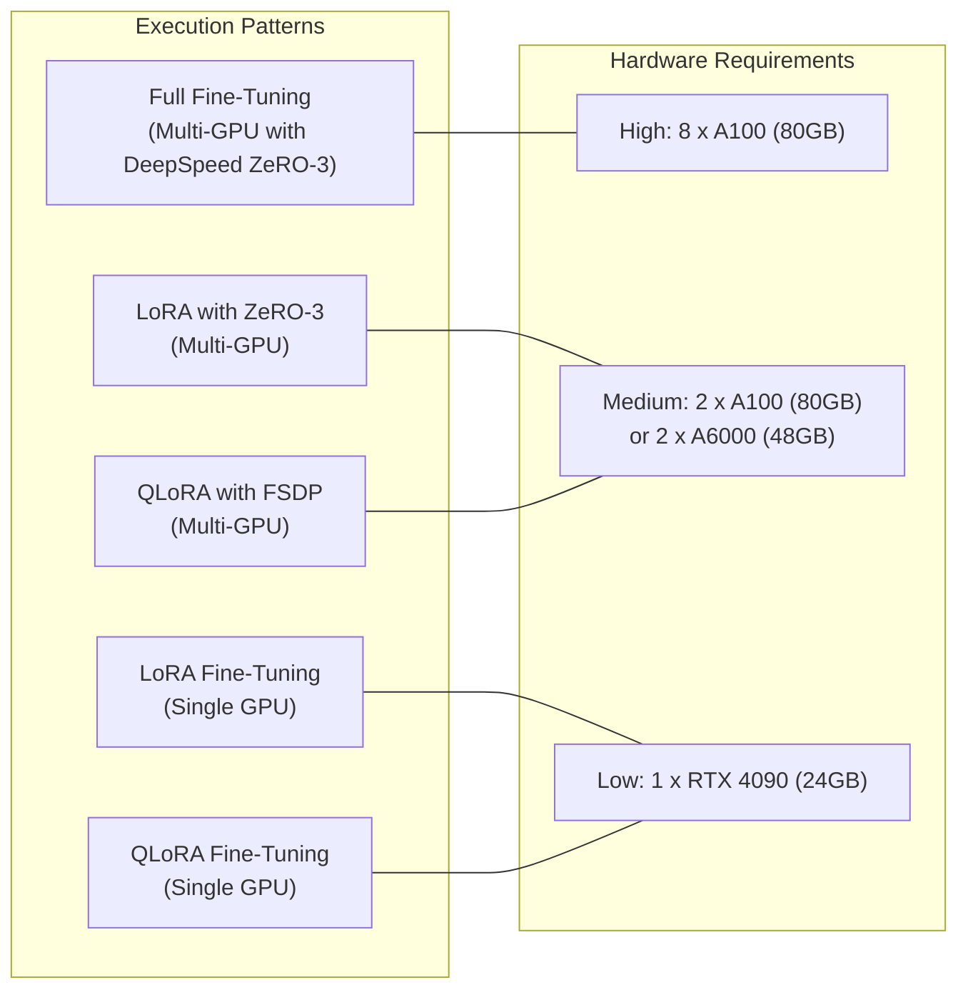
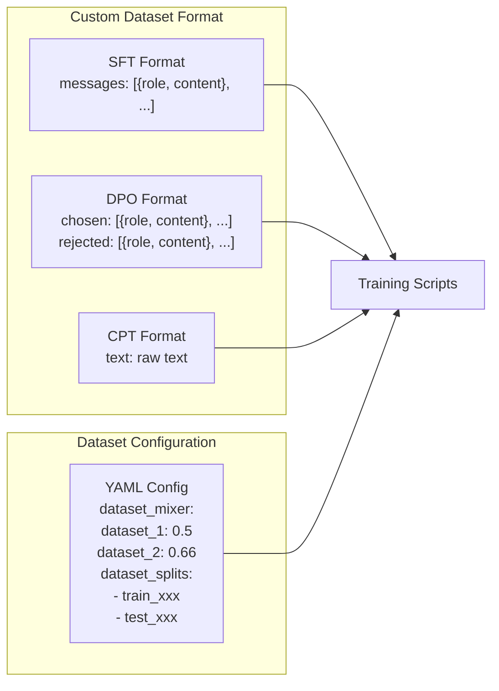
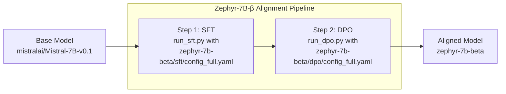

<!-- source: DeepWiki mcp.deepwiki.com · repo huggingface/alignment-handbook · page 3 Training Methods · fetched 2026-10-26 -->

# Training Methods

<details>
<summary>Relevant source files</summary>

The following files were used as context for generating this wiki page:

- [README.md](README.md)
- [scripts/README.md](scripts/README.md)

</details>


## Purpose and Overview

The Alignment Handbook supports multiple training methodologies for aligning language models with human and AI preferences. This page provides an overview of the different training methods available, their use cases, and how they fit into the alignment pipeline.

The handbook implements four primary training methods:
- **Supervised Fine-Tuning (SFT)**: Train models on instruction-response pairs
- **Direct Preference Optimization (DPO)**: Align models using preference data
- **Odds Ratio Preference Optimization (ORPO)**: Single-stage alignment combining SFT and preference learning
- **Continued Pretraining (CPT)**: Adapt models to new domains or languages

For information about the Core Library components used by these methods, see [Core Library (src/alignment)](#2).

Sources: [README.md:11-19](), [README.md:53-61](), [scripts/README.md:31-36]()
</thinking>

## Training Pathways

The handbook supports multiple pathways for training aligned models, depending on your goals and resources:



**Common Pathways:**
- **Two-Stage (Traditional)**: Base → SFT → DPO
  - Example: Zephyr-7B-β, StarChat2
  - Most flexible but requires two training stages
- **Single-Stage (Efficient)**: Base → ORPO
  - Example: Zephyr-141B
  - Faster and more memory-efficient
- **Domain Adaptation**: Base → CPT → SFT → DPO
  - Example: GPT-NL recipe
  - For adapting to new languages or domains

Sources: [README.md:53-61](), [scripts/README.md:31-36]()

## Method Comparison

| Method | Purpose | Training Stages | Dataset Format | Use Case |
|--------|---------|----------------|----------------|----------|
| **SFT** | Instruction following | 1 (after base model) | `messages` column with role/content | Teaching specific behaviors and formats |
| **DPO** | Preference alignment | 2 (after SFT model) | `chosen` and `rejected` columns | Aligning with human preferences |
| **ORPO** | Combined SFT + alignment | 1 (after base model) | `chosen` and `rejected` columns | Efficient single-stage training |
| **CPT** | Domain adaptation | 0 (before SFT) | Raw text data | Language/domain specialization |

Sources: [scripts/README.md:31-36](), [scripts/README.md:98-107]()

## Supervised Fine-Tuning (SFT)

### Methodology

Supervised Fine-Tuning teaches a pre-trained language model to follow instructions by training on high-quality instruction-response pairs. This is typically the first step in the alignment pipeline.

**How it works:**
1. Start with a base pre-trained model (e.g., Mistral-7B)
2. Train on conversation datasets with instruction-response pairs
3. The model learns to generate appropriate responses to user queries
4. Outputs an instruction-tuned model ready for preference alignment

### Dataset Format

SFT requires datasets with a `messages` column containing conversation turns:

```python
{
  "messages": [
    {"role": "user", "content": "What is the capital of France?"},
    {"role": "assistant", "content": "The capital of France is Paris."}
  ]
}
```

Each message has:
- `role`: Either "user", "assistant", or "system"
- `content`: The text content of the message

Example dataset: [HuggingFaceH4/ultrachat_200k](https://huggingface.co/datasets/HuggingFaceH4/ultrachat_200k)

### Training Process

**SFT Data Processing Pipeline:**


**Key features:**
- **Packing**: Multiple sequences packed into single training examples for efficiency
- **Chat templates**: Applied via `apply_chat_template` to format conversations
- **Decontamination**: Removes benchmark data (e.g., HumanEval) to prevent overfitting to evaluation sets

### Implementation

The `scripts/sft.py` script implements SFT training:
- Uses `SFTTrainer` from the TRL library
- Loads datasets via `get_datasets()` function
- Applies chat templates automatically
- Supports full fine-tuning, LoRA, and QLoRA

**Typical configuration:**
- Learning rate: 2e-5
- Batch size: 128 (global)
- Epochs: 1-3
- Sequence packing: Enabled for efficiency

Sources: [scripts/README.md:98-102](), [README.md:56]()

## Direct Preference Optimization (DPO)

### Methodology

Direct Preference Optimization aligns language models with human preferences by training on pairs of chosen and rejected responses. Unlike RLHF, DPO does not require a separate reward model or reinforcement learning.

**How it works:**
1. Start with an SFT model (the policy model to be trained)
2. Use a reference model (typically the same SFT model frozen)
3. Train on preference pairs to increase probability of chosen responses
4. The `beta` parameter controls the strength of the KL divergence constraint

**Mathematical intuition:**
DPO optimizes the model to prefer chosen responses over rejected ones while staying close to the reference model. Higher `beta` values keep the model closer to the reference, lower values allow more deviation.

### Dataset Format

DPO requires datasets with `chosen` and `rejected` columns, both containing conversation format:

```python
{
  "chosen": [
    {"role": "user", "content": "Explain quantum computing"},
    {"role": "assistant", "content": "Quantum computing uses qubits..."}
  ],
  "rejected": [
    {"role": "user", "content": "Explain quantum computing"},
    {"role": "assistant", "content": "I don't know."}
  ]
}
```

Both chosen and rejected must have the same user prompt, with different assistant responses. The model learns to prefer the chosen response.

Example dataset: [HuggingFaceH4/ultrafeedback_binarized](https://huggingface.co/datasets/HuggingFaceH4/ultrafeedback_binarized)

### Training Process

**DPO Training Architecture:**



**Key components:**
- **Policy model**: The model being trained, initialized from SFT checkpoint
- **Reference model**: Frozen copy used to constrain updates, prevents over-optimization
- **Beta parameter**: Controls KL divergence penalty (typical values: 0.01-0.1)

### Implementation

The `scripts/dpo.py` script implements DPO training:
- Uses `DPOTrainer` from the TRL library
- Automatically loads policy and reference models
- Applies chat templates with `task='dpo'` mode
- Supports LoRA and QLoRA for efficient training

**Typical configuration:**
- Learning rate: 5e-7 (much lower than SFT)
- Beta: 0.01-0.1
- Batch size: 64-128 (global)
- Epochs: 1-3
- Requires SFT checkpoint as starting point

Sources: [scripts/README.md:104-107](), [README.md:59]()

## Odds Ratio Preference Optimization (ORPO)

### Methodology

ORPO combines supervised fine-tuning and preference alignment into a single training stage. This is more efficient than the traditional two-stage SFT→DPO pipeline.

**How it works:**
1. Start directly with a base pre-trained model
2. Train simultaneously on instruction-following and preference data
3. Uses an odds ratio-based objective to prefer chosen over rejected responses
4. Outputs a fully aligned model in one stage

**Advantages over SFT+DPO:**
- **Efficiency**: Single training run instead of two
- **Memory**: No need to load reference model
- **Speed**: Faster total training time
- **Performance**: Often achieves comparable results to two-stage methods

### Dataset Format

ORPO uses the same format as DPO - preference pairs with `chosen` and `rejected` columns. The key difference is that ORPO can work directly from a base model without requiring an SFT stage first.

### Implementation

The `scripts/run_orpo.py` script implements ORPO training:
- Uses `ORPOTrainer` from the TRL library
- Can start from base models or SFT checkpoints
- Particularly effective for large models (e.g., Mixtral 8x22B)
- Used for training Zephyr-141B

**Typical configuration:**
- Learning rate: 8e-6
- Batch size: 64-128 (global)
- Epochs: 1-3
- Works well with FSDP for very large models

Sources: [README.md:60](), [README.md:25]()

## Continued Pretraining (CPT)

### Methodology

Continued Pretraining adapts a pre-trained language model to a new domain or language by continuing the causal language modeling objective on domain-specific data.

**Use cases:**
- **Language adaptation**: Adapt an English model to Dutch, French, etc.
- **Domain specialization**: Adapt a general model to medical, legal, or code domains
- **Knowledge update**: Update a model with more recent data

**When to use CPT:**
- You have large amounts of domain-specific raw text
- The base model performs poorly on your domain
- You need better understanding of specialized terminology

### Dataset Format

CPT uses raw text data without any special formatting:

```python
{
  "text": "This is raw text from your domain. No special formatting needed."
}
```

The model is trained to predict the next token, continuing the pre-training objective on your domain data.

### Training Process



### Implementation

The `scripts/run_cpt.py` script implements continued pretraining:
- Uses `SFTTrainer` but configured for raw text
- No chat template applied
- Causal language modeling objective
- Should be followed by SFT and DPO stages

**Typical configuration:**
- Learning rate: 2e-5
- Batch size: 256-512 (global, large for efficiency)
- Epochs: 1-2 (depends on data size)
- Sequence packing: Enabled

**Example**: The GPT-NL recipe demonstrates adapting GPT-2 to Dutch.

Sources: [README.md:55](), [scripts/README.md:32]()

## Execution Patterns

The Alignment Handbook supports various execution patterns for different hardware setups:



Each execution pattern is invoked through `accelerate launch` with the appropriate configuration file:

| Execution Pattern | Command | Hardware |
|-------------------|---------|----------|
| Full Fine-Tuning | `accelerate launch --config_file recipes/accelerate_configs/deepspeed_zero3.yaml scripts/run_{task}.py recipes/{model_name}/{task}/config_full.yaml` | 8 x A100 (80GB) |
| QLoRA (single GPU) | `accelerate launch --config_file recipes/accelerate_configs/multi_gpu.yaml --num_processes=1 scripts/run_{task}.py recipes/{model_name}/{task}/config_qlora.yaml` | 1 x RTX 4090 (24GB) |
| LoRA (single GPU) | `accelerate launch --config_file recipes/accelerate_configs/multi_gpu.yaml --num_processes=1 scripts/run_{task}.py recipes/{model_name}/{task}/config_qlora.yaml --load_in_4bit=false` | 1 x RTX 4090 (24GB) |
| LoRA with ZeRO-3 | `accelerate launch --config_file recipes/accelerate_configs/deepspeed_zero3.yaml --num_processes={num_gpus} scripts/run_{task}.py recipes/{model_name}/{task}/config_qlora.yaml --load_in_4bit=false` | 2+ x A100 (80GB) |
| QLoRA with FSDP | `accelerate launch --config_file recipes/accelerate_configs/fsdp+qlora.yaml --num_processes={num_gpus} scripts/run_{task}.py recipes/{model_name}/{task}/config_qlora.yaml --torch_dtype=bfloat16 --bnb_4bit_quant_storage=bfloat16` | 2+ x A6000 (48GB) |

Sources: [scripts/README.md:7-29]()

## Using Training Scripts with Custom Datasets

To use the training scripts with custom datasets, you need to format your data appropriately:



Sources: [scripts/README.md:82-115]()

## Evaluation

After training, models can be evaluated using benchmarks like MT-Bench and AlpacaEval:

| Benchmark | Purpose | Evaluation Method |
|-----------|---------|------------------|
| MT-Bench | Multi-turn benchmark with 80 dialogues across 10 domains | GPT-4 judging |
| AlpacaEval | Single-turn benchmark comparing helpfulness against `text-davinci-003` | GPT-4 judging |
| Chatbot Arena | Live human evaluation in head-to-head comparisons | Human judging |

Sources: [scripts/README.md:118-142]()

## Full Alignment Pipeline Example

Below is an example of a complete alignment pipeline using the Zephyr-7B-β recipe:



Sources: [scripts/README.md:37-45]()

---

