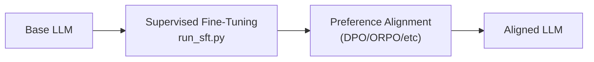
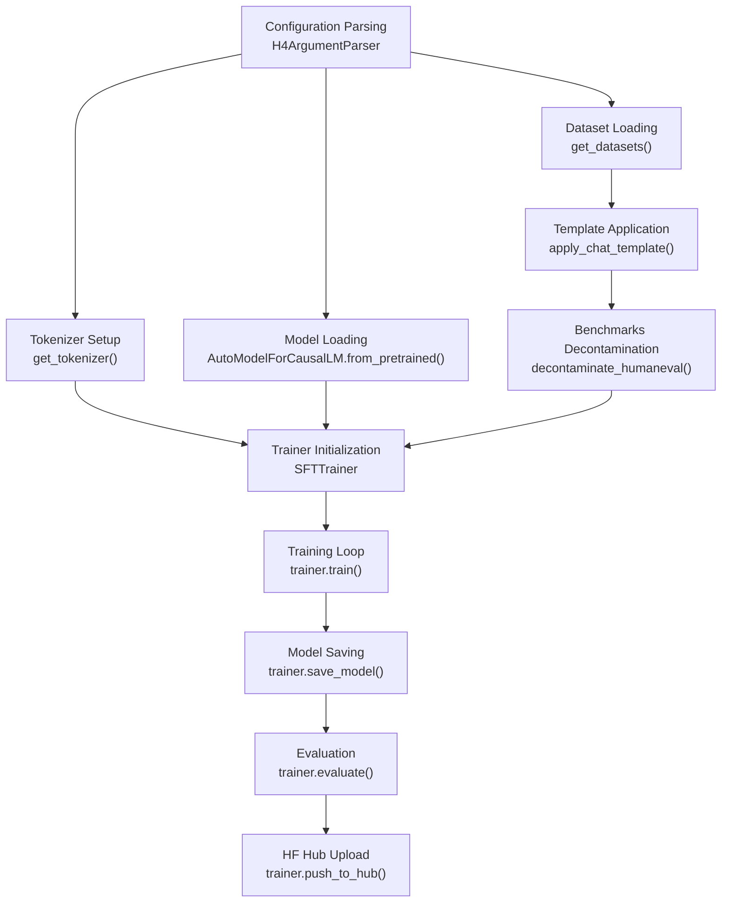
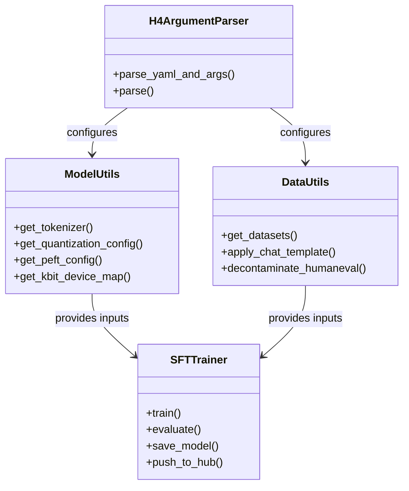
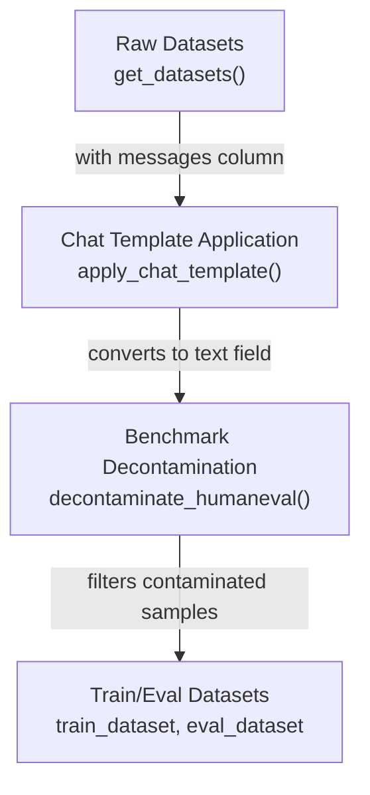

<!-- source: DeepWiki mcp.deepwiki.com · repo huggingface/alignment-handbook · page 3.1 Supervised Fine-Tuning (SFT) · fetched 2026-10-26 -->

# Supervised Fine-Tuning (SFT)

<details>
<summary>Relevant source files</summary>

The following files were used as context for generating this wiki page:

- [recipes/zephyr-7b-beta/README.md](recipes/zephyr-7b-beta/README.md)
- [recipes/zephyr-7b-beta/dpo/config_qlora.yaml](recipes/zephyr-7b-beta/dpo/config_qlora.yaml)
- [recipes/zephyr-7b-beta/sft/config_qlora.yaml](recipes/zephyr-7b-beta/sft/config_qlora.yaml)
- [scripts/README.md](scripts/README.md)

</details>


## Purpose and Scope

This document describes the Supervised Fine-Tuning (SFT) system in the Alignment Handbook. SFT is the first stage in the process of aligning language models with human preferences, where models are trained on demonstrations of the desired behavior, typically formatted as instruction-response pairs. 

SFT serves as the foundation for further alignment techniques such as Direct Preference Optimization (DPO) or Odds Ratio Preference Optimization (ORPO). For information about these subsequent alignment techniques, see [Direct Preference Optimization (DPO)](#3.2) and [Advanced Alignment Techniques](#3.4).

## Architecture Overview

### SFT in the Alignment Pipeline



Supervised Fine-Tuning is the critical first step in the alignment process. It teaches the base language model to follow instructions and produce responses in the desired format, creating a foundation for subsequent preference-based alignment.

Sources: [scripts/run_sft.py:1-234](), [scripts/README.md:31-35]()

### SFT Script Workflow



This diagram illustrates the complete SFT workflow, from configuration parsing to model saving and evaluation. Each step in the process is linked to specific functions in the codebase.

Sources: [scripts/run_sft.py:49-229]()

## Implementation Details

### Configuration Components

The SFT system uses three main configuration classes:

| Configuration Class | Purpose | Key Parameters |
|---------------------|---------|----------------|
| `ModelArguments` | Model loading and configuration | `model_name_or_path`, `tokenizer_name_or_path`, `torch_dtype`, `use_peft`, etc. |
| `DataArguments` | Dataset configuration | `dataset_mixer`, `dataset_splits`, `chat_template`, etc. |
| `SFTConfig` | Training parameters | `max_seq_length`, `learning_rate`, `num_train_epochs`, `per_device_train_batch_size`, etc. |

These configuration classes are parsed using the `H4ArgumentParser`, which can load settings from both YAML files and command-line arguments.

Sources: [scripts/run_sft.py:49-51]()

### Key Components



The SFT system is built around these key components, with configuration parsed by `H4ArgumentParser`, model utilities handling tokenization and model setup, data utilities managing dataset processing, and the `SFTTrainer` integrating these components for training.

Sources: [scripts/run_sft.py:29-43](), [scripts/run_sft.py:165-177]()

## Dataset Requirements and Processing

### Dataset Format

For SFT, datasets should contain a `messages` column with a list of dictionaries in the following format:

```
[
  {"role": "user", "content": "What is the capital of France?"},
  {"role": "assistant", "content": "The capital of France is Paris."}
]
```

This format is compatible with the UltraChat-200k dataset, which is commonly used for SFT.

Sources: [scripts/README.md:98-102]()

### Data Processing Flow



The data processing pipeline converts the structured message format into a continuous text format suitable for training, applies the chat template specific to the model being trained, and removes examples that could contaminate benchmark results.

Sources: [scripts/run_sft.py:88-156]()

## Training Process

### SFTTrainer Configuration

The `SFTTrainer` from the TRL library is initialized with:

- Model and tokenizer
- Training arguments
- Datasets
- Maximum sequence length
- PEFT configuration (for parameter-efficient fine-tuning)
- Dataset text field and packing configuration

The trainer handles sequence packing, tokenization, and optimizing the training process.

Sources: [scripts/run_sft.py:165-177]()

### Training Loop

The training loop:
1. Checks for checkpoints to resume from
2. Conducts the training process
3. Logs training metrics
4. Saves the trained model
5. Creates a model card with relevant metadata
6. Optionally conducts evaluation 
7. Optionally pushes the model to the Hugging Face Hub

Sources: [scripts/run_sft.py:182-229]()

## Supported Training Methods

The Alignment Handbook supports several approaches to SFT:

| Training Method | Hardware Requirements | Configuration |
|-----------------|------------------------|--------------|
| Full Fine-tuning with DeepSpeed ZeRO-3 | Multi-GPU (8 x A100 80GB) | `config_full.yaml` |
| LoRA Fine-tuning | Single GPU (24GB) | `config_qlora.yaml` with `--load_in_4bit=false` |
| QLoRA Fine-tuning | Single GPU (24GB) | `config_qlora.yaml` |
| LoRA with DeepSpeed ZeRO-3 | Multi-GPU (2+ GPUs) | `config_qlora.yaml` with DeepSpeed config |
| QLoRA with FSDP | Multi-GPU (2+ GPUs) | `config_qlora.yaml` with FSDP config |

Sources: [scripts/README.md:5-29]()

## Usage Examples

### Basic Command Line Usage

To perform SFT with full fine-tuning using DeepSpeed ZeRO-3:

```
ACCELERATE_LOG_LEVEL=info accelerate launch --config_file recipes/accelerate_configs/deepspeed_zero3.yaml scripts/run_sft.py recipes/{model_name}/sft/config_full.yaml
```

For QLoRA fine-tuning on a single GPU:

```
ACCELERATE_LOG_LEVEL=info accelerate launch --config_file recipes/accelerate_configs/multi_gpu.yaml --num_processes=1 scripts/run_sft.py recipes/{model_name}/sft/config_qlora.yaml
```

Sources: [scripts/README.md:14-22]()

### Example for Zephyr-7B-β

To replicate the first step in training Zephyr-7B-β:

```
ACCELERATE_LOG_LEVEL=info accelerate launch --config_file recipes/accelerate_configs/deepspeed_zero3.yaml scripts/run_sft.py recipes/zephyr-7b-beta/sft/config_full.yaml
```

Sources: [scripts/README.md:39-41]()

### Slurm Job Submission

For training on a Slurm cluster:

```
sbatch --job-name=handbook_sft --nodes=1 recipes/launch.slurm zephyr-7b-beta sft full deepspeed_zero3
```

Sources: [scripts/README.md:68-76]()

## Integration with Other Components

### Position in the Alignment Pipeline

SFT is the first step in a multi-stage alignment process:

1. SFT teaches the model to follow instructions and generate responses in a specific format
2. Preference-based methods (DPO/ORPO) further align the model with human preferences
3. Evaluation determines the effectiveness of the alignment

This pipeline is used to produce models like Zephyr-7B-β, which follows a two-step process of SFT followed by DPO.

Sources: [scripts/README.md:39-45]()

### Evaluation Integration

After training, SFT models can be evaluated using:

- MT-Bench: A multi-turn benchmark with 80 dialogues across 10 domains
- AlpacaEval: A single-turn benchmark evaluating helpfulness against text-davinci-003
- Chatbot Arena: Human evaluation through head-to-head comparisons

Sources: [scripts/README.md:117-142]()

## Summary

The SFT system in the Alignment Handbook provides a comprehensive framework for fine-tuning language models on instruction data. It supports various training approaches, from full fine-tuning on multiple GPUs to parameter-efficient methods like QLoRA on consumer hardware. The modular architecture with configurable components makes it adaptable to different models, datasets, and hardware configurations, while integration with the broader alignment pipeline enables the creation of models that follow instructions and align with human preferences.

---

