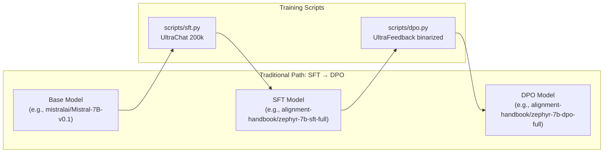
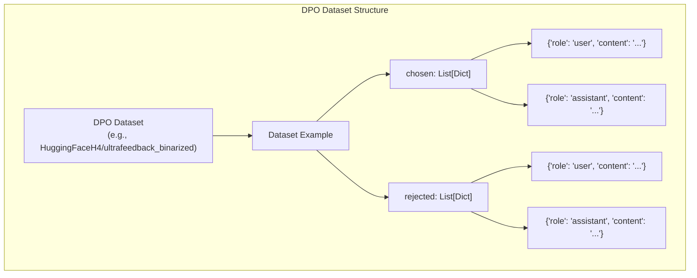
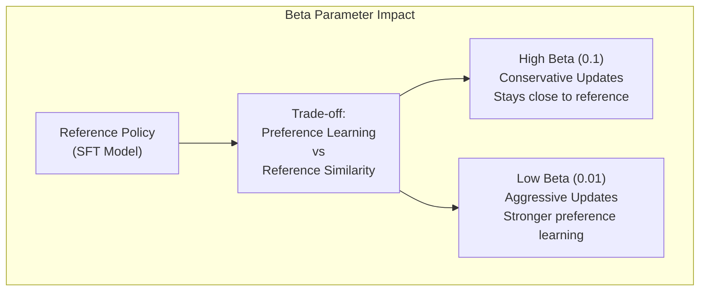
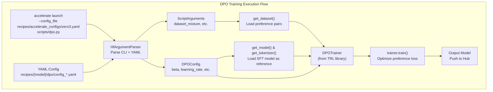
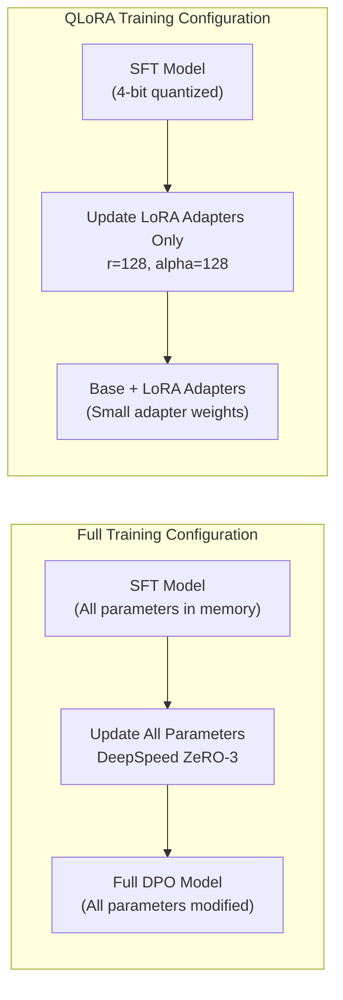
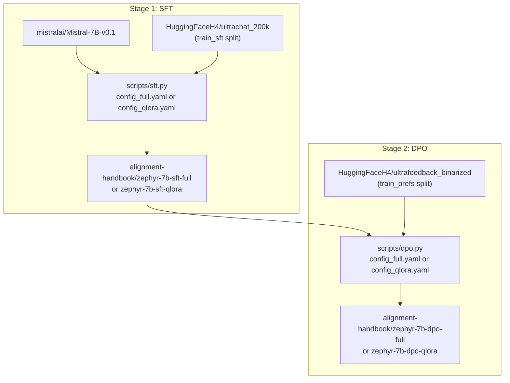
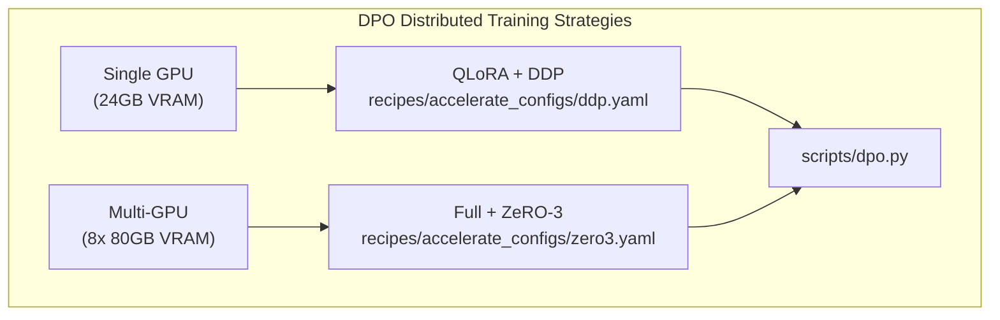

<!-- source: DeepWiki mcp.deepwiki.com · repo huggingface/alignment-handbook · page 3.2 Direct Preference Optimization (DPO) · fetched 2026-10-26 -->

# Direct Preference Optimization (DPO)

<details>
<summary>Relevant source files</summary>

The following files were used as context for generating this wiki page:

- [recipes/zephyr-7b-beta/README.md](recipes/zephyr-7b-beta/README.md)
- [recipes/zephyr-7b-beta/dpo/config_qlora.yaml](recipes/zephyr-7b-beta/dpo/config_qlora.yaml)
- [recipes/zephyr-7b-beta/sft/config_qlora.yaml](recipes/zephyr-7b-beta/sft/config_qlora.yaml)
- [scripts/README.md](scripts/README.md)

</details>


## Purpose and Scope

This page documents Direct Preference Optimization (DPO), one of the core preference alignment methods implemented in the Alignment Handbook. DPO is typically used as the second stage in a two-step training pipeline to align language models with human preferences without requiring a separate reward model.

For information about the first-stage supervised fine-tuning that precedes DPO, see [Supervised Fine-Tuning (SFT)](#3.1). For alternative preference alignment methods, see [Odds Ratio Preference Optimization (ORPO)](#3.3) and [Comparing Preference Alignment Methods](#3.5).

**Sources:** [scripts/README.md:1-42](), [recipes/zephyr-7b-beta/README.md:1-10]()

## DPO Methodology Overview

Direct Preference Optimization is a preference alignment technique that directly optimizes a language model to prefer chosen responses over rejected responses. Unlike RLHF (Reinforcement Learning from Human Feedback), DPO does not require training a separate reward model or using reinforcement learning. Instead, it formulates preference learning as a classification problem on preference pairs.



**DPO Training Pipeline Position**

The DPO method operates by:

1. Taking an SFT model as the reference policy
2. Learning to increase the probability of chosen responses relative to rejected responses
3. Controlling the deviation from the reference policy using a hyperparameter `beta`

**Sources:** [recipes/zephyr-7b-beta/README.md:1-10](), [scripts/README.md:34-44]()

## Dataset Format Requirements

DPO requires preference pair datasets with specific column structures. Each example must contain both a preferred (chosen) and dispreferred (rejected) response to the same prompt.

### Required Columns

| Column | Type | Description |
|--------|------|-------------|
| `chosen` | `List[Dict]` | List of message dicts `{"role": "{role}", "content": "{content}"}` for the preferred dialogue |
| `rejected` | `List[Dict]` | List of message dicts `{"role": "{role}", "content": "{content}"}` for the dispreferred dialogue |

### Dataset Format Structure



**Dataset Column Requirements**

### Standard Dataset Splits

The handbook convention uses dedicated splits for preference data:
- `train_prefs`: Training split for preference modeling
- `test_prefs`: Evaluation split for preference modeling

**Example Configuration:**

```yaml
dataset_mixer:
  HuggingFaceH4/ultrafeedback_binarized: 1.0
dataset_splits:
- train_prefs
- test_prefs
```

**Sources:** [scripts/README.md:103-114](), [recipes/zephyr-7b-beta/dpo/config_qlora.yaml:22-27]()

## DPO Configuration Parameters

The DPO training process is configured through the `DPOConfig` class (which extends TRL's `DPOConfig`) and `ScriptArguments`. Key parameters control the preference learning behavior and training dynamics.

### Core DPO Parameters

| Parameter | Default | Description |
|-----------|---------|-------------|
| `beta` | `0.01` | KL divergence penalty coefficient controlling deviation from reference policy |
| `max_length` | `1024` | Maximum sequence length for chosen/rejected pairs |
| `max_prompt_length` | `512` | Maximum length for the prompt portion |
| `learning_rate` | `5.0e-6` | Learning rate for DPO training (typically lower than SFT) |

### Critical: Beta Parameter

The `beta` parameter is crucial in DPO training. It controls the trade-off between:
- **Higher beta** (e.g., `0.1`): Stronger constraint to stay close to reference policy, more conservative updates
- **Lower beta** (e.g., `0.01`): Allows more deviation from reference policy, stronger preference learning



**Beta Parameter Trade-offs**

**Note:** The Zephyr team found that using `beta=0.01` for 1 epoch achieved comparable performance to the original `beta=0.1` for 3 epochs reported in the technical report, after fixing dataset labeling issues and training bugs.

**Sources:** [recipes/zephyr-7b-beta/dpo/config_qlora.yaml:30-57](), [recipes/zephyr-7b-beta/README.md:9-10]()

## Training Script and Execution Flow

The DPO training is orchestrated through [scripts/dpo.py](), which integrates with the TRL library's `DPOTrainer`.



**DPO Training Execution Pipeline**

### Command Line Interface

Basic execution pattern:

```shell
ACCELERATE_LOG_LEVEL=info accelerate launch \
  --config_file recipes/accelerate_configs/{accelerate_config}.yaml \
  scripts/dpo.py \
  --config recipes/{model_name}/dpo/config_{precision}.yaml
```

**Sources:** [scripts/README.md:16-44](), [scripts/dpo.py]()

## Full Training vs QLoRA Configurations

The Alignment Handbook supports multiple training modes for DPO, optimized for different hardware configurations.

### Full DPO Training

**Hardware Requirements:** 8 GPUs with 80GB VRAM each

```shell
# Full DPO training with DeepSpeed ZeRO-3
ACCELERATE_LOG_LEVEL=info accelerate launch \
  --config_file recipes/accelerate_configs/zero3.yaml \
  scripts/dpo.py \
  --config recipes/zephyr-7b-beta/dpo/config_full.yaml
```

**Key Full Training Configuration:**
- No quantization (`load_in_4bit: false`)
- No LoRA (`use_peft: false`)
- All parameters are updated
- Requires DeepSpeed ZeRO-3 for model sharding

### QLoRA DPO Training

**Hardware Requirements:** Single GPU with 24GB VRAM (e.g., RTX 4090)

```shell
# QLoRA DPO training on single GPU
ACCELERATE_LOG_LEVEL=info accelerate launch \
  --config_file recipes/accelerate_configs/ddp.yaml \
  --num_processes=1 \
  scripts/dpo.py \
  --config recipes/zephyr-7b-beta/dpo/config_qlora.yaml
```

**Key QLoRA Configuration Parameters:**

| Parameter | Value | Purpose |
|-----------|-------|---------|
| `load_in_4bit` | `true` | 4-bit quantization for memory efficiency |
| `use_peft` | `true` | Enable Parameter-Efficient Fine-Tuning |
| `lora_r` | `128` | LoRA rank (adapter dimension) |
| `lora_alpha` | `128` | LoRA scaling parameter |
| `lora_dropout` | `0.05` | Dropout for LoRA layers |
| `lora_target_modules` | `[q_proj, k_proj, v_proj, o_proj, gate_proj, up_proj, down_proj]` | Attention and MLP layers to adapt |



**Full Training vs QLoRA Configurations**

**Performance Note:** The handbook reports comparable performance between full and QLoRA fine-tuning, with QLoRA producing smaller adapter weights that are faster to upload/download from the Hub.

**Sources:** [scripts/README.md:7-28](), [recipes/zephyr-7b-beta/dpo/config_qlora.yaml:1-57](), [recipes/zephyr-7b-beta/README.md:24-44]()

## Example: Zephyr-7B-Beta DPO Training

The Zephyr-7B-Beta model demonstrates a complete DPO training pipeline, serving as the reference implementation in the handbook.

### Two-Stage Training Pipeline



**Zephyr-7B-Beta Two-Stage Pipeline**

### QLoRA Configuration Details

**SFT Stage Input Model:**
```yaml
model_name_or_path: alignment-handbook/zephyr-7b-sft-qlora
```

**DPO Stage Key Parameters:**
```yaml
# LoRA configuration
use_peft: true
load_in_4bit: true
lora_r: 128
lora_alpha: 128
lora_dropout: 0.05

# Dataset configuration
dataset_mixer:
  HuggingFaceH4/ultrafeedback_binarized: 1.0
dataset_splits:
- train_prefs
- test_prefs

# DPO-specific parameters
beta: 0.01
learning_rate: 5.0e-6
max_length: 1024
max_prompt_length: 512
num_train_epochs: 1

# Training configuration
per_device_train_batch_size: 4
gradient_accumulation_steps: 4
```

### Hyperparameter Evolution

The Zephyr team discovered improved hyperparameters after the initial release:

| Parameter | Original (Technical Report) | Improved |
|-----------|---------------------------|----------|
| `beta` | `0.1` | `0.01` |
| `num_train_epochs` | `3` | `1` |

**Reason:** Corrected dataset labels in UltraFeedback and fixed TRL learning rate scheduler bug led to finding that lower beta with fewer epochs achieves comparable or better performance.

**Sources:** [recipes/zephyr-7b-beta/README.md:1-44](), [recipes/zephyr-7b-beta/dpo/config_qlora.yaml:1-57]()

## Parameter Override and Customization

DPO configurations can be customized via command-line overrides without modifying YAML files:

```shell
# Override DPO-specific parameters
ACCELERATE_LOG_LEVEL=info accelerate launch \
  --config_file recipes/accelerate_configs/zero3.yaml \
  scripts/dpo.py \
  --config recipes/zephyr-7b-beta/dpo/config_full.yaml \
  --beta=0.05 \
  --learning_rate=1e-5 \
  --num_train_epochs=2 \
  --per_device_train_batch_size=8
```

### Common Parameters to Override

| Parameter | Use Case |
|-----------|----------|
| `--beta` | Tune preference learning strength |
| `--learning_rate` | Adjust convergence speed |
| `--per_device_train_batch_size` | Scale to available GPU memory |
| `--gradient_accumulation_steps` | Maintain effective batch size |
| `--num_train_epochs` | Control training duration |
| `--hub_model_id` | Customize output model name |

**Sources:** [scripts/README.md:49-54]()

## Distributed Training Configurations

DPO supports multiple distributed training strategies through Accelerate configurations.

### Accelerate Configuration Mapping

| Configuration | File | Use Case | Hardware |
|--------------|------|----------|----------|
| DeepSpeed ZeRO-3 | `recipes/accelerate_configs/zero3.yaml` | Full training, multi-GPU | 8x A100 80GB |
| PyTorch DDP | `recipes/accelerate_configs/ddp.yaml` | QLoRA, single/multi-GPU | 1x RTX 4090 or multiple |
| PyTorch FSDP | `recipes/accelerate_configs/fsdp.yaml` | Very large models | Multiple A100s |



**DPO Distributed Training Strategy Selection**

**Sources:** [scripts/README.md:7-28](), [recipes/zephyr-7b-beta/README.md:14-22]()

## Output and Model Publishing

DPO training outputs are automatically managed through the configuration:

### Output Configuration

```yaml
output_dir: data/zephyr-7b-dpo-qlora  # Local checkpoint directory
hub_model_id: zephyr-7b-dpo-qlora      # Hub repository name
push_to_hub: true                       # Automatically push to Hub
hub_strategy: every_save                # Push after each checkpoint
```

### Output Artifacts

| Artifact | Location | Description |
|----------|----------|-------------|
| Model checkpoints | `{output_dir}/checkpoint-{step}` | Training checkpoints |
| Final model | `{output_dir}` | Final trained model |
| Hub model | `{username}/{hub_model_id}` | Published on Hugging Face Hub |
| Training logs | `{output_dir}/runs` | TensorBoard logs |

**Sources:** [recipes/zephyr-7b-beta/dpo/config_qlora.yaml:40-56]()

## Logging and Monitoring

DPO training supports multiple logging backends:

### TensorBoard (Default)

```yaml
report_to:
- tensorboard
```

Logs stored in `{output_dir}/runs/`

### Weights & Biases Integration

```shell
# Enable W&B logging
ACCELERATE_LOG_LEVEL=info accelerate launch \
  --config_file recipes/accelerate_configs/zero3.yaml \
  scripts/dpo.py \
  --config recipes/zephyr-7b-beta/dpo/config_full.yaml \
  --report_to=wandb
```

**Sources:** [scripts/README.md:56-61]()

---

