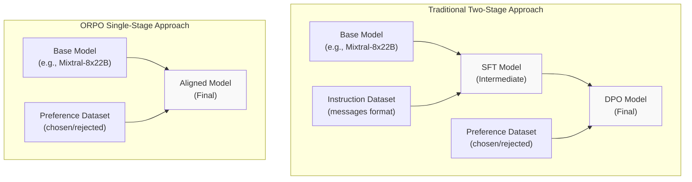
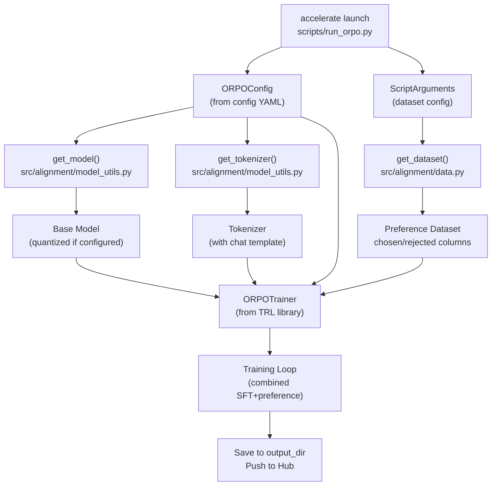
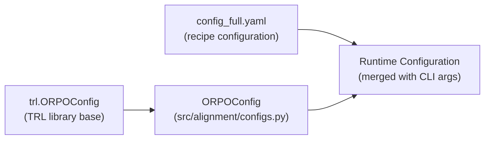
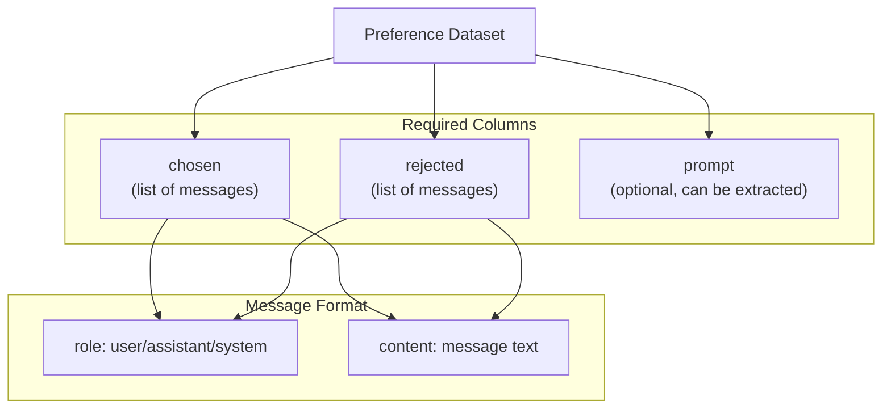
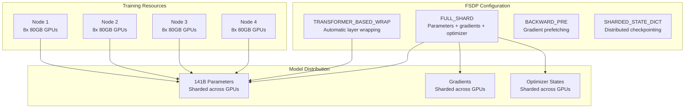
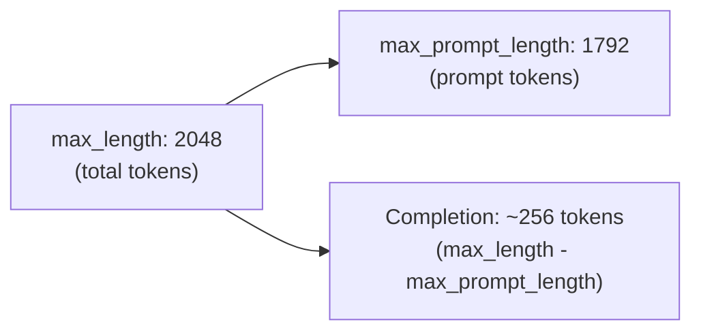
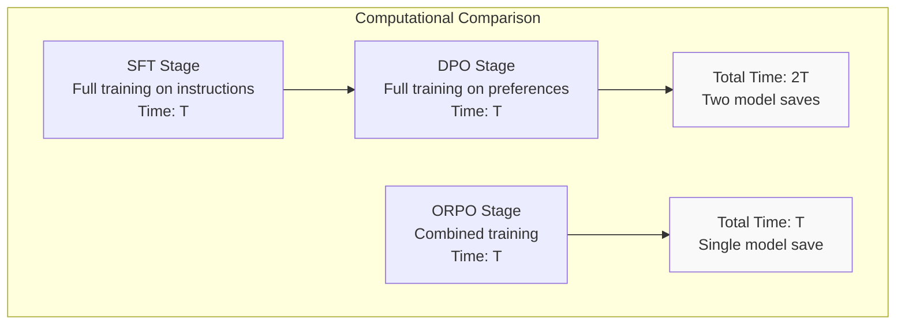

<!-- source: DeepWiki mcp.deepwiki.com · repo huggingface/alignment-handbook · page 3.3 Odds Ratio Preference Optimization (ORPO) · fetched 2026-10-26 -->

# Odds Ratio Preference Optimization (ORPO)

<details>
<summary>Relevant source files</summary>

The following files were used as context for generating this wiki page:

- [recipes/accelerate_configs/fsdp.yaml](recipes/accelerate_configs/fsdp.yaml)
- [recipes/starchat2-15b/README.md](recipes/starchat2-15b/README.md)
- [recipes/zephyr-141b-A35b/README.md](recipes/zephyr-141b-A35b/README.md)
- [recipes/zephyr-141b-A35b/orpo/config_full.yaml](recipes/zephyr-141b-A35b/orpo/config_full.yaml)

</details>


**Purpose**: This page explains the Odds Ratio Preference Optimization (ORPO) training method, its implementation in `scripts/run_orpo.py`, configuration through `ORPOConfig`, and how it differs from the traditional two-stage SFT+DPO approach. For information about Direct Preference Optimization, see [DPO](#3.2). For supervised fine-tuning, see [SFT](#3.1).

**Scope**: Covers the ORPO algorithm, its single-stage training approach, configuration parameters, dataset requirements, and practical examples from the Zephyr-141B-A35B training recipe.

## Overview

ORPO is a novel preference alignment algorithm that combines supervised fine-tuning and preference optimization into a single training stage. Unlike traditional approaches that require separate SFT and DPO stages, ORPO achieves high performance through a unified objective function that simultaneously learns from instruction-response pairs and preference data.

### Key Advantages

| Feature | Traditional SFT+DPO | ORPO |
|---------|-------------------|------|
| Training Stages | 2 (SFT → DPO) | 1 (Direct ORPO) |
| Computational Cost | Higher (two full training runs) | Lower (single training run) |
| Model Checkpoints | Requires saving SFT model | Single output model |
| Dataset Requirements | Instruction data + preference data | Preference data only |
| Training Time | 2x (sequential stages) | 1x |

The primary use case in the handbook is training the Zephyr-141B-A35B model, which leverages ORPO's efficiency to train a 141B parameter Mixtral-based model without requiring an intermediate SFT checkpoint.

**Sources**: [recipes/zephyr-141b-A35b/README.md:4]()

## ORPO Methodology



**ORPO Training Flow vs Traditional Alignment**

ORPO modifies the training objective to include both a language modeling loss (like SFT) and a preference alignment loss (like DPO) in a single unified loss function. The algorithm uses an odds ratio-based penalty that encourages the model to increase the likelihood of chosen responses while decreasing the likelihood of rejected responses.

**Sources**: [recipes/zephyr-141b-A35b/README.md:4]()

## Training Script Architecture



**ORPO Script Execution Flow**

The `scripts/run_orpo.py` script orchestrates ORPO training by:

1. **Configuration Loading**: Parses `ORPOConfig` and `ScriptArguments` from YAML and CLI arguments
2. **Data Loading**: Loads preference dataset with `chosen` and `rejected` columns using `get_dataset()`
3. **Model Setup**: Initializes the base model with optional quantization and flash attention
4. **Trainer Instantiation**: Creates `ORPOTrainer` with the unified loss function
5. **Training**: Executes the single-stage training loop
6. **Model Saving**: Saves the final aligned model locally and optionally to Hugging Face Hub

**Sources**: [recipes/zephyr-141b-A35b/README.md:22]()

## Configuration System

### ORPOConfig Class

The `ORPOConfig` class extends TRL's base configuration with ORPO-specific parameters. It is defined in `src/alignment/configs.py` and inherits from TRL's `ORPOConfig`.



**Configuration Hierarchy**

### Key Configuration Parameters

| Parameter | Purpose | Typical Value | Notes |
|-----------|---------|--------------|-------|
| `beta` | Odds ratio penalty strength | 0.05 | Controls preference alignment strength |
| `max_length` | Maximum sequence length | 2048 | Total tokens (prompt + completion) |
| `max_prompt_length` | Maximum prompt length | 1792 | Leaves room for completion |
| `learning_rate` | Optimizer learning rate | 5.0e-6 | Often lower than SFT |
| `num_train_epochs` | Training epochs | 3 | ORPO typically needs fewer epochs |
| `gradient_checkpointing` | Memory optimization | true | Essential for large models |
| `optim` | Optimizer type | adamw_bnb_8bit | 8-bit optimizer for memory efficiency |

### Example Configuration

From [recipes/zephyr-141b-A35b/orpo/config_full.yaml:1-38]():

```yaml
# Model arguments
model_name_or_path: mistral-community/Mixtral-8x22B-v0.1
torch_dtype: bfloat16
attn_implementation: flash_attention_2

# Data training arguments
dataset_name: argilla/distilabel-capybara-dpo-7k-binarized
dataset_train_split: train

# ORPOTrainer arguments
beta: 0.05
learning_rate: 5.0e-6
max_length: 2048
max_prompt_length: 1792
num_train_epochs: 3
gradient_checkpointing: true
per_device_train_batch_size: 1
```

**Sources**: [recipes/zephyr-141b-A35b/orpo/config_full.yaml:1-38]()

## Dataset Requirements

ORPO uses the same dataset format as DPO, requiring preference pairs with `chosen` and `rejected` columns.



**ORPO Dataset Structure**

### Dataset Format Example

Each row in the dataset should contain:

```json
{
  "prompt": "User's question or instruction",
  "chosen": [
    {"role": "user", "content": "User message"},
    {"role": "assistant", "content": "Preferred response"}
  ],
  "rejected": [
    {"role": "user", "content": "User message"},
    {"role": "assistant", "content": "Rejected response"}
  ]
}
```

The Zephyr-141B-A35B recipe uses the [`argilla/distilabel-capybara-dpo-7k-binarized`](https://huggingface.co/datasets/argilla/distilabel-capybara-dpo-7k-binarized) dataset, which contains:
- **7,000 synthetic preference pairs**
- **Multi-turn conversations**
- **High-quality responses scored via LLMs**

**Sources**: [recipes/zephyr-141b-A35b/README.md:4](), [recipes/zephyr-141b-A35b/orpo/config_full.yaml:9-11]()

## Running ORPO Training

### Command-Line Execution

For large-scale ORPO training with FSDP (required for 141B parameter models):

```bash
ACCELERATE_LOG_LEVEL=info TRANSFORMERS_VERBOSITY=info \
  accelerate launch \
  --config_file recipes/accelerate_configs/fsdp.yaml \
  scripts/run_orpo.py \
  --config recipes/zephyr-141b-A35b/orpo/config_full.yaml
```

### Slurm Cluster Deployment

For multi-node training on HPC clusters:

```bash
sbatch --job-name=orpo_training --nodes=4 \
  recipes/launch.slurm zephyr-141b-A35b orpo full fsdp
```

This launches ORPO training across 4 nodes (32 GPUs total) using the FSDP configuration.

**Sources**: [recipes/zephyr-141b-A35b/README.md:15-22]()

### Distributed Training Strategy



**FSDP Distributed Training for Large-Scale ORPO**

The Zephyr-141B-A35B recipe uses FSDP (Fully Sharded Data Parallel) because:
- **Model Size**: 141B parameters exceed single-GPU memory
- **DeepSpeed Issues**: NCCL errors prevented DeepSpeed ZeRO-3 usage at this scale
- **Memory Efficiency**: FSDP shards parameters, gradients, and optimizer states
- **Scaling**: Supports multi-node training (4 nodes × 8 GPUs = 32 GPUs)

**Sources**: [recipes/zephyr-141b-A35b/README.md:6](), [recipes/accelerate_configs/fsdp.yaml:1-27]()

## Key Hyperparameters

### Beta Parameter

The `beta` parameter controls the strength of the odds ratio penalty:

- **Lower beta (0.01-0.05)**: Gentler preference alignment, more conservative updates
- **Higher beta (0.1-0.5)**: Stronger preference alignment, more aggressive updates
- **Zephyr-141B uses**: `beta=0.05` for balanced alignment

The beta parameter in ORPO serves a similar role to DPO's beta but operates on odds ratios rather than log probabilities.

### Learning Rate

ORPO typically uses lower learning rates than standard SFT:

- **SFT learning rate**: Often 2e-5 or higher
- **ORPO learning rate**: 5e-6 (Zephyr-141B-A35B)
- **Rationale**: Combined objective is more sensitive to learning rate

### Sequence Length Parameters



**Sequence Length Configuration**

- `max_length`: Maximum total sequence length (prompt + completion)
- `max_prompt_length`: Maximum prompt length, reserves space for completions
- **Buffer**: Difference ensures completions have adequate space
- **Memory impact**: Longer sequences require more GPU memory

**Sources**: [recipes/zephyr-141b-A35b/orpo/config_full.yaml:25-26]()

## ORPO vs Traditional Alignment



**Training Time Comparison**

### When to Use ORPO

| Scenario | Recommendation | Reason |
|----------|---------------|--------|
| Limited compute budget | **Use ORPO** | 50% reduction in training time and storage |
| Very large models (>70B) | **Use ORPO** | Avoids saving massive intermediate checkpoints |
| High-quality preference data | **Use ORPO** | Can learn instruction-following from preferences alone |
| Need separate SFT model | **Use SFT+DPO** | Provides reusable SFT checkpoint for experiments |
| Extensive hyperparameter tuning | **Use SFT+DPO** | Can tune each stage independently |

### Performance Considerations

The Zephyr-141B-A35B model demonstrates that ORPO can achieve competitive performance:
- **No SFT required**: Learns instruction-following from preference data
- **Efficient for large models**: Critical for 141B parameter training
- **Dataset quality matters**: Requires high-quality preference pairs with good coverage

Traditional SFT+DPO may be preferable when:
- You want to reuse the SFT model for multiple DPO experiments
- The preference dataset has limited coverage of instruction types
- You're conducting research on the SFT vs preference alignment stages

**Sources**: [recipes/zephyr-141b-A35b/README.md:4]()

## Memory Optimization Techniques

### Gradient Checkpointing

ORPO training of large models requires gradient checkpointing:

```yaml
gradient_checkpointing: true
gradient_checkpointing_kwargs:
  use_reentrant: true
```

This trades computation for memory by recomputing activations during backward pass instead of storing them.

### 8-bit Optimizer

The configuration uses `optim: adamw_bnb_8bit` for memory-efficient optimization:
- **Standard AdamW**: Requires 2 optimizer states per parameter (32-bit each)
- **8-bit AdamW**: Stores optimizer states in 8-bit, ~4x memory reduction
- **Minimal accuracy impact**: BitsAndBytes 8-bit optimizer maintains quality

### Batch Size Configuration

For the 141B model on 4 nodes (32 GPUs):
```yaml
per_device_train_batch_size: 1
gradient_accumulation_steps: 1
```

- **Per-device batch size**: 1 sample per GPU
- **Global batch size**: 32 samples (1 × 32 GPUs)
- **Memory optimization**: Small per-device batch fits in GPU memory
- **Training stability**: Reasonable global batch size for stable training

**Sources**: [recipes/zephyr-141b-A35b/orpo/config_full.yaml:17-30]()

## Chat Template Configuration

ORPO requires a chat template for formatting multi-turn conversations:

```yaml
chat_template: "

{{ '<|user|>\n' + message['content'] + eos_token }}

{{ '<|system|>\n' + message['content'] + eos_token }}

{{ '<|assistant|>\n'  + message['content'] + eos_token }}


{{ '<|assistant|>' }}

"
```

This Jinja2 template formats messages with role-specific tokens:
- `<|user|>`, `<|system|>`, `<|assistant|>`: Role markers
- `eos_token`: End-of-sequence token after each message
- `add_generation_prompt`: Adds assistant prompt for generation

For more details on chat templates, see [Chat Templates and Message Formatting](#6.3).

**Sources**: [recipes/zephyr-141b-A35b/orpo/config_full.yaml:8]()

## Comparison with Other Models

The handbook includes ORPO training only for the Zephyr-141B-A35B model, while other models use the traditional SFT+DPO approach:

| Model Family | Training Approach | Stages | Rationale |
|--------------|------------------|--------|-----------|
| **Zephyr-7B-Beta** | SFT + DPO | 2 | Traditional approach, established recipe |
| **Zephyr-141B-A35B** | ORPO | 1 | Efficiency for very large model |
| **StarChat2-15B** | SFT + DPO | 2 | Code-specialized, benefits from SFT on code data |
| **SmolLM** | SFT + DPO/APO | 2-3 | Small models, multi-stage for capability building |

The choice of ORPO for Zephyr-141B-A35B reflects the computational constraints of training models at the 141B parameter scale, where saving an intermediate SFT checkpoint and running a separate DPO stage would be prohibitively expensive.

**Sources**: [recipes/starchat2-15b/README.md:4-7]()

---

**Related Pages**:
- [Direct Preference Optimization (DPO)](#3.2) - Traditional two-stage preference alignment
- [Supervised Fine-Tuning (SFT)](#3.1) - Instruction tuning with message data
- [Comparing Preference Alignment Methods](#3.5) - DPO, KTO, IPO comparison
- [Zephyr-141B-A35B (Large Scale ORPO)](#4.1.3) - Detailed recipe for 141B model
- [PyTorch FSDP](#5.1.2) - FSDP configuration for very large models

---

