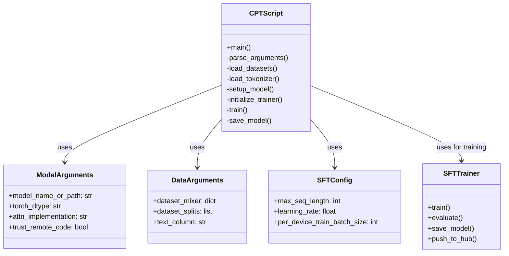
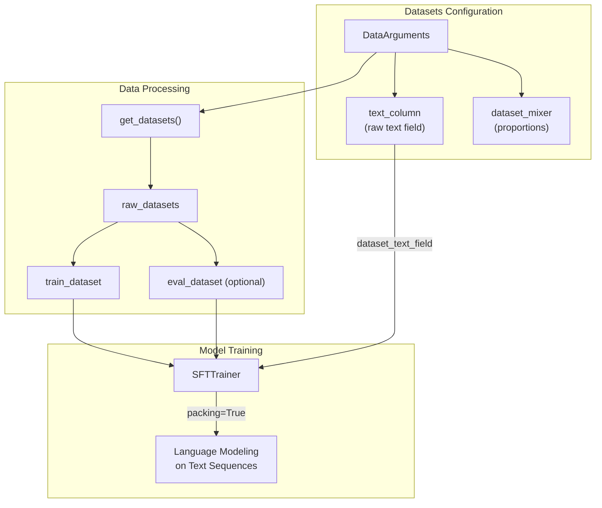
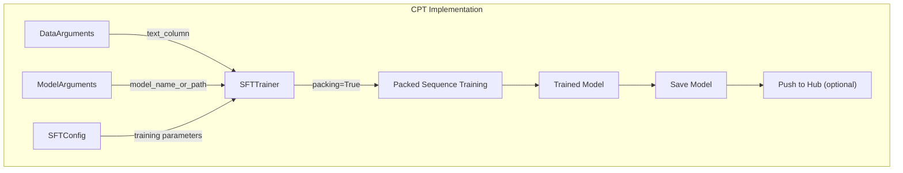
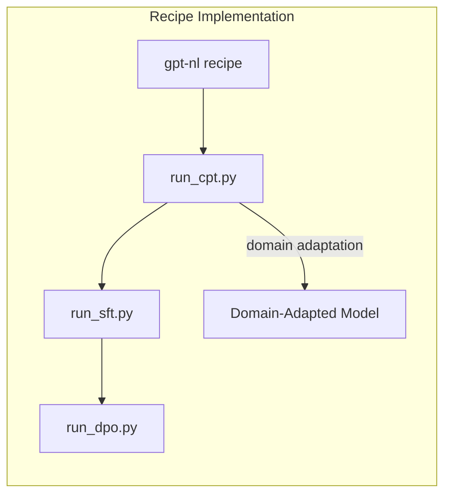

<!-- source: DeepWiki mcp.deepwiki.com · repo huggingface/alignment-handbook · page 3.4 Continued Pretraining (CPT) · fetched 2026-10-26 -->

# Continued Pretraining (CPT)

<details>
<summary>Relevant source files</summary>

The following files were used as context for generating this wiki page:

- [README.md](README.md)
- [scripts/README.md](scripts/README.md)

</details>


## Purpose and Scope

This document describes the Continued Pretraining (CPT) component of the Alignment Handbook, which enables further pretraining of decoder language models on domain-specific data before fine-tuning. CPT is typically the first step in the alignment workflow, performed before Supervised Fine-Tuning (SFT) (for information about SFT, see [Supervised Fine-Tuning (SFT)](#3.1)). CPT allows adapting a base language model to specific domains or data distributions without modifying its instruction-following capabilities.

## CPT in the Alignment Workflow

Continued Pretraining is a strategic step in the language model alignment pipeline, positioned between using a base model and performing supervised fine-tuning.


Sources: [scripts/README.md:31-35]()

## Key Components of the CPT Script

The CPT functionality is implemented in the `run_cpt.py` script, which shares architectural similarities with other training scripts in the Alignment Handbook. Unlike other alignment techniques that focus on instruction following or preference alignment, CPT focuses purely on improving the model's general capabilities in a specific domain.



Sources: [scripts/run_cpt.py:41-206]()

## Data Processing for CPT

Unlike other alignment techniques such as SFT or DPO which use specifically formatted instruction data, CPT works with raw text data for language modeling. The script uses a plain text column from the input datasets.



Sources: [scripts/run_cpt.py:84-104]()

## Key Differences from Other Alignment Techniques

CPT differs from SFT and preference alignment methods in several important ways:

| Feature | CPT | SFT | DPO/ORPO |
|---------|-----|-----|----------|
| Input data format | Raw text | Instruction-response pairs | Preferred/dispreferred responses |
| Data column | `text_column` | `messages` format | `chosen`/`rejected` format |
| Chat template usage | Not used | Required | Required |
| Training objective | Language modeling | Instruction following | Preference alignment |
| Position in workflow | First step | Second step | Third step |

Sources: [scripts/README.md:96-107](), [scripts/run_cpt.py:112]()

## Configuring CPT Training

CPT training is configured using the same configuration classes used by other training scripts in the Alignment Handbook:

1. **ModelArguments**: Controls model loading, quantization, and architecture settings
2. **DataArguments**: Specifies datasets, their mixing proportions, and text column name
3. **SFTConfig**: Defines training hyperparameters like learning rate and batch size

A critical difference in CPT is setting `auto_set_chat_template=False` when loading the tokenizer, as CPT does not use chat templates.

```python
# No chat template is needed for CPT
tokenizer = get_tokenizer(model_args, data_args, auto_set_chat_template=False)
```

Sources: [scripts/run_cpt.py:112]()

## Running CPT Training

CPT training can be launched using the same commands as other training scripts, with variations for different hardware configurations:

```bash
# Full training with ZeRO-3 on 8 GPUs
ACCELERATE_LOG_LEVEL=info accelerate launch --config_file recipes/accelerate_configs/deepspeed_zero3.yaml scripts/run_cpt.py recipes/{model_name}/cpt/config_full.yaml

# QLoRA 4-bit training on a single GPU
ACCELERATE_LOG_LEVEL=info accelerate launch --config_file recipes/accelerate_configs/multi_gpu.yaml --num_processes=1 scripts/run_cpt.py recipes/{model_name}/cpt/config_qlora.yaml
```

The Alignment Handbook also provides a Slurm launcher script for running on compute clusters:

```bash
sbatch --job-name=handbook_cpt --nodes=1 recipes/launch.slurm {model_name} cpt {precision} {accelerator}
```

Sources: [scripts/README.md:14-29](), [scripts/README.md:63-76]()

## CPT Implementation Details

The `run_cpt.py` script uses the TRL library's `SFTTrainer` class with packing enabled to efficiently perform continued pretraining:



Key parameters for the SFTTrainer in CPT context:

```python
trainer = SFTTrainer(
    model=model_args.model_name_or_path,
    model_init_kwargs=model_kwargs,
    args=training_args,
    train_dataset=train_dataset,
    eval_dataset=eval_dataset,
    dataset_text_field=data_args.text_column,
    max_seq_length=training_args.max_seq_length,
    tokenizer=tokenizer,
    packing=True,  # Enables efficient packing of sequences for CPT
    peft_config=get_peft_config(model_args),
    dataset_kwargs=training_args.dataset_kwargs,
)
```

Sources: [scripts/run_cpt.py:140-152]()

## Recipe Support and Availability

CPT is primarily used in the `gpt-nl` recipe of the Alignment Handbook, as noted in the documentation. This allows for domain adaptation before applying other alignment techniques.



Sources: [scripts/README.md:32-33]()

## Integration with the Alignment Workflow

Continued pretraining provides the foundation for further alignment steps. A typical workflow using CPT would be:

1. **CPT**: Adapt the base model to your target domain using raw text data
2. **SFT**: Fine-tune the CPT model on instruction data to improve instruction following
3. **DPO/ORPO**: Align the model with human preferences using preference pairs

This workflow is particularly useful when adapting models to specialized domains such as legal text, scientific literature, or specific languages that may be underrepresented in the base model's training data.

Sources: [scripts/README.md:31-35]()

---

