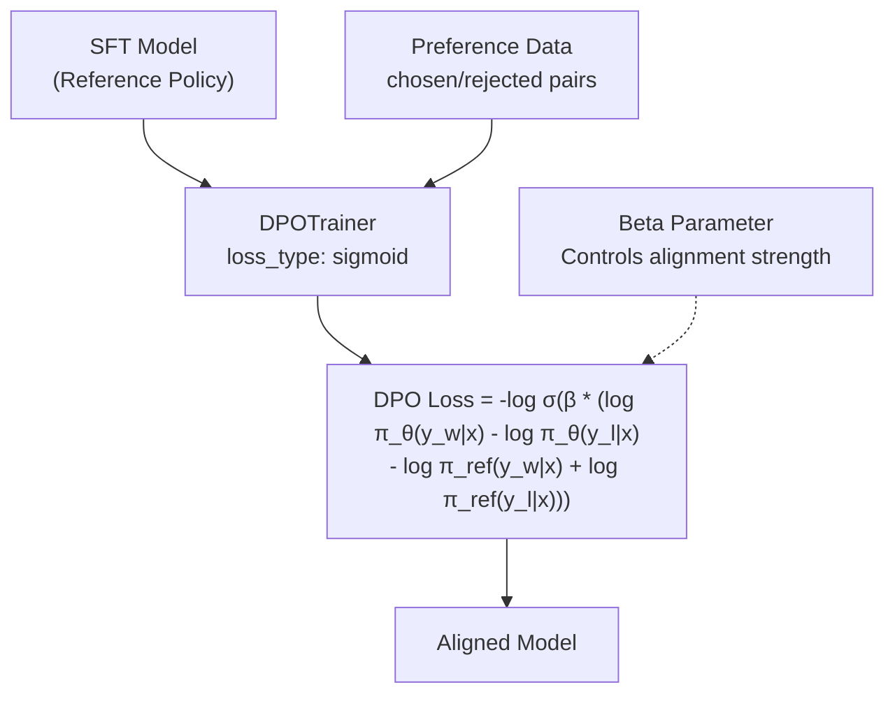
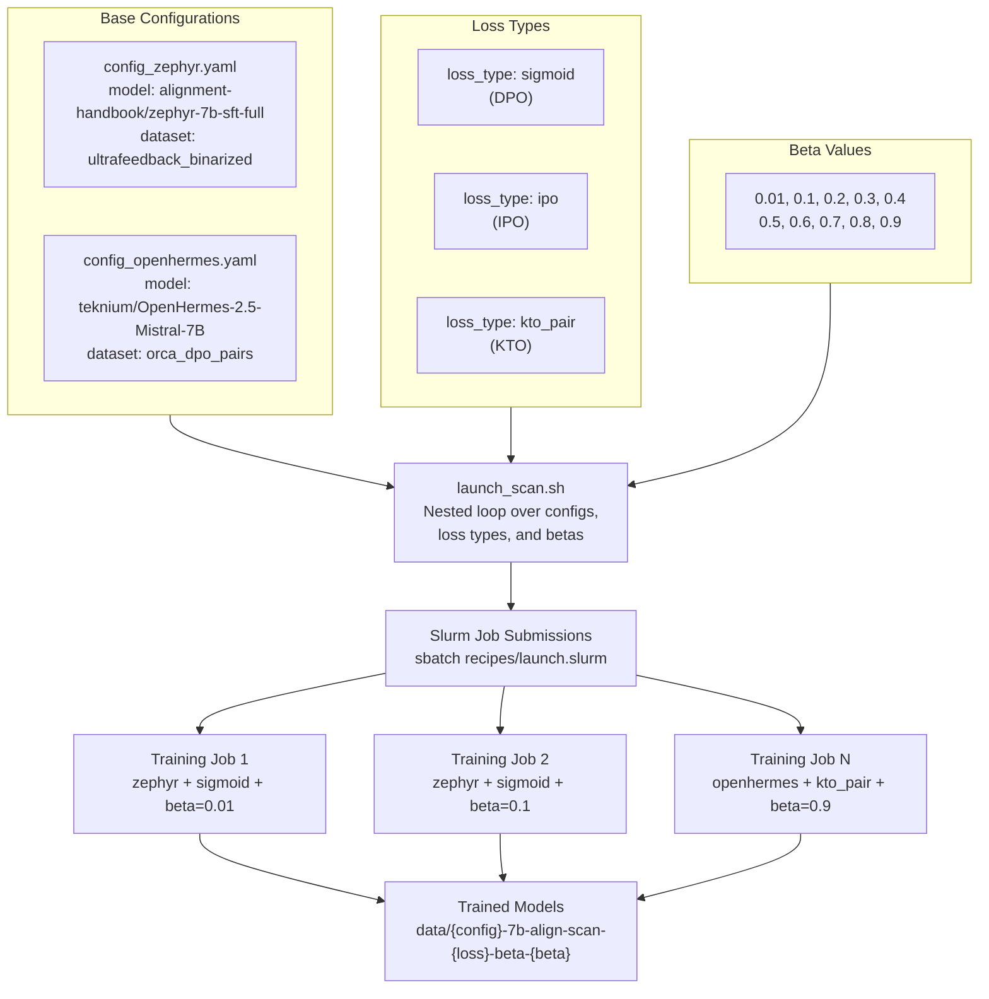
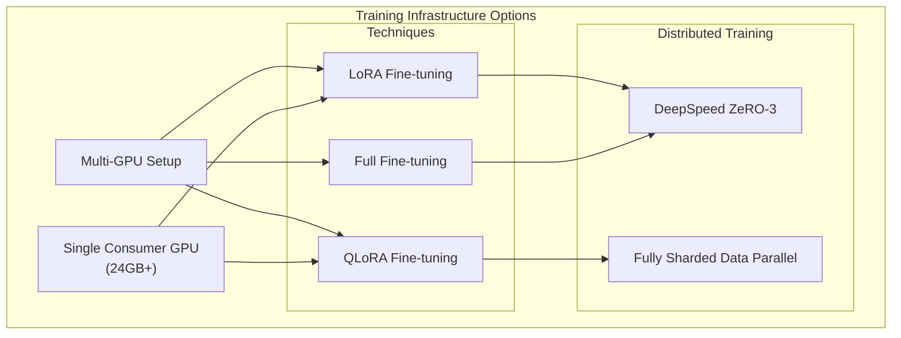

<!-- source: DeepWiki mcp.deepwiki.com · repo huggingface/alignment-handbook · page 3.5 Comparing Preference Alignment Methods · fetched 2026-10-26 -->

# Comparing Preference Alignment Methods

<details>
<summary>Relevant source files</summary>

The following files were used as context for generating this wiki page:

- [recipes/pref_align_scan/README.md](recipes/pref_align_scan/README.md)
- [recipes/pref_align_scan/dpo/config_openhermes.yaml](recipes/pref_align_scan/dpo/config_openhermes.yaml)
- [recipes/pref_align_scan/dpo/config_zephyr.yaml](recipes/pref_align_scan/dpo/config_zephyr.yaml)
- [recipes/pref_align_scan/launch_scan.sh](recipes/pref_align_scan/launch_scan.sh)

</details>


## Overview

The Alignment Handbook implements multiple preference alignment algorithms that optimize models to prefer chosen responses over rejected ones. This page compares three key preference optimization methods: Direct Preference Optimization (DPO), Identity Preference Optimization (IPO), and Kahneman-Tversky Optimization (KTO). Understanding the differences between these methods and their hyperparameter sensitivities enables informed selection of the optimal alignment strategy for specific models and datasets.

The handbook includes a comprehensive preference alignment scanning framework located in [recipes/pref_align_scan/]() that systematically evaluates these algorithms across different hyperparameter configurations, providing empirical guidance for method selection.

Sources: [recipes/pref_align_scan/README.md:1-9]()

## Preference Alignment Methods

All three methods use paired preference data containing chosen and rejected responses. They differ in their loss formulations and mathematical approaches to learning from preferences.

### Direct Preference Optimization (DPO)



DPO uses a sigmoid loss function (`loss_type: "sigmoid"`) that directly optimizes the policy to increase the likelihood ratio between chosen and rejected responses. The beta parameter controls the strength of the preference optimization relative to the reference policy. In the scanning framework, DPO serves as the baseline implementation.

**Configuration Example:**
```yaml
loss_type: sigmoid
beta: 0.01  # Tunable from 0.01 to 0.9
```

Sources: [recipes/pref_align_scan/dpo/config_zephyr.yaml:28-29](), [recipes/pref_align_scan/dpo/config_openhermes.yaml:28-29]()

### Identity Preference Optimization (IPO)

IPO uses an alternative loss formulation (`loss_type: "ipo"`) that directly regresses on the preference data without the log-ratio term. This approach can be more stable in certain training scenarios and less sensitive to initialization.

**Key Differences from DPO:**
- Uses squared error on preference differences rather than log probabilities
- More robust to noisy preference labels
- Different beta sensitivity profile

**Configuration Example:**
```yaml
loss_type: ipo
beta: 0.1  # Often requires different beta values than DPO
```

Sources: [recipes/pref_align_scan/README.md:22](), [recipes/pref_align_scan/launch_scan.sh:5]()

### Kahneman-Tversky Optimization (KTO)

KTO uses a loss formulation (`loss_type: "kto_pair"`) inspired by prospect theory from behavioral economics. It models human preferences with asymmetric gains and losses, potentially capturing preference patterns that symmetric losses miss.

**Key Differences from DPO and IPO:**
- Asymmetric treatment of chosen vs rejected responses
- Can handle unpaired preference data (though pair mode is used in scanning)
- Different mathematical foundation based on prospect theory

**Configuration Example:**
```yaml
loss_type: kto_pair
beta: 0.1  # Paired version for fair comparison
```

Sources: [recipes/pref_align_scan/README.md:22](), [recipes/pref_align_scan/launch_scan.sh:5]()

## Preference Alignment Scanning Framework

The Alignment Handbook includes a systematic framework for comparing preference alignment algorithms and their hyperparameters. This scanning system automates the process of training models with different loss types and beta values, enabling empirical comparison of algorithm performance.

### Scanning Architecture



The scanning framework uses a three-level nested loop to generate all combinations:
- 2 base configurations (Zephyr, OpenHermes)
- 3 loss types (sigmoid, ipo, kto_pair)
- 10 beta values (0.01, 0.1-0.9)

This produces 60 total training jobs for comprehensive comparison.

Sources: [recipes/pref_align_scan/launch_scan.sh:1-24](), [recipes/pref_align_scan/README.md:11-13]()

### Base Configuration Files

The scanning framework provides two base configurations representing different model families and datasets:

#### Zephyr Configuration

**Model and Data:**
- Base model: `alignment-handbook/zephyr-7b-sft-full`
- Dataset: `HuggingFaceH4/ultrafeedback_binarized`
- Splits: `train_prefs` and `test_prefs`
- Test split size: 2000 examples

**Training Parameters:**
```yaml
learning_rate: 5.0e-7
per_device_train_batch_size: 8
gradient_accumulation_steps: 2
max_prompt_length: 512
num_train_epochs: 1
warmup_ratio: 0.1
```

Sources: [recipes/pref_align_scan/dpo/config_zephyr.yaml:1-52]()

#### OpenHermes Configuration

**Model and Data:**
- Base model: `teknium/OpenHermes-2.5-Mistral-7B`
- Dataset: `HuggingFaceH4/orca_dpo_pairs`
- Splits: `train_prefs` and `test_prefs`
- Test split size: 500 examples

**Training Parameters:**
```yaml
learning_rate: 5.0e-7
per_device_train_batch_size: 8
gradient_accumulation_steps: 2
max_prompt_length: 512
num_train_epochs: 1
warmup_ratio: 0.1
```

Both configurations use identical training hyperparameters except for test split size, ensuring fair comparison of loss types and beta values.

Sources: [recipes/pref_align_scan/dpo/config_openhermes.yaml:1-54]()

### Running Scanning Experiments

#### Using launch_scan.sh

The [recipes/pref_align_scan/launch_scan.sh]() script automates the scanning process:

```bash
#!/bin/bash
configs=("zephyr" "openhermes")
loss_types=("sigmoid" "kto_pair" "ipo")
betas=("0.01" "0.1" "0.2" "0.3" "0.4" "0.5" "0.6" "0.7" "0.8" "0.9")

for config in "${configs[@]}"; do
    for loss_type in "${loss_types[@]}"; do
        for beta in "${betas[@]}"; do
            job_name="${config}_${loss_type}_beta_${beta}"
            model_revision="${loss_type}-${beta}"
            
            sbatch --job-name=${job_name} recipes/launch.slurm pref_align_scan dpo $config zero3 \
            "--beta=${beta} --loss_type=${loss_type} --output_dir=data/$config-7b-align-scan-${loss_type}-beta-${beta} --hub_model_revision=${model_revision}"
        done
    done
done
```

**Key Components:**

| Component | Purpose |
|-----------|---------|
| `configs` array | Selects which base configuration to use (`config_zephyr.yaml` or `config_openhermes.yaml`) |
| `loss_types` array | Specifies which preference optimization algorithm to test |
| `betas` array | Defines the range of beta values to scan |
| `job_name` | Unique identifier for each Slurm job |
| `model_revision` | Hub revision name for organizing trained models |

**Command Structure:**

The script calls `recipes/launch.slurm` with the following arguments:
1. `pref_align_scan` - Recipe subdirectory
2. `dpo` - Script type (uses `scripts/dpo.py` since all methods implemented via loss_type)
3. `$config` - Base configuration file name
4. `zero3` - Accelerate config (DeepSpeed ZeRO-3)
5. Parameter overrides - `--beta`, `--loss_type`, `--output_dir`, `--hub_model_revision`

Sources: [recipes/pref_align_scan/launch_scan.sh:1-24](), [recipes/pref_align_scan/README.md:14-44]()

#### Parameter Override Mechanism

The scanning script uses command-line parameter overrides to modify the base configuration:

```bash
"--beta=${beta} --loss_type=${loss_type} --output_dir=data/$config-7b-align-scan-${loss_type}-beta-${beta} --hub_model_revision=${model_revision}"
```

This allows a single base configuration to be reused across all loss types and beta values, with only the specific parameters being varied for each experiment.

**Output Organization:**

Each training job produces:
- Local output: `data/{config}-7b-align-scan-{loss_type}-beta-{beta}/`
- Hub revision: `{loss_type}-{beta}` (e.g., `sigmoid-0.1`, `ipo-0.5`)

This organization enables systematic comparison of results across the parameter space.

Sources: [recipes/pref_align_scan/launch_scan.sh:19-21]()

### Dataset Configuration Details

Both scanning configurations use the dataset mixture system with proper train/test splitting:

**Zephyr Dataset Configuration:**
```yaml
dataset_mixture:
  datasets:
    - id: HuggingFaceH4/ultrafeedback_binarized
      config: default
      split: train_prefs
      columns: [chosen, rejected]
      weight: 1.0
    - id: HuggingFaceH4/ultrafeedback_binarized
      config: default
      split: test_prefs
      columns: [chosen, rejected]
      weight: 1.0
  test_split_size: 2000
  seed: 0
```

This configuration:
- Loads both train and test splits from the same dataset
- Ensures `chosen` and `rejected` columns are retained
- Reserves 2000 examples for evaluation
- Uses seed 0 for reproducible splits

Sources: [recipes/pref_align_scan/dpo/config_zephyr.yaml:5-24]()

### Training Configuration Details

Both base configurations share common training settings optimized for systematic comparison:

**Shared Training Settings:**

| Parameter | Value | Purpose |
|-----------|-------|---------|
| `bf16` | `true` | Use bfloat16 precision |
| `gradient_checkpointing` | `true` | Reduce memory usage |
| `do_eval` | `true` | Enable evaluation |
| `eval_strategy` | `steps` | Evaluate periodically |
| `eval_steps` | `100` | Evaluation frequency |
| `logging_steps` | `10` | Logging frequency |
| `save_strategy` | `steps` | Save periodically |
| `save_steps` | `100` | Save frequency |
| `save_total_limit` | `1` | Keep only latest checkpoint |
| `lr_scheduler_type` | `cosine` | Cosine learning rate schedule |
| `optim` | `adamw_torch` | AdamW optimizer |

These settings ensure consistent training dynamics across all experiments, isolating the effects of loss type and beta value.

Sources: [recipes/pref_align_scan/dpo/config_zephyr.yaml:26-52](), [recipes/pref_align_scan/dpo/config_openhermes.yaml:26-54]()

## Analyzing and Comparing Results

### Beta Parameter Sensitivity

The scanning framework tests 10 beta values to map the sensitivity landscape:

**Beta Range:**
- `0.01` - Very weak alignment signal
- `0.1` to `0.9` - Standard range in 0.1 increments
- Higher beta = stronger preference optimization

The inclusion of `beta=0.01` is notable: experiments showed that very small beta values can be effective in certain configurations, contradicting initial assumptions that higher beta values are always better.

Sources: [recipes/pref_align_scan/README.md:12]()

### Loss Type Comparison

The three loss types (`sigmoid`, `ipo`, `kto_pair`) represent fundamentally different approaches to preference learning:

| Loss Type | Mathematical Approach | Typical Characteristics |
|-----------|----------------------|------------------------|
| `sigmoid` (DPO) | Log-ratio with sigmoid | Baseline method, well-studied |
| `ipo` | Squared error regression | More robust to noise |
| `kto_pair` | Asymmetric prospect theory | Models human loss aversion |

Results vary by model and dataset combination, highlighting the importance of empirical evaluation for specific use cases.

Sources: [recipes/pref_align_scan/README.md:3-4]()

### Model and Dataset Dependencies

The scanning framework tests two distinct combinations:

**Zephyr + Ultrafeedback:**
- General-purpose chat model
- Diverse preference data across domains
- Larger test split (2000 examples)

**OpenHermes + Orca:**
- Instruction-following specialist
- More focused preference data
- Smaller test split (500 examples)

Performance patterns differ between these combinations, indicating that optimal hyperparameters are context-dependent.

Sources: [recipes/pref_align_scan/README.md:5-6]()

### Accessing Detailed Results

Comprehensive analysis of the scanning experiments is available in the Hugging Face blog post on preference tuning. The trained models and datasets from these experiments are released in a Hugging Face collection, with additional models available upon request.

Sources: [recipes/pref_align_scan/README.md:8-9]()

## Practical Implementation Considerations

When implementing advanced alignment techniques, several practical considerations should be taken into account:

### Data Requirements

For ORPO and other preference-based methods:
- Preference data must include both chosen and rejected responses
- Data format should include `chosen` and `rejected` fields, each containing a list of message dictionaries
- Example format: `{"chosen": [{"role": "user", "content": "..."}, {"role": "assistant", "content": "..."}], "rejected": [...]}`

Sources: [scripts/README.md:104-107]()

### Evaluation and Benchmarking

To evaluate models aligned with advanced techniques, the Alignment Handbook recommends:

1. Automated benchmarks:
   - MT-Bench: multi-turn benchmark with 80 dialogues across 10 domains
   - AlpacaEval: single-turn benchmark evaluating helpfulness against text-davinci-003

2. Human evaluation:
   - Chatbot Arena: live human evaluations through head-to-head comparisons

Proper evaluation is crucial for determining the effectiveness of different alignment techniques and hyperparameter settings.

Sources: [scripts/README.md:119-142]()

### Integration with Training Infrastructure

Advanced alignment techniques can be integrated with various training infrastructure options:



The choice of infrastructure depends on:
- Available computational resources
- Size of the base model
- Desired training efficiency
- Need for distributed training

Sources: [scripts/README.md:5-11]()

## Conclusion

Advanced alignment techniques like ORPO and preference alignment scanning extend the basic alignment methods with more sophisticated approaches. The Alignment Handbook provides a comprehensive framework for experimenting with these techniques, comparing their effectiveness, and advancing the state of alignment research.

By systematically exploring different algorithms and hyperparameters, researchers can identify the optimal alignment strategy for specific models and use cases, ultimately leading to more helpful, harmless, and honest language models.

---

