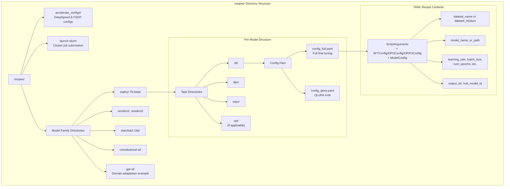
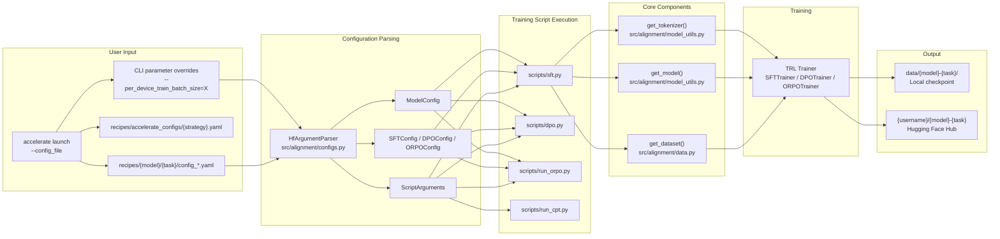
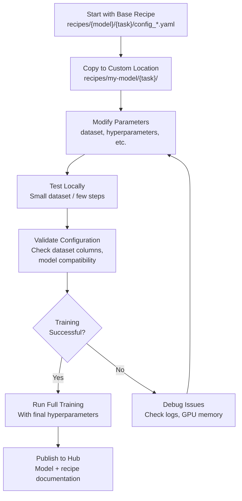

<!-- source: DeepWiki mcp.deepwiki.com · repo huggingface/alignment-handbook · page 4 Model Training Recipes · fetched 2026-10-26 -->

# Model Training Recipes

<details>
<summary>Relevant source files</summary>

The following files were used as context for generating this wiki page:

- [README.md](README.md)
- [scripts/README.md](scripts/README.md)

</details>


## Purpose and Scope

This page provides an overview of the recipe system in the Alignment Handbook. A **recipe** is a pre-configured YAML file that specifies all hyperparameters, datasets, model settings, and training configurations needed to reproduce a specific trained model. Recipes enable reproducible training across different hardware setups and serve as starting points for custom model development.

For detailed training methodology explanations (SFT, DPO, ORPO, CPT), see [Training Methods](#3). For infrastructure and distributed training setup, see [Training Infrastructure](#5). For specific model family recipes, see the subsections below ([Zephyr](#4.1), [SmolLM](#4.2), [StarChat](#4.3), [Constitutional AI](#4.4)).

---

## Recipe System Architecture

The recipe system provides a declarative approach to model training, separating configuration from code and enabling version-controlled reproducibility.

### Recipe File Organization



**Sources:** [README.md:41-42](), [README.md:109-119](), [scripts/README.md:37-38]()

---

## Recipe Types and Training Modes

Recipes are organized by **training precision** to accommodate different hardware configurations:

| Recipe Type | File Name | Description | Hardware Requirement | Use Case |
|------------|-----------|-------------|---------------------|----------|
| **Full Fine-tuning** | `config_full.yaml` | All model parameters trainable | 8x A100 80GB (for 7B models) | Maximum quality, full control |
| **QLoRA** | `config_qlora.yaml` | 4-bit quantized LoRA adapters | Single 24GB GPU (e.g., RTX 4090) | Resource-constrained, fast iteration |
| **LoRA** | `config_qlora.yaml` with `load_in_4bit=false` | 16-bit LoRA adapters | Single or multi-GPU | Balanced quality/efficiency |

**Sources:** [scripts/README.md:6-11](), [scripts/README.md:14-29]()

---

## Recipe Execution Flow



**Sources:** [scripts/README.md:39-46](), [scripts/README.md:49-54](), [README.md:38-42]()

---

## Recipe Structure and Configuration

### YAML Recipe Format

Each recipe YAML file contains three main configuration sections that map to Python dataclasses:

```mermaid
graph TD
    subgraph "YAML Recipe File"
        YAMLFile["config_full.yaml / config_qlora.yaml"]
    end
    
    subgraph "Python Configuration Classes"
        ScriptArguments["ScriptArguments<br/>src/alignment/configs.py"]
        TrainingConfig["SFTConfig / DPOConfig / ORPOConfig<br/>Extends TRL base configs"]
        ModelConfig["ModelConfig<br/>From TRL library"]
    end
    
    subgraph "ScriptArguments Fields"
        DatasetName["dataset_name: str<br/>Single dataset"]
        DatasetMixture["dataset_mixture: DatasetMixtureConfig<br/>Multiple weighted datasets"]
        DatasetSplits["dataset_splits: List[str]<br/>train_sft, test_sft, etc."]
        PreprocessFunc["preprocessing_num_workers: int"]
    end
    
    subgraph "TrainingConfig Fields"
        OutputDir["output_dir: str<br/>Local save path"]
        HubModelID["hub_model_id: str<br/>Hub upload path"]
        LearningRate["learning_rate: float"]
        BatchSize["per_device_train_batch_size: int"]
        NumEpochs["num_train_epochs: int"]
        GradAccum["gradient_accumulation_steps: int"]
        BetaParam["beta: float<br/>(DPO/ORPO specific)"]
    end
    
    subgraph "ModelConfig Fields"
        ModelPath["model_name_or_path: str<br/>Base model ID"]
        TorchDtype["torch_dtype: str<br/>bfloat16 / float16"]
        LoadIn4Bit["load_in_4bit: bool<br/>Quantization flag"]
        UseLoRA["use_peft: bool<br/>LoRA/QLoRA flag"]
        LoRAParams["lora_r, lora_alpha, lora_dropout<br/>LoRA hyperparameters"]
    end
    
    YAMLFile --> ScriptArguments
    YAMLFile --> TrainingConfig
    YAMLFile --> ModelConfig
    
    ScriptArguments --> DatasetName
    ScriptArguments --> DatasetMixture
    ScriptArguments --> DatasetSplits
    ScriptArguments --> PreprocessFunc
    
    TrainingConfig --> OutputDir
    TrainingConfig --> HubModelID
    TrainingConfig --> LearningRate
    TrainingConfig --> BatchSize
    TrainingConfig --> NumEpochs
    TrainingConfig --> GradAccum
    TrainingConfig --> BetaParam
    
    ModelConfig --> ModelPath
    ModelConfig --> TorchDtype
    ModelConfig --> LoadIn4Bit
    ModelConfig --> UseLoRA
    ModelConfig --> LoRAParams
```



**Sources:** [README.md:86-94](), [scripts/README.md:84-95]()

---

## Using Recipes

### Basic Recipe Execution

The standard command pattern for executing a recipe:

```bash
ACCELERATE_LOG_LEVEL=info accelerate launch \
  --config_file recipes/accelerate_configs/{strategy}.yaml \
  scripts/{task}.py \
  --config recipes/{model_name}/{task}/config_{precision}.yaml
```

Where:
- `{strategy}`: `zero3`, `ddp`, `fsdp`, or `fsdp+qlora` from [recipes/accelerate_configs/]()
- `{task}`: `sft`, `dpo`, `run_orpo`, or `run_cpt`
- `{model_name}`: Model family directory (e.g., `zephyr-7b-beta`, `smollm2`)
- `{precision}`: `full` or `qlora`

**Sources:** [scripts/README.md:14-29](), [README.md:40-45]()

### Recipe Parameter Overrides

CLI arguments override YAML values, enabling experimentation without modifying recipe files:

```bash
# Override batch size and epochs
accelerate launch --config_file recipes/accelerate_configs/zero3.yaml \
  scripts/sft.py \
  --config recipes/zephyr-7b-beta/sft/config_full.yaml \
  --per_device_train_batch_size=8 \
  --num_train_epochs=3 \
  --learning_rate=5e-5
```

**Priority order:** CLI arguments > YAML recipe > Default values

**Sources:** [scripts/README.md:49-54]()

### Multi-Node Slurm Execution

For HPC clusters with Slurm:

```bash
sbatch --job-name=handbook_{task} --nodes={N} \
  recipes/launch.slurm {model_name} {task} {precision} {accelerator} \
  '{override_params}'
```

Example:
```bash
sbatch --job-name=handbook_sft --nodes=1 \
  recipes/launch.slurm zephyr-7b-beta sft full zero3 \
  '--per_device_train_batch_size=4 --num_train_epochs=1'
```

**Sources:** [scripts/README.md:63-79]()

---

## Dataset Configuration in Recipes

Recipes support two dataset specification modes:

### Single Dataset Mode

```yaml
# Example: recipes/zephyr-7b-beta/sft/config_full.yaml
dataset_name: HuggingFaceH4/ultrachat_200k
dataset_splits:
  - train_sft
  - test_sft
```

### Dataset Mixture Mode

```yaml
# Example: Multi-domain mixing
dataset_mixer:
  HuggingFaceH4/ultrachat_200k: 0.5      # 50% sampling
  meta-math/MetaMathQA: 0.3               # 30% sampling
  OpenAssistant/oasst1: 0.2               # 20% sampling
dataset_splits:
  - train
```

The `get_dataset()` function [src/alignment/data.py]() processes these configurations to load, weight, concatenate, and shuffle datasets according to the recipe specification.

**Sources:** [scripts/README.md:84-95]()

---

## Available Recipe Families

The handbook includes pre-configured recipes for multiple model families, each optimized for specific use cases:

| Model Family | Base Models | Tasks | Key Datasets | Output Models |
|--------------|-------------|-------|--------------|---------------|
| **Zephyr** | Mistral-7B, Gemma-7B, Mixtral-8x22B | SFT, DPO, ORPO | UltraChat 200k, UltraFeedback | Chat/assistant models |
| **SmolLM** | SmolLM 135M-3B | SFT, DPO, mid-training | SmolTalk, custom reasoning data | Efficient small models |
| **StarChat** | StarCoder2-15B | SFT, ORPO | Code instruction datasets | Code-specialized assistants |
| **Constitutional AI** | Mistral-7B | SFT, DPO | Anthropic HH, Grok-style data | Safety-aligned models |
| **GPT-NL** | GPT-2 | CPT, SFT, DPO | Dutch language data | Language adaptation example |

Each family has dedicated recipe directories under [recipes/]() with README files documenting training procedures, hyperparameter choices, and evaluation results.

**Sources:** [README.md:22-30](), [README.md:34]()

---

## Recipe Reproducibility Features

### Version Control Integration

All recipes are tracked in Git, ensuring:
- Complete hyperparameter history
- Reproducible training runs
- Easy A/B testing via branches
- Community contributions via pull requests

### Deterministic Training

Recipes specify seeds and configurations for reproducibility:
- Dataset shuffling seed: [src/alignment/data.py]()
- Training seed in config files
- Locked dependency versions

### Model Provenance

Each trained model includes:
- Source recipe in model card
- Training hyperparameters in `config.json`
- Dataset attribution
- Hardware/time metadata

**Sources:** [README.md:11-19](), [README.md:123-133]()

---

## Recipe Customization Workflow



For detailed instructions on creating custom recipes, see [Creating Custom Recipes](#4.5).

**Sources:** [scripts/README.md:82-116]()

---

## Recipe Naming Conventions

The handbook follows consistent naming conventions for recipe organization:

- **Model directory**: `recipes/{base-model-name}/` (e.g., `zephyr-7b-beta`, `smollm2`)
- **Task subdirectory**: `{task}/` where task is `sft`, `dpo`, `orpo`, or `cpt`
- **Config file**: `config_{precision}.yaml` where precision is `full` or `qlora`
- **Accelerate config**: `recipes/accelerate_configs/{strategy}.yaml`
- **Output directory**: `data/{model_name}-{task}/` (local)
- **Hub model ID**: `{username}/{model_name}-{task}` (remote)

This structure enables automatic discovery and consistent tooling across all recipes.

**Sources:** [scripts/README.md:37-38](), [scripts/README.md:49](), [README.md:113]()

---

## Integration with TRL Library

All recipes extend configuration classes from the [TRL (Transformer Reinforcement Learning)](https://github.com/huggingface/trl) library:

- `SFTConfig` extends `trl.trainer.SFTConfig`
- `DPOConfig` extends `trl.trainer.DPOConfig`  
- `ORPOConfig` extends `trl.trainer.ORPOConfig`
- `ModelConfig` from `trl.trainer.ModelConfig`

The alignment handbook adds custom fields (e.g., `dataset_mixture`, `chat_template`) while maintaining compatibility with TRL trainers.

**Sources:** Configuration system detailed in [Configuration System](#2.1).

---

