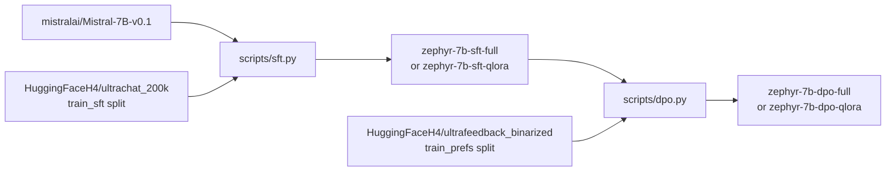
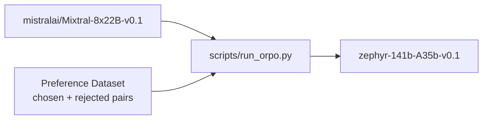
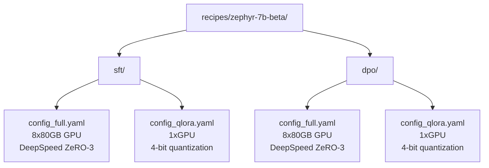
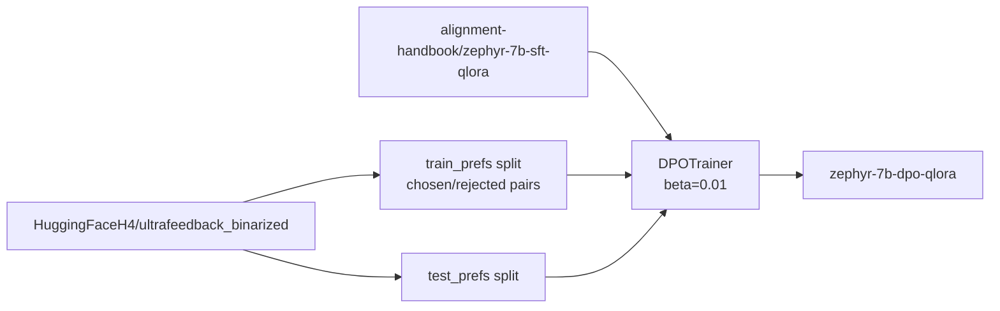
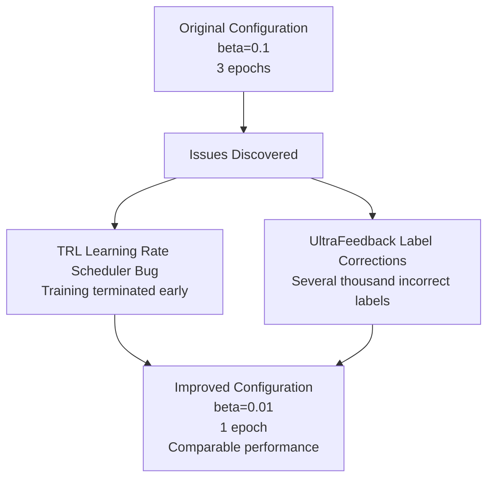
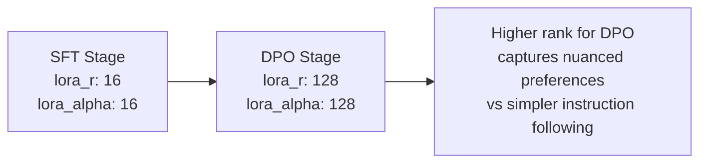

<!-- source: DeepWiki mcp.deepwiki.com · repo huggingface/alignment-handbook · page 4.1 Zephyr Model Family · fetched 2026-10-26 -->

# Zephyr Model Family

<details>
<summary>Relevant source files</summary>

The following files were used as context for generating this wiki page:

- [README.md](README.md)
- [recipes/zephyr-7b-beta/README.md](recipes/zephyr-7b-beta/README.md)
- [recipes/zephyr-7b-beta/dpo/config_qlora.yaml](recipes/zephyr-7b-beta/dpo/config_qlora.yaml)
- [recipes/zephyr-7b-beta/sft/config_qlora.yaml](recipes/zephyr-7b-beta/sft/config_qlora.yaml)

</details>


The Zephyr model family represents a series of aligned language models trained using the Alignment Handbook's recipes, demonstrating different approaches to preference alignment across multiple base models and scales. This page provides an overview of the Zephyr family architecture, training methodology, and variants.

For detailed training instructions for specific variants, see:
- [Zephyr-7B-Beta](#4.1.1) - The original two-stage SFT+DPO approach on Mistral-7B
- [Zephyr-7B-Gemma and Variants](#4.1.2) - Adaptations to different base models
- [Zephyr-141B-A35B](#4.1.3) - Large-scale ORPO training on Mixtral-8x22B

For information about the training methods used, see [Supervised Fine-Tuning](#3.1), [Direct Preference Optimization](#3.2), and [ORPO](#3.3).

## Model Variants

The Zephyr family includes several variants trained on different base models with varying alignment approaches:

| Model | Base Model | Parameters | Training Method | Primary Datasets |
|-------|------------|------------|-----------------|------------------|
| Zephyr-7B-β | Mistral-7B-v0.1 | 7B | SFT → DPO | UltraChat 200k, UltraFeedback |
| Zephyr-7B-Gemma | Gemma-7B | 7B | SFT → DPO (RLAIF) | UltraChat 200k, UltraFeedback |
| Zephyr-141B-A35B | Mixtral-8x22B | 141B (35B active) | ORPO (single-stage) | Custom preference dataset |

Sources: [README.md:21-27](), [recipes/zephyr-7b-beta/README.md:1-10]()

## Training Architecture

The Zephyr family demonstrates two primary training paradigms:

### Two-Stage SFT+DPO Pipeline (Zephyr-7B-β)



**Training Pipeline - Two-Stage Approach**

Sources: [recipes/zephyr-7b-beta/README.md:1-11](), [README.md:34-46]()

### Single-Stage ORPO Pipeline (Zephyr-141B)



**Training Pipeline - Single-Stage ORPO**

Sources: [README.md:25]()

## Configuration Structure

Zephyr models use recipe configurations organized in the `recipes/zephyr-7b-beta/` directory structure:



**Configuration Organization**

Sources: [recipes/zephyr-7b-beta/README.md:13-44]()

## SFT Stage Configuration

The supervised fine-tuning stage adapts the base model to follow instructions using conversational data. Key configuration elements:

### Dataset Configuration

The SFT stage uses the UltraChat 200k dataset with a custom chat template:


**SFT Dataset Processing**

The chat template defined in [recipes/zephyr-7b-beta/sft/config_qlora.yaml:23]() uses a Jinja2 format:

```


{{ '<|user|>\n' + message['content'] + eos_token }}

{{ '<|system|>\n' + message['content'] + eos_token }}

{{ '<|assistant|>\n'  + message['content'] + eos_token }}


{{ '<|assistant|>' }}


```

Sources: [recipes/zephyr-7b-beta/sft/config_qlora.yaml:23-40]()

### Training Parameters

Key SFT hyperparameters for the QLoRA variant:

| Parameter | Value | Purpose |
|-----------|-------|---------|
| `learning_rate` | 2.0e-04 | Higher LR for QLoRA training |
| `num_train_epochs` | 1 | Single pass over UltraChat |
| `max_seq_length` | 2048 | Maximum conversation length |
| `lora_r` | 16 | LoRA rank |
| `lora_alpha` | 16 | LoRA scaling factor |
| `per_device_train_batch_size` | 4 | Batch size per GPU |
| `gradient_accumulation_steps` | 2 | Effective batch size = 8 |

Sources: [recipes/zephyr-7b-beta/sft/config_qlora.yaml:1-71]()

### LoRA Target Modules

The SFT stage applies LoRA to all attention and MLP projection layers:

- `q_proj`, `k_proj`, `v_proj`, `o_proj` - Attention projections
- `gate_proj`, `up_proj`, `down_proj` - MLP layers

Sources: [recipes/zephyr-7b-beta/sft/config_qlora.yaml:13-20]()

## DPO Stage Configuration

The Direct Preference Optimization stage aligns the SFT model to AI preferences using the UltraFeedback dataset.

### Dataset Configuration



**DPO Training Pipeline**

Sources: [recipes/zephyr-7b-beta/dpo/config_qlora.yaml:1-57]()

### Training Parameters

Key DPO hyperparameters differ from SFT to emphasize preference learning:

| Parameter | Value | Notes |
|-----------|-------|-------|
| `model_name_or_path` | alignment-handbook/zephyr-7b-sft-qlora | Start from SFT checkpoint |
| `beta` | 0.01 | Lower than original (was 0.1) after bug fixes |
| `learning_rate` | 5.0e-6 | Much lower than SFT |
| `num_train_epochs` | 1 | Reduced from original 3 epochs |
| `lora_r` | 128 | Increased rank vs SFT (16→128) |
| `max_length` | 1024 | Full response length |
| `max_prompt_length` | 512 | Maximum prompt length |

Sources: [recipes/zephyr-7b-beta/dpo/config_qlora.yaml:1-57](), [recipes/zephyr-7b-beta/README.md:9]()

## Hyperparameter Evolution

The Zephyr-7B-β training configuration evolved after the initial technical report:



**Configuration Evolution**

The revised hyperparameters achieve comparable performance to the original `zephyr-7b-beta` with more efficient training (1 epoch vs 3 epochs).

Sources: [recipes/zephyr-7b-beta/README.md:9]()

## Training Execution

### Full Model Training

Full model training requires 8x80GB GPUs and uses DeepSpeed ZeRO-3:

```bash
# Step 1 - SFT
ACCELERATE_LOG_LEVEL=info accelerate launch \
  --config_file recipes/accelerate_configs/zero3.yaml \
  scripts/sft.py \
  --config recipes/zephyr-7b-beta/sft/config_full.yaml

# Step 2 - DPO
ACCELERATE_LOG_LEVEL=info accelerate launch \
  --config_file recipes/accelerate_configs/zero3.yaml \
  scripts/dpo.py \
  --config recipes/zephyr-7b-beta/dpo/config_full.yaml
```

Sources: [recipes/zephyr-7b-beta/README.md:13-22]()

### QLoRA Training

QLoRA training enables single-GPU training with 4-bit quantization:

```bash
# Step 1 - SFT
ACCELERATE_LOG_LEVEL=info accelerate launch \
  --config_file recipes/accelerate_configs/ddp.yaml \
  --num_processes=1 \
  scripts/sft.py \
  --config recipes/zephyr-7b-beta/sft/config_qlora.yaml \
  --load_in_4bit=true

# Step 2 - DPO
ACCELERATE_LOG_LEVEL=info accelerate launch \
  --config_file recipes/accelerate_configs/ddp.yaml \
  --num_processes=1 \
  scripts/dpo.py \
  --config recipes/zephyr-7b-beta/dpo/config_qlora.yaml
```

Sources: [recipes/zephyr-7b-beta/README.md:24-44]()

## Published Model Artifacts

The Zephyr training recipes produce intermediate and final model checkpoints:

| Checkpoint | Purpose | Location Pattern |
|------------|---------|------------------|
| SFT Full | Intermediate SFT model (full training) | `alignment-handbook/zephyr-7b-sft-full` |
| SFT QLoRA | Intermediate SFT model (QLoRA adapters) | `alignment-handbook/zephyr-7b-sft-qlora` |
| DPO Full | Final aligned model (full training) | `alignment-handbook/zephyr-7b-dpo-full` |
| DPO QLoRA | Final aligned model (QLoRA adapters) | `alignment-handbook/zephyr-7b-dpo-qlora` |

All models are published to the Hugging Face Hub with the `hub_model_id` configuration parameter.

Sources: [recipes/zephyr-7b-beta/README.md:4-7](), [recipes/zephyr-7b-beta/sft/config_qlora.yaml:50](), [recipes/zephyr-7b-beta/dpo/config_qlora.yaml:40]()

## Key Design Decisions

### Two-Stage vs Single-Stage

The Zephyr family demonstrates both approaches:

**Two-Stage (SFT → DPO)**:
- **Advantages**: Modular training, intermediate SFT checkpoint useful independently
- **Used by**: Zephyr-7B-β, Zephyr-7B-Gemma
- **Scripts**: [scripts/sft.py]() followed by [scripts/dpo.py]()

**Single-Stage (ORPO)**:
- **Advantages**: Computational efficiency, unified objective
- **Used by**: Zephyr-141B-A35B
- **Script**: [scripts/run_orpo.py]()

Sources: [recipes/zephyr-7b-beta/README.md:1-11](), [README.md:25]()

### LoRA Configuration Differences

The DPO stage uses a higher LoRA rank than SFT:



**LoRA Rank Progression**

This design allows the DPO stage to capture more complex preference patterns while maintaining parameter efficiency.

Sources: [recipes/zephyr-7b-beta/sft/config_qlora.yaml:10-11](), [recipes/zephyr-7b-beta/dpo/config_qlora.yaml:9-10]()

## Related Resources

- Technical Report: [Zephyr: Direct Distillation of LM Alignment](https://arxiv.org/abs/2310.16944)
- Model Collection: [Zephyr 7B models, datasets, and demos](https://huggingface.co/collections/HuggingFaceH4/zephyr-7b-6538c6d6d5ddd1cbb1744a66)
- Datasets: [UltraChat 200k](https://huggingface.co/datasets/HuggingFaceH4/ultrachat_200k), [UltraFeedback Binarized](https://huggingface.co/datasets/HuggingFaceH4/ultrafeedback_binarized)
- Additional Dataset: [No Robots](https://huggingface.co/datasets/HuggingFaceH4/no_robots) - 10,000 human-annotated instructions

Sources: [README.md:6](), [README.md:30](), [README.md:34]()

---

