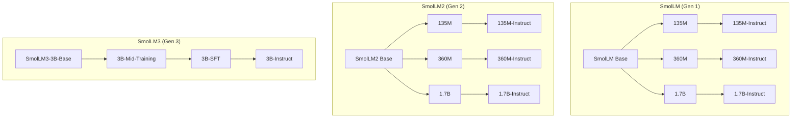
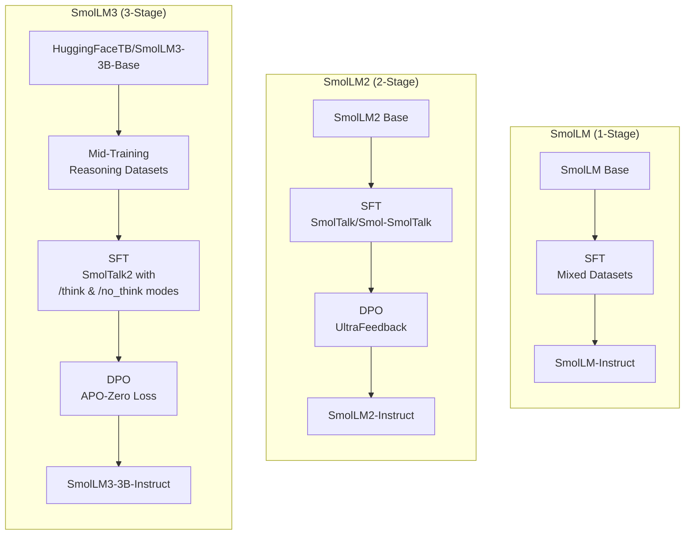
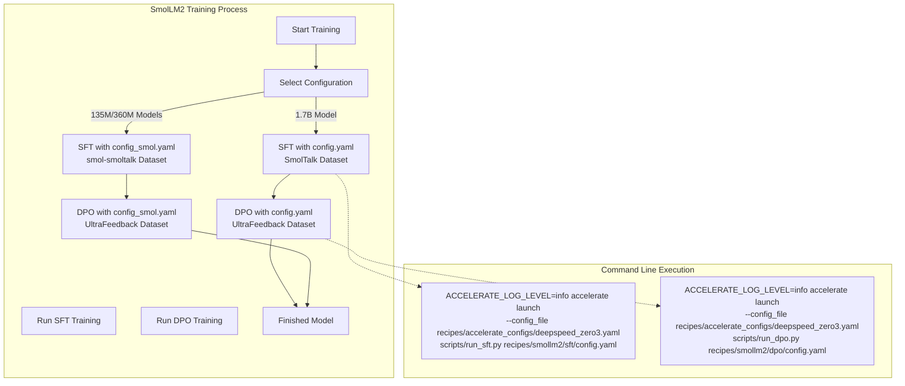
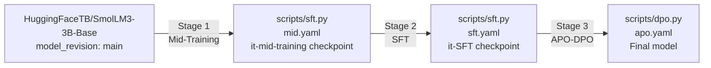

<!-- source: DeepWiki mcp.deepwiki.com · repo huggingface/alignment-handbook · page 4.2 SmolLM Small Language Models · fetched 2026-10-26 -->

# SmolLM Small Language Models

<details>
<summary>Relevant source files</summary>

The following files were used as context for generating this wiki page:

- [recipes/smollm2/README.md](recipes/smollm2/README.md)
- [recipes/smollm2/dpo/config.yaml](recipes/smollm2/dpo/config.yaml)
- [recipes/smollm2/dpo/config_smol.yaml](recipes/smollm2/dpo/config_smol.yaml)
- [recipes/smollm2/sft/config.yaml](recipes/smollm2/sft/config.yaml)
- [recipes/smollm2/sft/config_smol.yaml](recipes/smollm2/sft/config_smol.yaml)
- [recipes/smollm3/README.md](recipes/smollm3/README.md)
- [recipes/smollm3/dpo/apo.yaml](recipes/smollm3/dpo/apo.yaml)
- [recipes/smollm3/sft/mid.yaml](recipes/smollm3/sft/mid.yaml)
- [recipes/smollm3/sft/sft.yaml](recipes/smollm3/sft/sft.yaml)

</details>


This page documents the SmolLM family training recipes in the Alignment Handbook. It covers the configuration, training process, and datasets used to create these efficient, compact language models ranging from 135M to 3B parameters. For information about larger models like Zephyr, see page 4.1.

## Overview of SmolLM Family

The Alignment Handbook provides recipes for training three generations of small language models:

1. **SmolLM** - First generation of compact language models
2. **SmolLM2** - Second generation with improved capabilities and longer context
3. **SmolLM3** - Third generation with advanced reasoning capabilities and multi-stage training

These models are available in different parameter sizes:
- 135 million parameters (135M)
- 360 million parameters (360M) 
- 1.7 billion parameters (1.7B)
- 3 billion parameters (3B) - SmolLM3 only

The training process varies by generation:
- **SmolLM**: Single-stage SFT
- **SmolLM2**: Two-stage SFT + DPO
- **SmolLM3**: Three-stage mid-training + SFT + DPO



Sources: [recipes/smollm2/README.md:1-4](), [recipes/smollm3/README.md:1-3]()

## Training Workflow

The SmolLM family uses progressively more advanced training workflows across generations:



Sources: [recipes/smollm2/README.md:1-4](), [recipes/smollm3/README.md:1-3](), [recipes/smollm3/sft/mid.yaml:1-10](), [recipes/smollm3/sft/sft.yaml:1-10]()

## SmolLM Training Recipe

The SmolLM models are created through Supervised Fine-Tuning (SFT) on a mixture of instruction-following datasets.

### Datasets

SmolLM models use a carefully curated mix of datasets:

| Dataset | Mixing Ratio | Description |
|---------|--------------|-------------|
| Magpie-Pro-300K-Filtered | 1.0 | High-quality filtered subset of the Magpie-Pro dataset |
| self-oss-instruct-sc2 | 1.0 | Self-instruction dataset from StarCoder2 |
| OpenHermes-2.5 | 0.001 | Small subset of OpenHermes conversational data |
| everyday-conversations-llama3.1-2k | 1.0 | 2K simple everyday conversations generated by Llama 3.1-70B |
| instruct-data-basics-smollm | 1.0 | Basic instruction data tailored for SmolLM |

Sources: [recipes/smollm/sft/config.yaml:9-14]()

### Training Configuration

SmolLM uses the following key training parameters:

```yaml
learning_rate: 1.0e-03
max_seq_length: 2048
gradient_accumulation_steps: 4
num_train_epochs: 1
per_device_train_batch_size: 4
```

SmolLM is trained on 8 GPUs using DeepSpeed ZeRO-3 for distributed training.

Sources: [recipes/smollm/sft/config.yaml:21-53](), [recipes/smollm/README.md:14-19]()

## SmolLM2 Training Recipe

SmolLM2 models follow a two-stage training process: SFT followed by DPO.

### Datasets

SmolLM2 models use different datasets depending on model size:

**For 1.7B model:**
- SFT: [SmolTalk](https://huggingface.co/datasets/HuggingFaceTB/smoltalk)
- DPO: [UltraFeedback](https://huggingface.co/datasets/HuggingFaceH4/ultrafeedback_binarized)

**For 135M and 360M models:**
- SFT: [smol-smoltalk](https://huggingface.co/datasets/HuggingFaceTB/smol-smoltalk)
- DPO: [UltraFeedback](https://huggingface.co/datasets/HuggingFaceH4/ultrafeedback_binarized)

Sources: [recipes/smollm2/README.md:4-21](), [recipes/smollm2/sft/config.yaml:8-10](), [recipes/smollm2/sft/config_smol.yaml:8-10](), [recipes/smollm2/dpo/config.yaml:5-7]()

### SFT Configuration

Key SFT configuration parameters for SmolLM2-1.7B:

```yaml
learning_rate: 3.0e-04
max_seq_length: 8192
gradient_accumulation_steps: 4
num_train_epochs: 2
per_device_train_batch_size: 4
```

For SmolLM2-135M and SmolLM2-360M:

```yaml
learning_rate: 1.0e-03
max_seq_length: 8192
gradient_accumulation_steps: 4
num_train_epochs: 2
per_device_train_batch_size: 4
```

Sources: [recipes/smollm2/sft/config.yaml:20-49](), [recipes/smollm2/sft/config_smol.yaml:17-46]()

### DPO Configuration

The DPO training uses these key parameters:

```yaml
beta: 0.5
learning_rate: 1.0e-6
max_length: 1024
max_prompt_length: 512
num_train_epochs: 3  # 2 epochs for smaller models
gradient_accumulation_steps: 8
per_device_train_batch_size: 2
```

Sources: [recipes/smollm2/dpo/config.yaml:14-43](), [recipes/smollm2/dpo/config_smol.yaml:14-43]()

## Training Execution



Sources: [recipes/smollm2/README.md:13-28](), [recipes/smollm/README.md:14-19]()

## SmolLM3 Training (Advanced 3-Stage Pipeline)

SmolLM3-3B represents the most advanced training approach in the SmolLM family, using a three-stage pipeline that includes mid-training, SFT with reasoning modes, and APO-based DPO.

### Three-Stage Training Pipeline



Sources: [recipes/smollm3/README.md:3-19](), [recipes/smollm3/sft/mid.yaml:3-4](), [recipes/smollm3/sft/sft.yaml:3-4](), [recipes/smollm3/dpo/apo.yaml:3-4]()

### Stage 1: Mid-Training

The mid-training stage adapts the base model to reasoning tasks before instruction tuning.

**Configuration**: [recipes/smollm3/sft/mid.yaml:1-64]()

**Datasets**:
- `HuggingFaceTB/smoltalk2` (Mid configuration)
  - `Llama_Nemotron_Post_Training_Dataset_reasoning_r1` (weight: 1.0)
  - `OpenThoughts3_1.2M` (weight: 1.0)

**Key Parameters**:
| Parameter | Value | Purpose |
|-----------|-------|---------|
| `max_length` | 32768 | Extended context for reasoning |
| `learning_rate` | 2.0e-05 | Conservative learning rate |
| `num_train_epochs` | 5 | Multiple passes over data |
| `packing` | true | Efficient sequence packing |
| `use_liger_kernel` | true | Memory optimization |
| `warmup_ratio` | 0.03 | Small warmup |

Sources: [recipes/smollm3/sft/mid.yaml:11-64]()

### Stage 2: SFT with Reasoning Modes

The SFT stage uses a complex chat template that supports reasoning modes and extensive dataset mixing.

**Configuration**: [recipes/smollm3/sft/sft.yaml:1-228]()

#### Reasoning Modes

SmolLM3 supports two reasoning modes controlled via chat template:

1. **`/think` mode**: Model generates explicit reasoning in `<think>` tags before answering
2. **`/no_think` mode**: Model generates answers without explicit reasoning steps

The reasoning mode is controlled by the `enable_thinking` variable and can be overridden in system messages.

Sources: [recipes/smollm3/sft/sft.yaml:10]()

#### Dataset Mixture

SmolLM3 SFT uses 23 different datasets from `HuggingFaceTB/smoltalk2` with varying weights:

**No-Think Mode Datasets** (weight: 0.4-1.0):
- `smoltalk_smollm3_everyday_conversations_no_think`
- `smoltalk_smollm3_systemchats_30k_no_think`
- `tulu_3_sft_personas_instruction_following_no_think`
- `hermes_function_calling_v1_no_think`
- `table_gpt_no_think`
- `LongAlign_64k_context_lang_annotated_lang_6_no_think`
- And more...

**Think Mode Datasets** (weight: 0.02-1.0):
- `multi_turn_reasoning_if_think`
- `smoltalk_everyday_convs_reasoning_Qwen3_32B_think`
- `smoltalk_systemchats_Qwen3_32B_think`
- `s1k_1.1_think`
- `LongAlign_64k_Qwen3_32B_yarn_131k_think`
- And more...

Sources: [recipes/smollm3/sft/sft.yaml:11-188]()

#### SFT Training Parameters

| Parameter | Value | Notes |
|-----------|-------|-------|
| `max_length` | 65536 | Very long context support |
| `learning_rate` | 2.0e-05 | Stable learning rate |
| `num_train_epochs` | 5 | Multiple epochs |
| `packing` | true | FFD packing strategy |
| `packing_strategy` | `ffd` | First-fit-decreasing |
| `assistant_only_loss` | true | Only compute loss on assistant tokens |
| `use_liger_kernel` | true | Memory optimization |
| `gradient_accumulation_steps` | 2 | Per config |

Sources: [recipes/smollm3/sft/sft.yaml:193-227]()

### Stage 3: APO-Based DPO

The final stage uses Adversarial Preference Optimization (APO) with the `apo_zero` loss type.

**Configuration**: [recipes/smollm3/dpo/apo.yaml:1-66]()

**Datasets**:
- `llama_3.1_tulu_3_8b_preference_mixture_no_think` (weight: 0.5)
- `tulu_3_8b_pref_mix_Qwen3_32B_Qwen3_0.6B_think` (weight: 0.25)

**Key Parameters**:
| Parameter | Value | Purpose |
|-----------|-------|---------|
| `loss_type` | `apo_zero` | APO loss variant |
| `beta` | 0.05 | Low beta for APO |
| `learning_rate` | 1.0e-06 | Very low learning rate |
| `max_length` | 24576 | Long context |
| `padding_free` | true | Memory efficient |
| `num_train_epochs` | 1 | Single epoch |

Sources: [recipes/smollm3/dpo/apo.yaml:31-66]()

### Chat Template

SmolLM3 uses an advanced chat template with several features:

1. **Reasoning Mode Control**: `/think` or `/no_think` in system message
2. **Metadata Section**: Knowledge cutoff, current date, reasoning mode
3. **Custom Instructions**: Optional custom system instructions
4. **Tool Support**: XML tools and Python tools sections
5. **Conditional Reasoning Tags**: Automatic `<think>` tag insertion based on mode

The template is defined as a complex Jinja2 template at [recipes/smollm3/sft/sft.yaml:10]().

Sources: [recipes/smollm3/sft/sft.yaml:10]()

### Execution Commands

```bash
# Stage 1 - Mid-Training
ACCELERATE_LOG_LEVEL=info accelerate launch \
  --config_file recipes/accelerate_configs/zero3.yaml \
  scripts/sft.py \
  --config recipes/smollm3/sft/mid.yaml \
  --gradient_accumulation_steps 16

# Stage 2 - SFT
ACCELERATE_LOG_LEVEL=info accelerate launch \
  --config_file recipes/accelerate_configs/zero3.yaml \
  scripts/sft.py \
  --config recipes/smollm3/sft/sft.yaml \
  --gradient_accumulation_steps 16

# Stage 3 - APO-DPO
ACCELERATE_LOG_LEVEL=info accelerate launch \
  --config_file recipes/accelerate_configs/zero3.yaml \
  scripts/dpo.py \
  --config recipes/smollm3/dpo/apo.yaml \
  --gradient_accumulation_steps 4
```

Sources: [recipes/smollm3/README.md:11-19]()

## Technical Specifications

The SmolLM family spans three generations with increasing capabilities:

| Feature | SmolLM | SmolLM2 | SmolLM3 |
|---------|--------|---------|---------|
| **Parameter Sizes** | 135M, 360M, 1.7B | 135M, 360M, 1.7B | 3B |
| **Context Length** | 2048 | 8192 | 32768 (mid) / 65536 (SFT) |
| **Training Stages** | 1 (SFT) | 2 (SFT + DPO) | 3 (Mid + SFT + DPO) |
| **Reasoning Support** | No | No | Yes (/think mode) |
| **Chat Template** | Basic | Basic | Advanced with reasoning |
| **DPO Loss** | N/A | Standard | APO-Zero |
| **Tool Support** | No | No | Yes (XML + Python) |

**Common Optimizations** (all generations):
- Flash Attention 2 (`attn_implementation: flash_attention_2`)
- BFloat16 precision (`bf16: true`)
- Gradient checkpointing (`gradient_checkpointing: true`)
- DeepSpeed ZeRO-3 for distributed training
- Liger kernel for memory optimization (SmolLM3)

Sources: [recipes/smollm2/sft/config.yaml:1-7](), [recipes/smollm3/sft/sft.yaml:1-8](), [recipes/smollm3/sft/mid.yaml:1-8]()

## Hardware Requirements

Training these models requires multi-GPU setups:
- 8 GPUs recommended for all model sizes
- Less memory-intensive than larger models
- Can be trained on consumer-grade GPUs (for the smallest variants)

Training times vary by model size:
- 135M models: Fastest to train
- 360M models: Moderate training time
- 1.7B models: Longest training time but still much faster than larger models (like 7B parameter models)

Sources: [recipes/smollm/README.md:14-19](), [recipes/smollm2/README.md:11-19]()

---

