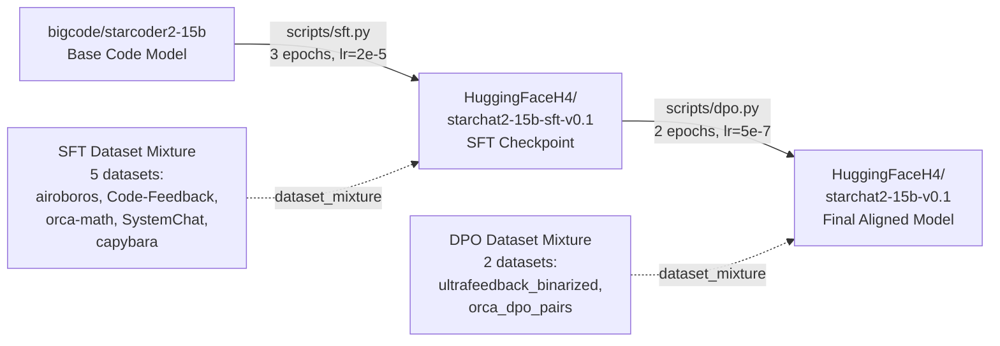
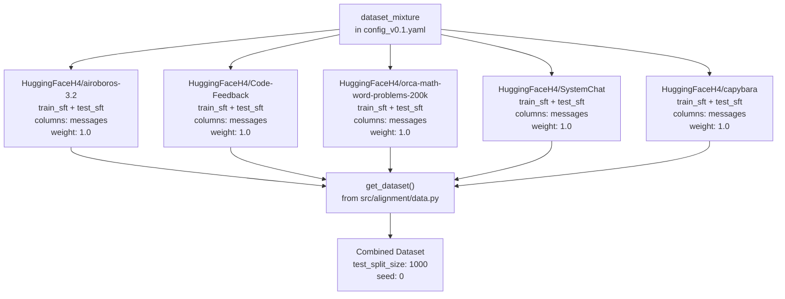
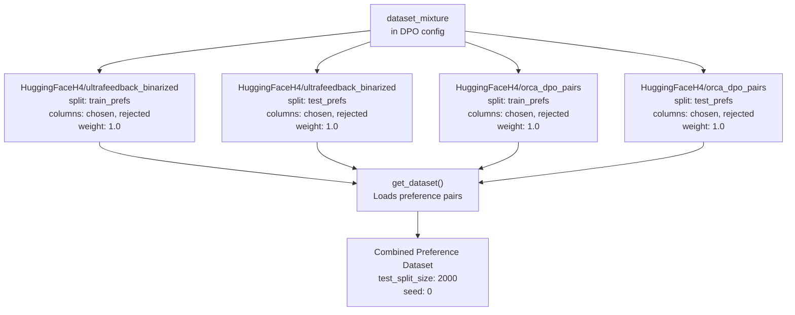
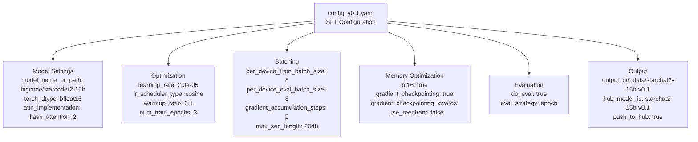
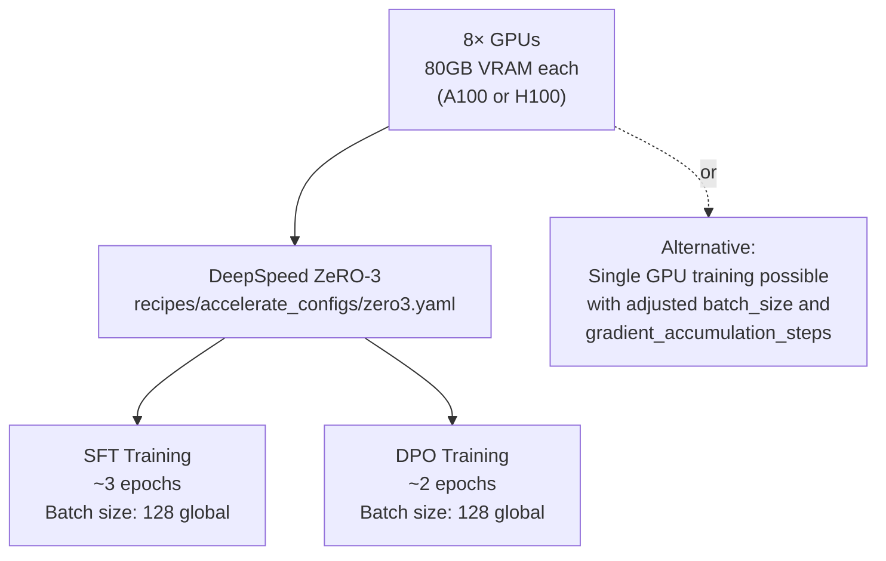
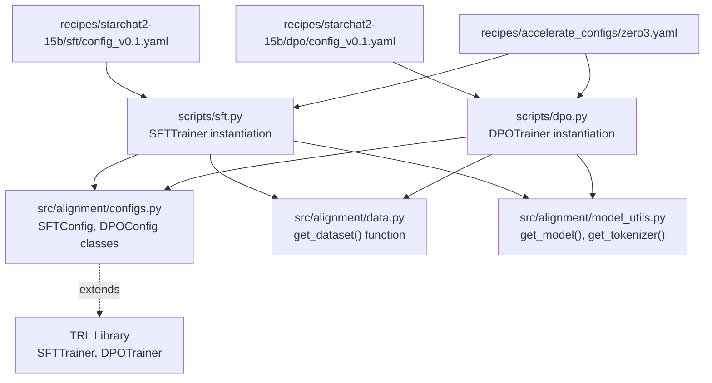

<!-- source: DeepWiki mcp.deepwiki.com · repo huggingface/alignment-handbook · page 4.3 StarChat Code Models · fetched 2026-10-26 -->

# StarChat Code Models

<details>
<summary>Relevant source files</summary>

The following files were used as context for generating this wiki page:

- [recipes/accelerate_configs/fsdp.yaml](recipes/accelerate_configs/fsdp.yaml)
- [recipes/starchat2-15b/README.md](recipes/starchat2-15b/README.md)
- [recipes/starchat2-15b/dpo/config_v0.1.yaml](recipes/starchat2-15b/dpo/config_v0.1.yaml)
- [recipes/starchat2-15b/sft/config_v0.1.yaml](recipes/starchat2-15b/sft/config_v0.1.yaml)
- [recipes/zephyr-141b-A35b/README.md](recipes/zephyr-141b-A35b/README.md)
- [recipes/zephyr-141b-A35b/orpo/config_full.yaml](recipes/zephyr-141b-A35b/orpo/config_full.yaml)
- [recipes/zephyr-7b-gemma/dpo/config_full.yaml](recipes/zephyr-7b-gemma/dpo/config_full.yaml)
- [recipes/zephyr-7b-gemma/sft/config_full.yaml](recipes/zephyr-7b-gemma/sft/config_full.yaml)

</details>


## Purpose and Scope

This document describes the training process for **StarChat2**, a family of code-specialized language models built on top of the StarCoder2 base model. StarChat2 models are designed for code generation, chat interactions, and mathematical reasoning through a two-stage training process: Supervised Fine-Tuning (SFT) on diverse code and chat datasets, followed by Direct Preference Optimization (DPO) for alignment.

For general information about DPO methodology, see [Direct Preference Optimization (DPO)](#3.2). For details on SFT methodology, see [Supervised Fine-Tuning (SFT)](#3.1). For distributed training infrastructure used by StarChat2, see [DeepSpeed ZeRO-3](#5.1.1).

---

## Model Architecture and Base Model

StarChat2 models are based on **bigcode/starcoder2-15b**, a 15-billion parameter code model from the BigCode project. The training process produces two intermediate checkpoints:

1. **starchat2-15b-sft-v0.1**: The result of SFT on mixed code/chat/math data
2. **starchat2-15b-v0.1**: The final aligned model after DPO

The models use `bfloat16` precision and `flash_attention_2` for efficient training.

**Sources:** [recipes/starchat2-15b/README.md:1-7](), [recipes/starchat2-15b/sft/config_v0.1.yaml:1-5]()

---

## Training Pipeline Overview



**Diagram: StarChat2 Two-Stage Training Pipeline**

The training follows a traditional two-stage approach similar to Zephyr-7B-Beta:

1. **Stage 1 - Supervised Fine-Tuning**: Fine-tune StarCoder2-15B on a weighted mixture of chat, code, and math datasets using [scripts/sft.py]()
2. **Stage 2 - Direct Preference Optimization**: Align the SFT model using preference pairs from UltraFeedback and Orca DPO datasets using [scripts/dpo.py]()

**Sources:** [recipes/starchat2-15b/README.md:4-7](), [recipes/starchat2-15b/sft/config_v0.1.yaml](), [recipes/starchat2-15b/dpo/config_v0.1.yaml]()

---

## SFT Stage Dataset Composition

The SFT stage uses a diverse mixture of five datasets to train the model on code generation, general chat, mathematical reasoning, and system interactions.

### Dataset Mixture Configuration



**Diagram: SFT Dataset Mixture Composition**

| Dataset | Purpose | Split | Column | Weight |
|---------|---------|-------|--------|--------|
| `HuggingFaceH4/airoboros-3.2` | General instruction following | `train_sft`, `test_sft` | `messages` | 1.0 |
| `HuggingFaceH4/Code-Feedback` | Code generation and debugging | `train_sft`, `test_sft` | `messages` | 1.0 |
| `HuggingFaceH4/orca-math-word-problems-200k` | Mathematical reasoning | `train_sft`, `test_sft` | `messages` | 1.0 |
| `HuggingFaceH4/SystemChat` | System-level interactions | `train_sft`, `test_sft` | `messages` | 1.0 |
| `HuggingFaceH4/capybara` | Multi-turn conversations | `train_sft`, `test_sft` | `messages` | 1.0 |

All datasets use equal weighting (1.0), with 1000 examples reserved for test evaluation. The configuration specifies `dataset_num_proc: 24` for parallel dataset processing.

**Sources:** [recipes/starchat2-15b/sft/config_v0.1.yaml:9-73]()

---

## DPO Stage Dataset Composition

The DPO stage uses preference pairs to align the model towards generating preferred responses over rejected ones.

### Preference Dataset Configuration



**Diagram: DPO Preference Dataset Composition**

| Dataset | Purpose | Split | Columns | Weight |
|---------|---------|-------|---------|--------|
| `HuggingFaceH4/ultrafeedback_binarized` | General preference pairs | `train_prefs`, `test_prefs` | `chosen`, `rejected` | 1.0 |
| `HuggingFaceH4/orca_dpo_pairs` | Code-specific preferences | `train_prefs`, `test_prefs` | `chosen`, `rejected` | 1.0 |

The DPO stage combines both general and code-specific preference pairs to ensure the model learns appropriate behavior across domains. A larger test split (2000 examples) is used compared to the SFT stage.

**Sources:** [recipes/starchat2-15b/dpo/config_v0.1.yaml:7-39]()

---

## Chat Template Specification

StarChat2 uses a custom chat template with special tokens `<|im_start|>` and `<|im_end|>` to delimit message boundaries.

### Template Structure

The chat template is defined in [recipes/starchat2-15b/sft/config_v0.1.yaml:8]() as a Jinja2 template:

```jinja2

  


  {{'<|im_start|>' + message['role'] + '\n' + message['content'] + '<|im_end|>' + '\n'}}


  {{ '<|im_start|>assistant\n' }}

```

### Example Formatted Conversation

```
<|im_start|>user
Write a Python function to calculate fibonacci numbers
<|im_end|>
<|im_start|>assistant
Here's a recursive implementation:

def fibonacci(n):
    if n <= 1:
        return n
    return fibonacci(n-1) + fibonacci(n-2)
<|im_end|>
```

This template structure is similar to ChatML format but uses different special tokens. The template does not prepend special tokens automatically (`add_special_tokens: false` in SFT config), as the template itself handles token insertion.

**Sources:** [recipes/starchat2-15b/sft/config_v0.1.yaml:8]()

---

## Training Configuration Details

### SFT Training Parameters



**Diagram: SFT Configuration Structure**

Key configuration parameters from [recipes/starchat2-15b/sft/config_v0.1.yaml]():

| Parameter | Value | Purpose |
|-----------|-------|---------|
| `learning_rate` | `2.0e-05` | Base learning rate for AdamW optimizer |
| `num_train_epochs` | `3` | Full passes through training data |
| `per_device_train_batch_size` | `8` | Samples per GPU |
| `gradient_accumulation_steps` | `2` | Effective batch size = 8 × 2 × 8 GPUs = 128 |
| `max_seq_length` | `2048` | Maximum sequence length for training |
| `lr_scheduler_type` | `cosine` | Cosine learning rate decay |
| `warmup_ratio` | `0.1` | 10% warmup of total steps |
| `gradient_checkpointing` | `true` | Trade compute for memory |
| `eval_strategy` | `epoch` | Evaluate after each epoch |

**Sources:** [recipes/starchat2-15b/sft/config_v0.1.yaml:75-104]()

### DPO Training Parameters

Key configuration parameters from [recipes/starchat2-15b/dpo/config_v0.1.yaml]():

| Parameter | Value | Purpose |
|-----------|-------|---------|
| `model_name_or_path` | `HuggingFaceH4/starchat2-15b-sft-v0.1` | SFT checkpoint as starting point |
| `beta` | `0.05` | DPO temperature parameter |
| `learning_rate` | `5.0e-7` | Much lower than SFT (10× smaller) |
| `num_train_epochs` | `2` | Fewer epochs than SFT |
| `per_device_train_batch_size` | `2` | Smaller batch size for memory |
| `gradient_accumulation_steps` | `8` | Higher accumulation (effective batch = 128) |
| `max_length` | `1024` | Shorter sequences for preference pairs |
| `max_prompt_length` | `512` | Maximum prompt length |
| `eval_strategy` | `steps` | Evaluate every 100 steps |

The DPO stage uses a significantly lower learning rate to avoid destabilizing the SFT initialization. The `beta` parameter controls the strength of the KL penalty against the reference model.

**Sources:** [recipes/starchat2-15b/dpo/config_v0.1.yaml:41-69]()

---

## Hardware Requirements and Execution

### Resource Requirements



**Diagram: Hardware Configuration and Distributed Training**

StarChat2-15B requires substantial GPU resources:

- **Recommended Setup**: 8× 80GB A100 GPUs with DeepSpeed ZeRO-3
- **Minimum Setup**: Single GPU possible with batch size adjustments (significantly slower)
- **Memory Optimization**: Uses gradient checkpointing and bf16 precision

The training uses DeepSpeed ZeRO-3 for model and optimizer state sharding across GPUs. Configuration file: [recipes/accelerate_configs/zero3.yaml]()

**Sources:** [recipes/starchat2-15b/README.md:13]()

### Execution Commands

**Step 1 - Supervised Fine-Tuning:**

```bash
ACCELERATE_LOG_LEVEL=info accelerate launch \
  --config_file recipes/accelerate_configs/zero3.yaml \
  scripts/sft.py \
  --config recipes/starchat2-15b/sft/config_v0.1.yaml
```

**Step 2 - Direct Preference Optimization:**

```bash
ACCELERATE_LOG_LEVEL=info accelerate launch \
  --config_file recipes/accelerate_configs/zero3.yaml \
  scripts/dpo.py \
  --config recipes/starchat2-15b/dpo/config_v0.1.yaml
```

These commands launch distributed training using the `accelerate` library with the DeepSpeed ZeRO-3 configuration. The `ACCELERATE_LOG_LEVEL=info` environment variable enables detailed logging.

**Alternative for Single GPU:**

To run on a single GPU, adjust the batch size parameters in the config files:
- Increase `gradient_accumulation_steps` proportionally
- Decrease `per_device_train_batch_size` if needed
- Maintain the same global batch size: `batch_size × accumulation_steps × num_gpus = 128`

**Sources:** [recipes/starchat2-15b/README.md:15-21]()

---

## Configuration File Mapping



**Diagram: Configuration Flow from Recipe Files to Execution**

The configuration system follows a layered architecture:

1. **Recipe Layer**: YAML files define all hyperparameters, dataset mixtures, and model settings
2. **Script Layer**: [scripts/sft.py]() and [scripts/dpo.py]() parse configs using `HfArgumentParser`
3. **Core Library Layer**: [src/alignment/]() provides reusable components for data loading, model loading, and configuration validation
4. **Framework Layer**: TRL library provides base `SFTTrainer` and `DPOTrainer` classes

**Sources:** [recipes/starchat2-15b/README.md](), [recipes/starchat2-15b/sft/config_v0.1.yaml](), [recipes/starchat2-15b/dpo/config_v0.1.yaml]()

---

## Published Model Checkpoints

The training pipeline produces two published checkpoints on the Hugging Face Hub:

| Checkpoint | Hub ID | Description |
|------------|--------|-------------|
| **SFT Model** | `HuggingFaceH4/starchat2-15b-sft-v0.1` | After Stage 1 SFT training |
| **Final Model** | `HuggingFaceH4/starchat2-15b-v0.1` | After Stage 2 DPO alignment |

Both checkpoints are automatically uploaded during training when `push_to_hub: true` is set in the configuration files. The models are saved under the organization `HuggingFaceH4` with names specified by the `hub_model_id` parameter.

**Sources:** [recipes/starchat2-15b/sft/config_v0.1.yaml:83](), [recipes/starchat2-15b/dpo/config_v0.1.yaml:51]()

---

## Comparison with Other Model Families

StarChat2 differs from other models in the Alignment Handbook in several ways:

| Aspect | StarChat2 | Zephyr | SmolLM |
|--------|-----------|---------|--------|
| **Base Model** | StarCoder2-15B (code-focused) | Mistral-7B/Gemma-7B | Custom small models |
| **Domain** | Code, math, chat | General chat | Efficient small-scale |
| **Training Method** | 2-stage (SFT + DPO) | 2-stage or ORPO | 2-stage or 3-stage |
| **Dataset Focus** | Heavy code/math emphasis | General instruction data | Curated small datasets |
| **Model Size** | 15B parameters | 7B-141B parameters | 135M-3B parameters |

StarChat2 is specifically designed for code generation tasks and uses a dataset mixture heavily weighted towards code and mathematical reasoning, unlike the general-purpose Zephyr family or efficiency-focused SmolLM models.

**Sources:** [recipes/starchat2-15b/sft/config_v0.1.yaml:9-73]()

---

