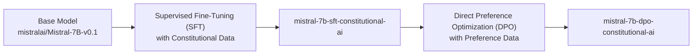
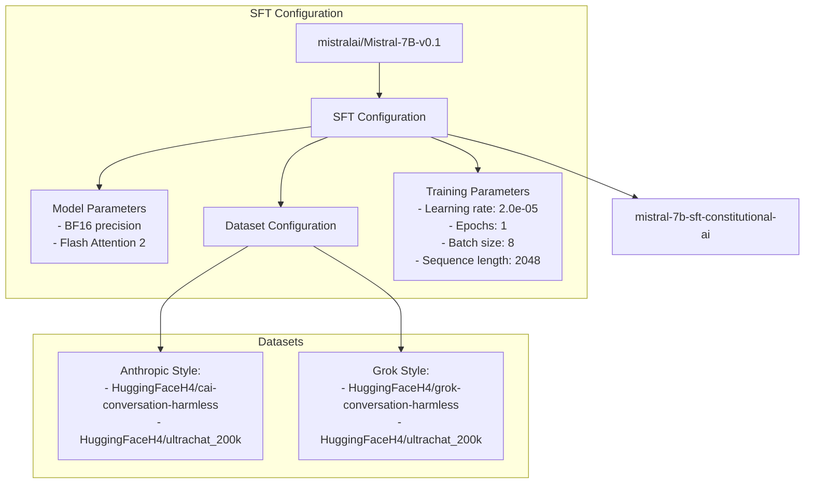
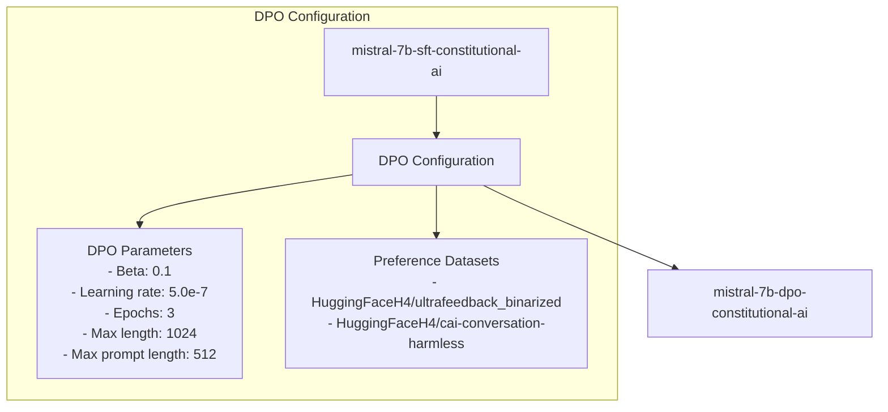
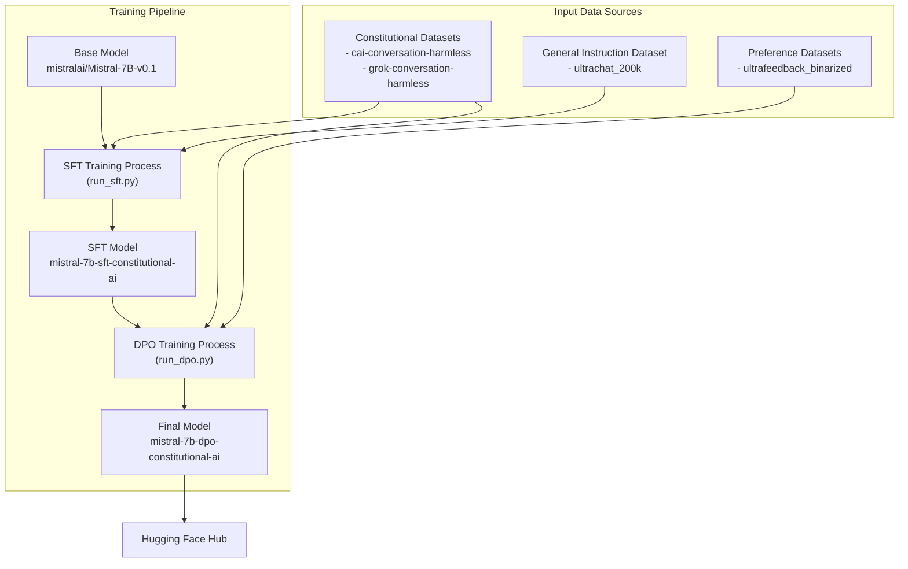

<!-- source: DeepWiki mcp.deepwiki.com · repo huggingface/alignment-handbook · page 4.4 Constitutional AI Models · fetched 2026-10-26 -->

# Constitutional AI

<details>
<summary>Relevant source files</summary>

The following files were used as context for generating this wiki page:

- [recipes/constitutional-ai/README.md](recipes/constitutional-ai/README.md)
- [recipes/constitutional-ai/dpo/config_anthropic.yaml](recipes/constitutional-ai/dpo/config_anthropic.yaml)
- [recipes/constitutional-ai/sft/config_anthropic.yaml](recipes/constitutional-ai/sft/config_anthropic.yaml)
- [recipes/constitutional-ai/sft/config_grok.yaml](recipes/constitutional-ai/sft/config_grok.yaml)

</details>


## Purpose and Scope

This document describes the implementation of Constitutional AI (CAI) training recipes within the Alignment Handbook. Constitutional AI is an approach to training language models that aligns them with human values and reduces harmful outputs by using a set of constitutional principles as guidance. The recipes in this section enable the training of models like Mistral-7B with constitutional alignment principles derived from Anthropic and Grok methodologies.

This page focuses specifically on the training recipes and implementation details for constitutional alignment. For other alignment techniques, see [Advanced Alignment Techniques](#3.4) or [Direct Preference Optimization (DPO)](#3.2).

## Constitutional AI Overview

Constitutional AI is a technique developed to align language models with specified principles or values. The approach typically involves:

1. Defining a set of constitutional principles (rules or guidelines)
2. Training models to generate responses that adhere to these principles
3. Using a multi-stage training process that typically involves SFT followed by preference alignment

In the context of the Alignment Handbook, Constitutional AI recipes are implemented as a two-stage process using SFT (Supervised Fine-Tuning) followed by DPO (Direct Preference Optimization).



Sources: [recipes/constitutional-ai/README.md:9-19](), [recipes/constitutional-ai/sft/config_anthropic.yaml:1-5](), [recipes/constitutional-ai/dpo/config_anthropic.yaml:1-2]()

## Model Variants

The Alignment Handbook provides recipes for two main Constitutional AI variants:

1. **Anthropic-style** - Based on principles similar to those used by Anthropic in their Claude models
2. **Grok-style** - Based on principles similar to those used in the Grok model

The key distinction between these variants is in the datasets used during training and the overall style of responses they're designed to generate.

Sources: [recipes/constitutional-ai/README.md:3-7]()

## Training Process

### Hardware Requirements

Training the full Constitutional AI models requires significant computational resources:

```
8 GPUs (80GB VRAM each)
```

The training uses DeepSpeed ZeRO-3 for distributed training to efficiently use these resources.

Sources: [recipes/constitutional-ai/README.md:11-13]()

### Step 1: Supervised Fine-Tuning (SFT)

The first stage of Constitutional AI training is Supervised Fine-Tuning with constitutionally aligned data.



Key components of the SFT configuration:

1. **Base Model**: mistralai/Mistral-7B-v0.1
2. **Custom Chat Template**: Specialized template for formatting conversations with user, system, and assistant roles
3. **Datasets**:
   - For Anthropic variant: `HuggingFaceH4/cai-conversation-harmless` and `HuggingFaceH4/ultrachat_200k`
   - For Grok variant: `HuggingFaceH4/grok-conversation-harmless` and `HuggingFaceH4/ultrachat_200k`

The `cai-conversation-harmless` and `grok-conversation-harmless` datasets contain examples of constitutionally aligned conversations that guide the model toward safe and helpful responses.

Sources: [recipes/constitutional-ai/sft/config_anthropic.yaml](), [recipes/constitutional-ai/sft/config_grok.yaml]()

### Step 2: Direct Preference Optimization (DPO)

The second stage applies Direct Preference Optimization to further align the model using preference data. Note that the Alignment Handbook only provides a DPO recipe for the Anthropic variant, as the Grok variant was found to become "overtrained and too snarky" with DPO.



Key components of the DPO configuration:

1. **Base Model**: The SFT model trained in step 1 (`mistral-7b-sft-constitutional-ai`)
2. **Datasets**:
   - `HuggingFaceH4/ultrafeedback_binarized`: Contains binary preference pairs for general alignment
   - `HuggingFaceH4/cai-conversation-harmless`: Further reinforces constitutional principles
3. **DPO Parameters**:
   - Beta: 0.1 (controls the strength of the KL penalty)
   - Learning rate: 5.0e-7 (much lower than SFT)
   - Longer training (3 epochs vs 1 for SFT)

The DPO step is critical for ensuring the model not only generates responses that follow constitutional principles but also produces outputs that humans would prefer.

Sources: [recipes/constitutional-ai/dpo/config_anthropic.yaml](), [recipes/constitutional-ai/README.md:17-19]()

## Running the Training

The Constitutional AI models can be trained using the following commands:

1. For the SFT stage:
```
ACCELERATE_LOG_LEVEL=info accelerate launch --config_file recipes/accelerate_configs/deepspeed_zero3.yaml scripts/run_sft.py recipes/constitutional-ai/sft/config_{grok,anthropic}.yaml
```

2. For the DPO stage (Anthropic variant only):
```
ACCELERATE_LOG_LEVEL=info accelerate launch --config_file recipes/accelerate_configs/deepspeed_zero3.yaml scripts/run_dpo.py recipes/constitutional-ai/dpo/config_anthropic.yaml
```

The training uses DeepSpeed ZeRO-3 for efficient distributed training across multiple GPUs.

Sources: [recipes/constitutional-ai/README.md:13-18]()

## Custom Dataset Generation

For users who want to create their own constitutional AI datasets, the README mentions an external tool:

```
https://github.com/huggingface/llm-swarm/tree/main/examples/constitutional-ai
```

This tool allows for customization of the constitutional principles and dataset generation process.

Sources: [recipes/constitutional-ai/README.md:22-24]()

## Data Flow Architecture

The following diagram illustrates the data flow through the Constitutional AI training pipeline:



Sources: [recipes/constitutional-ai/sft/config_anthropic.yaml:8-14](), [recipes/constitutional-ai/sft/config_grok.yaml:8-14](), [recipes/constitutional-ai/dpo/config_anthropic.yaml:6-13]()

## Comparison of Configuration Parameters

The following table compares key configuration parameters between SFT and DPO stages:

| Parameter | SFT | DPO |
|-----------|-----|-----|
| Base Model | mistralai/Mistral-7B-v0.1 | mistral-7b-sft-constitutional-ai |
| Learning Rate | 2.0e-05 | 5.0e-7 |
| Batch Size | 8 | 2 |
| Epochs | 1 | 3 |
| Sequence Length | 2048 | 1024 (max_length) |
| Optimizer | (default) | rmsprop |
| Scheduler | cosine | linear |
| Gradient Accumulation | 4 | 1 |

This comparison highlights the more conservative training approach used in the DPO stage, with a much lower learning rate and different optimizer to ensure stable preference learning.

Sources: [recipes/constitutional-ai/sft/config_anthropic.yaml:17-48](), [recipes/constitutional-ai/dpo/config_anthropic.yaml:15-41]()

## Summary

The Constitutional AI recipes in the Alignment Handbook provide a comprehensive approach to training language models with built-in constitutional principles. The two-stage process (SFT followed by DPO) results in models that not only generate responses aligned with specified principles but also produce outputs that humans would prefer. The provided recipes enable the training of two variants (Anthropic and Grok style), with customizable options for researchers and practitioners interested in constitutional alignment.

---

