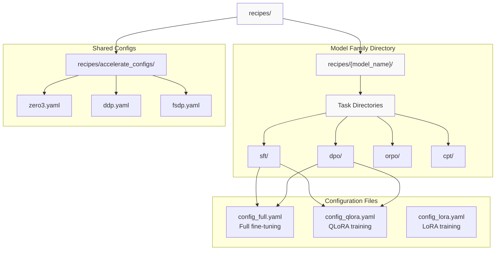
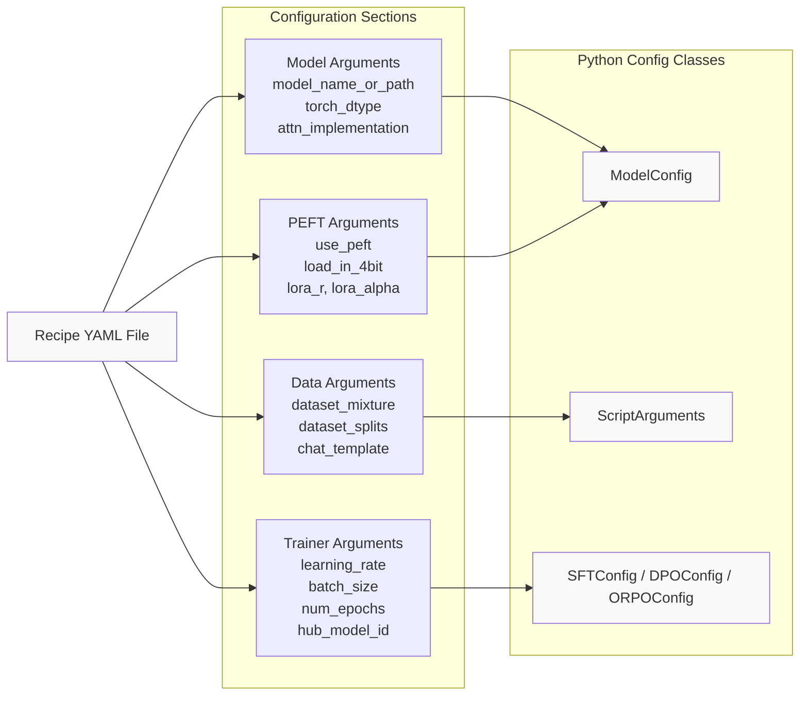
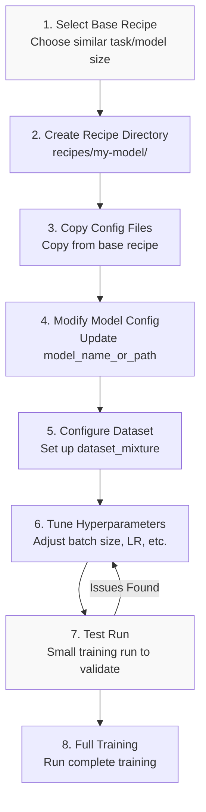
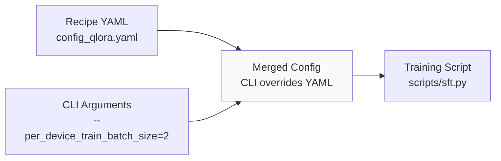

<!-- source: DeepWiki mcp.deepwiki.com · repo huggingface/alignment-handbook · page 4.5 Creating Custom Recipes · fetched 2026-10-26 -->

# Creating Custom Recipes

<details>
<summary>Relevant source files</summary>

The following files were used as context for generating this wiki page:

- [recipes/zephyr-7b-beta/README.md](recipes/zephyr-7b-beta/README.md)
- [recipes/zephyr-7b-beta/dpo/config_qlora.yaml](recipes/zephyr-7b-beta/dpo/config_qlora.yaml)
- [recipes/zephyr-7b-beta/sft/config_qlora.yaml](recipes/zephyr-7b-beta/sft/config_qlora.yaml)
- [scripts/README.md](scripts/README.md)

</details>


## Purpose and Scope

This page provides a comprehensive guide for creating custom training recipes for your own models and datasets. A recipe in the Alignment Handbook is a YAML configuration file that specifies all parameters needed to train a model, including model selection, dataset configuration, training hyperparameters, and distributed training settings.

For information about using existing pre-built recipes, see [Model Training Recipes](#4). For details on the configuration system's internal architecture, see [Configuration System](#2.1). For advanced dataset mixing strategies, see [Dataset Mixing and Weighting](#6.1).

---

## Recipe Structure and Organization

Recipes are organized in the `recipes/` directory following a hierarchical structure:



**Directory Structure:**
- `recipes/{model_name}/`: Top-level directory for a model family (e.g., `zephyr-7b-beta`, `smollm2`)
- `recipes/{model_name}/{task}/`: Task-specific subdirectories (`sft`, `dpo`, `orpo`, `cpt`)
- `recipes/{model_name}/{task}/config_{precision}.yaml`: Configuration files for different training modes
- `recipes/accelerate_configs/`: Shared distributed training configurations

Sources: [scripts/README.md:37-76](), [recipes/zephyr-7b-beta/README.md:1-45]()

---

## Anatomy of a Recipe Configuration

A recipe configuration file consists of several major sections, each corresponding to different aspects of the training process:



Sources: [recipes/zephyr-7b-beta/sft/config_qlora.yaml:1-71](), [recipes/zephyr-7b-beta/dpo/config_qlora.yaml:1-57]()

### Model Configuration

Model configuration parameters control which base model to load and how to instantiate it:

| Parameter | Description | Example Values |
|-----------|-------------|----------------|
| `model_name_or_path` | HuggingFace Hub model ID or local path | `mistralai/Mistral-7B-v0.1` |
| `model_revision` | Git revision/branch to load | `main`, `v1.0` |
| `torch_dtype` | Data type for model weights | `bfloat16`, `float16`, `float32` |
| `attn_implementation` | Attention implementation | `flash_attention_2`, `sdpa`, `eager` |

**Example:**
```yaml
# Model arguments
model_name_or_path: mistralai/Mistral-7B-v0.1
model_revision: main
torch_dtype: bfloat16
attn_implementation: flash_attention_2
```

Sources: [recipes/zephyr-7b-beta/sft/config_qlora.yaml:1-5]()

### Parameter-Efficient Fine-Tuning Configuration

For LoRA or QLoRA training, specify PEFT parameters:

| Parameter | Description | Typical Values |
|-----------|-------------|----------------|
| `use_peft` | Enable PEFT training | `true` / `false` |
| `load_in_4bit` | Enable 4-bit quantization (QLoRA) | `true` / `false` |
| `lora_r` | LoRA rank | 16 (SFT), 128 (DPO) |
| `lora_alpha` | LoRA scaling factor | Usually equals `lora_r` |
| `lora_dropout` | Dropout rate for LoRA layers | 0.05 |
| `lora_target_modules` | Which modules to apply LoRA to | See below |

**Example:**
```yaml
# LoRA arguments
use_peft: true
load_in_4bit: true
lora_r: 16
lora_alpha: 16
lora_dropout: 0.05
lora_target_modules:
- q_proj
- k_proj
- v_proj
- o_proj
- gate_proj
- up_proj
- down_proj
```

**Target Module Selection:**
- For most decoder models (Mistral, Gemma, Mixtral): Target all linear projections in attention and MLP layers
- Common pattern: `q_proj`, `k_proj`, `v_proj`, `o_proj`, `gate_proj`, `up_proj`, `down_proj`

Sources: [recipes/zephyr-7b-beta/sft/config_qlora.yaml:7-20](), [recipes/zephyr-7b-beta/dpo/config_qlora.yaml:6-19]()

### Dataset Configuration

Dataset configuration has two formats depending on complexity needs:

#### Simple Dataset Mixer (Legacy Format)

For simple single-dataset or basic mixing scenarios:

```yaml
dataset_mixer:
  HuggingFaceH4/ultrafeedback_binarized: 1.0
dataset_splits:
- train_prefs
- test_prefs
```

#### Advanced Dataset Mixture (Recommended Format)

For complex scenarios with multiple datasets, column mapping, and precise control:

```yaml
dataset_mixture:
  datasets:
    - id: HuggingFaceH4/ultrachat_200k
      config: default
      split: train_sft
      columns:
        - messages
      weight: 1.0
    - id: HuggingFaceH4/ultrachat_200k
      config: default
      split: test_sft
      columns:
        - messages
      weight: 1.0
  test_split_size: 1000
  seed: 0
```

**Dataset Configuration Parameters:**

| Parameter | Description |
|-----------|-------------|
| `id` | HuggingFace dataset ID or local path |
| `config` | Dataset configuration name (use `default` if none) |
| `split` | Dataset split to load |
| `columns` | List of columns to retain from dataset |
| `weight` | Sampling weight (0.0-1.0) for this dataset |
| `test_split_size` | Number of examples for test split |
| `seed` | Random seed for shuffling and splitting |

**Chat Template:**
For SFT training, you can specify a custom chat template:

```yaml
chat_template: "\n\n{{ '<|user|>\n' + message['content'] + eos_token }}\n\n{{ '<|assistant|>\n'  + message['content'] + eos_token }}\n\n"
```

Sources: [recipes/zephyr-7b-beta/sft/config_qlora.yaml:22-40](), [recipes/zephyr-7b-beta/dpo/config_qlora.yaml:21-28](), [scripts/README.md:82-116]()

### Training Configuration

Trainer-specific parameters control the optimization process:

#### Common Parameters (All Trainers)

| Parameter | Description | Typical Values |
|-----------|-------------|----------------|
| `bf16` / `fp16` | Enable mixed precision training | `true` |
| `learning_rate` | Peak learning rate | `2e-4` (SFT), `5e-6` (DPO) |
| `num_train_epochs` | Number of training epochs | 1-3 |
| `per_device_train_batch_size` | Batch size per GPU | 2-8 |
| `per_device_eval_batch_size` | Eval batch size per GPU | 8-16 |
| `gradient_accumulation_steps` | Steps to accumulate gradients | 2-8 |
| `gradient_checkpointing` | Enable gradient checkpointing | `true` |
| `lr_scheduler_type` | Learning rate scheduler | `cosine`, `linear` |
| `warmup_ratio` | Warmup proportion | 0.1 |
| `logging_steps` | Steps between logging | 5-10 |
| `eval_strategy` | Evaluation strategy | `steps`, `epoch` |
| `save_strategy` | Save strategy | `steps`, `epoch` |
| `save_steps` | Steps between checkpoints | 100 |
| `seed` | Random seed | 42 |
| `output_dir` | Local output directory | `data/{model}-{task}` |
| `hub_model_id` | HuggingFace Hub model ID | `{username}/{model}-{task}` |
| `push_to_hub` | Push model to Hub | `true` / `false` |

#### Task-Specific Parameters

**For DPO:**
- `beta`: KL penalty coefficient (typically 0.01-0.1)
- `max_length`: Maximum sequence length (typically 1024)
- `max_prompt_length`: Maximum prompt length (typically 512)

**For ORPO:**
- `lambda_param`: Odds ratio weight
- `max_length`: Maximum sequence length
- `max_prompt_length`: Maximum prompt length

**For SFT:**
- `max_seq_length`: Maximum sequence length (typically 2048)
- `packing`: Enable sequence packing (`true` / `false`)

Sources: [recipes/zephyr-7b-beta/sft/config_qlora.yaml:42-71](), [recipes/zephyr-7b-beta/dpo/config_qlora.yaml:30-57]()

---

## Creating a Recipe from Scratch

The recommended workflow for creating a custom recipe:



Sources: [scripts/README.md:82-116]()

### Starting from an Existing Recipe

1. **Choose a base recipe** that matches your use case:
   - For 7B models: Use `zephyr-7b-beta` as a template
   - For small models (<2B): Use `smollm2` as a template
   - For large models (>20B): Use `zephyr-141b-A35b` as a template
   - For code models: Use `starchat2-15b` as a template

2. **Create your recipe directory:**
```bash
mkdir -p recipes/my-custom-model/sft
mkdir -p recipes/my-custom-model/dpo
```

3. **Copy configuration files:**
```bash
cp recipes/zephyr-7b-beta/sft/config_qlora.yaml recipes/my-custom-model/sft/
cp recipes/zephyr-7b-beta/dpo/config_qlora.yaml recipes/my-custom-model/dpo/
```

### Configuring Your Base Model

Update the model configuration section with your base model:

```yaml
# Model arguments
model_name_or_path: your-org/your-base-model-7b
model_revision: main
torch_dtype: bfloat16
attn_implementation: flash_attention_2
```

**Considerations:**
- Ensure your base model architecture is supported (Mistral, Gemma, Llama, etc.)
- Use `flash_attention_2` if your GPU supports it (A100, H100)
- Use `bfloat16` for numerical stability with modern GPUs
- Adjust `model_revision` if you need a specific model version

### Setting Up Your Dataset

**For SFT training**, your dataset must have a `messages` column:

```yaml
dataset_mixture:
  datasets:
    - id: your-org/your-sft-dataset
      config: default
      split: train
      columns:
        - messages
      weight: 1.0
  test_split_size: 1000
  seed: 42
```

**For DPO/ORPO training**, your dataset must have `chosen` and `rejected` columns:

```yaml
dataset_mixer:
  your-org/your-preference-dataset: 1.0
dataset_splits:
- train_prefs
- test_prefs
```

**Multi-Dataset Mixing:**

```yaml
dataset_mixture:
  datasets:
    - id: dataset-1
      split: train
      columns: [messages]
      weight: 0.5  # Use 50% of examples
    - id: dataset-2
      split: train
      columns: [messages]
      weight: 0.3  # Use 30% of examples
    - id: dataset-3
      split: train
      columns: [messages]
      weight: 1.0  # Use 100% of examples
  test_split_size: 2000
  seed: 42
```

Sources: [scripts/README.md:82-116](), [recipes/zephyr-7b-beta/sft/config_qlora.yaml:24-38]()

### Tuning Hyperparameters

Key hyperparameters to adjust based on your hardware and model size:

#### Memory-Constrained Training

For limited GPU memory:
- Reduce `per_device_train_batch_size` to 1 or 2
- Increase `gradient_accumulation_steps` to maintain effective batch size
- Enable `gradient_checkpointing: true`
- Use QLoRA: `load_in_4bit: true`
- Reduce `max_seq_length` or `max_length`

Example for single 24GB GPU:
```yaml
per_device_train_batch_size: 1
gradient_accumulation_steps: 8
gradient_checkpointing: true
load_in_4bit: true
max_seq_length: 1024
```

#### Multi-GPU Training

For multiple GPUs, scale batch size and adjust accumulation:
```yaml
# For 8x80GB GPUs
per_device_train_batch_size: 8
gradient_accumulation_steps: 2
gradient_checkpointing: false
load_in_4bit: false
max_seq_length: 2048
```

**Formula for global batch size:**
```
global_batch_size = num_gpus × per_device_train_batch_size × gradient_accumulation_steps
```

#### Learning Rate Tuning

Common learning rate ranges:
- **SFT full fine-tuning**: `2e-5` to `5e-5`
- **SFT QLoRA**: `1e-4` to `3e-4`
- **DPO full fine-tuning**: `5e-7` to `5e-6`
- **DPO QLoRA**: `5e-6` to `5e-5`

**DPO Beta Parameter:**
- Higher beta (0.1-0.5): Stronger KL constraint, stays closer to reference model
- Lower beta (0.01-0.05): Weaker constraint, more aggressive optimization
- Start with `beta: 0.01` and increase if model becomes unstable

Sources: [scripts/README.md:47-48](), [recipes/zephyr-7b-beta/sft/config_qlora.yaml:42-71](), [recipes/zephyr-7b-beta/dpo/config_qlora.yaml:30-57]()

---

## Runtime Parameter Overrides

All parameters in the YAML config can be overridden at runtime via command-line arguments:



**Basic Override Syntax:**
```bash
accelerate launch --config_file recipes/accelerate_configs/zero3.yaml \
  scripts/sft.py \
  --config recipes/my-model/sft/config_qlora.yaml \
  --per_device_train_batch_size=2 \
  --learning_rate=1e-4 \
  --num_train_epochs=3
```

**Common Override Scenarios:**

**Experiment with different batch sizes:**
```bash
accelerate launch --config_file recipes/accelerate_configs/ddp.yaml \
  scripts/sft.py \
  --config recipes/my-model/sft/config_qlora.yaml \
  --per_device_train_batch_size=4 \
  --gradient_accumulation_steps=4
```

**Quick test run with fewer examples:**
```bash
accelerate launch --config_file recipes/accelerate_configs/ddp.yaml \
  scripts/sft.py \
  --config recipes/my-model/sft/config_qlora.yaml \
  --max_steps=100 \
  --push_to_hub=false
```

**Hyperparameter sweep for DPO beta:**
```bash
for beta in 0.01 0.05 0.1; do
  accelerate launch --config_file recipes/accelerate_configs/zero3.yaml \
    scripts/dpo.py \
    --config recipes/my-model/dpo/config_full.yaml \
    --beta=$beta \
    --hub_model_id=my-model-dpo-beta-${beta}
done
```

**Using Slurm with overrides:**
```bash
sbatch --job-name=my-sft --nodes=1 recipes/launch.slurm \
  my-custom-model sft qlora ddp \
  '--per_device_train_batch_size=8 --learning_rate=2e-4'
```

Sources: [scripts/README.md:49-54](), [scripts/README.md:71-76]()

---

## Recipe Naming Conventions

Follow these conventions for consistency and discoverability:

### Directory Naming

```
recipes/
├── {model-base-name}/              # e.g., zephyr-7b-beta, smollm2, my-model-7b
│   ├── sft/
│   │   ├── config_full.yaml        # Full fine-tuning configuration
│   │   ├── config_qlora.yaml       # QLoRA configuration
│   │   └── config_lora.yaml        # LoRA configuration (optional)
│   ├── dpo/
│   │   ├── config_full.yaml
│   │   └── config_qlora.yaml
│   └── orpo/                       # Optional: if using ORPO
│       └── config_full.yaml
```

### Model Naming on Hub

Use descriptive names that indicate the training stage:

```yaml
# SFT stage
hub_model_id: your-username/my-model-7b-sft-qlora

# DPO stage
hub_model_id: your-username/my-model-7b-dpo-qlora

# ORPO stage
hub_model_id: your-username/my-model-7b-orpo
```

### Output Directory Naming

Keep local outputs organized:

```yaml
# SFT
output_dir: data/my-model-7b-sft-qlora

# DPO
output_dir: data/my-model-7b-dpo-qlora
```

Sources: [recipes/zephyr-7b-beta/sft/config_qlora.yaml:50-60](), [recipes/zephyr-7b-beta/dpo/config_qlora.yaml:40-49]()

---

## Best Practices

### Configuration Management

1. **Version Control Your Recipes**: Keep recipes in git to track configuration evolution
   ```bash
   git add recipes/my-model/
   git commit -m "Add initial SFT recipe for my-model"
   ```

2. **Document Experiments**: Add comments in YAML to explain non-standard choices
   ```yaml
   # Using higher learning rate due to smaller dataset size
   learning_rate: 3e-4
   
   # Increased beta after observing reward hacking in initial runs
   beta: 0.05
   ```

3. **Create README Files**: Add `recipes/my-model/README.md` with training notes
   ```markdown
   # My Custom Model
   
   Training notes:
   - Base model: org/model-7b
   - SFT dataset: Custom instruction dataset (10k examples)
   - DPO dataset: Preference pairs from GPT-4 annotations
   - Hardware: 2x A100 80GB
   ```

### Testing Strategy

1. **Start Small**: Test with `max_steps=100` before full training
   ```bash
   accelerate launch scripts/sft.py \
     --config recipes/my-model/sft/config_qlora.yaml \
     --max_steps=100 \
     --push_to_hub=false
   ```

2. **Validate Dataset Loading**: Check dataset format before training
   ```python
   from datasets import load_dataset
   ds = load_dataset("your-org/your-dataset", split="train")
   print(ds[0])  # Verify 'messages' or 'chosen'/'rejected' columns exist
   ```

3. **Monitor First Epoch**: Watch training metrics closely in the first epoch
   - Loss should decrease steadily
   - Gradient norms should be stable
   - Memory usage should be consistent

### Hardware Optimization

**Match Configuration to Hardware:**

| Hardware | Recommended Config | Training Method |
|----------|-------------------|-----------------|
| 1x RTX 4090 (24GB) | `config_qlora.yaml` | QLoRA with small batch size |
| 2x A6000 (48GB) | `config_qlora.yaml` + FSDP | QLoRA with FSDP |
| 8x A100 (80GB) | `config_full.yaml` | Full fine-tuning with ZeRO-3 |
| >8x GPUs | `config_full.yaml` + FSDP | FSDP for very large models |

**Accelerate Config Selection:**
```bash
# Single GPU
accelerate launch --config_file recipes/accelerate_configs/ddp.yaml --num_processes=1

# 2-8 GPUs with QLoRA or full training
accelerate launch --config_file recipes/accelerate_configs/zero3.yaml

# Very large models (Mixtral 8x22B)
accelerate launch --config_file recipes/accelerate_configs/fsdp.yaml
```

### Dataset Preparation

1. **Validate Column Names**: Ensure your dataset has the expected columns
   - SFT: `messages`
   - DPO/ORPO: `chosen`, `rejected`

2. **Check Message Format**: Each message should be a dict with `role` and `content`
   ```python
   {
     "messages": [
       {"role": "user", "content": "Hello!"},
       {"role": "assistant", "content": "Hi! How can I help?"}
     ]
   }
   ```

3. **Balance Dataset Mixtures**: When mixing datasets, consider relative sizes
   ```yaml
   # If dataset-1 has 10k examples and dataset-2 has 100k examples
   datasets:
     - id: dataset-1
       weight: 1.0    # Use all 10k examples
     - id: dataset-2
       weight: 0.1    # Use 10k examples from dataset-2
   ```

### Reproducibility

1. **Set Seeds Consistently**: Use the same seed across runs
   ```yaml
   seed: 42
   ```

2. **Pin Dataset Seeds**: Set seed in dataset_mixture
   ```yaml
   dataset_mixture:
     datasets: [...]
     seed: 42  # Ensures consistent shuffling/splitting
   ```

3. **Document Environment**: Track key versions
   ```yaml
   # Add as comment in recipe
   # Environment: transformers==4.36.0, trl==0.7.4, torch==2.1.0
   ```

### Monitoring and Logging

1. **Enable Weights & Biases**: Track experiments systematically
   ```bash
   accelerate launch scripts/sft.py \
     --config recipes/my-model/sft/config_qlora.yaml \
     --report_to=wandb \
     --run_name="my-model-sft-lr2e4"
   ```

2. **Set Appropriate Logging Frequency**:
   ```yaml
   logging_steps: 10       # Log every 10 steps
   eval_steps: 100        # Evaluate every 100 steps
   save_steps: 100        # Save checkpoint every 100 steps
   ```

3. **Monitor Key Metrics**:
   - Training loss: Should decrease steadily
   - Evaluation loss: Should track training loss
   - Learning rate: Should follow scheduler curve
   - Gradient norm: Should remain stable

Sources: [scripts/README.md:56-61](), [scripts/README.md:1-142]()

---

