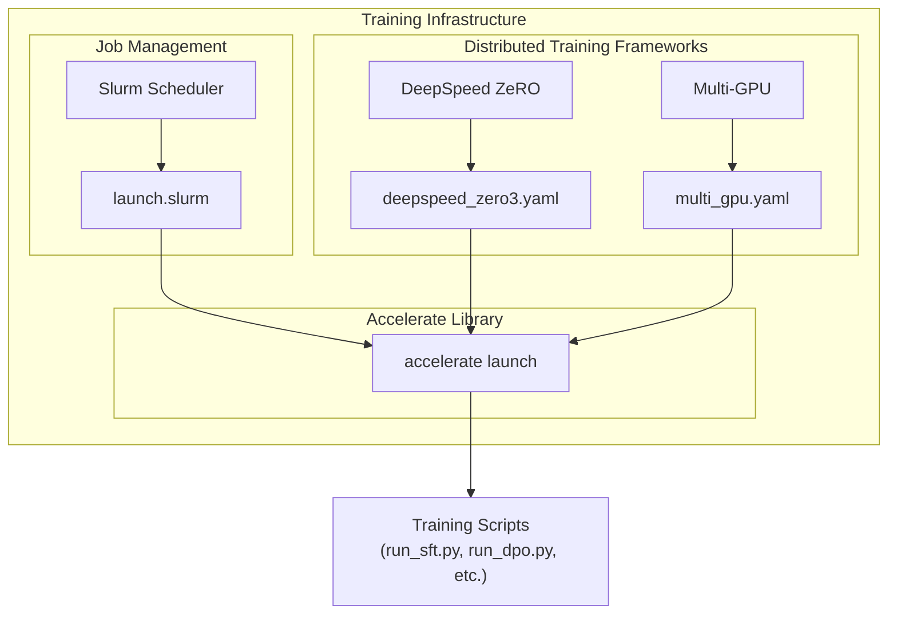
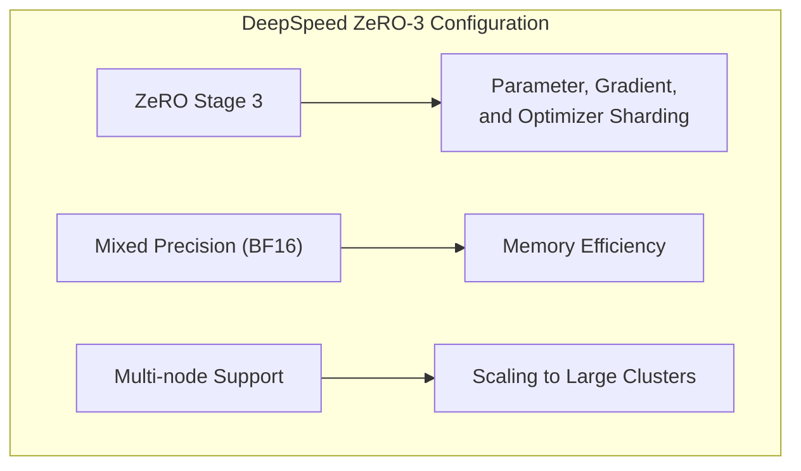
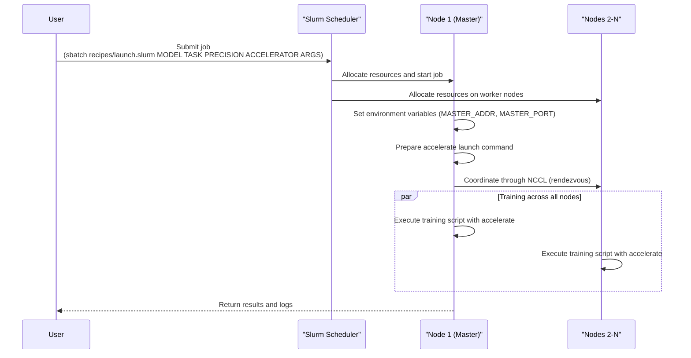
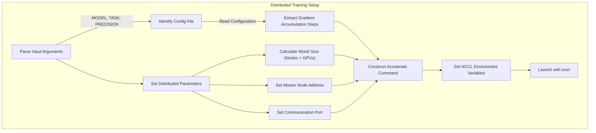
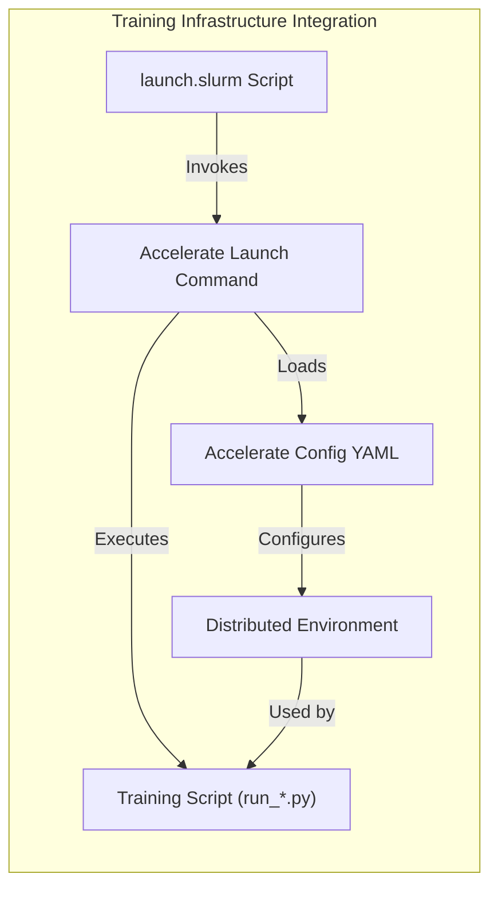

<!-- source: DeepWiki mcp.deepwiki.com · repo huggingface/alignment-handbook · page 5 Training Infrastructure · fetched 2026-10-26 -->

# Training Infrastructure

<details>
<summary>Relevant source files</summary>

The following files were used as context for generating this wiki page:

- [recipes/launch.slurm](recipes/launch.slurm)
- [scripts/README.md](scripts/README.md)

</details>


This page provides an overview of the distributed training infrastructure used in the Alignment Handbook to efficiently train and align large language models across multiple GPUs and nodes. The infrastructure components include distributed training frameworks like DeepSpeed ZeRO and multi-GPU configurations, along with Slurm-based job submission for high-performance computing (HPC) clusters.

For detailed instructions on specific distributed training configurations, see [Distributed Training Configurations](#5.1), and for Slurm-specific workflows, see [Slurm Workflow](#5.2).

## Components of Training Infrastructure

The Alignment Handbook provides infrastructure to support efficient training of large language models across various compute configurations:



Sources: [recipes/launch.slurm](), [recipes/accelerate_configs/deepspeed_zero3.yaml](), [recipes/accelerate_configs/multi_gpu.yaml]()

## Distributed Training Configurations

The Alignment Handbook supports multiple distributed training approaches through Hugging Face's Accelerate library. These configurations are stored as YAML files in the `recipes/accelerate_configs/` directory.

### DeepSpeed ZeRO-3

DeepSpeed with ZeRO-3 (Zero Redundancy Optimizer) is used for large model training, enabling efficient memory usage by sharding optimizer states, gradients, and model parameters across multiple GPUs.

Key features of the DeepSpeed ZeRO-3 configuration:
- Full model sharding (ZeRO stage 3)
- BF16 mixed precision training
- Support for multi-node training
- Model parameters saved in 16-bit precision for efficiency



Sources: [recipes/accelerate_configs/deepspeed_zero3.yaml]()

### Multi-GPU Configuration

For smaller models or single-node setups, the Alignment Handbook provides a standard multi-GPU configuration using PyTorch's native distributed capabilities.

Key features of the multi-GPU configuration:
- BF16 mixed precision training
- Simplified setup without DeepSpeed complexity
- Automatically uses all available GPUs on a node

Sources: [recipes/accelerate_configs/multi_gpu.yaml]()

## Slurm-Based Training Workflow

For training on HPC clusters, the Alignment Handbook includes a Slurm job script that handles distributed training across multiple nodes.



Sources: [recipes/launch.slurm]()

### Slurm Job Configuration

The `launch.slurm` script is the entry point for submitting distributed training jobs to a Slurm cluster. It accepts the following parameters:

1. `MODEL` - The model recipe to use (corresponds to a subdirectory in `recipes/`)
2. `TASK` - The training task (sft, dpo, cpt, etc.)
3. `PRECISION` - Precision configuration to use
4. `ACCELERATOR` - The accelerator configuration (deepspeed_zero3, multi_gpu, etc.)
5. `OPTIONAL_ARGS` - Additional arguments to pass to the training script

Example usage:
```bash
sbatch recipes/launch.slurm zephyr sft bf16 deepspeed_zero3 "--output_dir=/path/to/output"
```

The script automatically:
- Determines the number of nodes and GPUs
- Sets up the distributed environment (master address, port, etc.)
- Configures NCCL for efficient communication
- Launches the training across all allocated nodes using Slurm's `srun`

Sources: [recipes/launch.slurm:15-19](), [recipes/launch.slurm:79-84]()

### Distributed Environment Configuration

The script performs several important configuration steps to ensure efficient distributed training:



Key environment configurations:
- NCCL asynchronous error handling (`NCCL_ASYNC_ERROR_HANDLING=1`)
- Appropriate CUDA modules loaded
- BF16 mixed precision for most configurations

Sources: [recipes/launch.slurm:21-44](), [recipes/launch.slurm:64-74]()

## Integration with Training Scripts

The training infrastructure integrates with the training scripts through the Accelerate library, which abstracts away most of the complexity of distributed training.



The integration works by:
1. The Slurm script builds an Accelerate launch command based on input parameters
2. Accelerate loads the specified configuration (DeepSpeed, multi-GPU, etc.)
3. The training script is executed in the distributed environment
4. Each GPU processes its portion of the data and model, coordinating through NCCL

Sources: [recipes/launch.slurm:46-62]()

## Choosing the Right Configuration

The Alignment Handbook provides flexibility in choosing the appropriate configuration based on model size and available hardware:

| Configuration | Best For | Key Advantages | Limitations |
|---------------|----------|----------------|-------------|
| DeepSpeed ZeRO-3 | Large models (>7B parameters) | Memory-efficient, supports largest models | More complex, potential overhead |
| Multi-GPU | Smaller models, single node | Simpler setup, less overhead | Limited by GPU memory capacity |

For most alignment tasks with models 7B and larger, the DeepSpeed ZeRO-3 configuration is recommended due to its memory efficiency and ability to scale to very large models.

Sources: [recipes/accelerate_configs/deepspeed_zero3.yaml](), [recipes/accelerate_configs/multi_gpu.yaml]()

---

