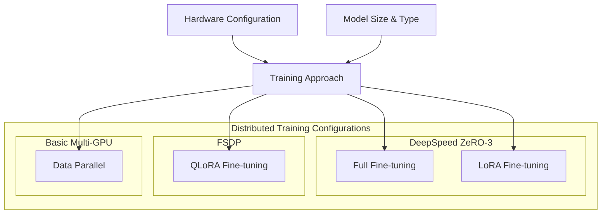
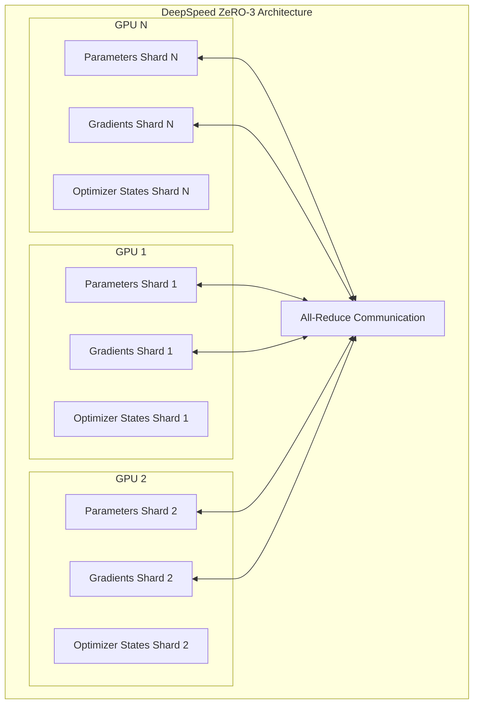
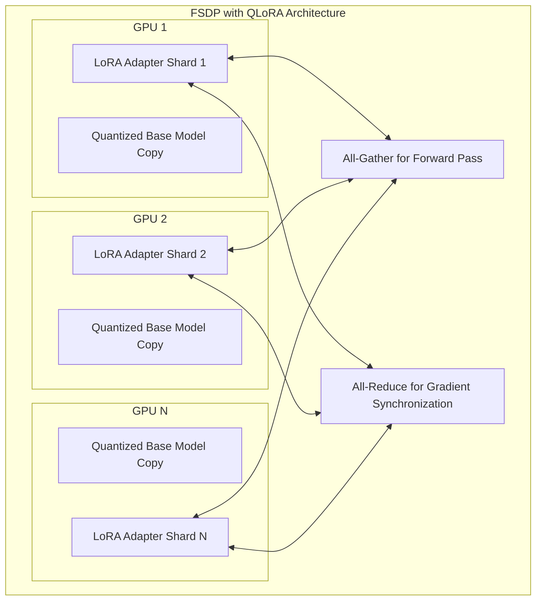
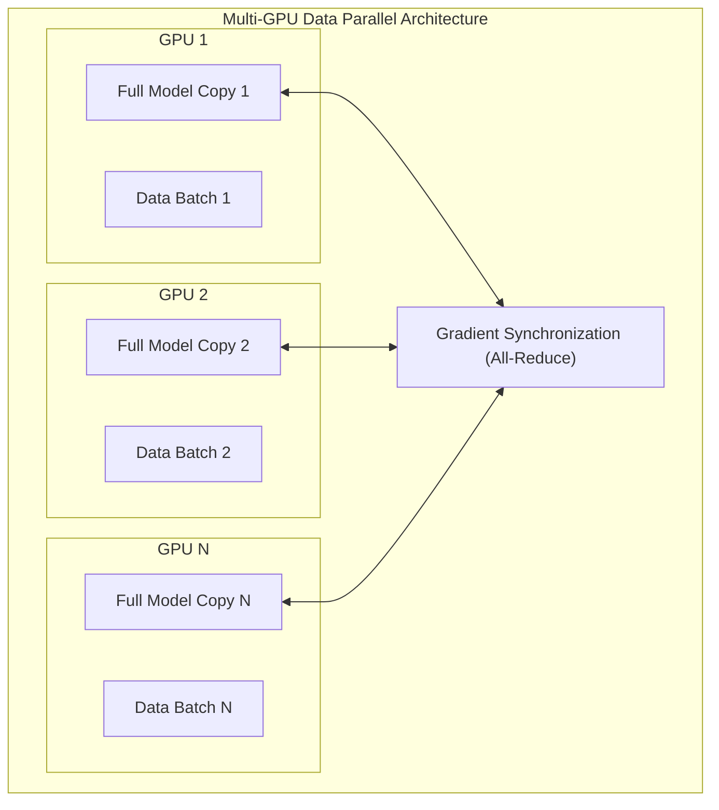
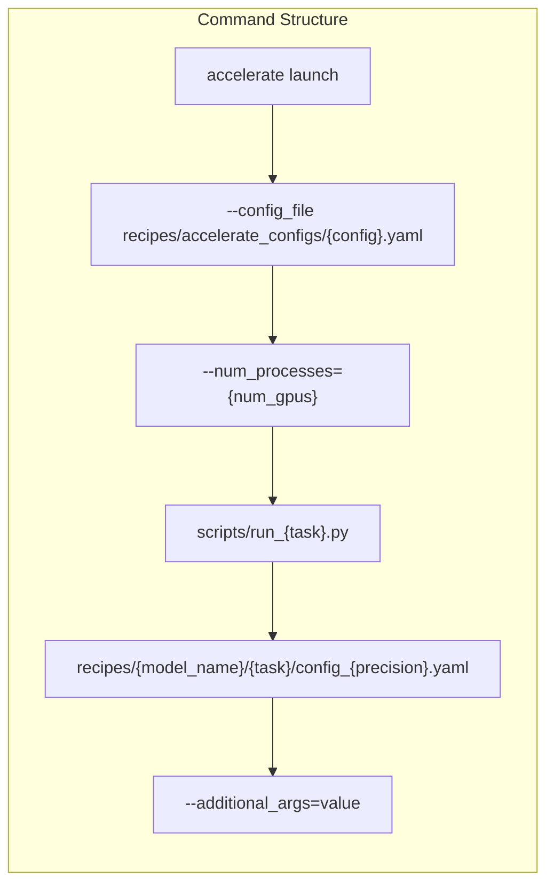
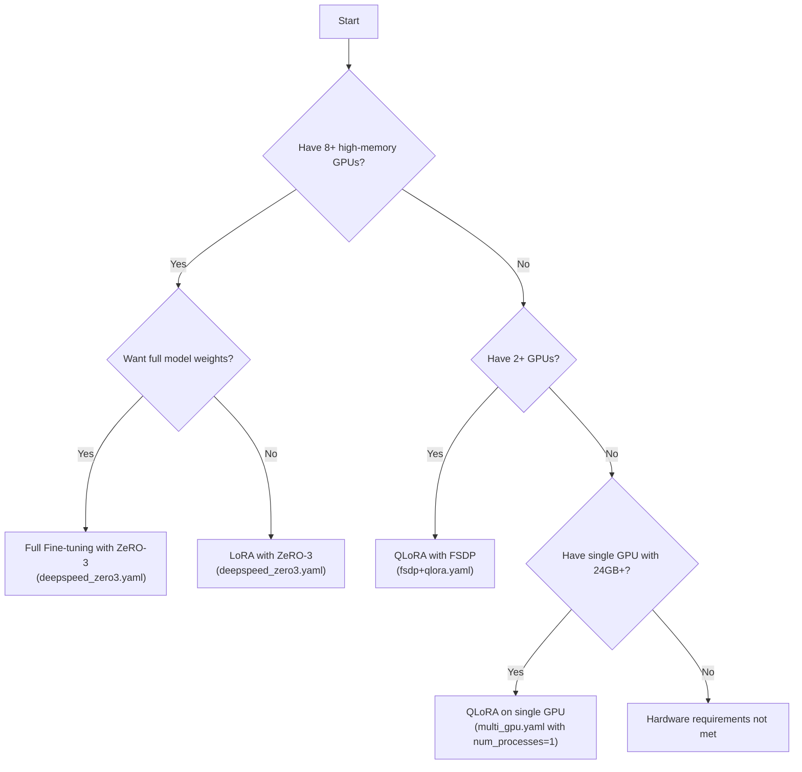

<!-- source: DeepWiki mcp.deepwiki.com · repo huggingface/alignment-handbook · page 5.1 Distributed Training Configurations · fetched 2026-10-26 -->

# Distributed Training Configurations

<details>
<summary>Relevant source files</summary>

The following files were used as context for generating this wiki page:

- [recipes/accelerate_configs/fsdp.yaml](recipes/accelerate_configs/fsdp.yaml)
- [recipes/starchat2-15b/README.md](recipes/starchat2-15b/README.md)
- [recipes/zephyr-141b-A35b/README.md](recipes/zephyr-141b-A35b/README.md)
- [recipes/zephyr-141b-A35b/orpo/config_full.yaml](recipes/zephyr-141b-A35b/orpo/config_full.yaml)
- [scripts/README.md](scripts/README.md)

</details>


## Purpose and Scope

This page documents the distributed training configurations available in the alignment-handbook framework for training large language models (LLMs) across multiple GPUs or nodes. These configurations enable efficient training of models that would otherwise be too large to fit on a single GPU. For information on how to submit jobs to a Slurm cluster, see [Slurm Workflow](#5.2).

## Supported Distributed Training Methods

The alignment-handbook supports four primary distributed training configurations, each optimized for different hardware setups and model sizes:

1. **Full fine-tuning with DeepSpeed ZeRO-3**: For training full models across multiple high-memory GPUs
2. **LoRA training with DeepSpeed ZeRO-3**: For parameter-efficient training across multiple GPUs
3. **QLoRA training with FSDP**: For quantized parameter-efficient training with Fully Sharded Data Parallel
4. **Single/Multi-GPU training**: For standard training without advanced sharding



Sources: [scripts/README.md:5-10]()

### Comparison of Distributed Training Methods

| Training Method | Configuration File | Suitable Hardware | Memory Efficiency | Training Speed | Use Case |
|-----------------|-------------------|-------------------|-------------------|---------------|----------|
| Full Fine-tuning with ZeRO-3 | deepspeed_zero3.yaml | 8 x A100 (80GB) | Medium | High | When full model weights are needed |
| LoRA with ZeRO-3 | deepspeed_zero3.yaml | 2+ x A100 (80GB) | High | Medium-High | Efficient multi-GPU training with adapters |
| QLoRA with FSDP | fsdp+qlora.yaml | 2+ x A6000 (48GB) | Very High | Medium | Maximum memory efficiency with sharded training |
| Single/Multi-GPU | multi_gpu.yaml | 1+ GPUs (24GB+) | Low | High | Simple setups without advanced sharding |

Sources: [scripts/README.md:7-10](), [scripts/README.md:15-28]()

## DeepSpeed ZeRO-3 Configuration

DeepSpeed ZeRO-3 (Zero Redundancy Optimizer Stage 3) shards model parameters, gradients, and optimizer states across GPUs, dramatically reducing memory requirements while maintaining training efficiency.

### Configuration Details

The `deepspeed_zero3.yaml` configuration file defines the ZeRO-3 setup:

```yaml
compute_environment: LOCAL_MACHINE
debug: false
deepspeed_config:
  deepspeed_multinode_launcher: standard
  offload_optimizer_device: none
  offload_param_device: none
  zero3_init_flag: true
  zero3_save_16bit_model: true
  zero_stage: 3
distributed_type: DEEPSPEED
mixed_precision: bf16
num_processes: 8
```

Key settings in this configuration:
- `zero_stage: 3`: Enables full sharding of parameters, gradients, and optimizer states
- `zero3_save_16bit_model: true`: Consolidates and saves 16-bit model weights after training
- `mixed_precision: bf16`: Uses bfloat16 precision for better numerical stability than fp16
- No offloading to CPU or NVMe is configured, keeping all data on GPU for speed

Sources: [recipes/accelerate_configs/deepspeed_zero3.yaml:1-23]()

### Architecture



Sources: [recipes/accelerate_configs/deepspeed_zero3.yaml:1-23]()

### Usage Examples

For full fine-tuning with DeepSpeed ZeRO-3:

```bash
ACCELERATE_LOG_LEVEL=info accelerate launch --config_file recipes/accelerate_configs/deepspeed_zero3.yaml scripts/run_sft.py recipes/{model_name}/sft/config_full.yaml
```

For LoRA fine-tuning with DeepSpeed ZeRO-3:

```bash
ACCELERATE_LOG_LEVEL=info accelerate launch --config_file recipes/accelerate_configs/deepspeed_zero3.yaml --num_processes={num_gpus} scripts/run_sft.py recipes/{model_name}/sft/config_qlora.yaml --load_in_4bit=false
```

Sources: [scripts/README.md:15-16](), [scripts/README.md:24-25]()

## FSDP (Fully Sharded Data Parallel) Configuration

FSDP is PyTorch's native implementation of model sharding, similar to DeepSpeed ZeRO-3 but with deeper PyTorch integration. In the alignment-handbook, it's primarily used with QLoRA for training quantized models.

### Architecture



### Usage Example

```bash
ACCELERATE_LOG_LEVEL=info accelerate launch --config_file recipes/accelerate_configs/fsdp+qlora.yaml --num_processes={num_gpus} scripts/run_sft.py recipes/{model_name}/sft/config_qlora.yaml --torch_dtype=bfloat16 --bnb_4bit_quant_storage=bfloat16
```

Sources: [scripts/README.md:27-28]()

## Multi-GPU Training

The `multi_gpu.yaml` configuration provides a simpler distributed training setup without advanced sharding techniques. It uses PyTorch's DistributedDataParallel (DDP) approach where each GPU has a complete copy of the model.

### Configuration Details

```yaml
compute_environment: LOCAL_MACHINE
debug: false
distributed_type: MULTI_GPU
downcast_bf16: 'no'
gpu_ids: all
mixed_precision: bf16
num_processes: 8
```

Key settings:
- `distributed_type: MULTI_GPU`: Uses standard PyTorch DDP
- `mixed_precision: bf16`: Uses bfloat16 mixed precision
- `gpu_ids: all`: Uses all available GPUs

Sources: [recipes/accelerate_configs/multi_gpu.yaml:1-17]()

### Architecture



### Usage Example

For single GPU training:

```bash
ACCELERATE_LOG_LEVEL=info accelerate launch --config_file recipes/accelerate_configs/multi_gpu.yaml --num_processes=1 scripts/run_sft.py recipes/{model_name}/sft/config_qlora.yaml
```

Sources: [scripts/README.md:19-20]()

## Integration with Training Scripts

The distributed configurations integrate with the training scripts through the Accelerate library. The complete command structure follows this pattern:



Sources: [scripts/README.md:15-28]()

## Scaling Considerations

When adjusting the number of GPUs, it's important to maintain the same global batch size to replicate results. This can be done by scaling either the per-device batch size or the number of gradient accumulation steps.

Global Batch Size Formula:
```
Global Batch Size = Per Device Batch Size × Number of GPUs × Gradient Accumulation Steps
```

Example: If the original configuration uses 8 GPUs with a per-device batch size of 2 and 4 gradient accumulation steps (global batch size = 64), and you reduce to 4 GPUs, you could:
- Increase per-device batch size to 4, keeping gradient accumulation at 4 (4×4×4=64)
- OR keep per-device batch size at 2 and increase gradient accumulation to 8 (2×4×8=64)

Sources: [scripts/README.md:47-48]()

## Configuration Selection Guide

To choose the appropriate distributed training configuration:



Sources: [scripts/README.md:7-10](), [scripts/README.md:15-28]()

## Conclusion

The alignment-handbook provides flexible distributed training configurations to accommodate various hardware setups and model sizes. By choosing the appropriate configuration, you can efficiently train and align large language models across multiple GPUs or nodes, balancing memory constraints with training speed.

For information on using these configurations within a Slurm environment, see the [Slurm Workflow](#5.2) page.

---

