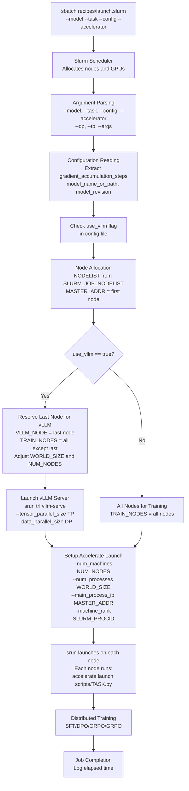
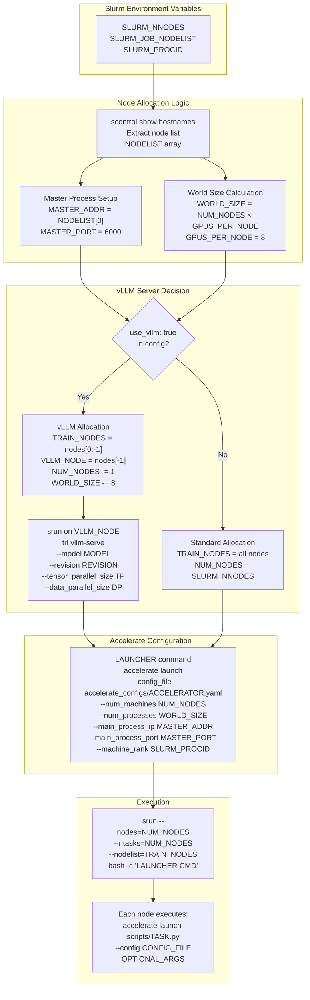
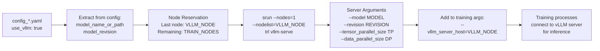
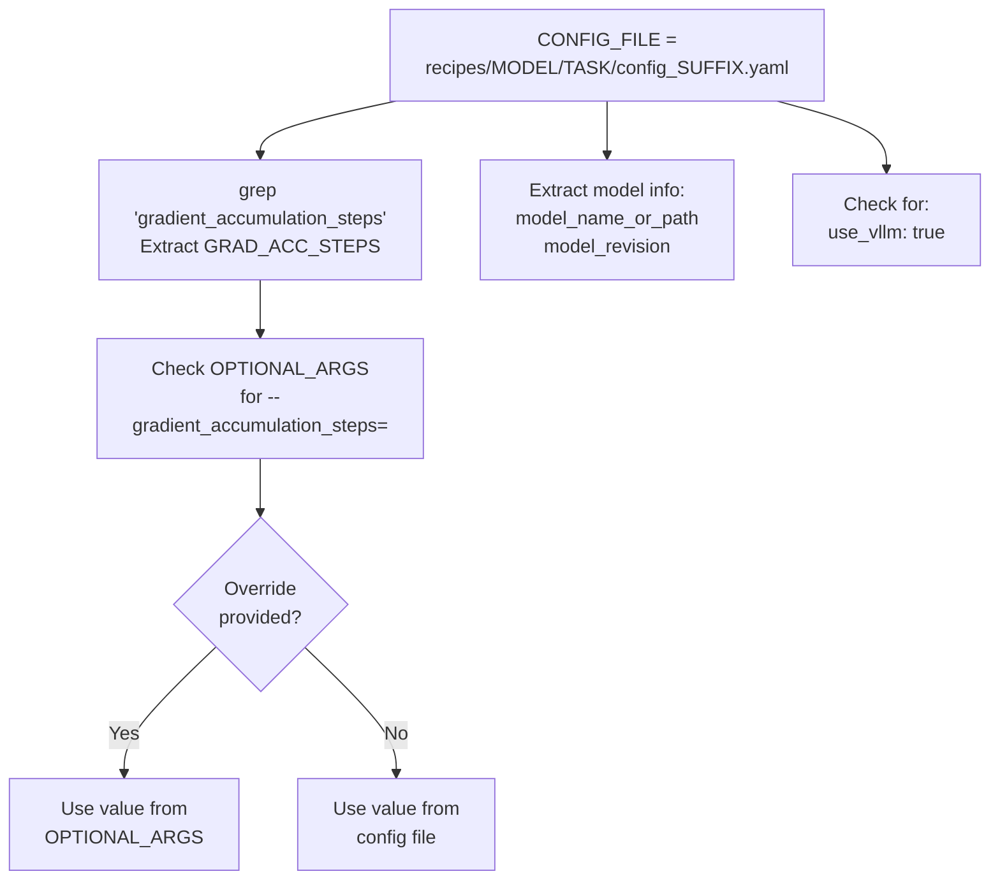

<!-- source: DeepWiki mcp.deepwiki.com · repo huggingface/alignment-handbook · page 5.2 Slurm Cluster Deployment · fetched 2026-10-26 -->

# Slurm Cluster Deployment

<details>
<summary>Relevant source files</summary>

The following files were used as context for generating this wiki page:

- [recipes/launch.slurm](recipes/launch.slurm)

</details>


## Purpose and Scope

This page provides a comprehensive guide to deploying training jobs on Slurm-managed HPC clusters using the `recipes/launch.slurm` script. This script orchestrates multi-node distributed training, handles node allocation, configures vLLM servers for online methods (GRPO/PPO), and manages the communication setup between distributed processes.

For information about distributed training strategies (DeepSpeed ZeRO-3, FSDP, DDP), see [Distributed Training Configurations](#5.1). For hardware requirements and memory considerations, see [Resource Requirements and Hardware](#5.3). For understanding the recipes that this script launches, see [Model Training Recipes](#4).

---

## Overview

The Slurm deployment system provides a unified interface for launching distributed training jobs across HPC clusters. The `launch.slurm` script serves as an orchestration layer that:

1. Manages Slurm resource allocation (nodes, GPUs, job scheduling)
2. Configures distributed training parameters for Accelerate
3. Optionally deploys vLLM inference servers for online RL methods
4. Sets up inter-node communication (NCCL, distributed backends)
5. Handles job requeuing, error recovery, and logging

The script abstracts away cluster-specific details while providing flexibility through command-line arguments and configuration file overrides.

**Sources:** [recipes/launch.slurm:1-177]()

---

## Slurm Script Architecture

The following diagram illustrates the execution flow from job submission to distributed training:



**Sources:** [recipes/launch.slurm:1-177]()

---

## Command-Line Interface

The `launch.slurm` script accepts the following command-line arguments:

| Argument | Required | Description | Example |
|----------|----------|-------------|---------|
| `--model` | Yes | Model family name (must match directory in `recipes/`) | `zephyr-7b-beta` |
| `--task` | Yes | Training task (must match script in `scripts/`) | `sft`, `dpo`, `orpo`, `grpo` |
| `--config` | Yes | Configuration suffix for the YAML file | `demo`, `v00.00`, `full` |
| `--accelerator` | Yes | Accelerate config name (must exist in `recipes/accelerate_configs/`) | `zero3`, `fsdp`, `ddp` |
| `--dp` | No | Data parallelism for vLLM server (default: 1) | `1`, `2`, `4` |
| `--tp` | No | Tensor parallelism for vLLM server (default: 1) | `1`, `2`, `4`, `8` |
| `--args` | No | Optional arguments to override config file parameters | `"--learning_rate=1e-5 --num_train_epochs=2"` |

The script constructs the configuration file path as: `recipes/$MODEL/$TASK/config_$CONFIG.yaml`

**Sources:** [recipes/launch.slurm:12-87]()

### Help and Validation

```bash
# Display help information
sbatch recipes/launch.slurm --help

# The script validates that all required arguments are provided
# and exits with an error message if any are missing
```

**Sources:** [recipes/launch.slurm:12-23](), [recipes/launch.slurm:82-87]()

---

## SBATCH Directives

The script includes Slurm directives that control job allocation and behavior:

```bash
#SBATCH --job-name=handbook          # Job name appears in squeue
#SBATCH --ntasks-per-node=1          # One task per node (each launches 8 GPU processes)
#SBATCH --exclusive                  # Exclusive node access
#SBATCH --gres=gpu:8                 # Request 8 GPUs per node
#SBATCH --partition=hopper-prod      # Target partition (adjust for your cluster)
#SBATCH --output=./logs/%x-%j.out    # Standard output log file
#SBATCH --error=./logs/%x-%j.err     # Standard error log file
#SBATCH --requeue                    # Auto-requeue on node failure
#SBATCH --time=3-00:00:00            # 3-day time limit
```

**Customization Notes:**
- Modify `--partition` to match your cluster's partition names
- Adjust `--gres=gpu:8` if your nodes have different GPU counts
- Change `--time` based on expected training duration
- Ensure `./logs/` directory exists before submission

**Sources:** [recipes/launch.slurm:1-10]()

---

## Multi-Node Distributed Configuration

The following diagram shows how the script configures multi-node distributed training:



**Sources:** [recipes/launch.slurm:110-132](), [recipes/launch.slurm:141-155](), [recipes/launch.slurm:159-168]()

### Key Configuration Variables

| Variable | Source | Purpose |
|----------|--------|---------|
| `NUM_NODES` | `$SLURM_NNODES` | Number of allocated nodes |
| `GPUS_PER_NODE` | Hardcoded to 8 | GPUs per node (adjust if needed) |
| `WORLD_SIZE` | `NUM_NODES * GPUS_PER_NODE` | Total number of distributed processes |
| `NODELIST` | `scontrol show hostnames` | Array of node hostnames |
| `MASTER_ADDR` | `NODELIST[0]` | First node serves as master process |
| `MASTER_PORT` | 6000 | Port for inter-node communication |

**Sources:** [recipes/launch.slurm:110-116]()

---

## vLLM Server Deployment for Online RL

For online reinforcement learning methods (GRPO, PPO), the script automatically detects the `use_vllm: true` flag in the configuration file and reserves the last node for running a vLLM inference server.

### vLLM Deployment Flow



**Sources:** [recipes/launch.slurm:106-131]()

### vLLM Configuration Parameters

The `--dp` and `--tp` arguments control parallelism within the vLLM server:

- **Tensor Parallelism (`--tp`)**: Splits model across GPUs on the same node
  - Use TP=8 for large models (70B+) to fit in single-node memory
  - Use TP=4 for medium models (7B-30B) for faster inference
  - Use TP=1 for small models (<7B)

- **Data Parallelism (`--dp`)**: Runs multiple model replicas for higher throughput
  - Use DP=1 for standard training
  - Increase DP if inference becomes a bottleneck

**Example:** For a 70B model, use `--tp 8 --dp 1` to fully utilize 8 GPUs on the vLLM node.

**Sources:** [recipes/launch.slurm:19-20](), [recipes/launch.slurm:128]()

### Node Count Adjustment

When `use_vllm: true`:
```
Original:  NUM_NODES = 4, WORLD_SIZE = 32 (4 nodes × 8 GPUs)
Adjusted:  NUM_NODES = 3, WORLD_SIZE = 24 (3 training nodes × 8 GPUs)
           VLLM_NODE = node[3] (reserved for inference)
```

**Sources:** [recipes/launch.slurm:124-127]()

---

## Configuration File Reading

The script extracts parameters from the specified YAML configuration file:



**Sources:** [recipes/launch.slurm:90-107](), [recipes/launch.slurm:119-121]()

### Gradient Accumulation Override

The script allows overriding `gradient_accumulation_steps` via `--args`:

```bash
sbatch recipes/launch.slurm \
  --model zephyr-7b-beta \
  --task sft \
  --config full \
  --accelerator zero3 \
  --args "--gradient_accumulation_steps=4"
```

This override is necessary because gradient accumulation must be configured in both the Accelerate launcher and the training config. The script ensures consistency by:
1. Reading the default from the config file
2. Checking for overrides in `--args`
3. Passing the final value to `accelerate launch --gradient_accumulation_steps`

**Sources:** [recipes/launch.slurm:91-104](), [recipes/launch.slurm:146]()

---

## Environment Setup

The script includes cluster-specific environment setup:

```bash
# Load CUDA module (adjust version for your cluster)
module load cuda/12.9

# Enable error reporting and command echoing
set -x -e

# Activate Python virtual environment
source ~/.bashrc
source handbook/bin/activate
```

**Customization:**
- Modify `module load` commands to match your cluster's module system
- Update virtual environment path (`handbook/bin/activate`) if different
- Add any cluster-specific environment variables or initialization scripts

**Sources:** [recipes/launch.slurm:26-30]()

---

## NCCL Configuration for Multi-Node Communication

The script configures NCCL (NVIDIA Collective Communications Library) for reliable distributed training:

```bash
# Force immediate error reporting on NCCL issues
export NCCL_ASYNC_ERROR_HANDLING=1

# Optional debugging flags (commented out by default)
# export NCCL_DEBUG=INFO
# export NCCL_DEBUG_SUBSYS=COLL
# export NCCL_SOCKET_NTHREADS=1
# export NCCL_NSOCKS_PERTHREAD=1
# export CUDA_LAUNCH_BLOCKING=1
```

**Sources:** [recipes/launch.slurm:133-139]()

### When to Enable Debugging

Uncomment debugging flags when troubleshooting:

| Issue | Flags to Enable | Purpose |
|-------|----------------|---------|
| Hanging collectives | `NCCL_DEBUG=INFO`, `NCCL_DEBUG_SUBSYS=COLL` | Verbose logging of collective operations |
| Network timeouts | `NCCL_SOCKET_NTHREADS=1`, `NCCL_NSOCKS_PERTHREAD=1` | Force single-threaded sockets |
| Synchronization bugs | `CUDA_LAUNCH_BLOCKING=1` | Synchronous CUDA operations |

---

## Srun Error Handling

The `srun` command includes error handling configuration:

```bash
srun \
  --wait=60 \                    # Wait 60s after first task terminates
  --kill-on-bad-exit=1 \         # Terminate if any task exits with non-zero
  --nodes=$NUM_NODES \
  --ntasks=$NUM_NODES \
  --nodelist=$NODELIST \
  bash -c "$LAUNCHER $CMD"
```

**Sources:** [recipes/launch.slurm:157-168]()

### Error Handling Behavior

- **`--wait=60`**: After the first task terminates, wait 60 seconds before killing remaining tasks. This allows graceful shutdown and log flushing.
- **`--kill-on-bad-exit=1`**: If any node's task exits with a non-zero code, terminate the entire job. This prevents partial failures from consuming resources.

---

## Job Submission Examples

### Basic SFT Training

```bash
# Single-node SFT with QLoRA
sbatch recipes/launch.slurm \
  --model zephyr-7b-beta \
  --task sft \
  --config demo \
  --accelerator ddp

# Multi-node SFT with DeepSpeed ZeRO-3
sbatch recipes/launch.slurm \
  --model zephyr-7b-beta \
  --task sft \
  --config full \
  --accelerator zero3
```

### DPO Training with Parameter Overrides

```bash
# Override learning rate and batch size
sbatch recipes/launch.slurm \
  --model zephyr-7b-beta \
  --task dpo \
  --config v00.00 \
  --accelerator zero3 \
  --args "--learning_rate=5e-7 --per_device_train_batch_size=2"
```

### ORPO Training on Large Models

```bash
# Train Mixtral 8x22B with FSDP
sbatch recipes/launch.slurm \
  --model zephyr-141b-A35b \
  --task orpo \
  --config full \
  --accelerator fsdp
```

### GRPO Training with vLLM Server

```bash
# GRPO with vLLM server on last node
sbatch recipes/launch.slurm \
  --model smollm3-3b \
  --task grpo \
  --config demo \
  --accelerator zero3 \
  --tp 8 \
  --dp 1
```

This assumes the config file has `use_vllm: true` set. The script will:
1. Reserve the last node for vLLM
2. Launch vLLM with TP=8, DP=1
3. Train on remaining nodes with vLLM server connection

**Sources:** [recipes/launch.slurm:1-177]()

---

## Job Monitoring and Logging

### Log Files

Standard output and error are redirected to:
```
./logs/handbook-{JOBID}.out
./logs/handbook-{JOBID}.err
```

Where `handbook` is the job name from `#SBATCH --job-name=handbook` and `{JOBID}` is assigned by Slurm.

**Sources:** [recipes/launch.slurm:2](), [recipes/launch.slurm:7-8]()

### Timing Information

The script logs start/end times and total duration:

```
START TIME: Mon Dec 16 14:23:45 UTC 2024
...
END TIME: Mon Dec 16 18:45:12 UTC 2024
TOTAL JOB TIME: 4h 21m 27s (15687 seconds)
```

**Sources:** [recipes/launch.slurm:31-32](), [recipes/launch.slurm:170-176]()

### Monitoring Active Jobs

```bash
# List your running jobs
squeue -u $USER

# Watch job progress
watch -n 10 squeue -u $USER

# Tail the output log
tail -f logs/handbook-{JOBID}.out
```

---

## Advanced Usage

### Custom Partition and Resource Allocation

Modify the SBATCH directives for different cluster configurations:

```bash
#SBATCH --partition=your-partition
#SBATCH --gres=gpu:4              # 4 GPUs per node
#SBATCH --nodes=2                  # Request specific node count
#SBATCH --time=1-00:00:00          # 1-day time limit
```

**Note:** When changing `--gres=gpu:N`, also update `GPUS_PER_NODE=8` on [recipes/launch.slurm:111]() to match.

### Checkpoint Resumption

If training is interrupted and you have checkpointing enabled:

```bash
sbatch recipes/launch.slurm \
  --model zephyr-7b-beta \
  --task sft \
  --config full \
  --accelerator zero3 \
  --args "--resume_from_checkpoint=path/to/checkpoint"
```

The `--requeue` directive on [recipes/launch.slurm:9]() automatically requeues jobs on node failures.

### Multi-Config Training Pipeline

Chain multiple training stages:

```bash
# Stage 1: SFT
JOBID1=$(sbatch --parsable recipes/launch.slurm \
  --model zephyr-7b-beta --task sft --config full --accelerator zero3)

# Stage 2: DPO (depends on SFT completion)
sbatch --dependency=afterok:$JOBID1 recipes/launch.slurm \
  --model zephyr-7b-beta --task dpo --config v00.00 --accelerator zero3 \
  --args "--model_name_or_path=path/to/sft/checkpoint"
```

---

## Troubleshooting

### Common Issues

| Problem | Symptoms | Solution |
|---------|----------|----------|
| Job stuck in queue | `squeue` shows `PENDING` | Check partition availability with `sinfo`, adjust `--partition` |
| NCCL timeout | Training hangs during collective ops | Enable NCCL debugging flags [recipes/launch.slurm:133-139]() |
| OOM on vLLM node | vLLM server crashes | Reduce `--tp` or increase vLLM node GPU count |
| Config file not found | Error: "No such file or directory" | Verify path: `recipes/$MODEL/$TASK/config_$CONFIG.yaml` exists |
| Gradient accumulation mismatch | Warning about inconsistent settings | Ensure `--gradient_accumulation_steps` matches config file |

### Debugging Multi-Node Issues

1. **Test single node first:**
   ```bash
   sbatch --nodes=1 recipes/launch.slurm ...
   ```

2. **Enable verbose logging:**
   Uncomment NCCL debug flags on [recipes/launch.slurm:135-136]()

3. **Check network connectivity:**
   ```bash
   srun --nodes=2 --ntasks=2 hostname
   ```

4. **Verify CUDA availability:**
   ```bash
   srun --nodes=1 --gres=gpu:1 nvidia-smi
   ```

### Log Analysis

Search logs for common error patterns:

```bash
# Find NCCL errors
grep -i "nccl" logs/handbook-*.err

# Find OOM errors
grep -i "out of memory" logs/handbook-*.err

# Find checkpoint issues
grep -i "checkpoint" logs/handbook-*.out
```

**Sources:** [recipes/launch.slurm:1-177]()

---

