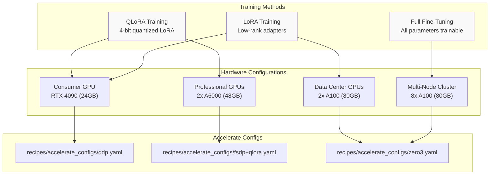
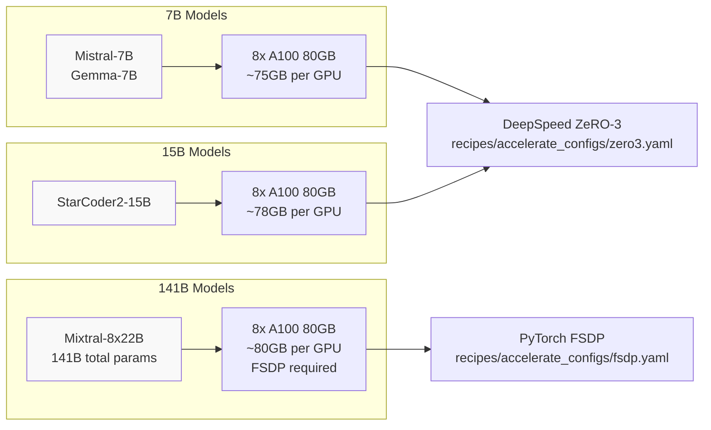
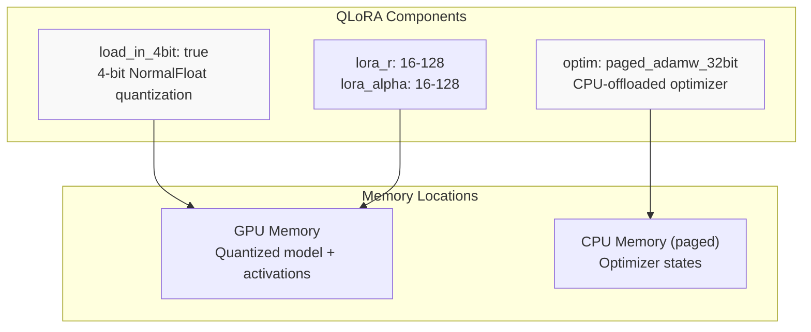
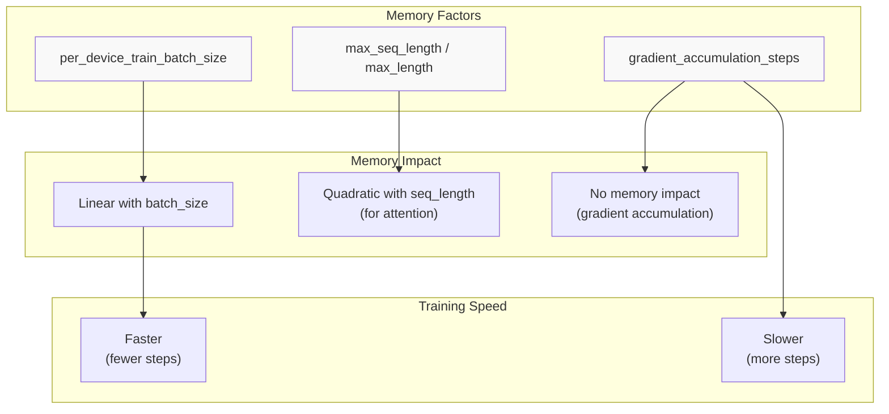
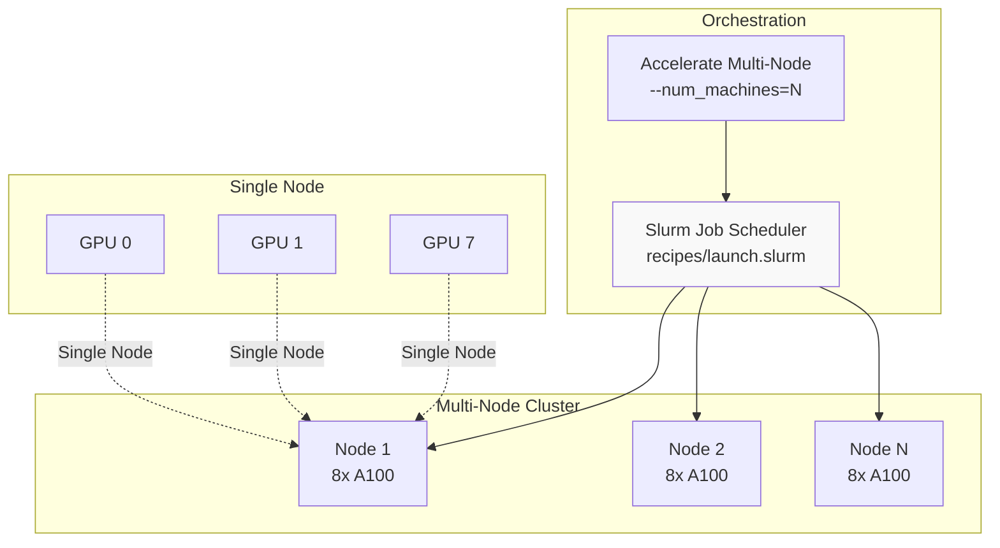
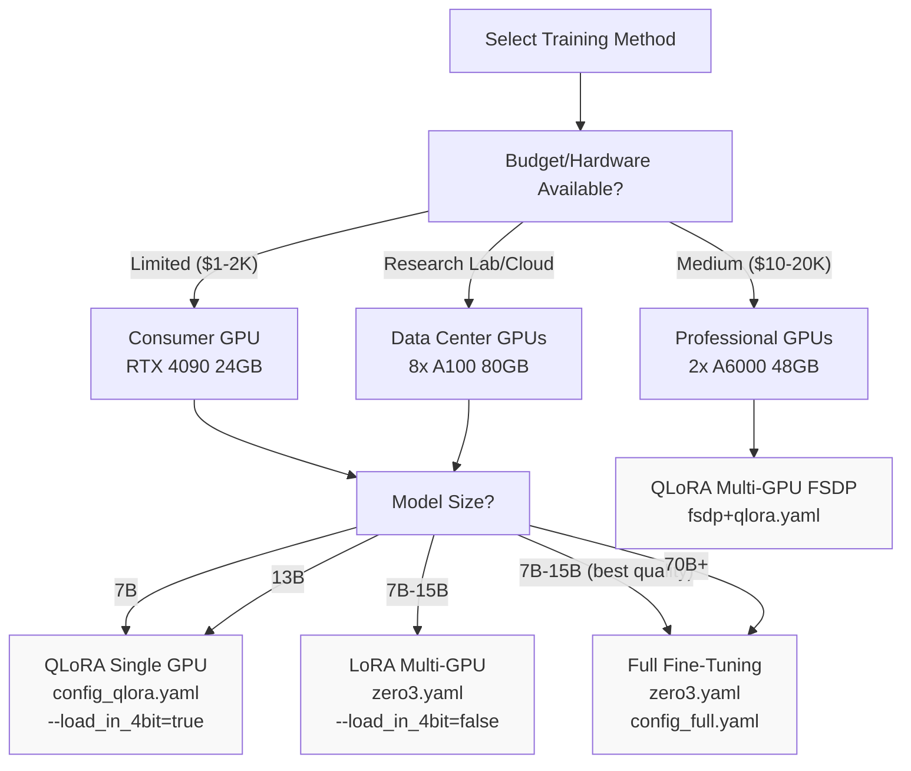

<!-- source: DeepWiki mcp.deepwiki.com · repo huggingface/alignment-handbook · page 5.3 Resource Requirements and Hardware · fetched 2026-10-26 -->

# Resource Requirements and Hardware

<details>
<summary>Relevant source files</summary>

The following files were used as context for generating this wiki page:

- [recipes/zephyr-7b-beta/README.md](recipes/zephyr-7b-beta/README.md)
- [recipes/zephyr-7b-beta/dpo/config_qlora.yaml](recipes/zephyr-7b-beta/dpo/config_qlora.yaml)
- [recipes/zephyr-7b-beta/sft/config_qlora.yaml](recipes/zephyr-7b-beta/sft/config_qlora.yaml)
- [scripts/README.md](scripts/README.md)

</details>


This page documents the hardware requirements and resource considerations for training language models using the Alignment Handbook. It covers GPU memory requirements, hardware configurations for different training methods (full fine-tuning, LoRA, QLoRA), and scaling strategies.

For information about distributed training configurations and strategies, see [Distributed Training Configurations](#5.1). For details on Slurm cluster deployment, see [Slurm Cluster Deployment](#5.2).

## Hardware Requirements Overview

The Alignment Handbook supports training on a wide range of hardware configurations, from single consumer GPUs to multi-node HPC clusters. The choice of hardware depends on the training method and model size.

### Training Method to Hardware Mapping



**Sources:** [scripts/README.md:5-11]()

### Hardware Requirements Table

| Training Method | Model Size | Minimum Hardware | Recommended Hardware | Accelerate Config | Memory per GPU |
|----------------|------------|------------------|---------------------|-------------------|----------------|
| QLoRA | 7B | 1x RTX 4090 (24GB) | 1x RTX 4090 (24GB) | `ddp.yaml` | ~18-20GB |
| QLoRA + FSDP | 7B | 2x A6000 (48GB) | 2x A6000 (48GB) | `fsdp+qlora.yaml` | ~35-40GB |
| LoRA | 7B | 1x RTX 4090 (24GB) | 2x A100 (80GB) | `ddp.yaml` or `zero3.yaml` | ~20-22GB single, ~40GB multi |
| Full | 7B | 8x A100 (80GB) | 8x A100 (80GB) | `zero3.yaml` | ~75-78GB |
| Full (FSDP) | 141B (Mixtral) | 8x A100 (80GB) | 8x H100 (80GB) | `fsdp.yaml` | ~78-80GB |

**Sources:** [scripts/README.md:5-11](), [recipes/zephyr-7b-beta/README.md:15]()

## Full Fine-Tuning Requirements

Full fine-tuning trains all model parameters and requires the most GPU memory. This method is documented in the `config_full.yaml` files across recipes.

### Memory Requirements

For a 7B parameter model (e.g., Mistral-7B, Gemma-7B):
- **Model weights (bfloat16):** ~14GB
- **Optimizer states (AdamW):** ~28GB (2x model size for momentum and variance)
- **Gradients:** ~14GB
- **Activations and buffers:** ~15-20GB
- **Total:** ~71-76GB per GPU with ZeRO-3 sharding

### Command Structure

```bash
# 8 GPU full training with DeepSpeed ZeRO-3
ACCELERATE_LOG_LEVEL=info accelerate launch \
  --config_file recipes/accelerate_configs/zero3.yaml \
  scripts/sft.py \
  --config recipes/zephyr-7b-beta/sft/config_full.yaml
```

**Sources:** [scripts/README.md:15-16](), [recipes/zephyr-7b-beta/README.md:16-22]()

### GPU Requirements by Model Size



**Sources:** [scripts/README.md:7](), [recipes/zephyr-7b-beta/README.md:15]()

## LoRA Training Requirements

LoRA (Low-Rank Adaptation) significantly reduces memory requirements by training only small adapter matrices while keeping the base model frozen.

### Memory Savings

For a 7B model with LoRA:
- **Base model (frozen):** ~14GB (can be kept in fp16/bf16)
- **LoRA adapters:** ~100-500MB (depending on `lora_r`)
- **Optimizer states:** Only for adapters (~200MB-1GB)
- **Gradients:** Only for adapters (~100-500MB)
- **Activations:** ~10-15GB
- **Total:** ~25-30GB per GPU (single GPU training)

### LoRA Configuration Parameters

Key parameters in LoRA configs affect memory usage:
- `lora_r`: Rank of adapter matrices (typical: 16-128)
- `lora_alpha`: Scaling factor (typically equals `lora_r`)
- `lora_target_modules`: Which layers to adapt

Example from [recipes/zephyr-7b-beta/sft/config_qlora.yaml:8-20]():
```yaml
use_peft: true
lora_r: 16
lora_alpha: 16
lora_dropout: 0.05
lora_target_modules:
- q_proj
- k_proj
- v_proj
- o_proj
- gate_proj
- up_proj
- down_proj
```

### Single vs Multi-GPU LoRA

```bash
# Single GPU LoRA (without quantization)
ACCELERATE_LOG_LEVEL=info accelerate launch \
  --config_file recipes/accelerate_configs/ddp.yaml \
  --num_processes=1 \
  scripts/sft.py \
  --config recipes/zephyr-7b-beta/sft/config_qlora.yaml \
  --load_in_4bit=false

# Multi-GPU LoRA with ZeRO-3
ACCELERATE_LOG_LEVEL=info accelerate launch \
  --config_file recipes/accelerate_configs/zero3.yaml \
  --num_processes=2 \
  scripts/sft.py \
  --config recipes/zephyr-7b-beta/sft/config_qlora.yaml \
  --load_in_4bit=false
```

**Sources:** [scripts/README.md:21-25](), [recipes/zephyr-7b-beta/sft/config_qlora.yaml:7-20]()

## QLoRA Training Requirements

QLoRA (Quantized LoRA) uses 4-bit quantization to further reduce memory requirements, enabling training on consumer GPUs.

### Memory Profile

For a 7B model with QLoRA:
- **Base model (4-bit quantized):** ~3.5GB
- **LoRA adapters:** ~100-500MB
- **Optimizer states (paged_adamw_32bit):** ~300MB-1GB
- **Gradients:** ~100-500MB
- **Activations:** ~8-12GB
- **Total:** ~12-16GB per GPU (single GPU training)

### QLoRA Configuration



**Sources:** [recipes/zephyr-7b-beta/sft/config_qlora.yaml:8](), [recipes/zephyr-7b-beta/dpo/config_qlora.yaml:8]()

### Single GPU QLoRA

The most accessible training method for consumer hardware:

```bash
ACCELERATE_LOG_LEVEL=info accelerate launch \
  --config_file recipes/accelerate_configs/ddp.yaml \
  --num_processes=1 \
  scripts/sft.py \
  --config recipes/zephyr-7b-beta/sft/config_qlora.yaml \
  --load_in_4bit=true
```

**Hardware Requirements:**
- RTX 4090 (24GB): Comfortable training with batch size 4-8
- RTX 3090 (24GB): Batch size 2-4
- RTX 4080 (16GB): Batch size 1-2, requires careful tuning

**Sources:** [scripts/README.md:18-19](), [recipes/zephyr-7b-beta/README.md:27-33]()

### Multi-GPU QLoRA with FSDP

For larger batch sizes or slightly larger models:

```bash
ACCELERATE_LOG_LEVEL=info accelerate launch \
  --config_file recipes/accelerate_configs/fsdp+qlora.yaml \
  --num_processes=2 \
  scripts/sft.py \
  --config recipes/zephyr-7b-beta/sft/config_qlora.yaml \
  --torch_dtype=bfloat16 \
  --bnb_4bit_quant_storage=bfloat16
```

**Hardware Requirements:**
- 2x A6000 (48GB each): Tested configuration
- 2x RTX 6000 Ada (48GB each): Alternative

**Sources:** [scripts/README.md:27-28](), [scripts/README.md:10]()

## Memory Optimization Techniques

### Gradient Checkpointing

Reduces activation memory at the cost of recomputation:

```yaml
gradient_checkpointing: true
gradient_checkpointing_kwargs:
  use_reentrant: false
```

**Memory Savings:** ~30-40% reduction in activation memory
**Performance Cost:** ~20-30% slower training

**Sources:** [recipes/zephyr-7b-beta/sft/config_qlora.yaml:47-49]()

### Gradient Accumulation

Simulates larger batch sizes without additional memory:

```yaml
per_device_train_batch_size: 4
gradient_accumulation_steps: 2
# Effective batch size = 4 * 2 = 8 per GPU
```

**Memory Impact:** No increase in memory usage
**Trade-off:** Slower training due to more forward/backward passes

**Sources:** [recipes/zephyr-7b-beta/sft/config_qlora.yaml:46](), [recipes/zephyr-7b-beta/dpo/config_qlora.yaml:36]()

### Flash Attention 2

Reduces memory usage for attention computation and increases speed:

```yaml
attn_implementation: flash_attention_2
```

**Benefits:**
- ~30-40% memory reduction for long sequences
- 2-3x faster attention computation
- Enables 2x larger batch sizes

**Requirements:**
- Ampere GPUs or newer (A100, H100, RTX 4090, RTX 6000 Ada)
- Flash Attention library installed

Alternative without Flash Attention:
```yaml
attn_implementation: sdpa  # PyTorch scaled dot product attention
```

**Sources:** [recipes/zephyr-7b-beta/README.md:35](), [recipes/zephyr-7b-beta/sft/config_qlora.yaml:5](), [recipes/zephyr-7b-beta/README.md:40-43]()

### Batch Size and Sequence Length Trade-offs



**Typical Configurations:**

| Hardware | Batch Size | Seq Length | Grad Acc | Effective Batch |
|----------|-----------|------------|----------|-----------------|
| RTX 4090 (QLoRA) | 4 | 2048 | 2 | 8 |
| 2x A100 (LoRA) | 8 | 2048 | 2 | 32 |
| 8x A100 (Full) | 2 | 2048 | 4 | 64 |

**Sources:** [recipes/zephyr-7b-beta/sft/config_qlora.yaml:57-63](), [recipes/zephyr-7b-beta/dpo/config_qlora.yaml:50-51]()

## Scaling Considerations

### Batch Size Scaling Rule

When scaling GPU count, maintain constant global batch size for reproducibility:

```
global_batch_size = num_gpus × per_device_batch_size × gradient_accumulation_steps
```

**Example:** Scaling from 1 to 8 GPUs:
- 1 GPU: `batch_size=4, grad_acc=8` → global=32
- 8 GPUs: `batch_size=4, grad_acc=1` → global=32

Or scale per-device batch size:
- 8 GPUs: `batch_size=32, grad_acc=1` → global=256

**Important:** Larger batch sizes may require learning rate adjustments.

**Sources:** [scripts/README.md:47]()

### Multi-Node Training



**Scaling to Multiple Nodes:**

```bash
sbatch --job-name=handbook_sft --nodes=2 \
  recipes/launch.slurm \
  zephyr-7b-beta sft full zero3
```

**Sources:** [scripts/README.md:78]()

## Hardware Selection Guidelines

### Decision Tree



**Sources:** [scripts/README.md:5-28]()

### Performance vs Quality Trade-offs

| Method | Training Speed | Final Quality | Adapter Size | Infrastructure Cost |
|--------|---------------|---------------|--------------|---------------------|
| Full Fine-Tuning | 1.0x (baseline) | Best | N/A (full model) | Highest (8x A100) |
| LoRA | 1.2x | ~98% of full | ~50-500MB | Medium (2-8x GPU) |
| QLoRA | 0.8-1.0x | ~95-98% of full | ~50-500MB | Lowest (1x consumer) |

**Note:** Quality differences are typically small and task-dependent. QLoRA is recommended for most use cases due to accessibility.

**Sources:** [scripts/README.md:12]()

### Recommended Configurations by Use Case

**Prototyping/Research:**
- Hardware: 1x RTX 4090 (24GB)
- Method: QLoRA
- Config: [recipes/zephyr-7b-beta/sft/config_qlora.yaml]()
- Batch size: 2-4
- Grad accumulation: 4-8

**Production Training (7B models):**
- Hardware: 8x A100 (80GB)
- Method: Full fine-tuning
- Config: [recipes/zephyr-7b-beta/sft/config_full.yaml]()
- Batch size: 2-4
- Grad accumulation: 2-4

**Large Models (70B+):**
- Hardware: 8x A100 (80GB) or 8x H100 (80GB)
- Method: Full fine-tuning with FSDP
- Config: Custom with `fsdp.yaml`
- Requires careful tuning

**Educational/Individual:**
- Hardware: 1x RTX 3090/4090 (24GB)
- Method: QLoRA
- Models: 7B-13B
- Expect ~24-48 hours for SFT + DPO pipeline

**Sources:** [scripts/README.md:5-11](), [recipes/zephyr-7b-beta/README.md:15]()

---

