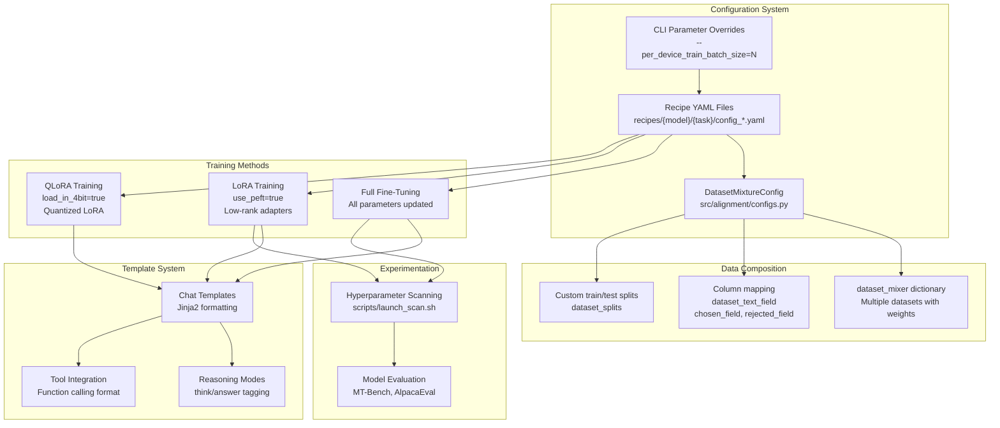
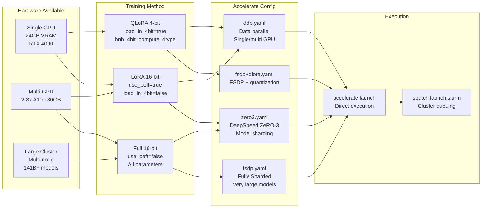
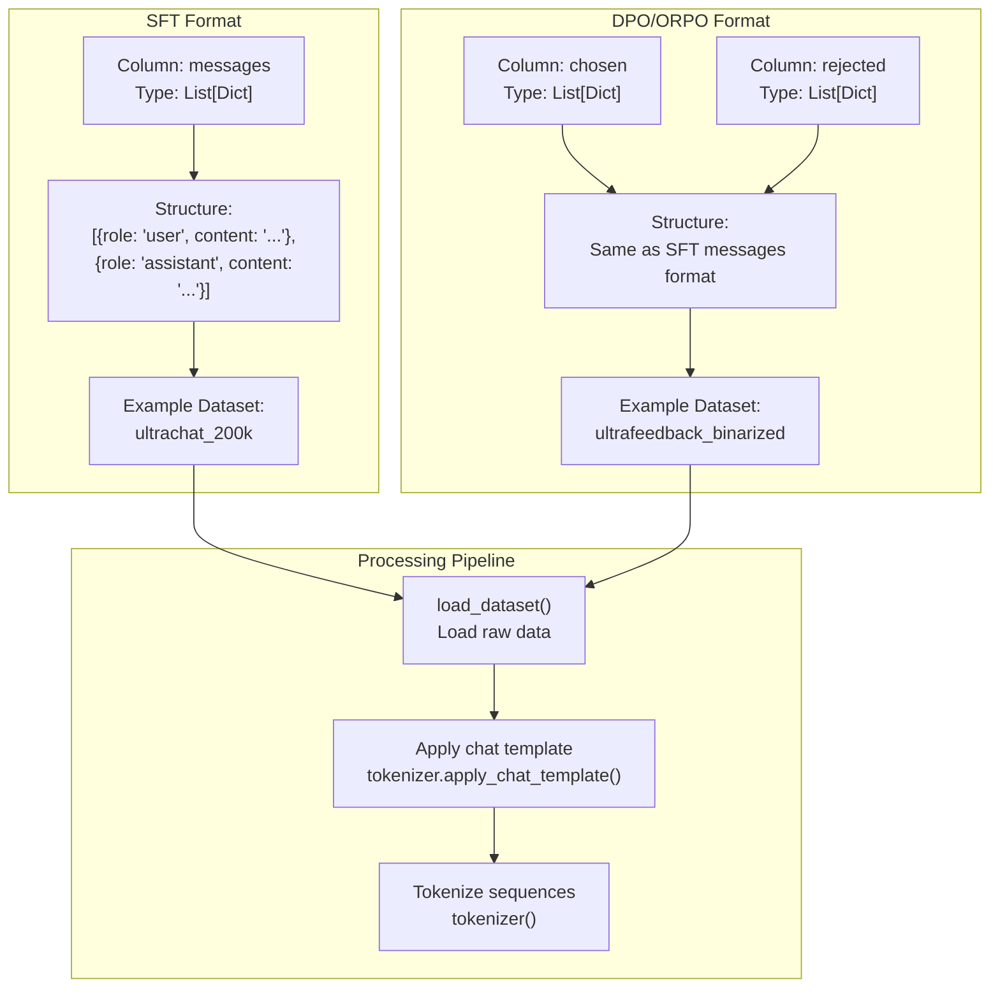

<!-- source: DeepWiki mcp.deepwiki.com · repo huggingface/alignment-handbook · page 6 Advanced Topics · fetched 2026-10-26 -->

# Advanced Topics

<details>
<summary>Relevant source files</summary>

The following files were used as context for generating this wiki page:

- [scripts/README.md](scripts/README.md)

</details>


This page covers advanced techniques and configurations for power users of the Alignment Handbook. It provides an overview of sophisticated features including dataset mixing strategies, parameter-efficient fine-tuning methods (LoRA/QLoRA), chat template customization, systematic hyperparameter scanning, and model evaluation methodologies.

For basic usage and getting started, see [Quick Start Guide](#1.3). For standard training recipes, see [Model Training Recipes](#4). For distributed training infrastructure basics, see [Training Infrastructure](#5).

## Advanced Usage Overview

The Alignment Handbook provides several advanced capabilities beyond basic recipe execution. These features enable fine-grained control over training behavior, efficient resource utilization, and systematic experimentation.

### Core Advanced Features

The system supports advanced usage through multiple mechanisms:



**Sources:** [scripts/README.md:1-142]()

### Parameter Override System

All training scripts support runtime parameter overrides via CLI arguments. The override system follows a precedence hierarchy where CLI arguments take highest priority:

| Priority | Source | Example |
|----------|--------|---------|
| 1 (Highest) | CLI arguments | `--per_device_train_batch_size=42` |
| 2 | Recipe YAML file | `per_device_train_batch_size: 8` in config |
| 3 | Accelerate config | Settings from `zero3.yaml`, `fsdp.yaml`, etc. |
| 4 (Lowest) | Default values | Class defaults in `SFTConfig`, `DPOConfig`, etc. |

Example override syntax:

```bash
ACCELERATE_LOG_LEVEL=info accelerate launch \
    --config_file recipes/accelerate_configs/zero3.yaml \
    scripts/run_sft.py \
    --config recipes/zephyr-7b-beta/sft/config_full.yaml \
    --per_device_train_batch_size=42 \
    --num_train_epochs=5 \
    --learning_rate=1e-5
```

This mechanism enables rapid experimentation without modifying recipe files [scripts/README.md:49-54]().

**Sources:** [scripts/README.md:49-54]()

## Training Configuration Matrix

The handbook supports multiple training configurations optimized for different hardware and resource constraints:

### Configuration Selection Guide



**Training Method Selection Table:**

| Use Case | Method | Memory (per GPU) | Training Speed | Adapter Size |
|----------|--------|------------------|----------------|--------------|
| Rapid prototyping | QLoRA 4-bit | ~10-15 GB | Slowest | ~50-200 MB |
| Production LoRA | LoRA 16-bit | ~20-40 GB | Medium | ~50-200 MB |
| Maximum performance | Full 16-bit | ~60-80 GB | Fastest | Full model size |
| Large models (70B+) | Full with FSDP | ~40-60 GB per GPU | Medium | Full model size |

**Sources:** [scripts/README.md:5-11](), [scripts/README.md:14-29]()

### Command Templates by Configuration

The following command patterns map hardware constraints to appropriate configurations:

```bash
# Single GPU QLoRA (consumer hardware)
ACCELERATE_LOG_LEVEL=info accelerate launch \
    --config_file recipes/accelerate_configs/ddp.yaml \
    --num_processes=1 \
    scripts/run_{task}.py \
    --config recipes/{model}/{task}/config_qlora.yaml

# Single GPU LoRA (disable 4-bit quantization)
ACCELERATE_LOG_LEVEL=info accelerate launch \
    --config_file recipes/accelerate_configs/ddp.yaml \
    --num_processes=1 \
    scripts/run_{task}.py \
    --config recipes/{model}/{task}/config_qlora.yaml \
    --load_in_4bit=false

# Multi-GPU LoRA with ZeRO-3
ACCELERATE_LOG_LEVEL=info accelerate launch \
    --config_file recipes/accelerate_configs/zero3.yaml \
    --num_processes={num_gpus} \
    scripts/run_{task}.py \
    --config recipes/{model}/{task}/config_qlora.yaml \
    --load_in_4bit=false

# Multi-GPU Full Training with ZeRO-3
ACCELERATE_LOG_LEVEL=info accelerate launch \
    --config_file recipes/accelerate_configs/zero3.yaml \
    scripts/run_{task}.py \
    --config recipes/{model}/{task}/config_full.yaml

# Multi-GPU QLoRA with FSDP
ACCELERATE_LOG_LEVEL=info accelerate launch \
    --config_file recipes/accelerate_configs/fsdp+qlora.yaml \
    --num_processes={num_gpus} \
    scripts/run_{task}.py \
    --config recipes/{model}/{task}/config_qlora.yaml \
    --torch_dtype=bfloat16 \
    --bnb_4bit_quant_storage=bfloat16
```

The `{task}` parameter accepts: `sft`, `dpo`, `orpo`, or `cpt` [scripts/README.md:31-36]().

**Sources:** [scripts/README.md:14-29]()

## Slurm Cluster Integration

The handbook provides `recipes/launch.slurm` for automated job submission on HPC clusters with Slurm scheduling [scripts/README.md:63-80]().

### Slurm Submission Syntax

```bash
sbatch \
    --job-name=handbook_{task} \
    --nodes={num_nodes} \
    recipes/launch.slurm \
    {model_name} \
    {task} \
    {precision} \
    {accelerator} \
    '{overrides}'
```

**Parameter Mapping:**

| Parameter | Description | Valid Values | Example |
|-----------|-------------|--------------|---------|
| `{model_name}` | Recipe directory name | `zephyr-7b-beta`, `smollm2`, etc. | `zephyr-7b-beta` |
| `{task}` | Training task type | `sft`, `dpo`, `orpo`, `cpt` | `sft` |
| `{precision}` | Training precision mode | `full`, `qlora` | `full` |
| `{accelerator}` | Accelerate config name | `zero3`, `fsdp`, `ddp` | `zero3` |
| `{overrides}` | Space-separated CLI args | Any valid training args | `'--per_device_train_batch_size=42'` |

### Example Slurm Submissions

```bash
# Single node SFT with ZeRO-3
sbatch --job-name=handbook_sft --nodes=1 \
    recipes/launch.slurm zephyr-7b-beta sft full zero3

# Single node DPO with parameter overrides
sbatch --job-name=handbook_dpo --nodes=1 \
    recipes/launch.slurm zephyr-7b-beta dpo full zero3 \
    '--per_device_train_batch_size=42 --num_train_epochs=5'

# Multi-node training (scale with --nodes)
sbatch --job-name=handbook_sft --nodes=4 \
    recipes/launch.slurm zephyr-141b-a35b orpo full fsdp
```

**Important:** The Slurm configuration is optimized for the Hugging Face compute cluster and may require adaptation for different cluster environments [scripts/README.md:80]().

**Sources:** [scripts/README.md:63-80]()

## Dataset Format Requirements

Each training task expects specific dataset column formats. The training scripts apply chat templates to these columns during data loading.

### Format Specification by Task



**Column Requirements:**

| Task | Required Columns | Data Type | Example Dataset |
|------|-----------------|-----------|-----------------|
| SFT | `messages` | `List[Dict[str, str]]` | [ultrachat_200k](https://huggingface.co/datasets/HuggingFaceH4/ultrachat_200k) |
| DPO | `chosen`, `rejected` | `List[Dict[str, str]]` each | [ultrafeedback_binarized](https://huggingface.co/datasets/HuggingFaceH4/ultrafeedback_binarized) |
| ORPO | `chosen`, `rejected` | `List[Dict[str, str]]` each | [ultrafeedback_binarized](https://huggingface.co/datasets/HuggingFaceH4/ultrafeedback_binarized) |

Each dictionary in the lists must contain `role` and `content` keys [scripts/README.md:96-108]().

**Sources:** [scripts/README.md:96-116]()

### Recommended Split Naming Conventions

The handbook adopts a naming convention for dataset splits to clearly indicate their purpose:

| Split Name | Purpose | Used By |
|------------|---------|---------|
| `train_sft` | Supervised fine-tuning training | `scripts/sft.py` |
| `test_sft` | SFT evaluation | `scripts/sft.py` |
| `train_gen` | Generation ranking (rejection sampling, PPO) | Future extensions |
| `test_gen` | Generation evaluation | Future extensions |
| `train_prefs` | Preference modeling (DPO, ORPO) | `scripts/dpo.py`, `scripts/run_orpo.py` |
| `test_prefs` | Preference evaluation | `scripts/dpo.py`, `scripts/run_orpo.py` |

Using this convention makes dataset splits self-documenting [scripts/README.md:109-114]().

**Sources:** [scripts/README.md:109-116]()

## Logging and Experiment Tracking

The training scripts support multiple logging backends for experiment tracking.

### TensorBoard (Default)

By default, all training metrics are logged to TensorBoard without additional configuration:

```bash
# View logs after training
tensorboard --logdir {output_dir}/runs
```

### Weights & Biases Integration

For W&B logging, authenticate and add the `--report_to=wandb` flag:

```bash
# Login to W&B
wandb login

# Train with W&B logging
ACCELERATE_LOG_LEVEL=info accelerate launch \
    --config_file recipes/accelerate_configs/zero3.yaml \
    scripts/run_{task}.py \
    --config recipes/{model}/{task}/config_full.yaml \
    --report_to=wandb
```

This enables real-time monitoring, hyperparameter tracking, and comparison across runs [scripts/README.md:56-61]().

**Sources:** [scripts/README.md:56-61]()

## Batch Size and Gradient Accumulation Scaling

When changing the number of GPUs, maintain a constant global batch size by adjusting `per_device_train_batch_size` or `gradient_accumulation_steps`:

```
global_batch_size = num_gpus × per_device_train_batch_size × gradient_accumulation_steps
```

**Scaling Strategy:**

| Configuration | GPUs | Per-Device BS | Grad Accum | Global BS |
|--------------|------|---------------|------------|-----------|
| Original | 8 | 8 | 2 | 128 |
| Scale down | 4 | 8 | 4 | 128 |
| Scale down | 2 | 16 | 4 | 128 |
| Scale down | 1 | 32 | 4 | 128 |

This ensures consistent training dynamics and reproducible results across hardware configurations [scripts/README.md:47]().

**Sources:** [scripts/README.md:47]()

## Advanced Topics Subsections

The following pages provide detailed coverage of specific advanced techniques:

- **[Dataset Mixing and Weighting](#6.1)**: Advanced dataset composition with weighted mixing, column mapping, and multi-task training strategies
- **[LoRA and QLoRA Training](#6.2)**: Parameter-efficient fine-tuning with low-rank adapters, quantization, and memory optimization techniques
- **[Chat Templates and Message Formatting](#6.3)**: Jinja2 chat templates, reasoning modes, system message handling, and tool integration
- **[Hyperparameter Scanning](#6.4)**: Systematic hyperparameter searches using `launch_scan.sh` for beta tuning and experimental optimization
- **[Model Evaluation](#6.5)**: Evaluation methodologies including MT-Bench, AlpacaEval, and Chatbot Arena for benchmarking chat models

Each subsection provides code-level details and practical examples for implementing these advanced features.

**Sources:** [scripts/README.md:1-142]()

---

