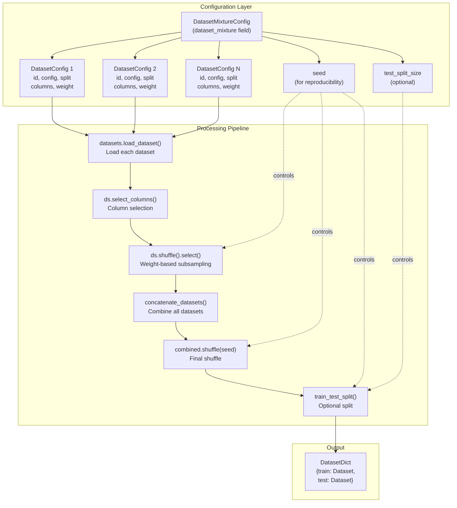
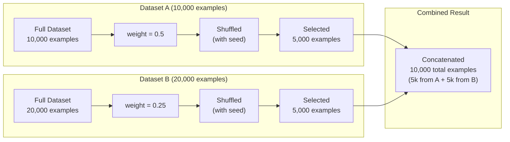
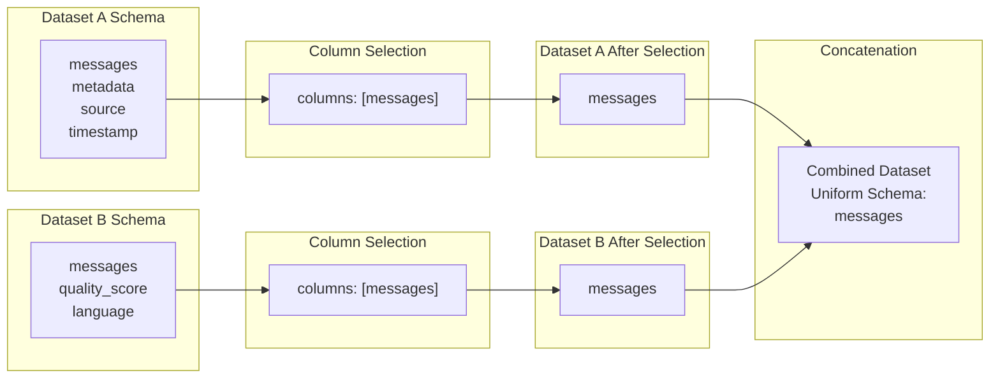
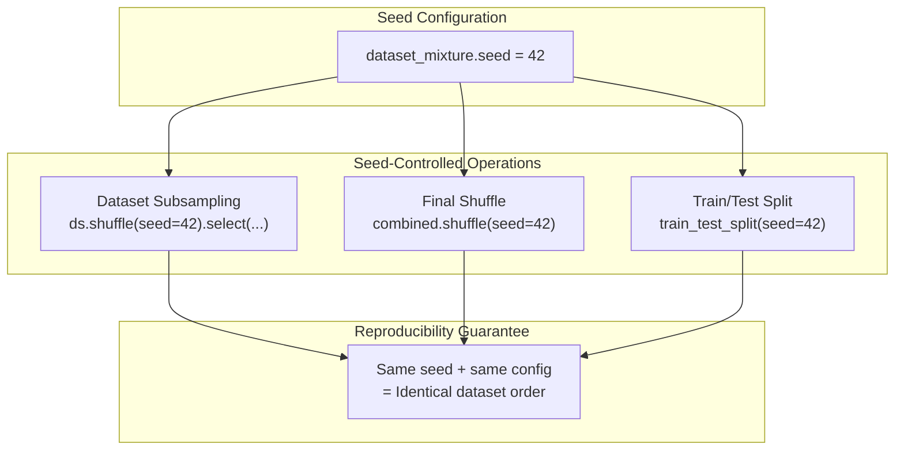
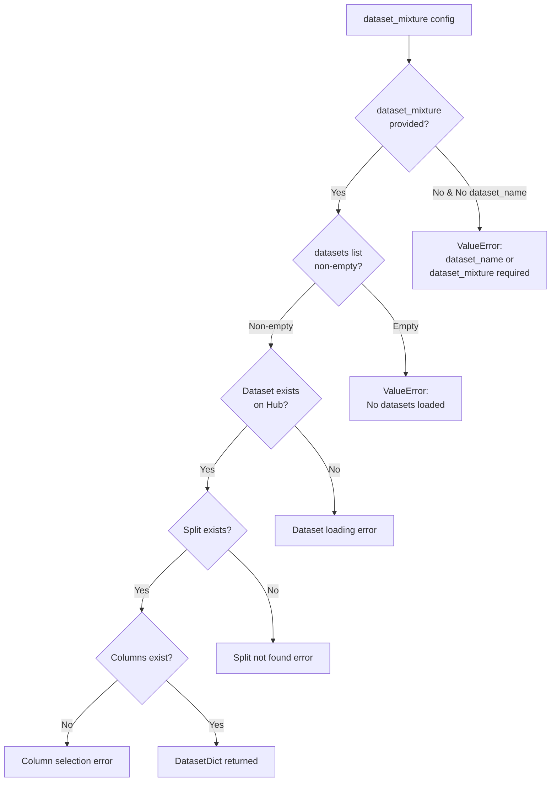

<!-- source: DeepWiki mcp.deepwiki.com · repo huggingface/alignment-handbook · page 6.1 Dataset Mixing and Weighting · fetched 2026-10-26 -->

# Dataset Mixing and Weighting

<details>
<summary>Relevant source files</summary>

The following files were used as context for generating this wiki page:

- [scripts/README.md](scripts/README.md)
- [src/alignment/data.py](src/alignment/data.py)

</details>


This document covers advanced techniques for combining multiple datasets with different weighting schemes, column mappings, and sampling strategies to create complex training data mixtures. These techniques enable multi-task learning, domain adaptation, and fine-grained control over training data composition.

For basic dataset loading concepts and the `get_dataset` function overview, see [Dataset Loading and Mixing](#2.3). For examples of dataset mixtures in specific model recipes, see [Zephyr Model Family](#4.1), [SmolLM Small Language Models](#4.2), and [Creating Custom Recipes](#4.5).

## Purpose and Scope

Dataset mixing is a critical capability in the Alignment Handbook that allows training on multiple datasets simultaneously with precise control over their relative contributions. This page focuses on:

- Understanding the dataset weighting system and its effect on training
- Configuring column mappings for heterogeneous datasets
- Creating multi-domain and multi-task training mixtures
- Advanced sampling strategies and reproducibility guarantees
- Common patterns and anti-patterns in dataset composition

## Dataset Mixture Architecture

The dataset mixing system operates through the `DatasetMixtureConfig` class, which specifies multiple `DatasetConfig` objects, each representing a single dataset source with its own configuration.



**Dataset Mixture Processing Flow**

Sources: [src/alignment/data.py:26-79]()

### Core Components

The dataset mixture system consists of these key components:

| Component | Location | Purpose |
|-----------|----------|---------|
| `DatasetMixtureConfig` | `src/alignment/configs.py` | Top-level configuration for dataset mixtures |
| `DatasetConfig` | `src/alignment/configs.py` | Per-dataset configuration (id, split, weight, columns) |
| `get_dataset()` | `src/alignment/data.py:26-79` | Main function that executes the mixing logic |
| `ScriptArguments.dataset_mixture` | `src/alignment/configs.py` | Field holding the mixture configuration |

Sources: [src/alignment/data.py:26-79](), [src/alignment/configs.py]()

## Dataset Weighting Mechanisms

### Weight Interpretation

The `weight` parameter in `DatasetConfig` controls dataset subsampling through a fractional value between 0 and 1. The system interprets weights as follows:



**Weight-Based Subsampling Logic**

The implementation at [src/alignment/data.py:52-56]() applies weighting by:

1. Shuffling the dataset with the configured seed
2. Selecting `int(len(ds) * weight)` examples
3. Logging the subsampling operation

**Key formula:** `num_selected = int(len(dataset) * weight)`

Sources: [src/alignment/data.py:52-56]()

### Weighting Strategies

| Strategy | Use Case | Example Configuration |
|----------|----------|----------------------|
| **Uniform** | Equal contribution from all datasets | All weights = 1.0 (or omitted) |
| **Proportional** | Balance by dataset size | Larger datasets get smaller weights |
| **Task-Biased** | Emphasize specific capabilities | High-quality datasets get higher weights |
| **Downsampling** | Handle dataset imbalance | Large datasets get fractional weights |

### Example Configurations

**Uniform Mixing (No Weights)**
```yaml
dataset_mixture:
  datasets:
    - id: "HuggingFaceH4/ultrachat_200k"
      split: "train_sft"
    - id: "HuggingFaceH4/no_robots"
      split: "train_sft"
```
Result: All examples from both datasets are used.

**Proportional Downsampling**
```yaml
dataset_mixture:
  datasets:
    - id: "large_dataset"
      split: "train"
      weight: 0.1  # Use 10% of examples
    - id: "small_dataset"
      split: "train"
      weight: 1.0  # Use all examples
```
Result: Balances a large and small dataset.

**Task-Specific Emphasis**
```yaml
dataset_mixture:
  datasets:
    - id: "high_quality_reasoning"
      split: "train"
      weight: 1.0
    - id: "general_chat"
      split: "train"
      weight: 0.3
    - id: "code_examples"
      split: "train"
      weight: 0.5
```
Result: Emphasizes reasoning while including diverse examples.

Sources: [scripts/README.md:86-94]()

## Column Selection and Mapping

### Column Selection

The `columns` parameter in `DatasetConfig` enables selecting specific columns from heterogeneous datasets, ensuring compatibility when mixing datasets with different schemas.



**Column Selection for Schema Harmonization**

The implementation at [src/alignment/data.py:50-51]() applies column selection using:
```python
if dataset_config.columns is not None:
    ds = ds.select_columns(dataset_config.columns)
```

Sources: [src/alignment/data.py:50-51]()

### Required Columns by Task

Different training tasks require specific column formats:

| Task | Required Columns | Format |
|------|------------------|--------|
| **SFT** | `messages` | List of dicts: `[{"role": "...", "content": "..."}]` |
| **DPO** | `chosen`, `rejected` | Lists of dicts in same format as SFT |
| **ORPO** | `chosen`, `rejected` | Lists of dicts in same format as SFT |
| **KTO** | `prompt`, `completion`, `label` | Strings + boolean |

### Column Mapping Example

When mixing datasets with different column names, use column selection to standardize:

```yaml
dataset_mixture:
  datasets:
    - id: "dataset_with_conversations"
      split: "train"
      columns: ["conversations"]  # Will fail - needs renaming first
    - id: "dataset_with_messages"
      split: "train"
      columns: ["messages"]
```

**Note:** The system does not perform automatic column renaming. Datasets must be preprocessed or the Hugging Face Hub dataset card must map columns correctly before mixing.

Sources: [scripts/README.md:96-108]()

## Multi-Task Training Configurations

### Combining Task-Specific Splits

A common pattern is to use dedicated splits per task within a dataset:

```yaml
# SFT Training
dataset_mixture:
  datasets:
    - id: "multi_task_dataset"
      split: "train_sft"
      columns: ["messages"]
    - id: "another_dataset"
      split: "train_sft"
      columns: ["messages"]

# DPO Training (later stage)
dataset_mixture:
  datasets:
    - id: "multi_task_dataset"
      split: "train_prefs"
      columns: ["chosen", "rejected"]
    - id: "another_dataset"
      split: "train_prefs"
      columns: ["chosen", "rejected"]
```

This pattern is recommended in the codebase documentation at [scripts/README.md:109-114]().

Sources: [scripts/README.md:109-114]()

### Multi-Domain Learning

For training models on multiple domains simultaneously:

```yaml
dataset_mixture:
  datasets:
    # General conversation
    - id: "HuggingFaceH4/ultrachat_200k"
      split: "train_sft"
      weight: 0.5
      columns: ["messages"]
    
    # Math reasoning
    - id: "math_dataset"
      split: "train"
      weight: 0.3
      columns: ["messages"]
    
    # Code generation
    - id: "code_dataset"
      split: "train"
      weight: 0.2
      columns: ["messages"]
  
  seed: 42
  test_split_size: 0.05
```

This creates a balanced multi-domain training set with:
- 50% general conversation examples
- 30% math reasoning examples  
- 20% code generation examples
- 5% held out for testing

Sources: [src/alignment/data.py:38-74]()

## Reproducibility and Shuffling

### Seed-Based Determinism

The dataset mixture system ensures reproducibility through seed-controlled operations:



**Seed Control Flow**

The seed is applied at three critical points in [src/alignment/data.py:40-68]():

1. **Line 40:** Seed extracted from configuration
2. **Line 53:** Applied to per-dataset shuffling before subsampling
3. **Line 62:** Applied to final dataset shuffle after concatenation
4. **Line 67:** Applied to train/test split

Sources: [src/alignment/data.py:40-68]()

### Shuffle-Then-Subsample Pattern

The implementation uses a specific order of operations:

```python
# From src/alignment/data.py:53
ds = ds.shuffle(seed=seed).select(range(int(len(ds) * weight)))
```

This pattern ensures:
1. **Randomness:** Shuffling before selection prevents bias toward dataset order
2. **Reproducibility:** Same seed produces same subset
3. **Distribution:** Subsampled data is representative of the full dataset

**Anti-pattern:** Selecting first N examples without shuffling would create biased subsets.

Sources: [src/alignment/data.py:53]()

## Train/Test Splitting

### Automatic Split Generation

The `test_split_size` parameter enables automatic generation of evaluation sets from mixed data:

```yaml
dataset_mixture:
  datasets:
    - id: "dataset_1"
      split: "train"
      weight: 0.5
    - id: "dataset_2"
      split: "train"
      weight: 0.3
  test_split_size: 0.1  # Hold out 10% for testing
  seed: 42
```

The implementation at [src/alignment/data.py:65-72]() creates a `DatasetDict` with:
- `train`: 90% of mixed examples
- `test`: 10% of mixed examples

**When to use:**
- Datasets lack dedicated test splits
- Need consistent train/test distribution from mixture
- Want to validate on held-out mixed data

**When not to use:**
- Datasets have task-specific test splits (use those directly)
- Need domain-specific evaluation (create separate test mixtures)

Sources: [src/alignment/data.py:65-72]()

### Manual Test Set Configuration

For more control, configure separate mixtures for train and test:

```python
# Training script pattern (not in data.py)
# Load training data
train_args.dataset_mixture = train_mixture_config
train_dataset = get_dataset(train_args)

# Load test data with different mixture
test_args.dataset_mixture = test_mixture_config
test_dataset = get_dataset(test_args)
```

This approach allows:
- Different proportions in test set
- Test-specific datasets not in training
- Domain-specific evaluation

Sources: [src/alignment/data.py:26-79]()

## Advanced Patterns

### Progressive Upsampling

Gradually increase representation of specific datasets:

```yaml
# Early training - equal mix
dataset_mixture:
  datasets:
    - id: "general_data"
      weight: 0.5
    - id: "specialist_data"
      weight: 0.5

# Later training - emphasize specialist (separate run)
dataset_mixture:
  datasets:
    - id: "general_data"
      weight: 0.2
    - id: "specialist_data"
      weight: 1.0
```

**Use case:** Domain adaptation where initial training builds general capability, later training specializes.

### Curriculum Learning

Order datasets by difficulty through staged training:

```yaml
# Stage 1: Simple examples
dataset_mixture:
  datasets:
    - id: "basic_conversations"
      weight: 1.0

# Stage 2: Complex examples (separate run)
dataset_mixture:
  datasets:
    - id: "basic_conversations"
      weight: 0.3
    - id: "complex_reasoning"
      weight: 1.0
```

### Quality Filtering Through Weighting

Use weights to emphasize high-quality data:

```yaml
dataset_mixture:
  datasets:
    - id: "human_curated"
      weight: 1.0  # All examples
    - id: "model_generated_filtered"
      weight: 0.5  # Half of examples
    - id: "web_scraped"
      weight: 0.1  # 10% of examples
```

Sources: [src/alignment/data.py:52-56]()

## Configuration Validation

### Implicit Validation

The `get_dataset` function performs implicit validation through the loading process:



**Dataset Loading Validation Flow**

Error handling occurs at [src/alignment/data.py:76-79]():

```python
if datasets_list:
    # ... processing
else:
    raise ValueError("No datasets were loaded from the mixture configuration")
```

Sources: [src/alignment/data.py:26-79]()

### Common Configuration Errors

| Error | Cause | Solution |
|-------|-------|----------|
| `ValueError: Either dataset_name or dataset_mixture must be provided` | Neither field set | Provide one configuration method |
| `ValueError: No datasets were loaded` | Empty datasets list | Add at least one dataset to mixture |
| Dataset not found | Invalid dataset ID | Verify dataset exists on Hub |
| Split not found | Invalid split name | Check available splits in dataset |
| Column not found | Invalid column name | Verify column exists in dataset |

## Best Practices

### Weighting Guidelines

1. **Start with uniform weights (1.0)** to understand baseline performance
2. **Use fractional weights (< 1.0)** to downsample large datasets
3. **Maintain total balance** - avoid one dataset dominating (e.g., 10k examples from A, 100 from B)
4. **Document weight rationale** in config comments

### Column Management

1. **Verify column compatibility** before mixing datasets with `columns` parameter
2. **Use minimal column sets** - only include required columns for the task
3. **Standardize formats** - ensure message formats match across datasets
4. **Test small samples** before full training

### Reproducibility

1. **Always set explicit seeds** in `dataset_mixture.seed`
2. **Document dataset versions** - note dataset IDs and dates
3. **Version control configs** - track changes to mixture recipes
4. **Log mixture statistics** - record actual example counts after weighting

### Performance Optimization

1. **Pre-filter datasets** on the Hub rather than loading full datasets
2. **Use streaming** for very large datasets (not shown in current implementation)
3. **Cache processed datasets** to avoid repeated downloads
4. **Monitor memory usage** when concatenating large mixtures

Sources: [src/alignment/data.py:26-79](), [scripts/README.md:82-115]()

## Logging and Debugging

### Mixture Logging

The system logs key information during dataset preparation:

```
INFO: Creating dataset mixture with 3 datasets
INFO: Loading dataset for mixture: dataset_1 (config: None)
INFO: Subsampled dataset 'dataset_1' (config: None) with weight=0.5 to 5000 examples
INFO: Loading dataset for mixture: dataset_2 (config: None)
INFO: Subsampled dataset 'dataset_2' (config: None) with weight=0.3 to 3000 examples
INFO: Created dataset mixture with 8000 examples
INFO: Split dataset into train and test sets with test size: 0.1
```

These logs appear at [src/alignment/data.py:39, 44, 54-56, 63, 69-70]() and provide:
- Number of datasets in mixture
- Each dataset ID and configuration
- Subsampling results (weight and final count)
- Total combined example count
- Train/test split confirmation

### Debugging Strategies

**Verify Example Counts:**
```python
# After loading
dataset_dict = get_dataset(args)
print(f"Train examples: {len(dataset_dict['train'])}")
if 'test' in dataset_dict:
    print(f"Test examples: {len(dataset_dict['test'])}")
```

**Inspect Column Schema:**
```python
print(dataset_dict['train'].column_names)
print(dataset_dict['train'][0])  # First example
```

**Validate Mixture Proportions:**
Calculate expected vs actual example counts based on weights to ensure subsampling worked correctly.

Sources: [src/alignment/data.py:39-70]()

## Integration with Training Scripts

### Usage in Training Scripts

Training scripts access dataset mixtures through the `ScriptArguments` configuration:

```mermaid
graph LR
    subgraph "YAML Config"
        YAML["config.yaml<br/>dataset_mixture:<br/>  datasets: [...]<br/>  seed: 42"]
    end
    
    subgraph "Script Execution"
        Parser["HfArgumentParser<br/>Parse YAML"]
        ScriptArgs["ScriptArguments<br/>dataset_mixture field"]
        GetDataset["get_dataset(args)"]
    end
    
    subgraph "Trainer"
        Trainer["SFTTrainer/<br/>DPOTrainer/<br/>ORPOTrainer"]
    end
    
    YAML --> Parser
    Parser --> ScriptArgs
    ScriptArgs --> GetDataset
    GetDataset --> Trainer
```

**Configuration Flow to Training**

The pattern used in scripts like `scripts/sft.py`, `scripts/dpo.py`:

1. Parse YAML configuration including `dataset_mixture`
2. Pass `ScriptArguments` to `get_dataset()`
3. Return `DatasetDict` to trainer
4. Trainer handles tokenization and batching

Sources: [src/alignment/data.py:26-79]()

### CLI Override Pattern

Override mixture parameters from command line:

```bash
accelerate launch scripts/sft.py \
  --config recipes/model/sft/config.yaml \
  --dataset_mixture.seed=123 \
  --dataset_mixture.test_split_size=0.05
```

This allows experimental variation without modifying YAML files.

Sources: [scripts/README.md:49-54]()

---

