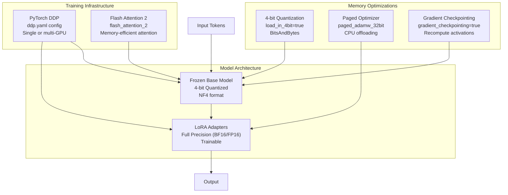
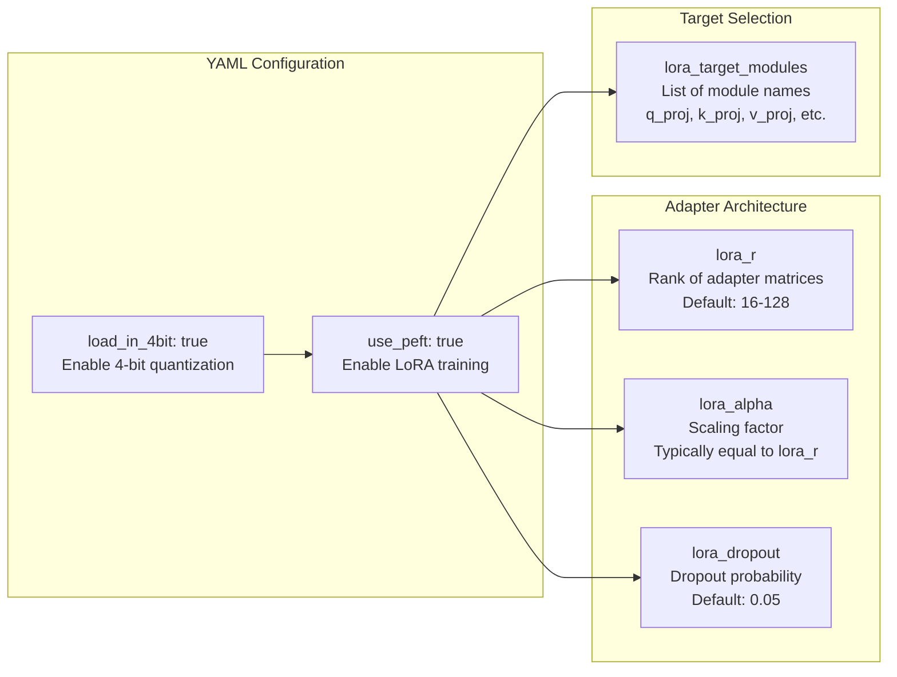
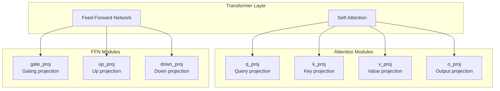
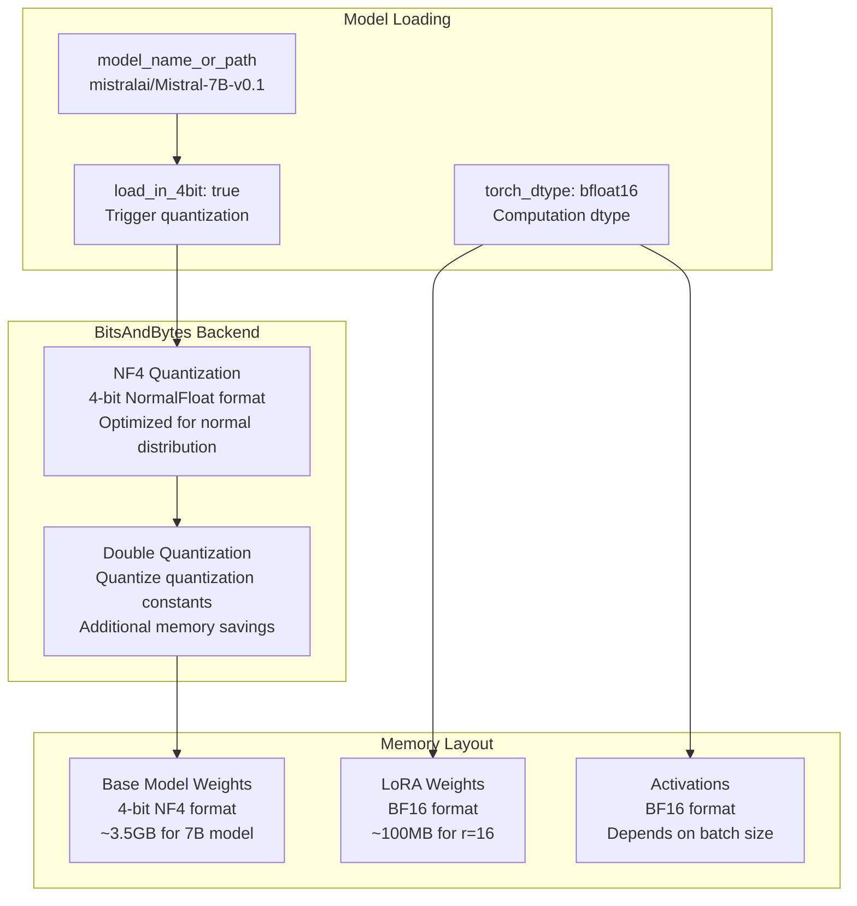
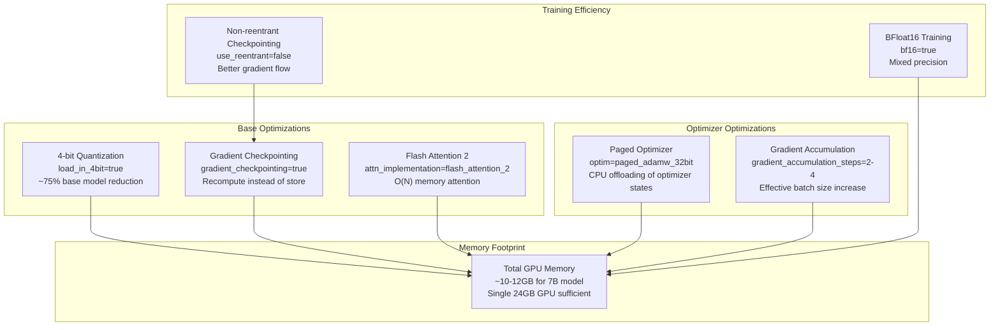
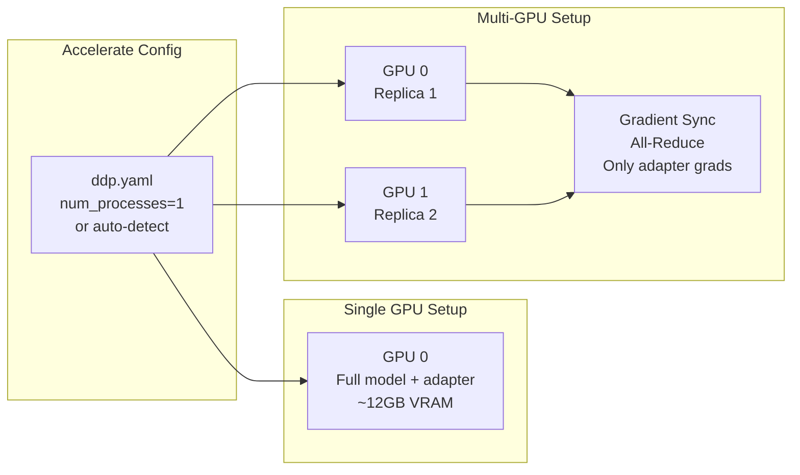
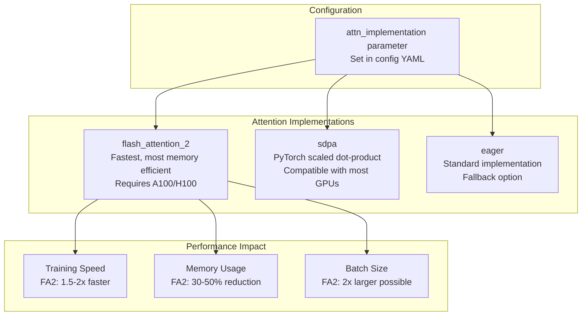
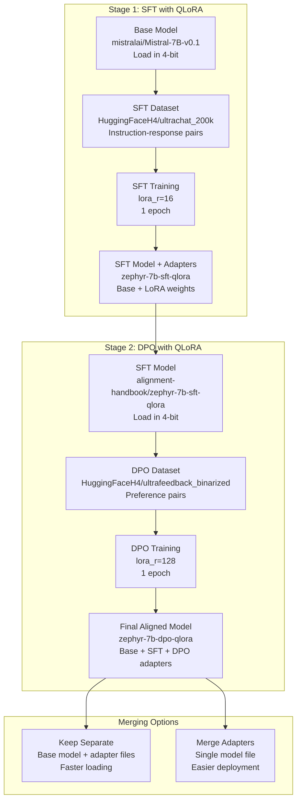
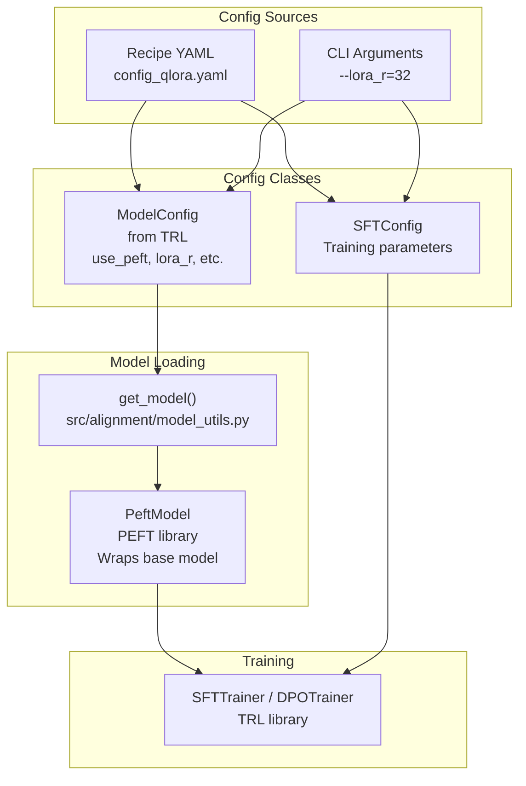

<!-- source: DeepWiki mcp.deepwiki.com · repo huggingface/alignment-handbook · page 6.2 LoRA and QLoRA Training · fetched 2026-10-26 -->

# LoRA and QLoRA Training

<details>
<summary>Relevant source files</summary>

The following files were used as context for generating this wiki page:

- [recipes/zephyr-7b-beta/README.md](recipes/zephyr-7b-beta/README.md)
- [recipes/zephyr-7b-beta/dpo/config_qlora.yaml](recipes/zephyr-7b-beta/dpo/config_qlora.yaml)
- [recipes/zephyr-7b-beta/sft/config_qlora.yaml](recipes/zephyr-7b-beta/sft/config_qlora.yaml)

</details>


## Purpose and Scope

This page provides a comprehensive guide to parameter-efficient fine-tuning using LoRA (Low-Rank Adaptation) and QLoRA (Quantized LoRA) in the Alignment Handbook. These techniques enable training large language models on consumer-grade hardware by dramatically reducing memory requirements compared to full fine-tuning.

For full model training strategies, see [Distributed Training Configurations](#5.1). For hardware requirements across training methods, see [Resource Requirements and Hardware](#5.3). For configuration system details, see [Configuration System](#2.1).

---

## LoRA: Low-Rank Adaptation

LoRA is a parameter-efficient fine-tuning technique that freezes the pretrained model weights and injects trainable low-rank decomposition matrices into each layer of the transformer architecture. Instead of updating all model parameters, LoRA adds small adapter matrices that are trained while keeping the base model frozen.

### Key Advantages

| Advantage | Description |
|-----------|-------------|
| **Memory Efficiency** | Only adapter weights are stored in optimizer states |
| **Storage Efficiency** | Adapter weights are typically <1% of full model size |
| **Faster Training** | Fewer parameters to update reduces training time |
| **Modularity** | Multiple adapters can be trained for different tasks |

### Mathematical Foundation

LoRA represents weight updates as a low-rank decomposition:

```
W = W₀ + BA
```

Where:
- `W₀` is the frozen pretrained weight matrix
- `B` and `A` are trainable matrices with rank `r` << min(d_in, d_out)
- The update is scaled by `α/r` where `α` is the LoRA alpha parameter

Sources: [recipes/zephyr-7b-beta/README.md:24-44]()

---

## QLoRA: Quantized LoRA

QLoRA extends LoRA by quantizing the base model to 4-bit precision using the BitsAndBytes library, enabling training of 7B+ models on consumer GPUs with 24GB VRAM. The frozen base model is stored in 4-bit format while LoRA adapters remain in full precision.

### QLoRA Components



**Diagram: QLoRA Training Architecture**

Sources: [recipes/zephyr-7b-beta/sft/config_qlora.yaml:1-71](), [recipes/zephyr-7b-beta/dpo/config_qlora.yaml:1-57]()

---

## LoRA Configuration Parameters

The Alignment Handbook exposes LoRA configuration through YAML config files and CLI arguments. These parameters control adapter architecture and training behavior.

### Core LoRA Parameters



**Diagram: LoRA Configuration Parameters**

### Parameter Reference Table

| Parameter | Type | Purpose | Typical Values | Effect on Memory |
|-----------|------|---------|----------------|------------------|
| `use_peft` | bool | Enable PEFT/LoRA | `true` | Enables adapter training |
| `load_in_4bit` | bool | 4-bit quantization | `true` for QLoRA | ~75% reduction |
| `lora_r` | int | Adapter rank | 16 (SFT), 128 (DPO) | Higher = more parameters |
| `lora_alpha` | int | Scaling factor | Same as `lora_r` | Affects learning dynamics |
| `lora_dropout` | float | Dropout rate | 0.05 | Regularization |
| `lora_target_modules` | list[str] | Modules to adapt | See below | More modules = more parameters |

Sources: [recipes/zephyr-7b-beta/sft/config_qlora.yaml:7-21](), [recipes/zephyr-7b-beta/dpo/config_qlora.yaml:6-19]()

---

## Target Module Selection

LoRA can be applied to different linear layers in the transformer. The choice of target modules affects both model performance and memory usage.

### Common Target Module Patterns



**Diagram: Target Modules in Transformer Architecture**

### Target Module Configuration Examples

**SFT Training** (Lower Rank):
```yaml
lora_r: 16
lora_alpha: 16
lora_target_modules:
- q_proj
- k_proj
- v_proj
- o_proj
- gate_proj
- up_proj
- down_proj
```

**DPO Training** (Higher Rank):
```yaml
lora_r: 128
lora_alpha: 128
lora_target_modules:
- q_proj
- k_proj
- v_proj
- o_proj
- gate_proj
- up_proj
- down_proj
```

### Rank Selection Guidelines

| Training Phase | Recommended Rank | Rationale |
|----------------|------------------|-----------|
| SFT | 16-32 | Initial instruction following, moderate adaptation |
| DPO | 64-128 | Fine-grained preference learning, more capacity needed |
| ORPO | 32-64 | Combined SFT+alignment, balanced approach |

Sources: [recipes/zephyr-7b-beta/sft/config_qlora.yaml:10-20](), [recipes/zephyr-7b-beta/dpo/config_qlora.yaml:9-19]()

---

## Quantization Configuration

QLoRA relies on 4-bit quantization provided by the BitsAndBytes library. The quantization is applied to the frozen base model weights, while LoRA adapters remain in full precision.

### Quantization Setup



**Diagram: QLoRA Quantization Configuration**

### Configuration Example

```yaml
# Model loading with quantization
model_name_or_path: mistralai/Mistral-7B-v0.1
torch_dtype: bfloat16
load_in_4bit: true

# LoRA parameters
use_peft: true
lora_r: 16
lora_alpha: 16
```

Sources: [recipes/zephyr-7b-beta/sft/config_qlora.yaml:1-11]()

---

## Memory Optimization Techniques

QLoRA training combines multiple memory optimization techniques to enable large model training on limited hardware.

### Optimization Stack



**Diagram: Memory Optimization Stack**

### Configuration Example

```yaml
# Memory optimizations
bf16: true
gradient_accumulation_steps: 2
gradient_checkpointing: true
gradient_checkpointing_kwargs:
  use_reentrant: false
optim: paged_adamw_32bit
per_device_train_batch_size: 4
```

### Memory Usage Breakdown

| Component | Full Training | QLoRA Training | Savings |
|-----------|---------------|----------------|---------|
| Base Model Weights | ~14GB (FP16) | ~3.5GB (4-bit) | 75% |
| LoRA Adapters | N/A | ~0.1GB (r=16) | N/A |
| Optimizer States | ~28GB (AdamW) | ~0.2GB (paged) | 99% |
| Gradients | ~14GB | ~0.1GB | 99% |
| Activations | ~8GB | ~2GB (checkpointing) | 75% |
| **Total** | **~64GB** | **~6GB** | **91%** |

Sources: [recipes/zephyr-7b-beta/sft/config_qlora.yaml:42-49](), [recipes/zephyr-7b-beta/dpo/config_qlora.yaml:36-39]()

---

## Distributed Training Strategy

QLoRA training typically uses PyTorch DDP (Distributed Data Parallel) rather than DeepSpeed or FSDP. This is because:

1. **No Weight Sharding Needed**: 4-bit base model fits on single GPU
2. **Simple Communication**: Only LoRA gradients need synchronization
3. **Compatibility**: Better support for quantized models

### DDP Configuration for QLoRA



**Diagram: DDP Strategy for QLoRA**

### Launch Commands

**Single GPU**:
```bash
ACCELERATE_LOG_LEVEL=info accelerate launch \
  --config_file recipes/accelerate_configs/ddp.yaml \
  --num_processes=1 \
  scripts/sft.py \
  --config recipes/zephyr-7b-beta/sft/config_qlora.yaml \
  --load_in_4bit=true
```

**Multi-GPU** (Data Parallel):
```bash
ACCELERATE_LOG_LEVEL=info accelerate launch \
  --config_file recipes/accelerate_configs/ddp.yaml \
  --num_processes=2 \
  scripts/sft.py \
  --config recipes/zephyr-7b-beta/sft/config_qlora.yaml \
  --load_in_4bit=true
```

Sources: [recipes/zephyr-7b-beta/README.md:27-43]()

---

## Flash Attention Integration

Flash Attention 2 provides significant memory savings and speed improvements for attention computation, making it particularly valuable for QLoRA training with limited VRAM.

### Attention Implementation Options



**Diagram: Flash Attention Configuration**

### Configuration with Flash Attention 2

```yaml
model_name_or_path: mistralai/Mistral-7B-v0.1
torch_dtype: bfloat16
attn_implementation: flash_attention_2

# Can increase batch size with FA2
per_device_train_batch_size: 8  # vs 4 without FA2
```

### Configuration with SDPA (Fallback)

```yaml
model_name_or_path: mistralai/Mistral-7B-v0.1
torch_dtype: bfloat16
attn_implementation: sdpa

per_device_train_batch_size: 4
```

### Batch Size Recommendations

| Attention Implementation | GPU | Batch Size (SFT) | Batch Size (DPO) |
|-------------------------|-----|------------------|------------------|
| Flash Attention 2 | RTX 4090 (24GB) | 8 | 8 |
| Flash Attention 2 | A100 (40GB) | 16 | 12 |
| SDPA | RTX 4090 (24GB) | 4 | 4 |
| SDPA | A100 (40GB) | 8 | 6 |

Sources: [recipes/zephyr-7b-beta/README.md:35-44](), [recipes/zephyr-7b-beta/sft/config_qlora.yaml:4-5]()

---

## Training Examples

### SFT with QLoRA

Complete configuration example for supervised fine-tuning with QLoRA:

```yaml
# Model arguments
model_name_or_path: mistralai/Mistral-7B-v0.1
model_revision: main
torch_dtype: bfloat16
attn_implementation: flash_attention_2

# LoRA arguments
load_in_4bit: true
use_peft: true
lora_r: 16
lora_alpha: 16
lora_dropout: 0.05
lora_target_modules:
- q_proj
- k_proj
- v_proj
- o_proj
- gate_proj
- up_proj
- down_proj

# SFT trainer config
bf16: true
do_eval: true
eval_strategy: epoch
gradient_accumulation_steps: 2
gradient_checkpointing: true
gradient_checkpointing_kwargs:
  use_reentrant: false
learning_rate: 2.0e-04
max_seq_length: 2048
num_train_epochs: 1
per_device_train_batch_size: 4
per_device_eval_batch_size: 8
warmup_ratio: 0.1
```

**Launch Command**:
```bash
accelerate launch \
  --config_file recipes/accelerate_configs/ddp.yaml \
  --num_processes=1 \
  scripts/sft.py \
  --config recipes/zephyr-7b-beta/sft/config_qlora.yaml \
  --load_in_4bit=true
```

Sources: [recipes/zephyr-7b-beta/sft/config_qlora.yaml:1-71](), [recipes/zephyr-7b-beta/README.md:27-33]()

### DPO with QLoRA

Complete configuration example for direct preference optimization with QLoRA:

```yaml
# Model arguments
model_name_or_path: alignment-handbook/zephyr-7b-sft-qlora
torch_dtype: bfloat16
attn_implementation: flash_attention_2

# LoRA arguments (higher rank for DPO)
use_peft: true
load_in_4bit: true
lora_r: 128
lora_alpha: 128
lora_dropout: 0.05
lora_target_modules:
- q_proj
- k_proj
- v_proj
- o_proj
- gate_proj
- up_proj
- down_proj

# DPOTrainer arguments
bf16: true
beta: 0.01
do_eval: true
eval_strategy: steps
eval_steps: 100
gradient_accumulation_steps: 4
gradient_checkpointing: true
gradient_checkpointing_kwargs:
  use_reentrant: false
learning_rate: 5.0e-6
max_length: 1024
max_prompt_length: 512
num_train_epochs: 1
optim: paged_adamw_32bit
per_device_train_batch_size: 4
per_device_eval_batch_size: 8
warmup_ratio: 0.1
```

**Launch Command**:
```bash
accelerate launch \
  --config_file recipes/accelerate_configs/ddp.yaml \
  --num_processes=1 \
  scripts/dpo.py \
  --config recipes/zephyr-7b-beta/dpo/config_qlora.yaml
```

Sources: [recipes/zephyr-7b-beta/dpo/config_qlora.yaml:1-57](), [recipes/zephyr-7b-beta/README.md:31-33]()

---

## Training Workflow

The typical workflow for training models with QLoRA follows a two-stage approach:



**Diagram: QLoRA Training Workflow**

Sources: [recipes/zephyr-7b-beta/README.md:1-44]()

---

## Hardware Requirements

### Single GPU Training

QLoRA enables training on consumer-grade hardware:

| Model Size | GPU | VRAM Required | Training Method |
|------------|-----|---------------|-----------------|
| 7B (Mistral, Llama) | RTX 4090 | 24GB | QLoRA (r=16-32) |
| 7B (Mistral, Llama) | RTX 3090 | 24GB | QLoRA (r=16) |
| 7B (Mistral, Llama) | RTX A6000 | 48GB | QLoRA (r=64-128) |
| 13B (Llama) | RTX 4090 | 24GB | QLoRA (r=8-16) |
| 13B (Llama) | A100 | 40GB | QLoRA (r=32-64) |

### Multi-GPU Training

Data parallelism with QLoRA scales training speed linearly:

| GPUs | Effective Batch Size | Training Speed | Use Case |
|------|---------------------|----------------|----------|
| 1x RTX 4090 | 4-8 | 1x baseline | Hobbyist, research |
| 2x RTX 4090 | 8-16 | 2x faster | Small lab |
| 4x A100 | 16-32 | 4x faster | Production |
| 8x A100 | 32-64 | 8x faster | Large-scale experiments |

### Memory Budget Calculator

Estimated VRAM usage for QLoRA training:

```
Base Model (4-bit): model_params * 0.5 bytes
LoRA Adapters: num_layers * (d_model * r * 4 + r * d_model * 4) * num_targets * 2 bytes
Optimizer States: adapter_params * 8 bytes (paged_adamw_32bit)
Activations: batch_size * seq_length * d_model * num_layers * 2 bytes / checkpoint_ratio
Gradients: adapter_params * 2 bytes

Example (Mistral-7B, r=16, batch_size=4, seq_len=2048):
- Base: 3.5GB
- Adapters: 0.1GB
- Optimizer: 0.8GB
- Activations: 4GB
- Gradients: 0.1GB
Total: ~8.5GB
```

Sources: [recipes/zephyr-7b-beta/README.md:24-44]()

---

## Best Practices

### Rank Selection Strategy

1. **Start Low**: Begin with `lora_r=16` for initial experiments
2. **Increase for Alignment**: Use `lora_r=128` for preference optimization (DPO, ORPO)
3. **Monitor Overfitting**: Lower rank provides regularization
4. **Task Complexity**: Higher ranks for complex tasks, lower for simple adaptations

### Training Stability

```yaml
# Recommended stable configuration
learning_rate: 2.0e-04  # SFT
learning_rate: 5.0e-06  # DPO (10x lower)
warmup_ratio: 0.1
lr_scheduler_type: cosine
gradient_accumulation_steps: 2-4
gradient_checkpointing: true
gradient_checkpointing_kwargs:
  use_reentrant: false
```

### Target Module Selection

```yaml
# Minimal (fastest, least memory)
lora_target_modules:
- q_proj
- v_proj

# Standard (balanced)
lora_target_modules:
- q_proj
- k_proj
- v_proj
- o_proj

# Full (best performance)
lora_target_modules:
- q_proj
- k_proj
- v_proj
- o_proj
- gate_proj
- up_proj
- down_proj
```

### Optimizer Selection

| Optimizer | Memory | Speed | Recommended For |
|-----------|--------|-------|-----------------|
| `paged_adamw_32bit` | Low | Fast | QLoRA default |
| `paged_adamw_8bit` | Lowest | Slower | Extreme memory constraints |
| `adamw_torch` | High | Fastest | Full fine-tuning only |

Sources: [recipes/zephyr-7b-beta/sft/config_qlora.yaml:1-71](), [recipes/zephyr-7b-beta/dpo/config_qlora.yaml:1-57]()

---

## Common Issues and Solutions

### Out of Memory Errors

**Symptoms**: CUDA OOM during training

**Solutions**:
1. Reduce `per_device_train_batch_size` to 2 or 1
2. Increase `gradient_accumulation_steps` to maintain effective batch size
3. Enable `gradient_checkpointing`
4. Reduce `max_seq_length`
5. Use `attn_implementation: sdpa` instead of Flash Attention 2

### Slow Training Speed

**Symptoms**: Training much slower than expected

**Solutions**:
1. Install Flash Attention 2 for compatible GPUs
2. Verify `torch_dtype: bfloat16` is set
3. Check `gradient_checkpointing` isn't causing excessive recomputation
4. Increase `per_device_train_batch_size` if memory allows
5. Use multiple GPUs with DDP

### Poor Model Quality

**Symptoms**: Trained model performs worse than expected

**Solutions**:
1. Increase `lora_r` (try 32, 64, 128)
2. Add more target modules (include FFN projections)
3. Increase `num_train_epochs` or `max_steps`
4. Verify dataset quality and format
5. Check learning rate isn't too high/low

### Quantization Errors

**Symptoms**: Errors loading quantized model

**Solutions**:
1. Verify BitsAndBytes is installed correctly
2. Check CUDA compatibility (requires CUDA 11+)
3. Ensure `torch_dtype` is set to `bfloat16` or `float16`
4. Try `load_in_8bit` instead of `load_in_4bit` as fallback

Sources: [recipes/zephyr-7b-beta/README.md:35-44]()

---

## Integration with Other Systems

### Configuration System

LoRA parameters integrate with the broader configuration system:



**Diagram: LoRA Integration with Configuration System**

### Dataset System

QLoRA works seamlessly with the dataset mixing system:

```yaml
# Works with single datasets
dataset_mixer:
  HuggingFaceH4/ultrachat_200k: 1.0

# Works with multiple datasets
dataset_mixture:
  datasets:
    - id: dataset1
      weight: 0.7
    - id: dataset2
      weight: 0.3
```

### Hub Publishing

LoRA adapters can be published separately from the base model:

```yaml
hub_model_id: zephyr-7b-sft-qlora
push_to_hub: true
```

This creates a repository with:
- `adapter_config.json`: LoRA configuration
- `adapter_model.safetensors`: Adapter weights
- `README.md`: Model card

Sources: [recipes/zephyr-7b-beta/sft/config_qlora.yaml:50-64]()

---

## Related Pages

- For full model training strategies: [DeepSpeed ZeRO-3](#5.1.1), [PyTorch FSDP](#5.1.2)
- For hardware requirements: [Resource Requirements and Hardware](#5.3)
- For training methods: [Supervised Fine-Tuning (SFT)](#3.1), [Direct Preference Optimization (DPO)](#3.2)
- For configuration details: [Configuration System](#2.1), [Model Loading and Utilities](#2.2)
- For dataset setup: [Dataset Loading and Mixing](#2.3), [Dataset Mixing and Weighting](#6.1)

---

