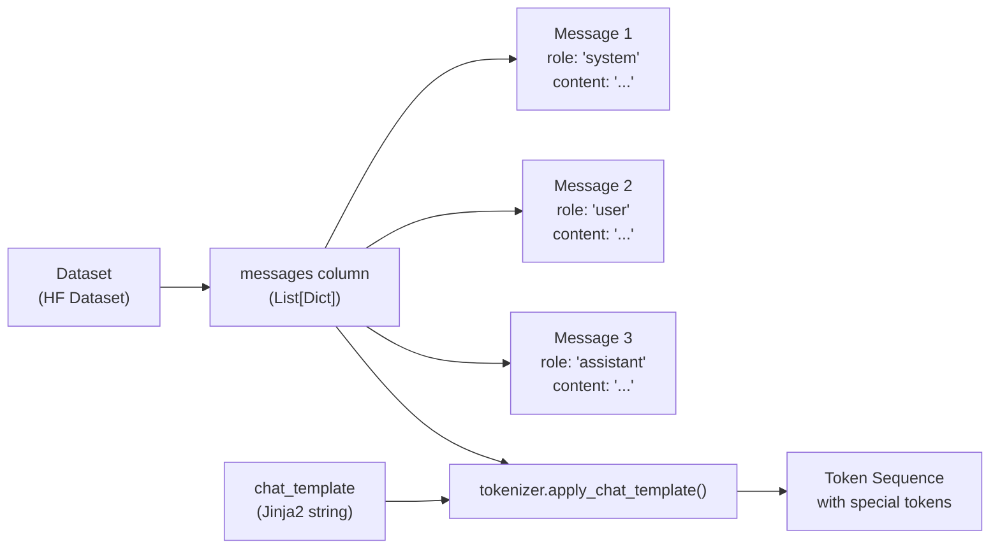
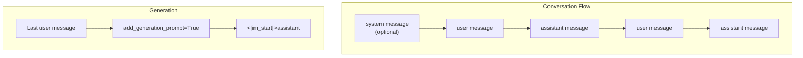
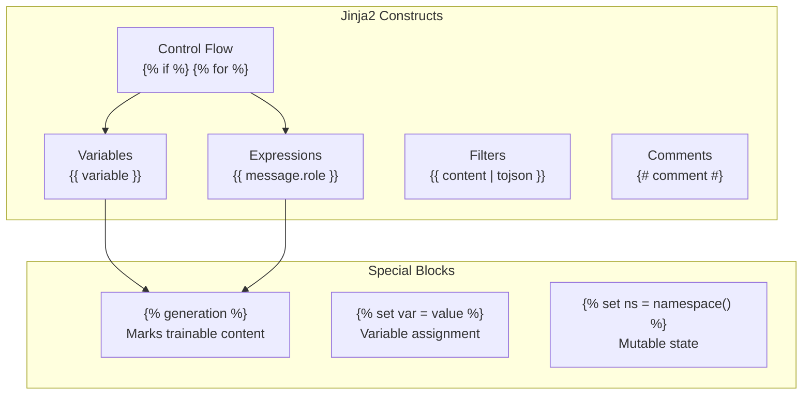
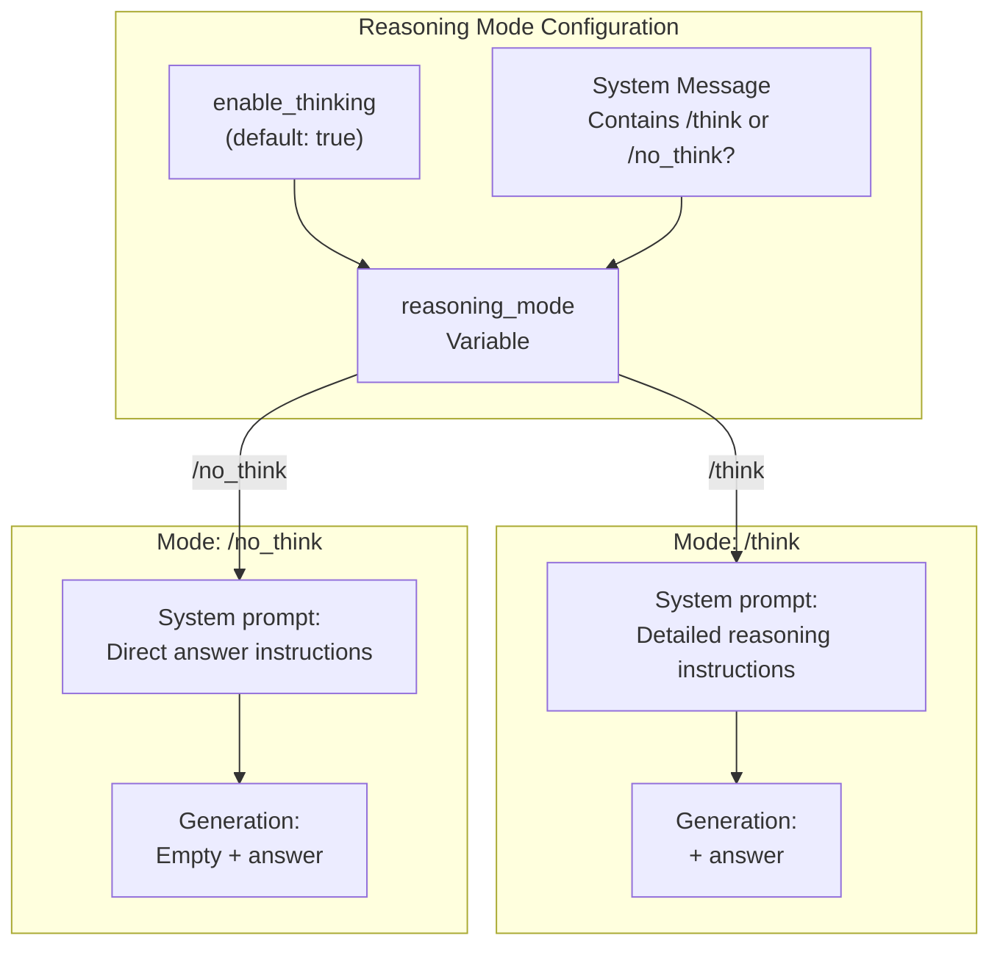
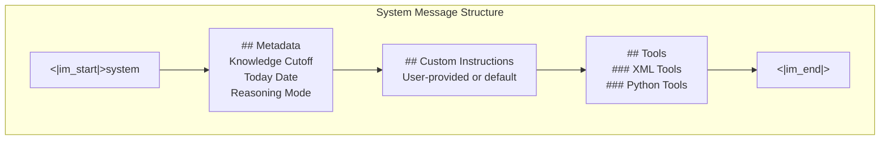
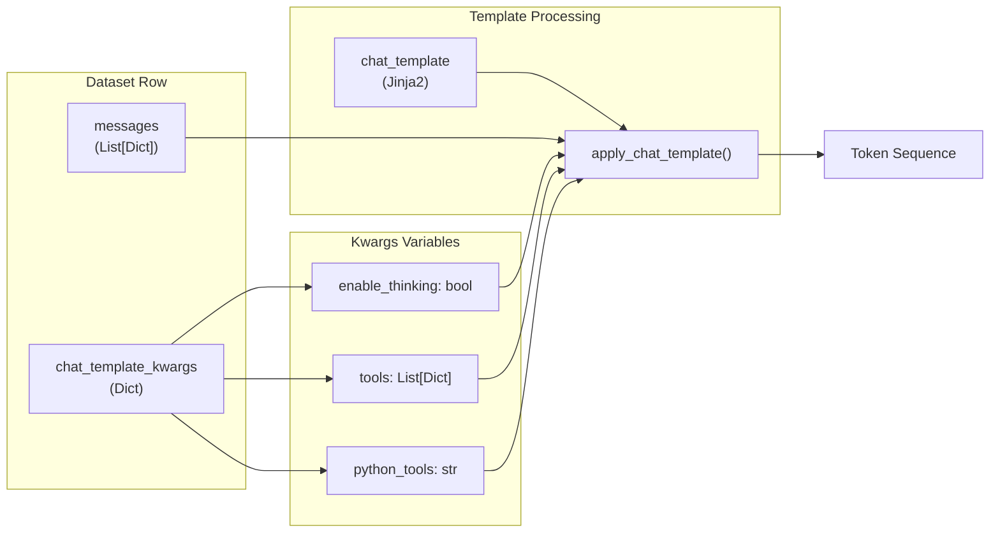
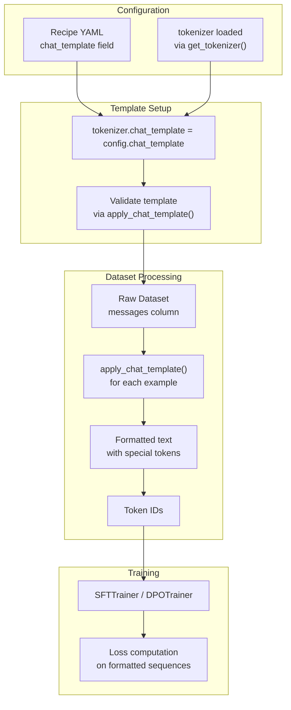

<!-- source: DeepWiki mcp.deepwiki.com · repo huggingface/alignment-handbook · page 6.3 Chat Templates and Message Formatting · fetched 2026-10-26 -->

# Chat Templates and Message Formatting

<details>
<summary>Relevant source files</summary>

The following files were used as context for generating this wiki page:

- [recipes/smollm3/README.md](recipes/smollm3/README.md)
- [recipes/smollm3/dpo/apo.yaml](recipes/smollm3/dpo/apo.yaml)
- [recipes/smollm3/sft/mid.yaml](recipes/smollm3/sft/mid.yaml)
- [recipes/smollm3/sft/sft.yaml](recipes/smollm3/sft/sft.yaml)

</details>


## Purpose and Scope

This page provides a comprehensive guide to chat templates and message formatting in the Alignment Handbook. Chat templates define how conversational data is formatted into token sequences that language models process during training and inference. They use Jinja2 templating to transform structured message data (role, content pairs) into model-specific text formats with special tokens.

This page covers:
- Message structure and role conventions
- Jinja2 templating syntax and features
- Advanced template features (reasoning modes, tool integration, system messages)
- Per-example customization with `chat_template_kwargs`
- How templates integrate with training scripts

For information about dataset format requirements, see [Dataset Formats](#8.2). For model loading and tokenizer configuration, see [Model Loading and Utilities](#2.2).

## Message Format Structure

### Standard Message Schema

Training datasets must contain a `messages` column with conversational data structured as a list of dictionaries. Each message has:

| Field | Type | Required | Description |
|-------|------|----------|-------------|
| `role` | string | Yes | One of: `"system"`, `"user"`, `"assistant"`, `"tool"` |
| `content` | string | Yes | The message text content |



**Sources:** [recipes/smollm3/sft/sft.yaml:1-228](), [recipes/smollm3/sft/mid.yaml:1-64]()

### Role Conventions

The Alignment Handbook follows these role conventions:

- **`system`**: Initial context/instructions (typically first message). Defines behavior, capabilities, metadata.
- **`user`**: Input from the human/user side of the conversation.
- **`assistant`**: Model-generated responses during training data.
- **`tool`**: Tool execution results, mapped to user role in templates for consistency.



**Sources:** [recipes/smollm3/sft/sft.yaml:10-228](), [recipes/smollm3/sft/mid.yaml:10]()

## Chat Template Basics

### Template Definition

Chat templates are defined in recipe YAML files using the `chat_template` parameter. They specify how messages are serialized into text with special tokens.

**Simple Template Example:**

[recipes/smollm3/sft/mid.yaml:10]() demonstrates a minimal template:

```jinja2

    {{- "<|im_start|>" + message.role + "\n" + message.content + "<|im_end|>" + "\n" -}}


    {{- "<|im_start|>assistant\n" -}}

```

This template:
1. Iterates over all messages
2. Wraps each with `<|im_start|>` and `<|im_end|>` special tokens
3. Adds role label after start token
4. Appends generation prompt if specified

**Sources:** [recipes/smollm3/sft/mid.yaml:10]()

### Special Tokens

Special tokens mark boundaries and provide structural information:

| Token | Purpose | Configuration |
|-------|---------|---------------|
| `<|im_start|>` | Marks message start with role | Defined in tokenizer |
| `<|im_end|>` | Marks message end | Defined in tokenizer |
| `<|endoftext|>` | End of sequence | Standard EOS token |

The `eos_token` parameter specifies which token ends training sequences:

```yaml
eos_token: <|im_end|>
```

This ensures training sequences end at message boundaries rather than arbitrary positions.

**Sources:** [recipes/smollm3/sft/sft.yaml:190](), [recipes/smollm3/sft/mid.yaml:27]()

## Jinja2 Templating in Chat Templates

### Core Jinja2 Syntax

Chat templates use Jinja2 templating with these constructs:



### Available Template Variables

| Variable | Type | Description |
|----------|------|-------------|
| `messages` | List[Dict] | Conversation messages array |
| `tools` | List[Dict] | Tool definitions (if provided) |
| `add_generation_prompt` | bool | Whether to add assistant start token |
| `enable_thinking` | bool | Reasoning mode flag (custom) |
| `chat_template_kwargs` | Dict | Per-example customization (custom) |

**Sources:** [recipes/smollm3/sft/sft.yaml:10]()

### Control Flow Patterns

**Conditional Rendering:**

```jinja2

  

```

**Iteration:**

```jinja2

    {{- "<|im_start|>" + message.role + "\n" + message.content + "<|im_end|>\n" -}}

```

**Namespace for Mutable State:**

```jinja2


  

```

**Sources:** [recipes/smollm3/sft/sft.yaml:10]()

## Reasoning Modes and Dynamic Behavior

### Reasoning Mode System

SmolLM3 implements a sophisticated reasoning mode system that controls whether the model outputs structured thinking before responses.



**Sources:** [recipes/smollm3/sft/sft.yaml:10]()

### Reasoning Mode Implementation

[recipes/smollm3/sft/sft.yaml:10]() implements reasoning modes through these steps:

**1. Mode Detection:**

```jinja2





  

  

```

**2. System Message Override:**

```jinja2

  
  
    
  
    
  

```

**3. Mode-Dependent System Prompt:**

```jinja2

    {{- "You are a helpful AI assistant... thoroughly exploring questions through a systematic thinking process...  Solution section..." -}}

    {{- "You are a helpful AI assistant named SmolLM, trained by Hugging Face.\n\n" -}}

```

**4. Generation Format:**

```jinja2

    {{ "<|im_start|>assistant\n" + content.lstrip("\n") + "<|im_end|>\n" }}

    {{ "<|im_start|>assistant\n" + "\n" + content.lstrip("\n") + "<|im_end|>\n" }}

```

**Sources:** [recipes/smollm3/sft/sft.yaml:10]()

### Dataset Split Convention

SmolLM3 datasets use naming conventions to indicate reasoning mode:

| Split Suffix | Reasoning Mode | Example |
|--------------|----------------|---------|
| `_no_think` | `/no_think` | `smoltalk_smollm3_everyday_conversations_no_think` |
| `_think` | `/think` | `multi_turn_reasoning_if_think` |

[recipes/smollm3/sft/sft.yaml:15-159]() demonstrates mixed training with both modes:

- 14 datasets with `_no_think` suffix (weight 0.4-1.0 each)
- 11 datasets with `_think` suffix (weight 0.02-1.0 each)

This trains the model to handle both reasoning and direct response modes.

**Sources:** [recipes/smollm3/sft/sft.yaml:11-188]()

## System Messages and Metadata

### Structured System Message

SmolLM3 templates generate rich system messages with metadata:



**Sources:** [recipes/smollm3/sft/sft.yaml:10]()

### System Message Components

**Metadata Section:**

```jinja2
{{- "## Metadata\n\n" -}}
{{- "Knowledge Cutoff Date: June 2025\n" -}}
{%- set today = strftime_now("%d %B %Y") -%}
{{- "Today Date: " ~ today ~ "\n" -}}
{{- "Reasoning Mode: " + reasoning_mode + "\n\n" -}}
```

Uses `strftime_now()` function for dynamic date injection.

**Custom Instructions:**

```jinja2

```

Extracts user instructions after removing mode markers.

**System Override:**

```jinja2

  {{- custom_instructions.replace("/system_override", "").rstrip() -}}
  {{- "<|im_end|>\n" -}}

  {{- "## Metadata\n\n..." -}}

```

The `/system_override` marker allows completely custom system messages, bypassing default structure.

**Sources:** [recipes/smollm3/sft/sft.yaml:10]()

## Tool Integration

### XML Tool Format

SmolLM3 templates support tool integration through structured XML tool descriptions:

```jinja2

    
    
      
    
    

```

**Tool Message Handling:**

```jinja2

{{ "<|im_start|>" + "user\n"  + content + "<|im_end|>\n" }}

```

Tool responses are mapped to the `user` role for consistency.

**Sources:** [recipes/smollm3/sft/sft.yaml:10]()

### Python Tools

Templates can include Python tool specifications:

```jinja2
{{- "### Python Tools\n\n" -}}

    {{- python_tools -}}

    {{- "None"  -}}

```

Both XML and Python tools are displayed in the system message Tools section.

**Sources:** [recipes/smollm3/sft/sft.yaml:10]()

### Tool-Enabled Datasets

[recipes/smollm3/sft/sft.yaml:36-47]() includes function calling datasets:

```yaml
- id: HuggingFaceTB/smoltalk2
  config: SFT
  split: hermes_function_calling_v1_no_think
  columns:
    - messages
    - chat_template_kwargs
  weight: 1.0
```

These datasets provide tool definitions through `chat_template_kwargs`, enabling tool-aware training.

**Sources:** [recipes/smollm3/sft/sft.yaml:36-145]()

## Per-Example Customization with chat_template_kwargs

### chat_template_kwargs Column

The `chat_template_kwargs` column enables per-example template customization:



**Sources:** [recipes/smollm3/sft/sft.yaml:11-188](), [recipes/smollm3/dpo/apo.yaml:19]()

### Usage in Dataset Configuration

All SmolLM3 datasets include the `chat_template_kwargs` column:

```yaml
- id: HuggingFaceTB/smoltalk2
  config: SFT
  split: multi_turn_reasoning_if_think
  columns:
    - messages
    - chat_template_kwargs
  weight: 1.0
```

This allows each example to specify:
- **`enable_thinking`**: Override reasoning mode for this example
- **`tools`**: Provide tool definitions for this conversation
- **`python_tools`**: Provide Python tool specifications

**DPO Usage:**

[recipes/smollm3/dpo/apo.yaml:19]() shows `chat_template_kwargs` in preference datasets:

```yaml
- id: HuggingFaceTB/smoltalk2
  config: Preference
  split: tulu_3_8b_pref_mix_Qwen3_32B_Qwen3_0.6B_think
  columns:
    - chosen
    - rejected
    - prompt
    - chat_template_kwargs
  weight: 0.25
```

Both chosen and rejected responses use the same template kwargs for consistency.

**Sources:** [recipes/smollm3/sft/sft.yaml:18-159](), [recipes/smollm3/dpo/apo.yaml:19]()

## Template Application in Training

### Integration with Training Scripts



**Sources:** [recipes/smollm3/sft/sft.yaml:1-228]()

### Template Setting in get_tokenizer

The `get_tokenizer` function in [src/alignment/model_utils.py]() applies the chat template from configuration:

1. Load tokenizer from model checkpoint
2. If `chat_template` specified in config, override tokenizer's default:
   ```python
   tokenizer.chat_template = config.chat_template
   ```
3. Validate template by calling `apply_chat_template()` on test data
4. Return configured tokenizer

This ensures consistent template application across training and inference.

**Sources:** [recipes/smollm3/sft/sft.yaml:10]()

### Assistant-Only Loss

The `assistant_only_loss` parameter ensures gradients only apply to assistant responses:

```yaml
assistant_only_loss: true
```

Combined with the `` block in templates:

```jinja2

    
    
        {{ "<|im_start|>assistant\n" + content.lstrip("\n") + "<|im_end|>\n" }}
    
        {{ "<|im_start|>assistant\n" + "\n" + content.lstrip("\n") + "<|im_end|>\n" }}
    
    

```

The `...` markers indicate which text segments should have loss applied.

**Sources:** [recipes/smollm3/sft/sft.yaml:10](), [recipes/smollm3/sft/sft.yaml:193]()

## Common Patterns and Examples

### Pattern 1: Simple Conversational Template

Basic template without advanced features [recipes/smollm3/sft/mid.yaml:10]():

```jinja2

    {{- "<|im_start|>" + message.role + "\n" + message.content + "<|im_end|>" + "\n" -}}


    {{- "<|im_start|>assistant\n" -}}

```

**Use Case:** Mid-training or simple SFT without reasoning modes or tools.

**Example Output:**
```
<|im_start|>user
What is machine learning?<|im_end|>
<|im_start|>assistant
Machine learning is...<|im_end|>
```

**Sources:** [recipes/smollm3/sft/mid.yaml:10]()

### Pattern 2: Reasoning-Enabled Template

Advanced template with reasoning modes [recipes/smollm3/sft/sft.yaml:10]():

Key features:
- Default reasoning mode configuration
- System message mode detection
- Structured system prompt with metadata
- Tool integration sections
- Conditional generation format based on mode

**Example Output (think mode):**
```
<|im_start|>system

## Metadata

Knowledge Cutoff Date: June 2025
Today Date: 15 January 2025
Reasoning Mode: /think

## Custom Instructions

[Custom instructions here]

## Tools

### XML Tools

[Tool definitions]

### Python Tools

None

<|im_end|>
<|im_start|>user
Solve this problem...<|im_end|>
<|im_start|>assistant

The solution is...<|im_end|>
```

**Sources:** [recipes/smollm3/sft/sft.yaml:10]()

### Pattern 3: DPO Preference Formatting

DPO training applies templates to both chosen and rejected responses:

```yaml
columns:
  - chosen
  - rejected
  - prompt
  - chat_template_kwargs
```

The training script applies the same template and kwargs to both:
1. Format prompt + chosen with template → positive sequence
2. Format prompt + rejected with template → negative sequence
3. Compute preference loss between them

**Sources:** [recipes/smollm3/dpo/apo.yaml:16-29]()

### Pattern 4: Multi-Dataset Training with Mode Mixing

[recipes/smollm3/sft/sft.yaml:11-188]() demonstrates sophisticated dataset mixing:

```yaml
dataset_mixture:
  datasets:
    # No-think datasets (14 datasets, weights 0.4-1.0)
    - split: smoltalk_smollm3_everyday_conversations_no_think
      weight: 1.0
    - split: OpenThoughts3_1.2M_no_think_no_think
      weight: 0.4
    
    # Think datasets (11 datasets, weights 0.02-1.0)
    - split: multi_turn_reasoning_if_think
      weight: 1.0
    - split: OpenThoughts3_1.2M_think
      weight: 0.02
```

This trains a single model to:
- Respond directly when appropriate (no_think examples)
- Show reasoning when needed (think examples)
- Adapt behavior based on user instructions in system message

**Sources:** [recipes/smollm3/sft/sft.yaml:11-188]()

### Comparison: Simple vs Advanced Templates

| Feature | Simple Template | Advanced Template |
|---------|----------------|-------------------|
| **File** | [mid.yaml:10]() | [sft.yaml:10]() |
| **Lines** | ~6 lines | ~50+ lines |
| **Reasoning modes** | No | Yes (/think, /no_think) |
| **System metadata** | No | Yes (date, cutoff, mode) |
| **Tool integration** | No | Yes (XML and Python) |
| **Custom instructions** | No | Yes |
| **System override** | No | Yes |
| **Per-example kwargs** | No | Yes |
| **Use case** | Basic training | Production models |

**Sources:** [recipes/smollm3/sft/mid.yaml:10](), [recipes/smollm3/sft/sft.yaml:10]()

---

**Key Takeaways:**

1. **Chat templates transform structured messages into model-specific token sequences** using Jinja2 templating
2. **Simple templates suffice for basic training**, but advanced templates enable sophisticated behaviors
3. **Reasoning modes allow conditional formatting** based on task requirements
4. **System messages can include structured metadata** (dates, modes, tools) for enhanced capabilities
5. **chat_template_kwargs enables per-example customization** without modifying the template
6. **Templates integrate with training through tokenizer configuration** and assistant-only loss masking
7. **Dataset naming conventions (_no_think, _think suffixes) coordinate with template behavior**

---

