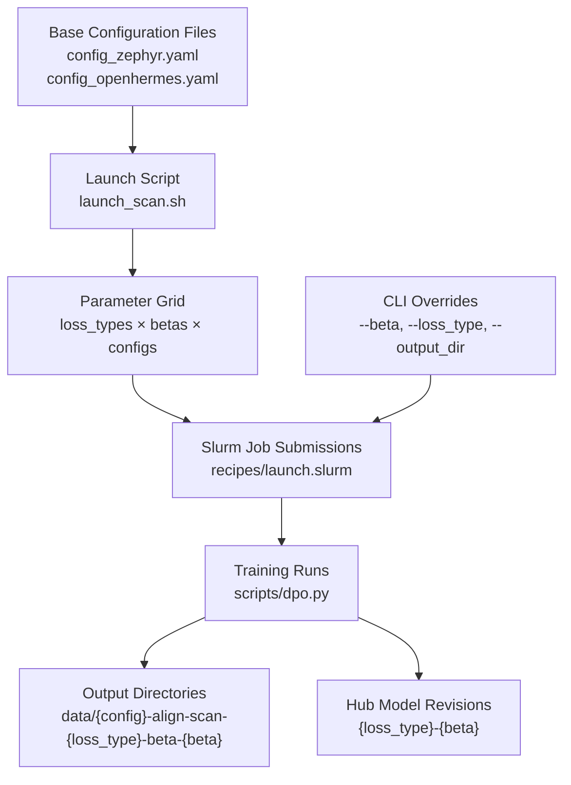
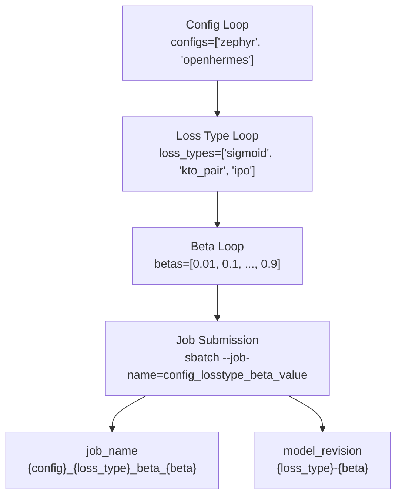
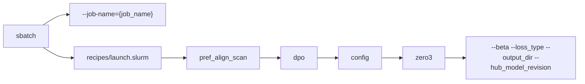
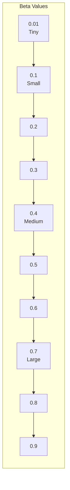
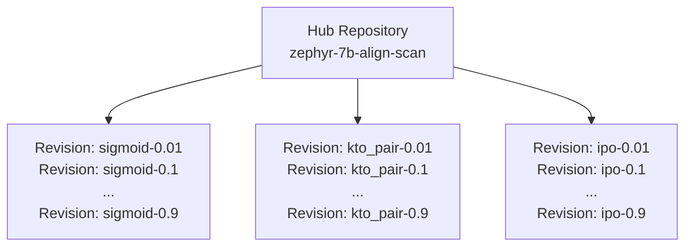
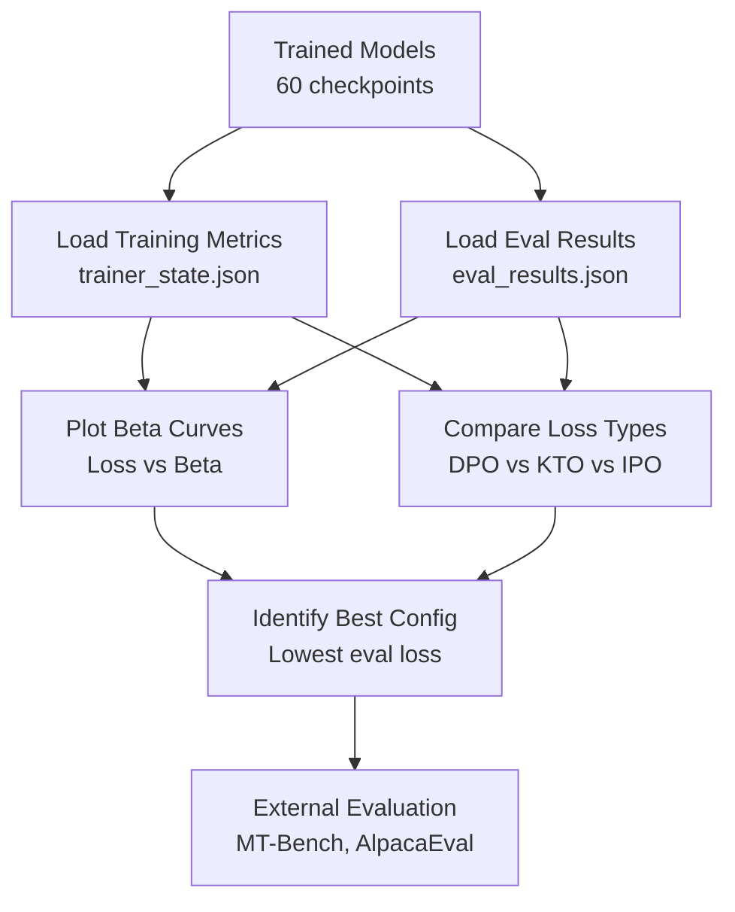

<!-- source: DeepWiki mcp.deepwiki.com · repo huggingface/alignment-handbook · page 6.4 Hyperparameter Scanning · fetched 2026-10-26 -->

# Hyperparameter Scanning

<details>
<summary>Relevant source files</summary>

The following files were used as context for generating this wiki page:

- [recipes/pref_align_scan/README.md](recipes/pref_align_scan/README.md)
- [recipes/pref_align_scan/dpo/config_openhermes.yaml](recipes/pref_align_scan/dpo/config_openhermes.yaml)
- [recipes/pref_align_scan/dpo/config_zephyr.yaml](recipes/pref_align_scan/dpo/config_zephyr.yaml)
- [recipes/pref_align_scan/launch_scan.sh](recipes/pref_align_scan/launch_scan.sh)

</details>


This document describes the hyperparameter scanning system for running systematic experiments across multiple training configurations. The scanning system automates the process of training models with different hyperparameter values to identify optimal settings for preference alignment algorithms.

For information about individual training methods, see [Training Methods](#3). For details about Slurm cluster deployment, see [Slurm Cluster Deployment](#5.2).

## Overview

The hyperparameter scanning system enables systematic exploration of training configurations, particularly for tuning preference alignment algorithms (DPO, IPO, KTO). The system is located in [recipes/pref_align_scan/]() and provides infrastructure for running grid searches over parameter combinations.

The primary use case is comparing preference alignment algorithms across different values of the `beta` parameter, which controls the strength of the KL-divergence constraint in methods like DPO. The scanning experiments documented in the [recipes/pref_align_scan/README.md]() compare three algorithms (DPO, IPO, KTO) across two model-dataset pairs:

1. Zephyr-7B-SFT with UltraFeedback dataset
2. OpenHermes-2.5 with Orca DPO pairs dataset

**Scan Workflow Architecture**



Sources: [recipes/pref_align_scan/README.md:1-51](), [recipes/pref_align_scan/launch_scan.sh:1-24]()

## Base Configuration Files

Each scanning experiment starts with a base configuration file that defines the common settings shared across all scan runs. The system provides two example configurations:

### Zephyr Configuration

The [recipes/pref_align_scan/dpo/config_zephyr.yaml]() file configures scans for the Zephyr-7B model:

- **Model**: `alignment-handbook/zephyr-7b-sft-full` (pre-trained SFT model)
- **Dataset**: `HuggingFaceH4/ultrafeedback_binarized` with train/test preference splits
- **Test split size**: 2000 examples for evaluation
- **Hub configuration**: Publishes to `zephyr-7b-align-scan` with revision-specific tags

### OpenHermes Configuration

The [recipes/pref_align_scan/dpo/config_openhermes.yaml]() file configures scans for the OpenHermes model:

- **Model**: `teknium/OpenHermes-2.5-Mistral-7B`
- **Dataset**: `HuggingFaceH4/orca_dpo_pairs` with train/test preference splits
- **Test split size**: 500 examples for evaluation
- **Hub configuration**: Publishes to `HuggingFaceH4/openhermes-2.5-mistral-7b-dpo`

**Base Configuration Structure**

| Configuration Section | Purpose | Key Parameters |
|----------------------|---------|----------------|
| Model arguments | Specifies base model | `model_name_or_path`, `torch_dtype` |
| Data training arguments | Dataset mixture configuration | `dataset_mixture`, `test_split_size`, `seed` |
| Training arguments | Common training settings | `learning_rate: 5.0e-7`, `num_train_epochs: 1`, `per_device_train_batch_size: 8` |
| Evaluation settings | Evaluation frequency | `eval_strategy: steps`, `eval_steps: 100` |
| Hub integration | Model publishing | `hub_model_id`, `hub_model_revision` |

The base configurations use **placeholder values** for `beta` and `output_dir` ([recipes/pref_align_scan/dpo/config_zephyr.yaml:28](), [recipes/pref_align_scan/dpo/config_zephyr.yaml:45]()), which are overridden by the launch script for each scan run.

Sources: [recipes/pref_align_scan/dpo/config_zephyr.yaml:1-52](), [recipes/pref_align_scan/dpo/config_openhermes.yaml:1-54]()

## Launch Script Architecture

The [recipes/pref_align_scan/launch_scan.sh]() script orchestrates the grid search by generating and submitting jobs for each parameter combination. The script implements a nested loop structure over three dimensions:

**Parameter Grid Structure**



Sources: [recipes/pref_align_scan/launch_scan.sh:1-24]()

### Script Parameters

The launch script defines three arrays that control the grid search space ([recipes/pref_align_scan/launch_scan.sh:2-7]()):

```bash
configs=("zephyr" "openhermes")
loss_types=("sigmoid" "kto_pair" "ipo")
betas=("0.01" "0.1" "0.2" "0.3" "0.4" "0.5" "0.6" "0.7" "0.8" "0.9")
```

This configuration produces **2 × 3 × 10 = 60** total training runs, exploring:
- 2 base configurations (zephyr and openhermes)
- 3 loss types (DPO sigmoid, KTO pair, IPO)
- 10 beta values (0.01, 0.1 through 0.9)

### Job Name Construction

For each parameter combination, the script constructs a unique job name and model revision ([recipes/pref_align_scan/launch_scan.sh:16-17]()):

```bash
job_name="$config_${loss_type}_beta_${beta}"
model_revision="${loss_type}-${beta}"
```

This naming scheme enables:
- **Job tracking**: Each job has a descriptive name in the Slurm queue
- **Result organization**: Output directories follow predictable patterns
- **Hub versioning**: Each run publishes to a unique model revision tag

Sources: [recipes/pref_align_scan/launch_scan.sh:1-24]()

## Job Submission Command

The launch script submits each job using `sbatch` with CLI parameter overrides ([recipes/pref_align_scan/launch_scan.sh:20-21]()):

```bash
sbatch --job-name=${job_name} recipes/launch.slurm pref_align_scan dpo $config zero3 \
"--beta=${beta} --loss_type=${loss_type} --output_dir=data/$config-7b-align-scan-${loss_type}-beta-${beta} --hub_model_revision=${model_revision}"
```

**Command Structure Breakdown**



### Slurm Launch Arguments

The command passes five positional arguments to `recipes/launch.slurm`:

1. **Recipe directory**: `pref_align_scan` - Points to [recipes/pref_align_scan/]()
2. **Task script**: `dpo` - Executes [scripts/dpo.py]()
3. **Config file**: `$config` - Either `zephyr` or `openhermes`, resolves to [recipes/pref_align_scan/dpo/config_{config}.yaml]()
4. **Accelerate config**: `zero3` - Uses DeepSpeed ZeRO-3 configuration
5. **CLI overrides**: String containing parameter overrides

### CLI Parameter Overrides

The final argument contains four critical overrides that customize each run:

| Override | Purpose | Example Value |
|----------|---------|---------------|
| `--beta` | KL-divergence penalty weight | `0.01`, `0.1`, ..., `0.9` |
| `--loss_type` | Preference alignment algorithm | `sigmoid` (DPO), `kto_pair` (KTO), `ipo` (IPO) |
| `--output_dir` | Training output directory | `data/zephyr-7b-align-scan-sigmoid-beta-0.1` |
| `--hub_model_revision` | Hub model version tag | `sigmoid-0.1` |

These overrides take precedence over the base configuration values, allowing a single config file to support many scan runs.

Sources: [recipes/pref_align_scan/launch_scan.sh:20-21]()

## Parameter Grid Exploration

The scanning system explores the `beta` parameter, which appears across all preference alignment methods. The beta values are chosen to cover a wide range ([recipes/pref_align_scan/README.md:12]()):

- **Tiny beta** (0.01): Very weak KL constraint, allows aggressive optimization
- **Small beta** (0.1-0.3): Light regularization
- **Medium beta** (0.4-0.6): Balanced trade-off
- **Large beta** (0.7-0.9): Strong regularization toward reference model

**Beta Parameter Exploration Space**



### Loss Type Variations

The scan explores three different loss formulations ([recipes/pref_align_scan/launch_scan.sh:5]()):

| Loss Type | Algorithm | Method |
|-----------|-----------|--------|
| `sigmoid` | Direct Preference Optimization (DPO) | Standard DPO with sigmoid loss |
| `kto_pair` | Kahneman-Tversky Optimization (KTO) | Pairwise KTO loss |
| `ipo` | Identity Preference Optimization (IPO) | Alternative DPO formulation |

Each loss type uses the same `beta` parameter but interprets it differently according to its objective function. See [Comparing Preference Alignment Methods](#3.5) for detailed algorithmic differences.

Sources: [recipes/pref_align_scan/README.md:1-51](), [recipes/pref_align_scan/launch_scan.sh:5]()

## Output Organization

The scanning system generates organized outputs for each run using a consistent naming pattern:

**Directory Structure**

```
data/
├── zephyr-7b-align-scan-sigmoid-beta-0.01/
├── zephyr-7b-align-scan-sigmoid-beta-0.1/
├── ...
├── zephyr-7b-align-scan-kto_pair-beta-0.01/
├── openhermes-7b-align-scan-sigmoid-beta-0.01/
└── ...
```

Each output directory contains:
- **Model checkpoints**: Saved at intervals specified by `save_steps: 100`
- **Training logs**: TensorBoard logs and console output
- **Evaluation metrics**: Validation metrics from `eval_steps: 100`
- **Final model**: The trained model after 1 epoch

### Hub Model Revisions

Models are published to Hugging Face Hub with revision tags following the pattern `{loss_type}-{beta}` ([recipes/pref_align_scan/launch_scan.sh:17]()):

**Hub Organization Structure**



This organization enables:
- **Easy comparison**: All scan results in one repository with distinct revisions
- **Versioned experiments**: Each parameter combination has a persistent identifier
- **Reproducible downloads**: Specific runs can be loaded via `revision` parameter

Sources: [recipes/pref_align_scan/dpo/config_zephyr.yaml:37-38](), [recipes/pref_align_scan/launch_scan.sh:17]()

## Running a Hyperparameter Scan

To execute a hyperparameter scan:

### Step 1: Customize Base Configuration

Edit the base configuration files to specify your model and dataset:

[recipes/pref_align_scan/dpo/config_zephyr.yaml:2-3]()
```yaml
model_name_or_path: alignment-handbook/zephyr-7b-sft-full
torch_dtype: null
```

Adjust training hyperparameters that remain constant across the scan ([recipes/pref_align_scan/dpo/config_zephyr.yaml:39-52]()):
- Learning rate: `learning_rate: 5.0e-7`
- Batch size: `per_device_train_batch_size: 8`
- Training epochs: `num_train_epochs: 1`
- Gradient accumulation: `gradient_accumulation_steps: 2`

### Step 2: Configure Scan Parameters

Modify [recipes/pref_align_scan/launch_scan.sh]() to define your parameter grid:

```bash
configs=("zephyr" "openhermes")              # Base configs to scan
loss_types=("sigmoid" "kto_pair" "ipo")      # Algorithms to compare
betas=("0.01" "0.1" "0.2" "0.3" "0.4")      # Beta values to explore
```

Adjust the grid to your computational budget. Each combination requires a full training run.

### Step 3: Execute the Scan

Run the launch script to submit all jobs:

```bash
bash recipes/pref_align_scan/launch_scan.sh
```

This submits jobs to your Slurm cluster. Monitor progress using standard Slurm commands:

```bash
squeue -u $USER                              # Check job status
sacct -j <job_id>                            # View job details
tail -f slurm-<job_id>.out                   # Follow training logs
```

### Step 4: Collect Results

After training completes, results are available in:
- **Local outputs**: `data/{config}-7b-align-scan-{loss_type}-beta-{beta}/`
- **Hub models**: Each revision on Hugging Face Hub
- **Training logs**: Accessible via TensorBoard or WandB if configured

Sources: [recipes/pref_align_scan/launch_scan.sh:1-24](), [recipes/pref_align_scan/README.md:14-44]()

## Analyzing Scan Results

The scanning experiments enable systematic comparison of hyperparameters. According to the [recipes/pref_align_scan/README.md:9](), results are documented in a [blog post](https://huggingface.co/blog/pref-tuning) analyzing the performance across configurations.

### Key Metrics to Compare

For each scan run, examine:

| Metric | Location | Purpose |
|--------|----------|---------|
| Training loss | `{output_dir}/trainer_state.json` | Optimization convergence |
| Evaluation metrics | Logged at `eval_steps: 100` | Validation performance |
| Final rewards | DPO/IPO/KTO reward margins | Preference alignment quality |
| Model outputs | Generated samples | Qualitative assessment |

### Comparison Workflow

**Scan Result Analysis Pipeline**



### Visualization Example

To compare beta values for a single loss type:

1. Collect eval metrics from all runs with the same `loss_type`
2. Plot evaluation loss against beta values
3. Identify the optimal beta (lowest validation loss)
4. Compare against other loss types at their respective optimal betas

The scanning infrastructure automatically organizes results to facilitate this analysis through consistent naming and hub organization.

Sources: [recipes/pref_align_scan/README.md:1-51]()

## Custom Scanning Experiments

To create custom hyperparameter scans beyond beta tuning:

### Extending the Launch Script

Modify [recipes/pref_align_scan/launch_scan.sh]() to scan different parameters:

```bash
learning_rates=("1e-7" "5e-7" "1e-6" "5e-6")
warmup_ratios=("0.0" "0.05" "0.1" "0.2")

for lr in "${learning_rates[@]}"; do
    for warmup in "${warmup_ratios[@]}"; do
        job_name="scan_lr_${lr}_warmup_${warmup}"
        sbatch --job-name=${job_name} recipes/launch.slurm ... \
        "--learning_rate=${lr} --warmup_ratio=${warmup}"
    done
done
```

### Multi-Dimensional Scans

For higher-dimensional scans, add nested loops:

```bash
for config in "${configs[@]}"; do
    for loss_type in "${loss_types[@]}"; do
        for beta in "${betas[@]}"; do
            for lr in "${learning_rates[@]}"; do
                # Submit job with all parameters
            done
        done
    done
done
```

**Warning**: Multi-dimensional scans grow exponentially. A 4-dimensional scan with 2×3×10×4 parameters requires 240 training runs.

### Custom Evaluation Metrics

To integrate custom evaluation within scans:

1. Add evaluation scripts to the base configuration
2. Use `compute_metrics` callback in trainer
3. Log custom metrics alongside standard training metrics
4. Aggregate across scan runs for comparison

Sources: [recipes/pref_align_scan/launch_scan.sh:1-24]()

## Scan Cost Estimation

Estimate computational requirements before launching large scans:

### Resource Calculation

For the default scan configuration:
- **Total runs**: 60 (2 configs × 3 loss types × 10 betas)
- **Time per run**: ~4-8 hours on 8×A100 GPUs (1 epoch on 60k examples)
- **Total GPU-hours**: 1920-3840 GPU-hours
- **Storage per run**: ~15 GB (model checkpoint + logs)
- **Total storage**: ~900 GB

### Budget Optimization Strategies

To reduce scan costs:

1. **Coarse-to-fine search**: Run sparse grid first (betas 0.1, 0.3, 0.5, 0.7, 0.9), then refine around optimal region
2. **Early stopping**: Use `save_total_limit: 1` to keep only final checkpoint
3. **Single config**: Start with one config/dataset pair before full factorial scan
4. **Reduce epochs**: Use `num_train_epochs: 0.5` for faster initial exploration
5. **Smaller eval set**: Decrease `test_split_size` for faster evaluation

Sources: [recipes/pref_align_scan/dpo/config_zephyr.yaml:22](), [recipes/pref_align_scan/dpo/config_zephyr.yaml:43](), [recipes/pref_align_scan/dpo/config_zephyr.yaml:49-50]()

---

